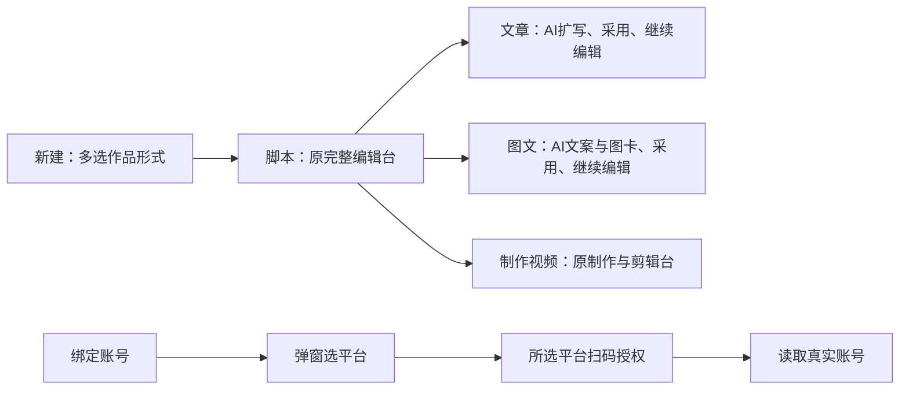

# T-1051 — 脚本为主的创作工作台与先选平台绑定账号

## 用户确认与阶段
2026-10-03 用户明确纠正当前 IA：绑定账号先弹窗选平台；作品组合 Tab 删除；脚本恒为第一项且使用之前完整脚本编辑台；文章、图文、制作视频随多选形式出现。文章/图文由 AI 基于主脚本或大纲扩写，扩写后可手工修改。此确认记录为 DEC-T1051-01，取代 T-1050 的组合首项与首形式跳转；保留 T-1050 的多选、账号守卫、部分失败同键恢复。当前 BUILD，跨层来源合同先独立评审；网页视觉由用户验收，不执行浏览器自动化。

## 大白话与流程
先在熟悉的脚本编辑台把主题、大纲或脚本写好。需要文章或图文时切到对应 Tab，用已保存内容生成候选，查看后采用，再在该工作台继续改稿。主脚本后来修改不会自动覆盖扩写稿。

## 参考与实际接线
用户提供 `/private/tmp/douyin_dl/noterelay-main/`，NoteRelay 0.1.8、AGPL-3.0-or-later。已读 README.zh-CN、package.json、src/ui/noteRelayView.ts：同一当前 Markdown note，经平台 Tab 和 adapter 预览、编辑配置、复制/导出；它不承担平台登录。仅参考流程，不执行其脚本、不复制实现、不新增插件依赖。
项目 `/projects/<id>` 已有 DraftWorkbenchPage、ScriptRichEditor、原对话和脚本版本；目前导航误指向新视频稿面。文章和图文正常生成目前只读项目简介/资料，必须增加真实主脚本来源。保留历史 output、组合和深链，删除面向新创作流程的组合入口。

## 要求
- FR-01：脚本恒为第一 Tab，href 为项目根路由；文章/图文/制作视频仅按属主校验后的真实对应 output 显示。复盘保留为现有公共末项；旧无 output 项目保留原制作链，读取失败不伪造已选形式。新建及快速创作默认进入根脚本工作台，形式多选仍产生对应真实 output。
- FR-02：取消新创作界面的作品组合 Tab 和组合入口，原 `/work` 与历史数据仍可直接读回。作品类型可在原添加作品入口继续补充。
- FR-03：backend application 新增窄主脚本来源装配，唯一写者仍是原 artifacts service。按原编辑台排序选择当前有内容 output_script、master_script；都无正文时可读同项目 content_outline。同类型固定按 createdAt 升序，与原编辑台 list 顺序一致：先扫描该类型全部候选并排除空正文，输出脚本中有正文者优先，再扫描主脚本。全新生成取被选中 artifact 的当前保存版本，不是凭最新创建的 artifact 改主稿；该当前版本缺失/无法读取必须报错，不能假装无稿换用简介。无正文的所有脚本才回退大纲，同类型大纲同样按 createdAt 升序取首个有内容者。核验账号、项目、stage/type 和真实 currentVersionId。结构化正文、contentText 或 HTML 中的正文均可作为冻结模型输入，未保存 UI 字不当真值。
- FR-04：article/graphic 正常候选生成读取上述保存版本，加入 sourceMaterials 和 sourceRefs；公共引用合同新增 `{kind:"project_script",id:artifactId,versionId}`，不新增表、不创建假 video output、不创建作品组合。后端采用/保存/重试经注入的 service port 验证该引用的同项目历史版本。历史版本仍合法，主稿改变不重绑旧候选。第一次生成无脚本/大纲时沿原简介/资料路径，界面明确说明，不硬阻断合法手工创作。sourceItemId 显式来源仍保留。
- FR-05：正常生成已有同 attempt 任务时恢复原输入，禁止脚本改变后同键换源；目标 output/字段/显式资料或品牌/规则输入改变仍冲突。独立扩写生成是候选，采用沿既有 CAS、选区/字段采纳、版本和事实待确认链；人工稿不会被自动覆盖。文章按钮改为“根据脚本扩写文章”；图文现有结果工具以可见说明引导根据保存脚本生成正文和图卡。无模型真实提示配置、允许手工保存。
- FR-06：账号页只保留一个“绑定账号”主入口和真实账号列表；点击在本页立即打开 Dialog，先显示抖音/小红书/快手平台选择，不调用登录 API；选择平台后才挂载既有真实扫码组件。公众号当前无真实扫码绑定接线，显示尚未接入的非操作说明，不提供假扫码。
- FR-07：授权进行中同一操作不能连点、切平台、关闭再开并发；锁住返回、关闭、Escape/遮罩，文字说明在弹出的本机浏览器完成后返回。完成/失败释放，可返回选平台重试；组件卸载不回写过期结果。成功广播账号刷新，失败显示真实错误，不写假账号。平台接入矩阵收进可选折叠项。

## 物理边界与改动范围
contract 仅定义 project_script 引用；backend application 经 projects/artifacts service 读取并验证，articles/graphic-posts 通过窄依赖注入使用，所有模型仍 Worker，前端 RPC 组合不含业务实现。persistence-client 只作注入接线。无迁移、删数据、账号归属改变、发布和额外平台接入。新增 source union 后检查所有消费者类型与历史读回。
前端：project-workspaces、新建/快速入口、作品入口、account-manager 与已有扫码组件、article/graphic 文案及相关测试。后端：project-script-source 装配及 tests、articles/graphic services 及 integration tests。合同：引用 schema/tests。保留 T-1049 已集成的实际文章/图文编辑器、原视频制作和脚本编辑能力。

## 验收
- AC-01：文章单选有脚本/文章/复盘，无图文和制作视频；图文单选、视频单选、三类多选均正确。脚本始终第一并回原完整稿面；刷新仍由真实数据决定。
- AC-02：两个创建入口多选成功都进根脚本；已确认创建成功项不会重复、失效账号和部分失败可恢复；无组合首项。
- AC-03：保存主脚本及大纲后，公共生成服务提交的冻结输入含真实正文、artifact/version 引用。脚本修改后旧候选引用旧历史、全新生成取新稿；同 attempt 恢复旧任务，不重新调用模型。跨账号/跨项目/错误类型或版本引用拒绝；来源空时保留原生成和手工能力。
- AC-04：文章/图文扩写候选可按原链编辑采用、CAS 冲突不覆盖人工新稿；相关已有候选采用/重试测试回归。代码检查不能冒充真实模型运行；本轮隔离网页模型/视觉缺证如实记录。
- AC-05：账号首屏没有三块扫码按钮；绑定弹窗选择前零 API 调用；选择后只出现所选真实入口；pending 下遮罩/Escape/返回/重按不重复授权，失败恢复、成功刷新；无公众号假按钮。

## Gate 与证据
当场红→绿：导航/创建/平台选择交互/主脚本冻结与引用/候选采用。frontend tsc、变更 lint、contract tests、backend 聚焦 integration、LED-047、本任务公共 HTTP 保存读回、boundary/orphan。最后 pmem sync、reconcile。已有全局欠债 T-916/T-1015/T-1026/T-1027 分别保留，不提高基线；用户视觉和真实扫码/模型验收未发生不写 PASS。完成状态仅用 taskctl，用户待验不能标全绿。
