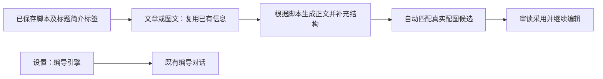

# T-1055 — 整理脚本衍生稿布局并复用主稿内容

## 用户确认
2026-10-04 用户截图要求：文章/图文布局与按钮合理；图自动匹配；基于脚本快速生成稿件，AI 润色及结构化补充后支持二次编辑；标题、简介、标签透传脚本阶段内容；编导引擎切换放入设置；删除脚本页“项目作品与创作”等重复小入口。沿 T-1051—T-1053 已接原生工作台和主脚本来源，不重写编辑引擎、不改变数据所有者。

## 大白话与目标
先在脚本页确定内容。文章/图文打开后沿用脚本的标题、简介和标签，主操作是基于脚本生成正文，再继续编辑。正文、稿件预览与保存操作有清楚的层次；主题、版式和历史是辅助设置。图片由真实素材匹配链提出候选，不要求逐段堆小按钮。

## 已核对来源与实现合同
- 原正文来自 artifacts 的 output_script/master_script/content_outline 当前保存版本，沿 T-1051 原选择顺序；标题、简介、标签来自脚本页 publishing 当前 revision，不能伪装成脚本正文引用。
- 应用层扩原主脚本读取端口，通过 projects/artifacts/publishing 公开 service 聚合真实 scriptContext；原 articles.get/graphicPosts.get 响应增加兼容可选字段，不新增 operation、表或模型运行器。scriptContext 包含主稿 ref、正文、元数据及实际 sourceOutputId/publicationId/revisionId（项目 fallback 明确单列 projectId/updatedAt）。
- 发布物料选择与脚本页现有 readPublishPack 一致：有明确主稿 contentOutputId 时核验同项目视频 output；无绑定时沿既有项目列表顺序的首 video；该 output 下优先实际含 description/tags 的当前 revision，否则原首项。不能借当前文章/图文自身 publication 回灌；读取失败与不存在分开显示，不用空对象伪装成功。复用现有发布包选择规则属于固定来源身份，不以名称/关键词判断内容质量。
- 文章文档增加兼容可选 tags 和真实元数据来源描述；图文已有 tags。读取只读，不自动创建版本。前端仅首次载入时填空字段，保留已保存/当前人工字段，标未保存；采用、重新载入或脚本变化不反复灌值。保存/生成时记录冻结来源描述，服务验证同账号/同项目引用。用户改元数据后本稿独立，不反写主脚本或其它稿。
- 文章主生成复用原 wechat.article-draft 结构候选（现 generateArticleCandidate/creativeResults sections 同服务），对已有稿润色及结构补充，支持 insert/replace，事实项与来源保留。图文复用 body/cardBriefs 的现有真实候选生成、采用；标题/简介/标签默认沿用，单项重生成收进高级选项。已有选定元数据不因正文采用被模型重写。
- 配图随结构生成一起完成语义匹配：应用层从真实项目/账号图片公开端口冻结 assetId/assetFileId/name/description 目录，Worker 原模型/Skill 为对应段落或图卡选择 exact pair。文章 proposedVisualBriefs 增兼容可选 proposedAssetId/proposedAssetFileId；图文 cardBriefs 增兼容可选 proposedImage。Worker 及 backend 验证 pair 在冻结目录且归属真实；没有匹配可留空。
- 用户采用选定段落/图卡时，经原 service/CAS 转入 imageUses，保持 sectionId/cardId；已有该目标图片不被默认替换。迟到候选、错目标、跨账号图片拒绝；目录空、单张过期/读取失败先跳过该图保留合法正文，提示可另换图。图片导出仍用原 exact file，不把匹配当生成图片。

## 界面与交互
- 文章/图文使用页面可用宽度，主编辑区与原生 NoteRelay 预览清楚分栏，窄屏堆叠；头部一个明确“根据脚本生成”主操作及正常尺寸保存操作，状态独立排列，不将长说明挤进按钮行。
- 标题、简介、标签在稿件信息区可编辑；正文编辑保持原稳定 sectionId/sourceRefs/图片和二次编辑能力。段落排序/删除等管理操作收进真实菜单或辅助区，手工换图保留为次要操作；避免每段重复堆生成按钮。
- NoteRelay 预览在其主题、署名、变量等辅助设置之前；复制/导出整合为清楚主次操作，保留真实纯文/HTML/PNG/ZIP 和翻页。主题设置折叠不重挂载/丢状态；原 Doocs/快图仍可辅助编辑，原 nativeLayout、保存/撤销/精确素材不改写。
- 编导引擎选择迁至设置的模型配置页签。保留 creatoros:assistant-engine:v1 和 change/storage 广播；抽无 UI hook，让聊天持续同步 liveSession.executionEngine 与真实可用状态。偏好只影响新请求，不重建在途流或改变既有消息重试的原引擎。真实 /api/chat/engines 状态/重新检查在设置中呈现，聊天不可用提示可到该设置卡。
- 删除脚本页“项目作品与创作”按钮；无导入/逐字稿/已发布真实动作时整条 draft-topbar 不渲染。已存在导入徽标、抓取与复盘按钮按原真实状态保留，旧 ?view=works 路由兼容。

## 物理边界与范围
contract 扩兼容 JSON/读回合同；backend application 组合公开 service 只读，articles/graphic-posts 仍为唯一文档写者；图片与元数据出处经窄注入端口验证。ai-worker 原模板/runtime 负责语义创作和匹配；frontend 只展现/编辑/调用，不放业务聚合与模型 SDK。
本轮无平台登录、发布、演示账号/图片、数据库迁移或外部安装。所有 AI 结果仍为候选；缺模型/素材诚实提示，现有手工编辑/保存可继续。本轮没有获准解除此前浏览器自动化限制。
具体改动：主脚本来源 application/port、articles/graphic-posts service/合同、两原 Worker 模板/runtime、组合根只读注入、两工作台/NoteRelay React host、engine hook/设置/聊天、脚本顶条和聚焦测试。主会话唯一控制面写者；并行写者在隔离快照内工作，按清楚文件边界整合。

## 验收与 Gate
- AC-01：保存脚本和发布包 metadata，文章/图文真实 get 响应能读同一来源；空字段预填并可保存读回，人工已填值保留；主稿/发布包修改不覆盖已改衍生稿。跨账号/项目/历史出处和旧无新增字段稿有服务/合同检查。
- AC-02：文章结构候选与图文 body/cardBriefs 从冻结主稿快速生成、润色/补结构；采用正文不重生成/覆盖已有标题/简介/标签，采用后仍可编辑再保存。同键恢复、CAS、错目标和迟到结果有真实回归。
- AC-03：原 Worker 模型返回真实目录中的 exact 图片 pair；对应段落/图卡采用后精确引用读回；无图片目录、错 pair、过期文件及已有选图均有检查。模型匹配用模型而非关键词/顺序选择；未发生真实模型运行不得写 PASS。
- AC-04：文章/图文可用宽度、主次按钮、主编辑/预览和折叠辅助设置有组件结构/类型检查；空稿/无模型仍可手工保存。NoteRelay 原实例/交付/主题/图片控制、Doocs 同稿同步及快图保存回归保留。
- AC-05：聊天无引擎选择器，设置真实可选；同窗/跨窗/账号切换、请求取消和旧响应不回写，真实执行器跟新设置；在途流、消息重试引擎保持。普通脚本无空顶条，真实导入/转录/复盘保留。
- AC-06：聚焦红→绿、frontend/backend/worker/contract 类型与相关 tests/lint、LED-047、原生相关检查、真实公共 HTTP 保存读回、boundary/orphan、最后 pmem sync/reconcile。复用未改代码与环境已有证据；既有全局欠债保留。网页像素/最小视口、系统剪贴板或真实模型没有当场证据就明确待验，不合成 frontend-validation。
