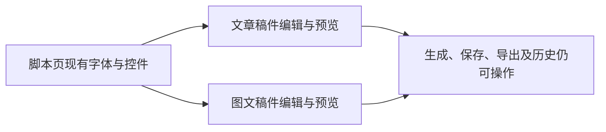

# T-1056 — 统一衍生稿字体并清理页头小字

## 用户确认
2026-10-04 用户明确要求：文章、图文页参考脚本页的字体与风格，删除页头项目出处、页面说明、“返回项目稿面”“文章产物”“当前版本 v3”“本次依据与资料（可选）”等小字；图文同样删除项目返回文字、页面说明和页头未保存/版本/历史文字的杂乱堆叠。

## 大白话与界面
文章、图文跟脚本使用同一套字体。进入页后直接看见稿件与编辑操作，重复解释不占一行。保存反馈与历史功能留在实际保存、历史操作处，出错时仍能看见原因。

## 范围与实现边界
- 仅前端展示；不改 contract、后端、Worker、稿件数据、版本或原生编辑器运行时。
- 核对脚本页真实字体 class 与现有公共控件后复用：表单、正文与按钮统一字号、字重、行高；内容预览保留用户所选排版主题。
- 删除两页重复大页头、项目 breadcrumb/返回小字、说明段落；作品选择仍可切换真实稿件，但不另加“文章产物”和页头版本说明。来源资料功能以真实辅助折叠区继续使用，不再展示用户指出的说明小字。
- 不展示页头未保存/版本小字；保存按钮继续反映真实 dirty/saving 状态，保存成功及冲突/失败反馈保留；历史放在正常尺寸的真实按钮或现有历史区，避免无状态的小链接堆叠。
- 保留已接通的生成、采纳、二次编辑、图片、NoteRelay、Doocs、快图、保存恢复、历史入口；不因删文案增加加载/轮询，不删除合法功能。

## 验收
- 用户逐项指出的页头小字从默认稿面移除；文章和图文主要标签、输入、按钮字号跟脚本页一致。
- 组件检查覆盖页面删文案、字号层级、真实保存状态及历史入口；既有两工作台和 NoteRelay 回归保持。
- 运行相关 frontend 类型检查、LED-047（若动折叠/打开路径）、boundary/orphan、pmem sync/reconcile；历史全局失败如实保留。
- HTTP 确认原预览页面可访问。沿之前浏览器自动化限制，本轮未获解除，像素及最小视口需用户查看，不合成浏览器验收。
