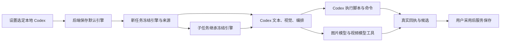

# T-1057 — 核对并统一本地 Codex 执行与模型配置

## 用户要求
2026-10-04 用户要求推论：选择本地 Codex 后是否只需配置两个模型，以及具体哪两个；保证执行脚本、命令由 Codex 执行，参考其他开源项目的实现。

## 当前状态
本文件是已完成代码核对后的合同候选，尚未通过实现准入。当前产品只在 `chat.run` 切换本地 Codex；所有业务链及原生命令未统一。完整核对、锁版开源来源及隔离探针见 [证据](../verification/t1057/research.md)。

随包版本为 `@openai/codex 0.159.3`，官方 tag `rust-v0.159.3` 对应 commit `01fc69f4026735edfdf6789820549727a4867b11`。本机 `command/exec` 实际拒绝网页示例中的 `workspaceWrite.readOnlyAccess`，要求使用 `permissionProfile`。不得直接复制网页参数上线。权限合同未验证前保持现有生产参数。

## 两类模型的推论
选择本地 Codex 且完成全部文本/视觉入口迁移后，CreatorOS 的额外配置入口应为：

1. 图片生成模型：`image.generate`；有参考图时，仅在供应商真实支持的情况下复用到 `image.edit`。
2. 视频生成模型：`video.generate`。

这是两类媒体能力，不是指定某两个模型品牌，也不是新建两个文本模型。文本理解、脚本、文章、图文配文、规划、审核、素材语义匹配由已登录的 Codex 执行，不要求额外文本 API key。图片/视频模型密钥仍由 backend 解析，Codex 通过任务绑定工具调用；密钥不进入提示词、命令环境或前端。

ASR 默认沿真实本地 Whisper，云端 ASR 选配；本地模型权重、解码器和运行环境必须实际可用。Embedding 是独立选配，未配沿现有关键词检索。当前没有验收完成的 TTS 音频生成链，不把口播文本误称为配音。搜索无独立模型 key，但仍依赖实际网络/浏览器工具。

## 大白话
选择本地 Codex 后，需要由它承担创作理解、文本任务和工具执行。图片、视频等它尚未直接提供的生成能力通过明确的模型工具调用；本地转写、素材读取、渲染与保存的真实路径需逐项核对。用户能分清谁实际执行，失败不悄悄切到另一引擎。

## 合同候选与准入条件

### FR-1057-1 后端统一引擎设置
默认引擎建议采用已有 `user_preferences` 的用户级设置（`pi | codex`），经 authenticated settings service 保存；当前浏览器 localStorage 仅可作为一次迁移来源及缓存。账号、项目与作品仍按每个任务的原 ownership 校验。前端请求、自动调度及其他后台入口使用同一后端默认。

迁移不能把浏览器旧值直接覆盖一个已保存的后端选择；保存失败显示真实失败。多窗口及账号切换读回服务值。设置与说明仅在设置页，选择 Codex 时显示媒体配置及真实登录/能力状态；原文本配置仍保留供 Pi 和旧任务使用。不得在全链迁移前隐藏仍必需的文本配置。

### FR-1057-2 创建时冻结执行路由
采用明确的执行路由联合类型，区分 `codex-app-server` 与既有 API/Pi 路由。Codex 路由不含 token/baseUrl，不伪造 API 模型规格。冻结执行引擎、协议/runtime 版本、能力类别、用户/账号/来源、权限策略版本，以及真实运行模型身份。模型由 Codex 自身登录和配置提供；返回的实际模型身份必须进入回执。

新任务在预约/创建时读取默认；子任务继承父任务冻结路由，不能重新读取当下设置。切换设置不改变在途任务、历史重试或 unknown 对账。旧任务缺路由字段沿原执行语义，不按当前设置改成 Codex。禁止失联、未登录、额度不足或协议不支持时静默切回 API/Pi。

### FR-1057-3 覆盖全部文本及视觉入口
统一 resolver 和 admission 必须同时覆盖主 structured/agentic 任务、业务 preflight、视频逐 Skill 身份、daily 可用性、chat 内嵌生成节点、intelligence/flywheel 的独立冻结账本，以及知识库同步生成和成片视觉审核旁路。具体入口列表在证据表中。

不能仅修改 `provider-factory.modelFor`：agentic Worker 直接使用 Pi；知识库同步接口与视觉描述在宿主直接调用模型，须改经受控 Worker/service port 并保留公共返回/保存语义。不得把独立业务任务冒充聊天消息提交到 `external-chat-turn.service`。

Codex structured transport 使用官方 `turn/start.outputSchema`，保留现有 Skill 快照、分节点生成、真实 ID、结构校验和候选投影。图片理解须传入真实授权图片/任务暂存路径并核对视觉能力，不能把图片丢弃后声称已迁移。

### FR-1057-4 脚本与命令统一执行
用户明确要求创作执行脚本及命令由 Codex 执行，取代 T-1044 的原生 shell 禁用规则。建议范围包括创作代码，以及 ffmpeg、Whisper 解码/转写、下载、探针与渲染等任务命令；这一底层范围已向用户提出具体澄清，答复未到前不把建议记为确认。

模型发起的脚本走 Codex 原生 turn 的工具执行；产品确定性工具命令走官方 app-server `command/exec` argv 协议。图片/视频生成仍由真实供应商工具执行，Codex 是编排与调用引擎，不能伪称 Codex 模型本身生成了媒体。应用服务启动、数据库事务、执行器生命周期和进程清理属于宿主基础设施，不冒称 AI 命令。

禁止留下一个普通 `execFile/spawn` 旁路再把 UI 状态标成 Codex；验收须逐项覆盖任务命令入口。禁止模型任意指定 cwd、权限 profile、环境密钥或更换可执行 Codex artifact。

### FR-1057-5 原生命令权限与产物
原生执行只在任务绑定目录工作。输入由 backend 校验当前归属与版本后暂存；可读根和可写根由宿主构造，防止 symlink/path traversal、跨账号数据读取和凭据泄漏。命令环境不得包含数据库、媒体供应商密钥或整个应用 process.env。文件系统策略必须由锁版 `permissionProfile` 的真实受限读写机制落实；私有 cwd 或 workspace-write 名称本身不能替代访问隔离。

需要核对 CodeModeOnly 模型的 code-mode host、原生环境与随包依赖；不能继续关闭实际模型所必需的 runtime 又宣称工具可用，也不能顺带启用未知 MCP/apps/plugins/hooks。实际业务搜索/下载只通过受控网络与来源合同。先核对 macOS/Linux/Windows 的可执行权限边界，未经平台验证不宣称跨平台上线。

输出仅作为任务产物暂存，回收时校验真实文件、类型、大小、路径及原租约，再由原 backend service 创建候选/存储绑定。领域正文、脚本、文章、图文及发布实体仍须用户采用后经原服务/CAS 落库。此前浏览器自动化限制继续有效。

### FR-1057-6 真实回执、取消与恢复
复用唯一 `execution_tasks` 和原 execution calls。原生生成在模型请求前预约，保存真实 thread/turn ID、请求摘要、实际模型/engine、终态及 usage；未知结果仅核对同一历史 turn，不重新发送生成提示词。

独立 `command/exec` 不创建 thread/turn，`processId` 是连接级 ID，不能用 `thread/read` 伪造其可恢复性。记录独立 call ID、argv/cwd/输入摘要、策略版本、真实 processId、退出码与截断规则。取消发送官方 terminate/interrupt 并清理进程树；连接失联或结果回执未确认时保留 unknown，不能自动重放有副作用命令。收费媒体调用继续沿原供应商幂等与恢复规则。

### FR-1057-7 必须验证后才宣称完成
至少验证：

- 后端设置保存/读回、多窗口、用户/账号归属；父子任务继承及旧任务兼容。
- 无文本 API key 时，脚本、文章扩写/润色、图文、选题/定位/复盘、视频决策、素材匹配、知识生成和后台任务均真实走 Codex；无遗漏 Pi、宿主直调或配置 preflight。
- 图片理解与 schema 输出真实生效；CodeModeOnly 的任务工具真实被调用，不能只验证注册。
- 本地 Codex 未登录/不可用与媒体模型缺失时诚实报告，无静默引擎回退。
- 每个业务脚本/命令的实际 Codex 回执；允许目录输出、越界拒绝、网络策略、取消、unknown 不重放。
- 图片/视频两个配置、真实本地 ASR、可选 embedding 和 Pi 历史任务原可用性。
- 候选审读/采用、来源冻结、CAS、budget、lease/fence 和原公共调用链读回；禁止新增质量门把原合法输出整单反杀。

## 物理边界
复用唯一 execution_tasks、原来源/账号/作品/CAS和候选采纳服务。遵守 worker/ai-runtime 宿主边界，前端不引入 SDK、不读/复制 Codex 原始凭据。后台引擎偏好、执行路由及原生权限是服务/安全合同变化，须按 `product-to-code-orchestrator` 先记录 DEC、经过独立复审及能力验证，才扩生产 write_set。此次未修改生产实现，未宣称全链通过。

## 证据与验收
调研采用官方文档/源码及开源项目源码，分开记录现有能力、推论、合同候选与未验证。当前已核对两类模型与真实执行缺口；两次隔离协议实验保留失败证据。尚无 T-1057 真实模型或命令成功证据；下一步必须先解决锁版权限合同与所提范围澄清，再按 FR-1057-7 验收全部入口。
