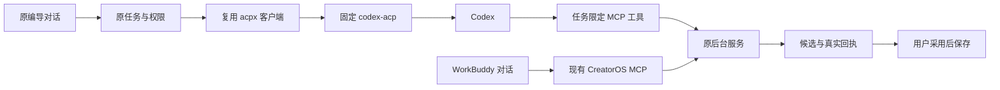

# T-1060 — 复用开源代码接入 Codex ACP 与 WorkBuddy MCP

## 授权与范围

用户 2026-10-04 在 T1059 文件级复用选择后明确“认可认可，你来推进吧”。据此实施已选择的 Codex ACP 客户端/适配器及 WorkBuddy MCP 连接器，保留当前产品任务与保存服务。排除 CodeBuddy，禁止从零实现协议、会话系统、执行器或媒体底层工具。T1059 研究不再作为本任务的实施限制；原先禁止浏览器自动化继续有效。实现、依赖构建及合同/集成验证可进行，实际模型调用仅使用隔离账号/临时项目且不读取或复制原始凭据，不改用户现有作品和 Agent 全局配置。

既有合法激活、渠道/自配模型/Agent 可组合和切换保留配置的方向不变。本任务交付已选接入代码和真实编导/外部工具路径；全业务文本入口迁移、激活后端补发等原独立范围仍在对应任务中，不以本任务的接通宣称它们已全部完成。

## 大白话与流程

在设置中选择本地 Codex 后，新编导任务通过已有 ACP 客户端发送给 Codex，工具调用仍回到产品原服务；以前的任务按创建时冻结的引擎继续。WorkBuddy 的接法是安装一个连接器，让其现有对话调用 CreatorOS 工具，不把它冒充已经可在本产品内启动的本地引擎。

## 实施合同

### FR-1060-1 固定来源与可构建依赖

- 客户端从 acpx `27efb1b57b9de22105a91e9154b1d29b51ede8cb` 复用 `AcpClient` 和完整必要源码闭包；MIT 原文、来源/修改记录随源码保留。仅加导出入口和产品宿主适配，不使用不存在的发布子路径。
- 使用 `@agentclientprotocol/codex-acp 2.1.1` 与固定解析依赖；SDK 使用来源实际支持的固定版本。新任务不能浮动 npx 下载。适配器和二进制的版本及运行能力核对后才能表示可用；不默认视为与当前 0.159.3 已兼容。
- 不引入 acpx runtime manager、flows、文件会话存储、历史、队列或另一张任务表。ACP SDK/client/server 均在 Worker，frontend 只用 contract。
- WorkBuddy 连接器包装复用 Univer `856eae4fe416b28adffb96092d67ff26c7797ff4` 的包装模板/生命周期，配合本产品已有 stdio MCP；配置路径/最小合并规则参考已固定 PowerContext/EverMe 实现。保留许可及修改记录，不引入 Office SDK、iframe、提示 Hook 或其它服务。

### FR-1060-2 新任务 ACP、旧任务冻结

- 新 Codex 编导任务冻结 `protocolKind=acp`、固定适配器/客户端身份与任务上下文；已有 native/历史 ACP 任务不得因为设置切换而改协议、改版本或重发 unknown 提示。
- 复用原 `external-chat-turn`、execution lease/calls、thread/session/turn 回执和候选投影。实际模型身份、真实 ACP stopReason/usage 如可得按实记录；缺值为空，不编造。
- 加载/恢复同一 provider 会话不等于可以重发未知回合。无可靠旧回合结果时保留 unknown/明确恢复受阻；不自动新建会话重试。
- 用户停任务传到 ACP cancel 并关闭本任务子进程/桥资源；发送取消和远端终止确认分开记录，不将本地关闭冒充远端未执行。

创建载荷中的 `externalAgentBinding` 由 backend 固定，参与原输入摘要：`protocolKind=acp`、客户端提交 `27efb1b57b9de22105a91e9154b1d29b51ede8cb`、适配器 `2.1.1`、本机程序 `0.159.3`、权限配置 `creatoros-acp-readonly-v1`。不接受前端传可执行路径、环境或策略。缺这个字段的旧 queued/reserved Codex 任务沿原 native 路径；旧 settled 回执仍可读，历史 ACP started/unknown 无完整绑定时明确恢复受阻。新路径顺序为创建会话、核对有效权限、等待原 `startExternalChatTurn` 持久入场确认、调用 prompt、等待事件处理结束、结算。`onRequestWritten` 仅观察；入场后任何无法排除已发送的失败均 unknown，不重发。真实 provider turn 如上游事件可得，通过原回执透传；缺值为空，不能拿 session 或本地序号充数。

### FR-1060-3 工具、认证和图片回执

- 任务限定 MCP 工具复用现有 external-task 工具服务与已存在桥接代码；不得默认向内部 Codex 暴露全契约工具。工具执行重新校验归属、版本、lease 与幂等；AI 只出候选，经用户采用落库。
- 显式关闭客户端托管 fs/terminal 回调；配置真实 Agent sandbox/approval 和可信工作目录。原生工具开放不能仅依赖 cwd 名称；验证前不显示脚本/命令或媒体能力已可用。底层 ffmpeg/Whisper/下载仍是产品已有工具。
- 子环境仅传 Agent 必需项，不传数据库、媒体供应商或产品服务密钥；不读取/复制 auth.json，不改 Agent 全局配置。复用用户既有登录仅通过 Agent 自身认证流程与状态接口。
- 原 SessionNotification 工具/图片内容和 `rawOutput.savedPath` 保留到现有受控回执/素材端口；校验真实文件、任务路径、类型、大小及幂等后入素材候选。同步通知不视为保存成功。能力不支持时如实呈现，不阻断合法文字任务。
- 维护适配器原生审批请求必须接现有许可结果；回调异常明确拒绝/取消，不能落入自动批准模式。

权限固定使用原适配器 `read-only` 模式：`approvalPolicy=on-request`、`approvalsReviewer=user`、readOnly sandbox、网络关闭、无可写根。宿主 permission 回调明确 cancelled；客户端 fs/terminal 能力均 false。沿原 native 禁用集合关闭 apps/plugins/hooks/multi_agent/multi_agent_v2/browser_use/computer_use/code_mode/code_mode_host/tool_suggest/shell_tool/unified_exec/view_image/skill_search/skill_mcp_dependency_install 和 web_search；只保留原生 image_generation 及本任务 MCP。以固定上游源码的窄补丁在子进程启动 argv 和 thread config 中覆盖这些设置，保留全局 MCP 的 disabled 项，再加入本任务服务器。原生 config/read 与 mcpServerStatus/list 核对实际集合后才返回可入场会话；额外/未核验工具不得进入 prompt。若所选模型仅支持另一个未授权工具模式，显示该 ACP 能力未就绪，保留原 Pi 和媒体服务，不偷偷放宽。

子环境沿原 `codexRuntimeEnvironment` 允许键；再加入宿主固定 CODEX_PATH/CODEX_CONFIG/INITIAL_AGENT_MODE。不接受调用者的 DEFAULT_AUTH_REQUEST、任意 MCP 或供应商配置。启动日志关闭原配置/认证请求输出，原文件不复制、不改写。新增来源补丁保留原许可、固定上游文件摘要和修改记录，不另建 ACP 方法。

聊天图片使用原 `pending-generated-asset` service，经同一聊天执行的窄 `saveExternalChatImage/recoverExternalChatImage` 端口提交/查原收据，不能伪装为 asset.generate。backend 重新校验 task/lease/输入摘要/started session/turn 归属，操作键从原 callId、真实 provider toolCallId、图片序号派生。Worker 校验实际 PNG/JPEG/WebP 字节，单图上限30MiB；路径只读任务私有目录内非符号链接普通文件，越界路径拒绝但有效内联字节仍可用。原素材服务以完整字节摘要及幂等操作键保存 pending；聊天回执仅持有受控 asset/file/checksum/byteLength 引用及失败项，结算前查原收据验证。纯图允许空 text 且至少一张已保存候选；正文+单图失败保留正文和明确未保存说明，全部为空则明确失败。通知接收同步，保存队列必须在 prompt 终态后 await flush；重放先查原素材收据，未知回合不重新调用模型。用户采用仍沿现有候选确认服务。

### FR-1060-4 WorkBuddy 连接与设置交付

- 连接器以现有 CreatorOS MCP 启动入口和安装连接握手为准；输出可安装包/配置及原生设置页的连接说明、复制连接指令/配置功能。配置成功、宿主首次信任和可调用状态分开。
- 本任务生成连接器工件，不自动覆盖用户 `~/.workbuddy/mcp.json`、安装信任或全局 Agent 设置。包含无个人路径的模板和真实启动入口；如需用户安装，交付具体可审阅工件。
- WorkBuddy 只显示为外部 MCP 接入，不放入应用内执行引擎下拉。外部项目上下文通过真实账户/project operation 明确提供；不生成不存在的 `get_active_project` 工具指令。
- 所有页面使用当前脚本工作台的字体/组件。引擎与接入设置只在设置页，保持原 API/Pi 设置和切换后的配置。

已有 `cli_access_status` 兼容可选非秘密 `mcpLaunch={command,args,env}`，由原生壳使用随包程序/CLI/connection descriptor 真路径生成，仅 ready 且 enabled 时提供；frontend 只复制/下载这段 JSON，Windows 不使用 .cmd 或 shell 拼接。stdio 入口复用固定 Univer 的幂等 EOF/信号关闭生命周期。公开 ZIP 模板不含个人路径/凭据，设置中解析的本机配置不进发布包；MCP 项目读取使用 accounts_list、projects_list、projects_get、projects_outputs_list 和真实 artifacts/文章/图文操作，账户及项目 ID 由用户明确选择。

### 合同增量与错误

复用原域、任务、素材表和权限属主；无新领域表或角色，按预算口径计两项既有 JSON 语义扩展（输入绑定、图片回执）。两个聊天图片私有端口、原 start/settle 绑定校验、原聊天输入 binding、原 cli_access_status 可选输出是本轮六项合同变更（评审只细化这些既定接点）。错误沿原 waiting_user/unknown_result/ConflictError；版本或权限不匹配等待配置，已入场但断线为 unknown，图片错误仅影响该图，复制失败只显示实际失败。取消只关闭本调用的客户端/桥，MCP EOF 不撤销已由后台接收的业务任务。检查覆盖旧缺绑定任务、入场失败/断线、全局 MCP 配置层、审批异常、环境白名单、字节图/路径图/重复图/纯图/延迟保存，以及非 shell argv、模板无秘密和复制失败。

## 检查与完成标准

执行当场、可重现的依赖构建/类型检查，协议/取消/退出/权限失败/未知回执/任务冻结/工具归属/图片路径安全的合同与隔离集成检查；保留此前失败样例。测试可用固定 mock 证明合同，但标明其不能代替真实模型或跨应用调用。

真实 Codex/WorkBuddy 不可用时，不伪造可用状态和真机通过；可构建工件、实际产品调用链和未验证项分别交付。禁止浏览器自动化，UI 检查采用源代码与非浏览器接口证据；缺真界面验收保留“待验”。运行本任务 boundary/orphan/LED-047 相关回归、pmem sync、reconcile，与 T1059 的全局失败基线比较；范围内新增失败先修复，范围外欠债明确保留。

实施前独立审核本合同；追加公共接口/权限或来源变更按 DEC 登记。已获方向授权不再次询问；独立审核不替代真实验收。完成以本任务源码、锁定依赖、连接器工件、验证记录和提交为证据。
