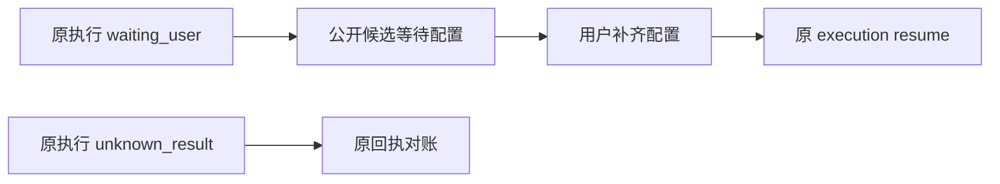

# T1061：修复 AI 等待配置被衍生候选误报为生成中

## 来源与当前事实

用户要求继续自行验证 AI。T1060 当场通过正式文章/图文 transport、后台和 Worker，在临时数据中复现：在模型调用前，凭据解析失败，execution.status=waiting_user、errorCode=MODEL_CREDENTIAL_UNAVAILABLE、calls=0；公开任务/候选仍 status=running，文章候选 errorCode=null。原稿未变、候选 0，页面源码的轮询可能一直提示生成中。证据：[真实回执](../verification/t1060/continue-ai/derived/evidence.json)。

承接 T915 FR8/AC05 的状态投影一致性与 T957 的实际错误表达。此文为具体缺陷登记，尚未独立审核，不代表已实施或修复。

## 要达到的效果

等待配置时，文章、图文明确提示配置阻断，结束“生成中”的轮询表达；用户补齐配置后通过原恢复动作继续同任务。结果未知时明确等待对账，不能推荐创建新任务或自动重发。

## 边界与检查

- 使用原 AI/候选/执行权，保留 runtimeStatus 和实际错误；接口与页面表达改动先按既有合同审核。不能把 waiting_user、unknown_result、paused 全部映成 failed。
- 保留已完成/失败/取消/旧任务的读取、归属与版本；不修改模型路由、激活或供应商配置，T1057 范围保持独立。
- 原 waiting_user 两项任务的 retry 已实际拒绝，wake=0、calls=0：[回执](../verification/t1060/continue-ai/derived/retry-guard.json)。不能松开这个门制造一个看似有效的按钮；合法恢复复用原 resume/原 task 与 operationKey。
- 实施前保留上述实际失败，补公共候选与 UI 状态回归；验收要覆盖配置阻断、补配置同任务恢复、unknown 不重发、正常生成、旧终态以及原稿不被覆盖。

根因接点：`backend/src/modules/ai/execution-task-projection.ts`、文章/图文领域候选读回、`frontend/src/features/article/article-workbench.tsx` 和图文候选展示。没有把测试宿主或模拟模型作为真实 AI 成功。
