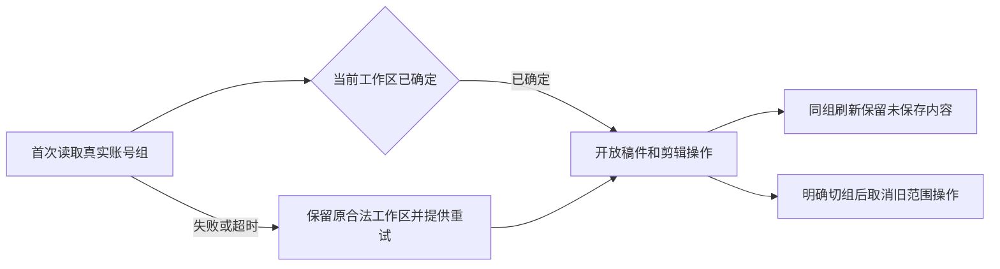
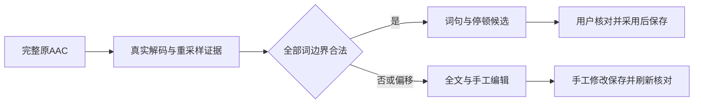
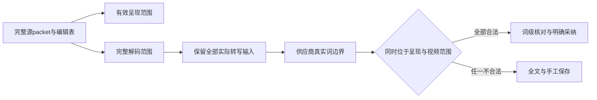

# T-1062 汇总会话改动、统一提交及本地客户端逐项验收

2026-10-05 用户明确授权：汇总几个 CreatorOS 会话正在做的任务并提交，准备本地客户端包；打包后逐个功能验证，供用户验收。剪辑工作台需支持类似 ChatCut 的粗剪及 Skill 集成，指定会话 `01a0fffe-4bc5-7473-bdb8-8729bf5382b2` 为参考。此授权不包含 push、公开发布、生产配置修改或自动合并真实账号数据。

## 范围及实现依据

先盘点主工作树及相关会话的分支、提交、未提交改动、依赖和实际验证，不把会话自述当实测。统一候选包含账号组、多平台工作区、主脚本与文章/图文衍生工作台、画布案例/资产/模板、Codex/WorkBuddy接入及视频剪辑；已有已评审功能继续遵循原SPEC，不重新建立业务真相。不同分支的看板、task ID、manifest和迁移序号可能冲突，合并时须按原SPEC与历史证据保留来源，不能整文件覆盖或伪造完成。

剪辑沿已评审T-850/T-1035—T-1046：真实源媒体与时间码→可配置Skill语义删留候选→用户核对影响并采用→同一原生时间轴→手工修改/撤销/保存/导出。调研ChatCut的真实录制、转写、选择重录、停顿压缩、原速备份与变速保音高流程；核实逐词删留、字幕/叠层映射等已有边界。没有真实时间码不能猜切点，原片不得覆盖，保存不得隐式生成或发布。对已实现能力如实验证；若发现超出已评审合同的缺口，补合同及独立评审后实现，不能仅改入口文案声称支持。

### 封闭来源清单与核对结果

本轮要汇总的是下列四个CreatorOS会话，用户指定的Moonlit/ChatCut会话仅作为粗剪参考，不把其媒体、个人Skill或其他项目代码无审查并入安装包。

| 会话/来源 | 盘点基点 | 原需求/规格 | 本轮处置 |
| --- | --- | --- | --- |
| 调研并重构账号组管理，01a105f7-b4c1-7993-bbf1-704987276e1f | 主树ebd63d9891d162b1bd8bf518bc1b9f573fa9146f | T-1022账号组及同树T-1017/T-1019已授权改动 | 纳入主树未提交候选，逐路径审查并留hash；不把待验任务改完成 |
| CreatorOS 工作台与本地 Codex：继续集成和验收，01a0f7f2-b7ab-7f21-a333-dbf8684b3941 | codex/user-diagnostics历史至39c1be32，由下一会话继承 | 该分支T-1029—T-1059的工作台与剪辑SPEC | 已由接力来源覆盖；按其提交祖先保留，不重复拣选 |
| CreatorOS 网页版：集成开源工作台并交付验收，01a0ffbc-cf31-76d3-b0cf-7b73f2997259 | codex/user-diagnostics bb00d580e2543dc886f145c13f686cf7dc50a4b8 | 上述继承规格及T-1060/T-1061 | 纳入已提交及已授权未提交候选，逐文件核对来源和敏感内容；待修/待验逐项登记 |
| 集成封面模板选择功能，01a105e1-58bd-7eb3-a187-36219849ccd1 | codex/t1021-canvas-templates 55a526d609633e2b014e2a70f319125dec8c0fea | 该分支T-1021模板及已合入画布SPEC | 纳入该提交及祖先；用户私人照片/本地收藏DB不入公共包 |

盘点后生成 `docs/verification/t1062/sources.json`：来源会话/仓路径/HEAD、关联SPEC、提交范围、未提交路径及SHA256、纳入/排除/已覆盖理由和冲突处置。此清单是上述来源的实施证据，不是第二个任务队列。最终验收逐项引用来源和候选SHA；未定位或未验证项不得默认为已覆盖。来源随后变化时重新核对增量，不沿用旧hash。其他项目会话及未被上述历史覆盖的独立实验分支不自动纳入。

### 已发现的归属与迁移整合约束

只读盘点发现，新画布/模板/文章图文及原生剪辑服务仍按accountId读取，而主树已经以groupId作为工作区；两个合理实现会造成空组不能创作、同组跨平台看不到资料或账号转组后旧资料随账号外泄。以下约束是用户已确认“账号组内数据可见”在新增功能上的落实，不改变真实平台事实仍归真实账号的边界，也不自动合并用户的真实资料。

- 新创作域（画布及其生成链接/候选、私人模板及变更回执、文章/图文/朋友圈候选、组合及版本/物料/审核、视频工程/编辑/渲染/源/转写/粗剪预约）必须沿root工作区规则有冻结的group归属。具体平台账号是可空的出处或真实发布目标，不能为了通过requireAccountId制造假账号。组内平台筛选只筛发布事实，不隐藏共享创作；空组可手工创作，缺模型或账号明确限制对应动作。
- 已有project/output父归属通过真实服务端关系落实到依赖闭包；同一用户不同group读写互斥，不能读不到项目就隐藏projectId但仍返回完整画布。新写入沿服务端membership事务锁、readonly/archive及版本/CAS守卫；转组只影响未来事实，新旧任务/采用/费用回执不改写，结算保持原冻结身份。
- 没有父关系的旧account域资料沿已评审的一账号一初始组方式保留，不凭账号目前已转到的组猜旧资料归属；不能从标题或文件名匹配。显式迁移仍预览选择真实闭包、共享文件保持原storageKey/真实授权，未识别的孤立资料保留待用户归组，不删除或默默开放。
- 三份journal的历史tag、SQL及时间证据原文保留；统一候选只新增明确的兼容收敛迁移/适配。不能仅把旧迁移编号或timestamp挪高冒充安全升级，也不能让某分支的最高when跳过另一分支建表/加列。空库、旧主树、旧诊断、旧画布四种隔离基线必须实测，核表/约束/默认值、原ID/行数/文件引用和二次启动幂等；未通过不进入本地包安装验收。
- 原public service与原生OpenCut文档继续为唯一工程真相。项目读取锁参/tx、发布unassigned结果、历史asset exact文件、旧digest重放与新完整视觉digest必须同时保留，不能删参或类型断言来消编译。

源证据为 `docs/verification/t1062/integration-inventory.md` 和新增域归属检查；所有实测在隔离库，不碰用户正在使用的ChatCut或真实库。

### ChatCut粗剪对照的必验结果

| 行为 | 验收结果与依据 | 裁决 |
| --- | --- | --- |
| 原片导入及原速保留 | exact媒体仍可读，候选与采用不覆盖原文件；T-850/T-1046 | 本包必须可执行并取证 |
| 真实转写与时间码 | 公开ASR链有真实回执；无有效词句时间码不得猜切点，要明确降级；T-850/T-1046 | 本包必须可执行并取证，词句粗剪缺证据不能写全面通过 |
| 选择完整重录、局部删口误/重复和处理停顿 | Skill读取真实内容和用户要求后给理由/不确定性，正常临场发挥与有意强调保留，无法判断默认保留；T-850语义边界 | 本包必须可执行并取证，逐项注明整段/词句支持范围 |
| 对照、明确采用及同轨后续编辑 | 一次明确采用，真实时间轴/影响清单，撤销重做、保存刷新与MP4回读；T-1046 | 本包必须可执行并取证 |
| 字幕及独立叠层时间关系 | 采用前明示受影响项，不静默错位或关联；基础时间映射沿T-850，native3限制沿T-1046 | 本包必须取证，未实现自动联动不得称ChatCut完整等效 |
| 1.13倍及保音高 | 来自参考会话个人选择，并非全用户默认；核对当前编辑/渲染是否真实支持，给可操作结果或明确差异 | 本轮调研及验收差异，不硬编码为自动粗剪策略 |
| B-roll、动效、双语跟读、导航与16处音效 | 参考会话的完整精剪，不把它们全当粗剪前置；已有功能仍进入各自验收项 | 本轮核对已有链路，不新增同款精剪模板作为粗剪验收前提 |

## 提交、打包及验收

- 记录来源HEAD与文件hash；不覆盖未提交改动，不提交密钥/激活码/私人照片或真实库。不擅自中止其他会话，读取其最新状态并核对磁盘事实。
- 合并或修复属于打包前实施；正式进入packaging Skill后冻结已提交候选，禁止边打包边改代码洗绿。本地版本沿仓库现有一致版本，不擅自升正式版本或发布。
- 冻结工作树干净，版本四处一致，运行四项打包基本检查，固定入口 `pnpm -C frontend desktop:package-local`；记录候选SHA、产物SHA256、签名属性、hdiutil verify、真实安装和启动结果。
- 验收逐项记录：启动/导航；组与绑定管理/迁移预览；首页/总览/分析/复盘；项目/主脚本/文章/图文；案例/资产/无限画布/模板采用；Codex工具与候选/取消/恢复；视频导入/转写/Skill粗剪/对照采用/原生编辑/撤销/保存刷新/预览导出；设置/模型配置往返；采集/发布原链兼容。不自动对外发布或费用不明地调用模型。
- 浏览器或夹具只能证明其实际覆盖；安装版、真实模型、五平台登录/采集与原生OS交互缺证据时写待验/具体阻塞。用户功能验收由用户实际操作确认，不代签。
- 必须保留失败日志，关联既有欠债；T-1062只有统一提交、包及该包可执行功能的逐项证据齐备才可完成，不把准备完当打包成功。

## 当前入口

BUILD集成和验证→SHIP本地包。上游来源为主树、`codex/user-diagnostics`、`codex/t1021-canvas-templates`及其已合入依赖；旧全局Gate仍按实际结果保留。用户本轮已经授权汇总、提交、本地打包与逐项验证，无新增发布授权。

### 实际浏览器首载发现的父归属修复（2026-10-06）

完整前端检查首次进入真实浏览器后，剪辑页公开 `getOutputProduction` 在锁定父项目事务中创建 production 时遗漏父项目 `groupId`，随后原 native editor 守卫正确拒绝它，导致组内工程无法打开。修复只从已锁定且已授权的真实父项目读取组归属并写入新 production；旧 nullable 父组原样保留，既有错误行仍拒绝，不从当前平台筛选猜组、不新增 DTO/API、不自动归组或改写用户旧资料。

实现写集仅增 `backend/src/modules/production/production.repository.ts` 与既有 `backend/src/modules/production/production-native-public.integration.test.ts`。已发生隔离公开 get→native read→save→重入回归：修复前 7 项中 3 项失败，候选修复后 7 项通过；纯组、同组平台筛选、旧账号 nullable/初始组、跨用户/组/账号零写入、幂等及已有错误行拒绝均有断言。该证据不等于完整浏览器或安装版通过。原 18 检查命令与顺序保留，另重跑此后端公共链回归。

旧画布浏览器夹具应按已确认的新组工作区公开 API 创建真实归组资源；历史孤立 account 资料仍须显式迁移，不新增按当前成员关系开放旧资料的捷径。被 T-995 清除的私人截图不恢复，图片与视频解码验收使用可追溯的中性有效媒体。

素材预览补充：真实浏览器中素材卡已有 `currentFileId`，但未交给要求 exact 文件的 `MediaPreview`，合法图片/视频因此只显示占位。实现范围另精确增加 `frontend/src/features/creative-canvas/canvas-asset-picker.tsx`，仅补传真实 `currentFileId`；权限、素材内容、插入行为及预览授权不变。既有 `canvas-editor.test.tsx` 的真实组件回归已出现 RED 1 项失败、候选 GREEN 27 项通过；不代签浏览器解码或安装版。

### 真实首载根就绪与文章验收夹具（2026-10-06）

真实浏览器两项公众号创建请求未取得回执，随后被AccountSwitcher初次载入真实组后切根取消；不能靠更新夹具代替产品修复。统一初次初始化状态复用真实Switcher公开列表和选择，不新增归属算法。通过同一context覆盖ShellRouter页面/Copilot和layout外的@modal，在初次根确认及真实选择/cookie同步完成后开放创作。后续同组列表刷新不关闭屏障、不卸载未保存稿或native；显式跨组切换仍沿原确认及旧操作取消。

列表错误/有界超时必须通过真实AbortSignal结束本轮请求，并提供可操作重试。已有server与browser一致的原group或旧account根保留可用性，原权限仍由backend严格检查；缺根时显示可恢复状态，账号/设置等管理入口仍可访问。初次已安全开放后，重试只刷新菜单，不隐式切根、重发写入或丢弃原输入。沿Oil0.10及原紫色丰富布局，仅使用既有tokens和状态组件，不另改视觉方向。

公众号夹具另通过公开分页accountGroups.list读取真实账号唯一active成员组，在原入口前同步同一组；缺失/非唯一即拒绝夹具，不猜组、不迁移资料。两个原用例的手写、保存、刷新、隔离、模型候选及采纳断言保留。原6项native/group旅程保留，另增真实延迟首载检查；原18检查argv、顺序、截止与失败历史不减，新增初始化和既有Switcher真实信号/失败恢复回归作为额外验证。

精确新增写集7条：frontend/tests/e2e/wechat-article-workbench.spec.ts、frontend/src/app/(creator)/layout.tsx、frontend/src/app/(creator)/shell-router.tsx、frontend/src/components/shell/account-switcher.tsx、frontend/src/components/shell/workspace-initialization.tsx、frontend/src/components/shell/workspace-initialization.test.tsx、frontend/src/components/shell/account-switcher.test.tsx。产品写集571→578，219保护项中的Switcher和wechat两项转写集，剩217；新增5快照，总790→795，module576→583。没有backend/SQL/平台事实归属或模型选择变更。静态方案和候选必须独立评审，实际失败先复现再实测，不以准备、夹具或单测代签浏览器及安装版。

## 实际公开保存与冻结传输装配补充（2026-10-06）

Original18 Attempt10 的两条真实原声/ASR旅程已完成公共上传、exact 文件回读、原生导入与真实时间轴加入，首次保存收到 404 OwnershipError「项目归属验证不可用」，尚未进入 ASR。真实调用链在 `frontend/src/server/persistence-client.ts` 的 `assertProductionEditorAsset` 事务分支创建 materialLinks service 时漏接项目归属端口；非事务根已通过公开 projects service 校验。只在该已冻结 reader 路径补同一 transaction 的公开 projects service `getProject` 返回真实父行，继续严格组/用户归属、精确 AssetFile 与项目用料关系检查，不换连接、不绕 guard、不造 materialId 或成功回执，不扩展该文件其他装配责任。

另只在 `frontend/src/lib/http-transport.ts` 恢复已有用户级账号管理操作、`forceNewDouyin` 选择及显式空 frozenScope 的传输兼容。原两常量、管理分支与严格冻结归属仍是边界；空 scope 不继承切换后的 currentB，不扩大共享/平台账号权限，不新增 DTO、服务契约、SQL、runtime 或 toolchain。原 `http-transport.test.ts` 两项真实失败、全部原17断言和 Original18 命令保持，生产候选由 ROOT 另行提供并独立评审，本补充不代签其实现。

另 targeted 原 LED-047 回归162项中161通过、1失败；`frontend/src/components/overlays/overlay-routing.test.tsx` 的旧 unit client mock 未连接已批准的真实 scopedWorkspace port，触发 Node URL parse 错误。只在该既有测试附加同款稳定 port proxy，保留真实 factory/capture/signal/epoch/assertCurrent/abort 与全部原15主体、业务断言、mocks，其他7个LED-047文件不改；不修改生产去迎合夹具，不把 unit兼容修复称作性能浏览器通过。测试候选由ROOT另产并独立评审。

本次权限只新增上述两个生产路径及一条既有unit测试，共三个 EXACT 既有路径：T-1062 integration module 583→586，required owned 577→580，加既有 active conditional 1 后有效产品 578→581；source snapshot 795 不增，protected 217 仅移出这三个路径成为 214，explicit readonly 9 仅移出 `http-transport.ts` 成为 8，其原测试仍只读。其他保护、原7首载路径、backend/contract/native闭包、31 source members、414 outputs、12删除、原6 native旅程、词级 ASR、原声20检查、旧失败及安装/听审待验状态保持。

仅 TMP 产生候选与有界隔离公开 service/transport 红→绿证据，来源函数从当前冻结字节机械抽取而非改测试接口；这不替代完整 frontend composite dispatch、浏览器、真实 ASR 或安装验收。两生产源、一测试源与本3控制须由其他 Agent 独立评审，先逐字节保护全部 WIP、释放旧 public lease、提交控制增量、同步干净 writer，再以新控制 HEAD claim并逐字节恢复；禁止在活跃 lease 上修改 modules.config。最终正式元数据只重绑新增3权限、当前 source bytes/回执、214保护和8只读，原18 argv/预算/断言不改。

## 普通 AAC 的可信词级时间映射与偏移手工流程（2026-10-06）

Original18 Attempt13 中22条真实浏览器旅程20通过、2失败：两项真实默认ASR完成全文，但原word请求都降级text。只读取证定位旧PCM-only入口令AAC先抽成MP3，缺mappingReceipt时Worker不传timingAudio；不能把全文成功等同词级通过。Research同族已实际暂停、两次有界区分实验、独立复核与登记的只读校验完成并恢复，完整失败、原声和所有源码仍保留。具体证据见docs/research/t1062-local-word-timing/RESEARCH.md；研究恢复只关闭未知机制，不证明实现或安装通过。

只在内部媒体证据协议新增独立严格v2，原v1 schema/export/PCM回执摘要和行为保持。asset-asr.ts必须显式strict v1|v2 union消费，不靠类型断言或删字段绕过。精确支持族为MOV/MP4、AAC-LC、单声道48k、视频与有效音频零起点，真实ISO BMFF音轨仅一条rate1 priming edit、movie/media timescale48000、media_time1024；全部packet/skip/discard、已消费priming的解码帧、实际重采样ashowinfo输出帧及独立WAV样本/PCM摘要必须闭合。中间packet/frame1024，最后有效D在1..1024且discard=1024-D；D、完整有效源S和输出N均逐真实输入取得，不能固定夹具的617/716393/238798。无empty edit、gap或未知字段推断；其它族保持旧全文与手工。

完整音频输出保留所有N样本（实证N=ceil(S/3)），禁止atrim、把末端N钉到S、按容器总秒数插值或四舍五入词边界。源skip已经由decoder消费一次，不能二次从解码S扣1024。sourceFrames用源48k验证；outputFrames来自aresample链的ashowinfo，独立WAV ffprobe重新分帧只对总数N。音频证据域S/48000可略长于视频源durationTicks*timebase，不截短音频或拒绝合法全文；每个真实provider start/end严格用n*48000/16000及源timebase的BigInt有理数换算，须同时在音频S和视频范围内且为整数tick。任一端点、身份、完整性、顺序或原回执不符，整份word映射降为text，不能只丢坏词或补时间。

每次冻结实际resolver给出的ffmpeg及ffprobe的realpath、binary SHA、完整-version回执摘要、平台和完整shell-free argv与pair digest；只有现场packet/edit/frame/count/PTS/PCM行为全闭合才verified。Homebrew9.0.1是实验实例，安装包b6.0是现有工具来源，均不作为唯一版本/路径白名单；未知版本行为沿旧text降级。打包脚本、下载机制和权限不改，最终实际安装包必须重新验证真实ASR。代码只验证机械身份、时钟、范围和摘要，删留语义仍由可配置Skill与用户决定（SEMANTIC_BOUNDARY_ALLOW）。

精确新增6条既有路径：contract/src/internal/asset-asr-timing.ts、contract/src/internal/asset-asr.ts、backend/src/modules/production/production-asr-pcm.ts、backend/src/modules/production/production-asr-timing.ts、backend/src/modules/production/production-precise-asr-mapping.test.ts、backend/src/modules/production/production-precise-asr.integration.test.ts。既有extractVerifiedNativePcm入口内分派AAC；production-asset-asr-media.ts保持只读，真实差异若证明确需改调用才另独评准入，不提前扩大。module586→592、required580→586，加已有conditional1为587；source795→801，原protected214/readonly8/native31/output414/delete12不减。原owned的t1062-group-native-rough.spec.ts只落实下述偏移完整旅程。

普通AAC原word断言、真实多tokens/可操作gap、原声20项自然播放/取消/dirty/重新核对/明确采用、完整source/digest/CAS和保存刷新都保留，不换原固定AAC或用PCM替代。偏移用例仍在真实UI请求word，但应真实成功全文、无tokens/无伪gap并显示手工提示；零语义粗剪候选、零自动采用；用户显式保存原转写及原生手工修改/保存/reload，公开回读完整plan、revision、mediaRefs、source身份和exact下载摘要相等。它验证已承诺的安全降级，不声称非零映射或精确试听可用。22case、Original18 argv/顺序/预算都保留，原normal不能改为容许text。

先独立评审本SPEC/DEC和精确module候选，保全176条WIP字节/mode/12删除，释放旧public lease，再提交控制增量、干净writer FF/claim和精确恢复，之后方可改实现。新增真实零起点AAC的内部strict roundtrip、物理抽音与公开ASR/word采用红→绿；原AAC偏移负例、旧PCM、预算回退、partial/缺side-data/非整数/越域/digest拒绝和原完整公共调用保持。追加两既有测试的真实执行，不删断言；无当场RED不补签。候选及元数据须由其他Agent独审，完整Original18、统一产品提交、安装/听审及用户验收继续待验。

### 随包工具实测后的有效呈现与完整解码双范围补充（2026-10-06）

同一普通 AAC 输入、默认随包静态 FFmpeg/ffprobe 6.0 实测显示：首 priming 已消费，完整解码700帧、716800样本，但单一ISO edit、音轨duration_ts和完整packet有效终点都是716393；末packet长度617且没有discard sideData，末decoded帧仍有1024样本。旧严格R5因此真实降级全文，原失败完整保留。不能把最后407样本称为已证明静音、捏造discard sideData、裁掉音频，或以开发机9.0.1结果代签安装包。

在同六个精确已有路径中追加独立strict R6 internal v2证据形状，以明确的decodedDomainProtocol区分；旧v1及已经形成的R5 v2形状、字段含义保持。有效呈现S与完整解码D_dec分别保存完整证明；末discard缺失必须保存null/absent，D_dec-S只能称呈现域外解码覆盖。完整PCM、resampler和WAV全部保留，不trim/pad/async/first_pts；输出N必须来自实际全部帧、WAV与PCM闭合，要求N=ceil(D_dec/3)，未实测前不能填写推论值为PASS。

仅接纳原MOV/MP4 AAC-LC mono48k、有效音视频原点0、单非空rate1且media_time1024的族。完整packet除末条外1024、首skip1024只消费一次，中间没有未知sideData；完整decoded每帧1024、从0连续、数量=packet-1，所有起点逐packet吻合。必须同时有S=音轨duration_ts=ISO edit长度=末packet起点+实际L，D_dec=完整帧和=末frame终点，D_dec-S=1024-L且差异只覆盖最后一帧的0..1023样本；任何矛盾、缺字段或多处差异返回旧全文。实测工具realpath、binary SHA/version、platform和完整argv逐次绑定，不加版本或路径白名单。

provider实际边界n仍以BigInt有理数映射3n及原冻结timebase，同时严格落在有效呈现S和冻结视频durationTicks内；完整物理解码D_dec及输出N不能作为可剪范围。所有实际词必须合法，任一失败整份降级，不钉端点、不舍入、不丢坏词。外部API、worker/provider/SDK、模型及语义选择、数据归属、数据库和原账本不变。普通AAC原词级/原声20及偏移全文/手工保存两完整旅程保留，同一固定媒体与随包6.0实际公共映射红→绿、完整Original18/22、真实模型、安装及用户听审仍必须当场验证。

验收输入恢复补充：旧TMP中的五份build/lock/网络声明及独评回执已实际缺失，经过授权私有归档全扫描仍无法恢复相同字节，必须保留missing历史，不重造旧SHA或追溯签字。同字节模型7、固定视频及manifest、wrapper/gate/cache与旧4快照已核对备份后恢复。四编辑器从既有真实源码归档和配套工具/lock在全新TMP完整production复建，完整31来源、414输出、12旧chunk删除及真实import图仍验证；只有当前新构建原字节吻合后才能给新的CURRENT回执。新NoteRelay web lock由实际npm产生并与原web依赖完整配套，当前ASR声明另绑定原wrapper/gate/model7和真实worker/eval路径并重新独评。CURRENT scope/transfer只重绑新当场证据，原缺失引用移入历史保留；不改原18命令/顺序/预算、frozenTmp、网络隔离、真实ready或源输入，不借丢回执减门。

## R6.1 完整重采样计数的实测修正（2026-10-06）

同固定普通AAC与随包b6.0的必要实现回归当场反证上一节ceil唯一值：完整701个resampler输出帧、117个独立WAV重分帧及477866字节PCM一致为N238933；D_dec716800和S716393保持独立，首输出PTS0、末flush16样本且PTS238917。原ceil238934守卫正确拒绝并使公共word仍text；实际FAIL及完整argv/toolpair/raw/frame/WAV/PCM摘要保留于private的aac-v2-r6-failure-6bb4bd15-20261006/current-fail-receipt.json，SHA81ccc79e07b809d9040ed8b9fa460e7f1efce3c6cee909b96ae2736c6b34b2af。不得改签此失败或把R6静态GO称作实际词级成功。

新增双域严格R6族的完整输出计数规则以本节为准，旧v1与已固定R5 shape/摘要不变。只在完整priming/edit/全部decoded首PTS0及连续、实际无trim/pad/async/first_pts/seek/截时的完整aresample链、实际首输出PTS0/全部输出帧连续/完整退出与末flush、独立完整WAV/PCM格式/长度/摘要及实际toolpair/argv都闭合时，以BigInt A=D_dec*outputSampleRate、B=sourceSampleRate，计算lower=A/B及upper=(A+B-1)/B，核对实际全部N在lower..upper闭区间。整除时唯一个值；48k→16k非整除至多两个相邻整数。新增明确outputCountPolicy=observed-full-output-floor-ceil/v1与严格countEvidence保存精确缩放rational、lower/upper/actual retained N，并从现场D_dec/rates机械重算纳入摘要；字段缺失、伪造、区间外、未完成或相互矛盾均整份全文降级。公式不能产生或修剪N，两个相邻整数规则不能替代完整时钟与输出证据；完整N原样保留。

每个真实provider端点仍严格sourceSample=3n及原冻结timebase BigInt精确转换，同时守真实呈现S和视频边界/整数tick。D_dec/N及计数区间都不能扩大可剪域；禁止pin/clamp、按容器秒插值、舍入词、丢坏词、补样本或假称呈现域外样本静音。首PTS0也不能单独证明映射，完整priming/edit/decoded/resampler链缺任一就text；实际模型词界与听感仍须后验。技术固定说明MD989f0134ac427337e679853c8b6050bfdc921e8cfc6c27c1de2942169eca9f90、JSON2d6cd0ad5bcdfb036ffb4beddf4a8c3bccfba8af918a8d14cbe062dee29544c5；它只修正被实测反证的ceil假设，不新增媒体研究输入或版本白名单。

准入仍同六既有路径、module592/required586+conditional1=587/source801/protected214/readonly8/native31/output414/delete12，正常原word/gap/原声20及偏移全文手工显式保存、Original18全部argv/顺序/预算与22浏览器用例不减。计数验收覆盖整除唯一值、floor/ceil、上下越界/伪造bounds、partial/drop flush/独立WAV或PCM矛盾，以及原双域/偏移/旧PCM/预算/digest公共调用负例；机械参数化单测不得冒充新增真实媒体支持。当前R6候选仍保持旧ceil失败，待完整SPEC第三轮独评及控制提交/干净claim后再实现，不预签绿测、真实模型、浏览器、包、安装、听审或用户验收。
