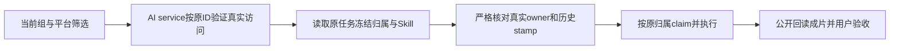

# T-1062 安装版渲染归属修复：工程准入记录

2026-10-06 ROOT 正常准入：独立静态稿 SHA256 5648039c437f49e414b6eb59d98fc3aa904503f212554d46905baf843329e4cf，独评报告 `/Users/zyongzhu/CreatorOS-local-acceptance/t1062-20261005-wm9zxxwl/render-owner-final-supplemental-independent-review-9a70417b/static-go-review.json` SHA256 262b7ccb970c18534906b4ffbbe356d1867eebb4df419f9d3daf5e55e4838ab0，静态 GO、findings=[]。实现、RED/GREEN、新包、MP4 均尚未执行；原 SPEC cfbaf9 字节与原审查不变。下方完整保留该经评审候选原文及候选时状态，当前只授权其中 exact4 工程实现，未签任何功能验收。

# T-1062 安装版 render Skill 归属修复独立补充 SPEC 候选（最终纠正版私有草案）

状态：DRAFT_NOT_ADMITTED_NOT_IMPLEMENTED_NOT_TESTED。仅供 ROOT 与独立评审正常准入；本文件不替代 BACKLOG/SPEC，不写仓库控制，不新增用户 capability，不冒充用户确认、独评、RED/GREEN、安装或成片验收。所有新增 gate 为后续执行要求。

## 1. 独立补充 SPEC 的条款（不得追加原 SPEC）

原 `docs/features/t1062-consolidated-local-client-acceptance.md` SHA256=`cfbaf9e80e6c8b005899c9be2f06d080e66cc119a14be381b721850a4fd36a1c` 保持原字节、原审查与原工件绑定；不把本轮条款追加到原文件，不重签原 SPEC。本候选经正常独评后由 ROOT 以独立 supplemental SPEC/control准入；原SPEC、integration801和所有旧证据仍按历史来源保留。前稿24b247ca…f65f4568保留为被纠正的草案，不覆盖原文件或追溯修改其SHA。

### 安装实测 Skill 冻结归属修复（2026-10-06）

**实际触发**：98c558bb9c793502ccfa156163b4c94ca7907c65 安装版公开 editor.get 仍 output-58776bff-119 / project-58776bff-104 / production-58776bff-169 / revision3；preview 实际成功，durationSec7.5、warnings[]。新意图 t1062-installed-repairs-manual-render-20261006 的公开 render 返回真实 task ai-task-1aaea51b-111，但 execution.tasks.get 实际 failed，errorMessage 为「[T-513] AI task ai-task-1aaea51b-111 的 Skill snapshot 属主不匹配」，startedAt=NULL、manifest=NULL、adoptedAssetIds=[]。没有 MP4，没有确认/采纳。回执位于私人 installed-repairs-public-acceptance-20261006 的 editor-current、manual-preview、manual-render、manual-render-task-1；旧228预览/render428及此前失败幂等key完整保留。

**根因边界**：resolveLocalContext 不提供 accountId；verifyAccountSelection 在缺号时保持原形，verifyGroupSelection 只增加真实 group/version。Skill resolver 将缺号规范为 NULL；AI repository 依真实冻结 membership 锁写任务 owner，并盖 snapshot group/epoch，但旧 live runner 直接用 snapshot.accountId !== ctx.accountId，使 NULL 与 undefined 误拒。该旧 runner 还缺少 frozen group 比较。公共返回 accountId=NULL 不能证明 raw ctx 带了显式 NULL。

**实现原则**：按已授权空组共享创作修复；根读取授权与任务冻归属是两个不同步骤。平台筛选不是新 task owner，不能为过校验造账号、忽略归属、绕过 Skill wrapper、改走 media.probe 或重写既有 snapshot。

1. 在既有 AI backend service 增加仅 server-only 的窄口，建议名 getTaskExecutionRuntime(ctx,taskId)。同一次 repo.requireTask 读取先通过真实 user/workspace/by-ID 服务门，再返回该真实 row 的 runtimeData 与 owner{userId,accountId,groupId,groupVersion,membershipVersion}。owner 来自 row，不来自 caller、snapshot、当前会员关系或用户可传 body；nullable 字段仅 NULL 规范化。该方法是 sibling port；旧 getTaskRuntimeData 的扁平 runtimeData 返回与所有旧消费者保持，不给它套 owner envelope。不得暴露到公开 DTO/operation、worker任意写口或新增库字段，不增加任意 foreign scan。
2. persistence-client 既有 runTaskWithEffectiveSkillSnapshot 经此窄口读取。原 parse/大小/shape 守卫保持；snapshot user/account/group 与真正冻 owner 严格核对，必要 epoch 按下一条处理。缺号 NULL/undefined 在上下文表达上等价，不把同组 caller platform B 与原纯组 task.accountId=NULL 强制相等。不得忽略 snapshot.accountId 腐坏、凭 current group 给 snapshot 补归属，或把同user异组授权成合法。
3. parseEffectiveSkillSnapshot的既有assertSnapshot并未完整校验groupVersion/membershipVersion，不能声称原parse已覆盖epoch门；新增owner guard必须另核字段存在、shape及真实row一致。普通或显式group snapshot需自有groupId/groupVersion/membershipVersion字段；groupId为真实非空string，groupVersion/membershipVersion仅允许真实NULL或安全整数版本且与row完全一致，不用??null把undefined伪装成已冻结NULL；普通组groupVersion须是实际冻结的有效版本，纯组没有真实成员时membershipVersion必须有字段且值真实NULL。浮点/负数/字符串/undefined/缺字段和已有stamp矛盾均拒绝。legacy缺字段读取兼容仅按下表，不推给parse或currentctx。新普通组或任何显式group入口的 snapshot group/epoch 必须完整且与真实 row对应：普通组或显式group缺 group/所需冻结 stamp拒绝，不能将缺失归为legacy。既有 stamp 的non-NULL矛盾拒绝；原row/旧协议缺失的epoch保持NULL/缺失，不复制当前group/member版本，不回填runtimeData，不升级或重签快照。纯组无真实member所对应membershipVersion=NULL保持真实NULL，不制造会员版本；其真实group/version必须一致。仅以下旧协议兼容允许缺stamp读取。
4. legacy 结果表为本补充的明确裁决（读取与执行分开）：

| 原入口与真实服务读取结果 | snapshot/epoch状态 | 窄口读取与Skill归属解释 | 执行/claim admission |
|---|---|---|---|
| noctxgroup +真实原account，requireTask授权真实row.groupId=NULL、同user/原account | 旧snapshot group/epoch缺失或NULL且无已有nonNULL冲突 | 可兼容读取；真实owner仍来自row，不补当前组或epoch | 执行context保留no-explicit-group原account解释；原claim/admission照常决定，不能从read成功推execute成功。 |
| noctxgroup +真实原account，requireTask授权真实row.groupId=该原账号真实grp_legacy_<accountId>、同user/原account | 旧snapshot缺group/epoch且无已有nonNULL冲突 | 可兼容读取；不能仅凭拼出的前缀授权，必须是原requireTask实际返回row | 执行scope保留no-explicit-group原account解释，不悄悄换成显式initialgroup。原admission仍使用真实task frozen row；initialgroup row.membershipVersion=NULL仍按原规则拒绝，不给予新豁免。 |
| 同上述legacy合法读取 | snapshot声明非NULL group/epoch与真实row已有stamp冲突，或user/account不同 | 拒绝，不以legacy掩盖矛盾，不把错误字段置NULL | 不进入executor；保留真实错误。 |
| 显式ctx.groupId，包含显式真实initialgroup | snapshot group/所需stamp缺失或NULL别名 | 拒绝；没有NULL fallback/alias | 保持原admission，不用legacy noctxgroup解释替它放行。 |
| 任意普通group，或foreign user/account/组 | 缺stamp或矛盾 | 拒绝；不从membership猜历史 | 不执行/不写foreign任务。 |

旧stamp兼容只允许实际历史字段缺失/NULL的读取解释，不容许一个已声明nonNULL的snapshot值与真实持久row相冲突；历史缺失字段不补签、不复制当前值。旧字段缺失的read成功与claim失败分别真实登记，不能签“legacy全绿”。本轮不修改membership/admission/旧来源判定；若原规则禁止执行，结果仍拒绝。这避免通过共享root新门为initialgroup membershipVersionNULL任务制造执行权。
5. 本次改造范围为 dispatchExecution 的 deterministic exec Skill wrapper（排除原 media.probe 与 agentic 分支），其调用者 ctx 只用于入口真实访问授权。该分支任务执行、claim、素材物化、结果写入与失败结算必须继续绑定该原任务冻结 owner。构造普通组执行 RequestContext 仅取真实 owner 与原调用 requestId/source，不复制 caller 平台筛选或当前 epoch；legacy执行scope按上述结果表保留no-explicit-group原account解释，guard仍绑定真实row.group，不能把兼容读取改成新的claim豁免或拿别的组重签。切换平台筛选可读原纯组任务，但不改变其冻结账号 NULL 或原 group。
6. 原 modelAuthority pin/matches、Skill parse、taskModelAuthorityScope、runWithEffectiveSkillSnapshot、runClaimedTaskExecution/lease、执行幂等、素材 exact-file/digest、归档/权限和持久预算门全部保留；只有规范正确且合法的原任务才进入 executor。源素材、剪辑版本、既有任务、旧失败 request/key 不改写。未知/失败原 task 保留事实，不自动重提、confirm 或重置期限。

简图（既有门均保持）：



**全部消费者和闭包边界（真实源码盘点）**：

- persistence-client.ts:4157 为直接 dispatchExecution 调用：非media.probe、非agentic的确定性执行，经此旧wrapper到runExecutionTask，包含当前video.render和echo.manifest。
- persistence-client.ts:5110将同名wrapper注入createCollectionExecution；backend/src/application/scheduling/collection-execution.ts:18旧端口只收run(signal)，:90调用，:91-92 enqueueCollectionRun(ctx)及runScheduledCollection(ctx)仍捕获原ctx。flywheel/daily-topic另有执行分支，不通过这个fallback wrapper。

exact4内优先安全实施选择：保持collection注入的既有wrapper interface、原ctx claim及原ctx collector闭包成对不改；新增冻结owner内部wrapper/core仅用于上面deterministic exec直接dispatch。direct callback必须接收并实际消费(signal,frozenContext)，runExecutionTask的ctx、assets materialize、原AI服务读写都消费相同frozenContext，不能只改claim。确定性分支取得授权owner后，parse/model/claim/executor失败由同冻结context结算；禁止外层pending.catch继续拿caller filterB给ownerA任务结算。未取得授权owner前的失败不得猜owner或写foreign任务。

若实现选择复用内部core消除共同Skill/authority/lease逻辑，必须给旧collection端口增加ROOT内显式兼容adapter：只有其原caller ctx与真正taskowner具有原协议等价的scope时才调用旧signal-only闭包，否则拒绝；不把claim换成ownerA再用闭包ctxB执行。collection-execution.ts/interface/业务collector/admission本轮只读；若正确性必须改它或其他第5文件，先正常扩大准入并独评，不能通过类型宽松/断言忽略闭包差异。本候选不声称collection隐含采用了新的owner context，不改变其原private account操作边界。

**精确 writer 范围**：仅以下4个文件。除第4为新增现场说明外，前3均为既有文件；不改 ai.repository、public contract、membership/admission、SQL、模型设置、旧 SPEC/801、打包脚本或 UI。若正确修复需要第5路径，应先真实报告并正常更新准入，不能自行扩大。

- backend/src/modules/ai/ai.service.ts
- frontend/src/server/persistence-client.ts
- frontend/src/server/__module_integration__/production-editor.persistence-client.test.ts
- docs/verification/t1062/installed-render-skill-owner-implementation.md

**隔离和测试**：真实 public composite transport → production/render → execution → AI backend → Skill resolver → freeze/claim/wrapper，不只 helper 测试。沿既有 root 测试文件使用明确媒体 executor fixture；它只证明达到执行端口，不称作真实 MP4。必须先原源码运行新增正例取得真正 RED，再最小生产修改取得 GREEN；负例的 fail-closed 同时保留，但 RED 未越过正执行前置时不能声称已走到全部负断言。

每例独立 mkdtemp 设置 CREATOROS_WORKSPACES_ROOT（初始化组合根前），因为根会 sweep 工作空间；不允许触碰用户真实 ~/CreatorOS/workspaces。必要测试根数据库/存储依现有隔离库保持，背景驱动显式关闭。原 beforeEach 重置、原案例、全部原断言保留，只增必要隔离 harness 与新 cases；afterEach 等实际运行结束/dispose/reset 后恢复环境再清自己临时目录，不能删其他目录或未知任务。单次测试/hook至少120秒，retry0、maxWorkers1，完整日志与退出保存，没有整套人为截断；不要为让日志绿改变当前共享租约/模型/历史。

后续必须实际覆盖的族（现阶段未执行）：

| 族 | 真实链路断言 |
|---|---|
| 空真实组，无 account 属性 | groups.create得到成员[]的真实组，组内project/output/asset/save/preview/render，到实际wrapper/claim/executor fixture；本族复现 NULL!==undefined 的 RED。 |
| 同空组，显式 accountId=NULL | 同实际task owner/snapshot NULL，预览/生成成功且不造平台账号。 |
| 同组合法 platform filter | 真实 active member 创建调用核其冻结出处；共享工程可见，不能在前置省略权限。原纯组任务在合法filterB下可通过既有公共回放读到同原task；core/port覆盖其真实冻NULL归属，普通组执行context仍NULL。没有公共重新dispatch入口，恢复执行待验；不把fixture人为ctxB/taskNULL冒充现行create事实，不新建测试专用生产入口。 |
| legacy NULL/真实初始组 | 真实服务 requireTask授权的原account row；新/旧 snapshot声明与缺 stamp分别覆盖，noctxgroup仅上述兼容，显式group无NULL alias；原claim/admission不绕过。 |
| snapshot错user/account/group/既有epoch | 仅隔离测试的真实server-only窄口返回后做明示故障注入，保留其真实owner，wrapper拒绝、executor0，任务失败保留；不改真实生产库、伪造probe/源proof或让snapshot参与构造owner。 |
| 缺/坏 snapshot，foreign user/group/account | parse或真实service门拒绝，executor0；foreign不能取得runtime字段。 |
| 模型/lease/幂等/归档 | 原authority改变处理保留；同request/task并发/回放最多有效claim1、不能重复执行；原失败/未知同ID回读；归档合法read与禁止newwrite按原门；原旧用例全保留。 |
| API边界 | 新owner/runtime窄口不加入ENDPOINTS/公开DTO；公开execution.tasks.get仍不泄露私有Skill/模型配置；内部返回值以真实row为来源，不由caller修改。 |

同组跨filter公共回放的最终裁决：它只读取原task，不代表重新dispatch。本轮未有公共重新dispatch入口，不新增入口、不删除fingerprint，不以直接core/port调用或伪造重启签公共恢复PASS；公共执行恢复保持待验。core/port能证明真实冻结owner和筛选边界，但这种证据不能改名为公共恢复。只读额外核实：renderEditor已有 frozen.request.taskId 时直接返回；execution.tasks.create同 attempt通过AI createTask回放时，fingerprint明确包含accountId，原NULL任务在filterB下会先得到AttemptPayloadMismatch，不能靠新窄口绕过此原幂等门。因此现行公开回放可覆盖读回原task，不能直接声称它触发跨filter重新dispatch。ROOT已裁决该公共重新dispatch入口当前不存在：执行恢复保留待验，不增加新旅程、不作为本次空组render修复的阻断；不扩 API或删fingerprint。服务窄口读取原NULL owner及执行context的负腐坏/筛选边界仍须真实测试，区别公共回放与执行恢复证据。

执行建议（由正常 claim 后的 writer 实际执行，不是当前证据）：

```text
pnpm --dir frontend exec vitest run src/server/__module_integration__/production-editor.persistence-client.test.ts --maxWorkers=1 --retry=0 --testTimeout=120000 --hookTimeout=120000
pnpm --dir backend exec vitest run src/modules/ai/ai.task-execution.integration.test.ts src/modules/production/production-native-public.integration.test.ts src/modules/production/production-video-material-owner.test.ts src/modules/production/production-video-material-hooks.test.ts --maxWorkers=1 --retry=0 --testTimeout=120000 --hookTimeout=120000
pnpm --dir frontend exec vitest run src/server/__module_integration__/production-video-material-root.persistence-client.test.ts --maxWorkers=1 --retry=0 --testTimeout=120000 --hookTimeout=120000
pnpm --dir frontend exec vitest run src/server/task-model-authority.test.ts --maxWorkers=1 --retry=0 --testTimeout=120000 --hookTimeout=120000
pnpm --dir backend typecheck
pnpm --dir frontend typecheck
pnpm --dir backend exec vitest run src/application/scheduling/collection-execution.test.ts --maxWorkers=1 --retry=0 --testTimeout=120000 --hookTimeout=120000
node orchestrator/process/boundary-scan.mjs
node orchestrator/process/semantic-boundary-scan.mjs
```

上面 owner/hooks 路径已由真实 rg --files核实。正常 scope verifier以 fresh packet/step名和exact4清单执行；backend typecheck为tsc --noEmit，frontend typecheck为next typegen && tsc --noEmit，保留退出及已有外部欠债，不扩大修旧债。Original18原argv/顺序/预算/断言，原 integration592/compat283/bootstrap45、旧source801及独评/RED/GREEN/缺失历史保持；新的 before/after证据绑定本轮真实source，不覆盖旧快照或旧签字。

**安装版闭环**：准入、独评、正常exact4 commit与控制done后冻结重新构建/备份/安装；原 output119 当前 editor 的完整真实plan/当前revision必须fresh读并冻结，preview/render只使用这一新冻结版本，成片按该plan的实际主轨区间/timebase/delivery/fps/音轨核验；7.5秒仅为历史revision3事实，不能固定为未来验收值。若ROOT已采用真实新转写/候选而版本或计划改变，应先记录新冻结输入与预期实际时长，不能用历史rev3 plan覆盖或强制比7.5。合法新意图由ROOT显式提交并保留原失败task111；同原任务 public执行至 succeeded/采用、renderlist精确asset、assets.get与assets.fileDownloadUrl取得真实MP4，全解码、与fresh计划相符的音画/帧边界核查、公开exact源e6c0hash仍同，才可签该次成片。真实word44/timingReceipt只是ASR供应商与时间码证据，原设置恢复也单独记实际；不是Skill粗剪/用户采用/MP4/原生操作PASS。

## 2. 拟追加 DEC 的内容（ROOT 分配最终条目ID）

**来源和授权**：用户授权汇总、提交、本地客户端打包及逐功能验证，并已确认用当前用户/现有 App 验收；已确认空组共享创作与组内平台筛选规则。98c安装真实任务失败属于 T-1062现有验收内实现缺陷。本轮由ROOT正常准入独立补充SPEC，原cfbaf9…36a1c不追加、不重签；落实 Owner=agent 的工程修复，不创建新用户capability或替用户签最终功能验收。

**决定**：采用真实 AI task owner server-only sibling窄口与确定性exec分支同源 immutable Skill 校验，拒绝仅比较当前ctx account的NULL修补方案。旧getTaskRuntimeData保持扁平协议；collection旧端口/原ctx闭包成对保留，不在其背后仅替claim上下文。读取权限沿原requireTask，执行归属沿真实冻结row；公开contract/schema/平台私有事实/成员转组/历史snapshot不变。允许 NULL/undefined未选号表达等价，但不忽略真实account/group矛盾。同组filterB不是恢复纯组任务的新账号；旧NULL/真实初始组兼容必须在原legacy service访问范围且原account同源，不从当前membership猜历史，epoch缺失不回填；legacy读取兼容不等于执行豁免，initialgroup membershipVersionNULL仍原admission拒绝。跨filter公共回放仅同task读取，重新dispatch入口不存在，保留待验不删fingerprint。

**实施与证据要求**：原SPEC cfbaf9…36a1c字节不变，新增独立supplemental SPEC和工程step，exact4 writer、独立tmp workspaces隔离、原案例原断言保持，正常freshpacket/claim后实际public链路RED→GREEN，type/scope/boundary/semantic及模型/lease/幂等原回归，独立实现复核再正常提交整合、重新出包与安装版MP4验收。原18及旧源/回执/全局红全部保留；此条是拟准入，当前不预签审查或绿测。控制元数据机械重绑由 ROOT 执行，不改旧签字或重造缺失hash。

**当前现场状态**：editor3/preview7.5成功，task111真实failed/无manifest/无产物。另Whisper实际任务128（完整taskId以ROOT实际回执为准）runtime succeeded、公开word44/timingReceipt返回、原模型设置完整恢复0与深等由ROOT真实证据登记，不转写成粗剪完成。

## 3. 私有草案源绑定

只读 MAIN HEAD：`98c558bb9c793502ccfa156163b4c94ca7907c65`。本文件仅 private draft 写入；尚无实现测试、App/DB调用或仓库修改。

| exact writer路径 | 草案读取时SHA256 |
|---|---|
| `backend/src/modules/ai/ai.service.ts` | `3d9a5edbdfac24cb8323ad6b6d8d5a26ecaed7f6ea1facbb6561b2cd1dc58ee5` |
| `frontend/src/server/persistence-client.ts` | `b59cffa4d7848168efab2f47a6264275c22c88599b6d95b18533f120afac3a09` |
| `frontend/src/server/__module_integration__/production-editor.persistence-client.test.ts` | `93cb43cc0a212aa53d767b67cc4836b4e57361be8669f542a2a18083af991991` |
| `docs/verification/t1062/installed-render-skill-owner-implementation.md` | 不存在，拟新增必要现场说明 |
