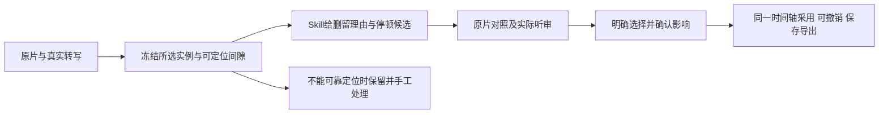

# T-1062 单条原片粗剪与停顿采用合同

本合同落实已评审 T-1062 的有限粗剪验收，不替换 T-850/T-1046 的工程、执行任务或原生文档真相。2026-10-05 用户已授权类似 ChatCut 的粗剪、Skill 集成及逐功能验证；新增精剪模板、自动发布和真实资料合并不在范围。当前为独立评审修订稿（首次 CONCERNS 的源时钟、冻结组/父范围、无可播放音轨三项已修订；待复核），未据此改产品代码。

## 用户要完成什么

一条口播原片中，用户希望选出表达完整的录次，删掉明确口误与废弃试讲，适当缩短长停顿；原片仍保留，候选先解释原因，用户对照后选择采用，再在同一时间轴继续手工剪辑、撤销、保存与导出。

现有逐词/整句目标继续沿真实 ASR 时间码；只有全文时给整片段或待复核建议，不能按字符猜切点。参考的 1.13 倍属于个人编辑选择，不成为默认粗剪策略。本合同只补齐相邻真实词句之间的停顿候选，不新增第二套编辑器、执行账本、音频分析或自动裁剪系统。



## 版本与历史兼容

- `productionRoughCutCreateBody` 新增可选 `protocolVersion: 3`。未提供时保留现有协议 2 路径及原请求 fingerprint/冻结输入字节；新界面明确提交 3，不偷偷改变旧客户端请求的含义。
- 协议 3 的 reservation 冻结 `roughProtocolVersion: 3` 与 `pauseGaps`；原任务输入仍只引用 reservation 的 project/output/request/digest，不接受客户端工程或模型构造的源范围。协议 3 同时冻结 `workspaceScope: {userId,groupId,groupVersion,accountId:null|string,membershipVersion:null|number}` 与真实 `{projectId,contentOutputId,parentGroupId}`：accountId 仅可选真实出处；仅存在真实账号时冻结其真实 membershipVersion，空组不得制造账号或成员版本。预约创建在同一事务中按 group→parent→必要 membership 的稳定锁顺序验证并冻结；这些字段及父 ID 进入新输入摘要。恢复、认领、模型回读、结算、候选查询和采用只能使用原冻结 scope，与唯一 execution/AI task 冻结 stamp 精确对账，不能按当前页面或当前账号成员关系重造。结算按原冻结任务身份保留原回执，不把账号转组当作重算既有费用的理由；新的采用/文件副作用重核当下组和父归属，资料移动后的历史采用仅沿原已评审的显式 rebind 路径。归档组保留历史读取及既有调用结算，拒绝新预约和新采用。旧协议 2 的原 bytes/digest 保留，通过独立来源映射适配确定的历史 scope，无法证明则明确升级复核，不放宽成跨组访问。实际 schema/冻结对象按版本显式分支；旧对象不能补默认新字段后重新计算原 digest。
- 公开 suggestion union 向后兼容读取旧 `clip` / `tokens` / `unlocated_text`。仅协议 3 的真实 reservation 可产生或采用 `pause_gap`；协议 2 或原回执重放仍按原解码、校验、结算、touch digest 与 receipt 规则运行。旧终态无需重新执行模型。
- 新版本 digest 必须覆盖完整原生视觉真相、source/transcript 证据、所选实例、冻结 gap 和候选目标。不能改写历史账本、旧 frozenInputDigest、原 storageKey 或任务 ID 来消冲突。

## 可定位间隙由后端提供

`pauseGaps` 每项冻结以下字段：

| 字段 | 含义及检查 |
| --- | --- |
| `gapId` | 由后端对下列身份与范围的规范化字节生成稳定内容摘要；不是模型造 ID |
| `clipId, sourceId, transcriptId` | 真实所选实例与同一不可变 source / transcript |
| `leftTokenId, rightTokenId` | 同一 verified timed transcript 中时间顺序相邻的两个真实 token |
| `sourceStartTicks, sourceEndTicks` | 严格等于左 token.end 与右 token.start，正区间完整落在冻结 clip.trim 内 |
| `sourceTimebase: {num,den}` | 沿现有真实 source 的有理 timebase，两项均为正安全整数，不压缩为整数频率 |
| `gapDigest` | 覆盖身份、tokens、原 timingReceipt/source proof、范围及 timebase 的 SHA256 |

这是确定性时间与身份映射，不是创作判断。仅同一 source、verified word/segment、同一原生 scene 主轨、1 倍速且无局部动画/effect/mask 的基础视频实例可以提供可采用间隙。真实 gap 起点、终点及候选裁切点都必须按 `ticks * num * 120000 / den` 的有理式精确映射到原生 ticks；可用 BigInt 机械核整除与安全整数，不作舍入、不假设 num=1，也不把 num/den 倒数压成整数。相邻 ASR token 的空白不证明无声，也不证明没有未识别语音。

源开头/结尾无 token 的停顿、token 内停顿、仅全文、时钟证据不足、多 chunk 未验证映射、变速或丰富片段不得构造假的 gap。保留原片和已有合法整片段/词句建议，提示对应范围需手工听审；不能因一个局部目标不支持而阻断整个粗剪、保存或导出。重复使用同一媒体的不同实例分别绑定，不跨实例采用。

## 模型只提出候选

新增目标：

```ts
{
  kind: 'pause_gap',
  clipId: string,
  transcriptId: string,
  gapId: string,
  retainedTicks: number // 源 timebase tick 单位中的非负安全整数
}
```

模型仅选择冻结的 gapId；不能自报 start/end、生成空 token、改写真实 token、返回要直接落库的原生轨道。`0 <= retainedTicks < sourceEndTicks - sourceStartTicks`，且 `sourceStartTicks + retainedTicks` 精确落原生格点。机械规则固定为保留间隙前端 `[start,start+retainedTicks)`，删除后端 `[start+retainedTicks,end)`；界面须显示两段实际时间范围和预期缩短量，不用“约”掩盖精度。

所有 pause_gap suggestion 的 `decision` 必须为 `review`；不承认仅凭转写的自动 remove。`reason` 说明缩短目的，`uncertainty` 说明需听审的语气/呼吸/未识别声音。普通 tokens/clip 保留现有 keep/remove/review 语义。语义由可配置 `production.rough-cut` Skill 与模型决定，不引入固定停顿阈值、口头禅词表、相似度选最佳录次或代码评分。

Skill 方法：先理解全段和用户目标；优先保留意思完整、衔接自然的表达。废弃试讲、口误后的重新表达和无意义重复可提出删留；强调、呼吸、必要连接、自然补充不能因重复或稿外就删。权威稿用于理解而非强迫逐字一致；不把不同未完成录次拼成用户未说过的完整句。不确定保留并说明需复核位置。本链只有文字及真实时间证据时不得声称模型已听过音频。

## 对照与明确采用

- 查询结果保留现有 actionability，并新增 `requires_audio_review`，仅用于 mechanically valid、尚未采用的协议 3 pause_gap review 候选。非法 ID / 时钟、变速、局部丰富效果等继续是 review_only/non_actionable/needs_regeneration；不得用一个“允许复核”开关绕过所有限制。
- 用户可以从候选就地播放真实原片间隙及左右上下文、核对保留/删除窗与缩短量。播放器必须引用已授权 exact 原片，文件失效时不得用假播放或假成功；采用按钮保持不可用并给恢复动作。沿现有组件和油 UI 规范设计，对照不另造独立工程。
- 仅来源具真实音轨且 exact 音频可播放时才返回 `requires_audio_review`；无音轨、文件缺失或解码不可用时保持 `review_only`，解释原因及手工处理/重新导入入口，不制造成功播放回执。每个可采用 gap 提供未勾选的“已听审，确认缩短这段停顿”确认项；界面仅在真实播放器完成至少一次该范围播放后允许勾选。播放或勾选后若 source/gap/实例/revision 改变，确认清除。播放器完成不证明人已经听懂，因此回执只记录用户声明，不宣称自动证明内容无声。
- `productionRoughCutAdoptBody` 新增可选 `pauseGapConfirmation: { entries: [{suggestionId,gapDigest}], acknowledgement: 'reviewed_audio_and_ranges' }`。entries 唯一，必须精确等于本次选中的 pause_gap 集合（混合选择只确认 gap 子集）；没有 gap 时不得提交不相关确认。后端校验其身份与当前不可变证据，但不把客户端播放标记当授权来源。缺确认返回明确 `PAUSE_AUDIO_REVIEW_REQUIRED`，零写入；机械失效或影响变化沿 typed409。
- 现有 `nativeImpactConfirmation` 仍必须确认本次所选全集及完整 sceneDigest；新增 gap 声明不能代替独立叠层/音频/字幕影响确认。界面明确主轨闭合，独立项保持绝对位置，不声称自动重定时。
- adopt 服务只在原 requires_audio_review + 合法 pause_gap + 精确用户确认时开放此一类采用；普通 review 候选不会变成可采用。事务内按原服务端 root/group/parent 锁核当前权限、归档、CAS、真实 source 与 transcript、所选 union、gap 摘要及完整影响，模型和客户端均不能越过这些检查。
- 删除窗从冻结 gap 唯一派生；与其他合法删除窗取 union、主轨 ripple、其余 scene 保留。沿原 native apply-tracks 完整前后 digest、单 Command、Undo/Redo、unknown ACK 原 requestId 重放和持久 receipt；不得二次 ripple、采用后新造请求重放或保存 v2 影子工程。冲突保留用户选择和原片，提供刷新对照/重新生成，不能吞错为成功。

## 拒绝、降级与实测

| 输入族 | 必须观察到的行为 |
| --- | --- |
| 无有效 timing、超界/重叠 provider 单位、非整数时钟 | 全文/手工复核，不猜 gap；其它合法创作继续可用 |
| 不存在 gap、非相邻 token、跨实例/source/transcript、trim 裁掉部分、摘要变化 | 不可采用或 typed409，零工程/账本写入 |
| retainedTicks 负/小数/越界、native 格点不可表达或空删除窗 | 拒绝该候选，不 round，不撤掉其它合法建议 |
| 变速/局部动画/effect/mask、原片首尾/token 内停顿 | review_only/明确手工路径，保留既有编辑保存导出 |
| 场景/轨道/来源变化、未确认所选 union/独立项、未声明听审 | 原 typed409 或 PAUSE_AUDIO_REVIEW_REQUIRED；不能新 request 隐式重试 |
| 呼吸、强调、未识别语音、不完整重录 | Skill 保留/待复核；不能用“无词”硬判删除或拼新句 |

必要验证必须绑定候选提交：合同旧请求/回执 digest 重放与 v3 拒绝族；真实公开 ASR 返回及原 PCM 时间映射；单条真实原片局部口误/完整重录/相邻长停顿分别产生可听候选；用户明确采用到真实原生时间轴、混合建议 union、同媒体重复实例隔离、撤销重做、保存刷新、实际 MP4 视听回读。真实 ASR 仍只有全文或不合格时间码时记具体缺口，不以夹具词级测试代替供应商或安装版通过。

独立合同评审须检查旧 strict schema 与 digest 兼容、停顿并非静音、权限与依赖闭包、六类拒绝、整体合法任务降级，以及是否仍沿同一执行/结算/原生采用链。评审通过后记录 DEC 与 source SHA 再串行实现；本合同不代替用户对安装包的功能验收。
