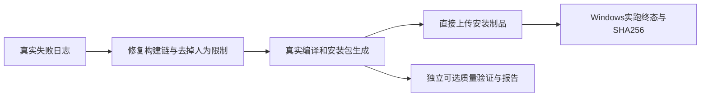

# T-1063 双端出包流水线解除阻断并重跑 Windows

用户2026-10-06明确要求：上个“1.12版本”Windows流水线失败；检查并去掉增加的超时及检查限制，以把包打出来为重点，Windows和Mac采用同一原则，修改后重新跑Windows。独立于T-1062本地客户端整合，不消费其lease，不修改其工作树或真实用户数据。

## 范围与授权

依据当前GitHub运行、精确SHA和原始日志确认失败，版本名称未核清不得猜测为1.1.2。只修改官方workflow及必要的构建脚本，移除人为构建超时、性能/大小/数量上限和额外验收对制品生成、上传的阻断。额外验证可独立选择运行、如实上传报告，不依赖其PASS交付实际已生成的安装包。编译/链接/资源组装错误及不存在文件仍真实失败；不改账号授权、激活、数据安全运行时规则或绕过真实签名，不伪造制品或验收。

用户已明确要求修改流水线与重跑Windows，按已有授权判断必要远端动作；未授权新增版本、tag、公开Release、生产更新或真实用户放量。本任务不合并T-1062产品候选。原技能禁止修改workflow的默认要求已被此次明确修复指示覆盖。

## 验收

1. 保存真实失败run/job/step、首个错误及版本证据；无法确定用户指向时注明。
2. Windows与Mac共用产包原则：无项目自设构建timeout，独立验证不会阻止已有安装制品上传；GitHub宿主硬上限如实注明。
3. 盘点workflow调用脚本的timeout、gate和失败传播；结构/脚本相关测试、diff检查通过。
4. 用提交SHA运行Windows，等待真实终态；下载非空setup.exe，记录版本、体积、SHA256及run链接。失败就保留日志并修授权范围内根因。
5. Mac只证明改动与结构检查；未实跑不得标签名/公证/安装验证PASS。Windows未签名如实注明，不代签用户功能验收。
6. 运行pmem sync、reconcile与必要边界检查；既有全局失败记录根因任务，不伪报全绿。

