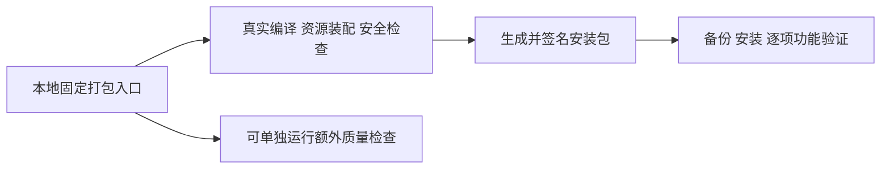

# T-1067：本地客户端先生成安装包，额外验证单独执行

## 用户授权与问题

用户2026-10-06明确要求取消双端出包的人为超时和额外阻断检查，重点生成安装包；Windows流水线已另开用户会话处理，本会话继续新的本地客户端打包及逐功能验证。原“1.12”由该会话用户澄清为1.2.0。本任务落实本地既定原则，不以T-1062的流程复审授权代替push权限，不扩其六源粗剪/账号组合同。

当前本地固定入口 package-local → package → build-sidecar 不经过远端 release/build-frontend。仅改workflow不会影响本地。现有5秒Node版本探测、20秒HyperFrames和30秒TLS探测、分层Worker30秒可误杀慢机；类型、课程、混淆后启动与媒体/运行时探针作为额外质量验证仍阻断产包。它们需要与产物生成分开，真实未运行如实记录。

## 必须产生的行为

保持 `pnpm -C frontend desktop:package-local`，默认显式 `CREATOROS_PACKAGE_BUILD_ONLY=1`；用户设置0可运行原额外验证。类型验收仅在desktop且build-only启用时从Next产包流程分离，普通Web不改。继续真实Next/Worker编译、运行时和Chromium/SDK/Codex/CLI闭包装配、混淆/字节码、Tauri构建、实际签名/公证及资源文件核验。删除上述探针人为deadline，保留真实错误处理。安装收尾观察5秒不影响DMG已生成，本次使用 `CREATOROS_LOCAL_SKIP_INSTALL=1`，先保留DMG，备份后另行安装验证。

build-only下课程/运行时import/启动/TLS/签名回放和质量报告不运行，validation记录not-run，不能算PASS。保留真实secret/bypass扫描、Verdict密钥、Node25版本条件、Worker包内路径和依赖闭包校验、SDK平台/CPU/版本识别、Codex alias/CLI原实现。HTTP错误、空缓存/空下载和缺必需资源仍报真实失败，不造工具或绕过激活。只把10MB任意大小门与启动探针移出产包。远端child跳过安全扫描/Worker闭包两处不带入本地。

## 精确8路径和隔离

以下为唯一产品写集；不整提交或治理文档cherry-pick（child T-1063与主同号字面路径任务冲突）。当前HEAD9615f124b9a45056568ec6c8aed92388dbfff870，三方草案报告采用此前6bb，当前8文件原字节未变，应用前再次核对。

|路径|before SHA256|候选 SHA256|
|---|---|---|
|frontend/next.config.ts|460a815ff21dc257ce8dda4e9963180b75b33cd8d85b0cd84b3fcf0c94be18f7|402337e866b36ef7d82edd141c6e265c4b08a64c619c2f04e2931cdfd9bb6ee7|
|frontend/scripts/desktop/build-sidecar.mjs|aca1c2313f3295eafcad580cd9e16dd612828d73232ad168595e9a1999c1a570|9d5e435795b23a4c2c3ec57984baa9b40f110ce054729a9fd8b4f526df17df05|
|frontend/scripts/desktop/package.mjs|128b19fe3f8e4e362ae31382dd5c3329d2f1e2aa838b1159a611d70cf57d32f6|af7f00cc5dca6b9e7e7bdaae5e347670d7010e3af30144dad7b3c81768e410bb|
|frontend/scripts/desktop/node-runtime.mjs|a6973a539a184065c7cc07c6c1f437575a041e6112ff804c20bac88416affcc5|980d1c2881c50cc0f04337295aac68c7a5a94ad4fc2fa5de9b1fe401bb1aebf0|
|frontend/scripts/desktop/fetch-ffmpeg.mjs|397085003d8db4331dc9cc9f7658a48cc626d3b6df3660f20820d5808b8d2b5d|14d86a849a53886c066eb461f8089b8f07386c259aa326ad82dd32da9f6fc6cb|
|frontend/scripts/desktop/package-local.mjs|70c2084ac81751f3f3f2aeb5e2da72a0706aef4ca480e1092a01a4991d07aa26|a24193b83f19f7217421838d1128e4156b2b4ccb7725da0732f021d0de2b7881|
|frontend/scripts/desktop/package-local.test.mjs|11186e1734b72b8795f2a5fbef52220d49594c3d69a482011ac071af10816115|7fb699dafb1488e22a06b44c21a01519e3faab60a24df81a07b53a1935255129|
|frontend/scripts/desktop/execution-worker-runtime.mjs|13f1973f504a9f4badd1f1f0ce7d68677136e802718ced7f4ae418262fb5cc43|fc2b920b1d2e2c99e256af00893993a7dbcd054b81958181e4d2d135c2653895|

来源 child d514e90d8f314e8958bea6d67f2e364d9a8b497e，仅做逐段移植。固定 local patch d4e454dd7ab48f270540b445d874fb027c1679189649e28b3cfde53b68987586 和 shared patch d9487bbd8f21d3ffbeeed22873e801c9409bb731e6c3878faad15aef224115d0 在私有持久目录 `/Users/zyongzhu/CreatorOS-local-acceptance/t1062-20261005-wm9zxxwl/t1062-mac-pipeline-readonly-admission-_z7wuwq0`。草案apply-check/语法通过只是静态事实，原测试/实际构建尚未运行。

与T-1062同物理树改动必须顺序进行：先完成其原18与候选提交，再按本任务精确8路径重新领取或使用独立worktree；修改modules config前释放旧lease。T-1062 module592/owned587/source801/protected214原数量及其全套18命令不扩，`next.config.ts`在其保护快照中，本任务必须在T-1062验收/候选提交之后写入；其他7路径不在其源码快照。本任务单独验证这8路径，不把其改变混入旧795/801证据。应用后新的最终出包commit绑定两个任务及真实测试结果。

## 必须实际验证及关闭

先独立评审完整SPEC和精确patch、安全/资源/默认开关与不可损失边界，再开始代码。实际运行package-local、node-runtime、fetch-ffmpeg、build-sidecar/Worker闭包与CLI/Codex、安全扫描对应已有回归，以及技能要求的package-local/desktop-release-workflow/notarize/tauri-signing-config四文件；核对原断言未删、额外验证显式0仍可选、空资源/版本/包外路径/凭证错误仍拒绝、移除超时没有改生产运行时任务。有关现有失败须保留原日志并判定真实原因，不签旧child107tests为本地PASS。

完成根任务已批准的原18后冻结干净已提交代码，实际运行固定本地入口，保留DMG、SHA、镜像/签名核验及日志。之后当前用户App和数据离线完整备份、安装与逐功能验收继续由T-1062执行。包已生成不能被后续额外验证回收；失败保留产物并明确未通过项目。不得新增版本/tag/Release/远端push，不关闭用户待验项。

本任务代码关闭证据为精确8路径commit和上述当场测试/边界检查；T-1062包/安装验收由根任务记录，不要求先改其SPEC或另求用户重复确认。状态一律taskctl，sync/reconcile保留真实既有全局失败。

## 初轮问题 REV-001 的约束落实（同8路径）

实际已记录 cycle1round1 为 CONCERNS[REV:03a44833887f]，保留原事件和major初稿；审查者随后升级blocker的追加报告另留，不能把第一次历史改写为FAIL。原fixed patch显式BUNDLE_SRC接受空工具确有反例。本次限定原8路径中，fetch显式两工具均要求非空普通文件；sidecar复制后的两工具再次校验非空普通文件，不恢复启动deadline。既有package-local.test追加真实公共解析函数的中性空文件/目录/非空文件回归，不删任何既有断言。

新完整8路径patch SHA256 0daae7c7c932b21689942291f76907e1d2f58d81eb858417997dd1a48fbb88be，TMP及私有持久目录 `/var/folders/0f/yn6rgq1j2lj2n8_868n28jzc0000gn/T/t1066-empty-resource-fix-f4d08wne` 与 `/Users/zyongzhu/CreatorOS-local-acceptance/t1062-20261005-wm9zxxwl/t1066-empty-resource-fix-f4d08wne`。旧两patch和完整报告保留来源，不作为当前待apply候选。实际对公共ensureFfmpegStatic/ensureFfprobeStatic以build-only1及0、空文件/目录/非空文件运行12个中性组合：旧patch真实exit1反例保留，新patch真实exit0；当前八路径git apply --check0。该结果仅证明资源解析边界，不冒充实际sidecar装配、全部包装测试、DMG或安装通过；sidecar复制后验证仍需正式打包实际发生。产品仓源码尚未应用，独评及正常准入后才执行。

## 独立任务编号澄清

实际并行用户会话在本地补充评审之后也登记了T-1066全系统超时修复。本分支旧T-1066按taskctl暂存为同号历史，原两轮事件/CONCERNS/PASS和旧SPEC完整保留，不改写或声称另一会话任务完成。本地固定8路径补充现在使用T-1067；行为、固定patch、测试和执行先后均不变，新编号完整规格需独立初审后正常start，绝不复用旧task_id的review receipt。原T-1062同六及原18验收不变。
