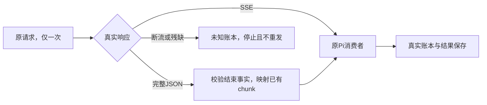

# T-1069 完整 Chat Completion JSON 兼容修复

## 用户结果与授权

用户2026-10-07在T-1068隔离复现后明确要求「修复根治一下」。完整供应商结果不再被流式读取误判为未知；真正断流保留未知状态和原调用，不重发。该授权覆盖T-1069/T-1070的源码修复、隔离验收及本地提交，不涉及安装、发布或改真实数据。决定见DEC-T1069-1070。

## FR与契约

FR-1069-01：既有openai_chat协议支持同一次请求返回完整非流式Chat Completion JSON，原有SSE继续使用。只转换成功响应且Content-Type为application/json或其+json族；响应必须有chat.completion对象、唯一index=0 choice、assistant message以及明确支持的finish_reason。正文、reasoning、function tool_calls、usage和responseId按实际字段无损映射。多choice、未知结束码、错误对象、损坏/残缺JSON、缺结束事实或工具参数损坏均不制造成功。

FR-1069-02：复用Pi 0.80.7及仓库已有patchedDependencies，在Pi OpenAI Chat适配器网络接收处将已完成JSON映射为既有chunk消费格式；不增加供应商调用、不全局替换fetch、不修改node_modules作为唯一交付。不改Anthropic/Responses、模型语义、账本与服务权限，不新增数据库/操作/角色/runtime。取消与原任务deadline原样传递，HTTP401/429/503明确拒绝分类和usage来源保持真实。

## AC与验证

AC-1069-01：T-1068实际Worker→Pi→本机HTTP→持久账本→任务终态链上，完整JSON只有一次请求，调用settled、候选保存、任务succeeded；同一正常SSE结果保持成功。

AC-1069-02：完整JSON文本、reasoning及多工具调用/参数、token/cache/reasoning usage、length/content_filter终止语义均有实际HTTP公共模型入口回归；截断JSON、缺finish_reason、错误对象、未知结束码、非assistant或非法工具形状保持未知而不能保存成功。原401/429/503和两种断流对照仍通过，未知任务不能再次claim。

AC-1069-03：先运行预期成功但当前失败的RED，再改补丁到GREEN；实际安装依赖必须消费与锁文件匹配的补丁，并从干净临时目录重新应用补丁/核对差异。运行ai-worker类型、相关模型/账本/协议测试、boundary/orphan与timeout防复发门；全局既有失败如实保留。

## 实现边界与图

写集：patches/@earendil-works__pi-ai@0.80.7.patch、pnpm-lock.yaml（仅补丁hash及其依赖身份）、ai-worker/src/runtime/pi-provider-json-compat.test.ts、backend/src/modules/execution/radar-model-result-unknown.repro.test.ts、本SPEC/评审与docs/verification/t1069/**；项目治理文件只更新本任务登记、DEC、LED与门。供应商能力依据：本机Pi/OpenAI SDK源码及[官方Chat Completion协议](https://developers.openai.com/api/reference/typescript/resources/chat/subresources/completions/methods/create)。

原未知任务不自动恢复或改写；源码验收不冒充用户原任务归因或安装版已生效。
