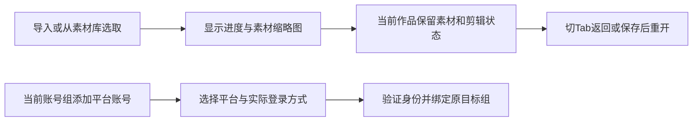

# T-1069 安装版素材导入、选择与跨Tab恢复及多平台绑定入口

用户2026-10-06在当前1.2.0安装版验收中报告：素材导入特别慢；素材库选择呈长文件名下拉，难以挑选；切换作品Tab后已导入素材丢失；当前账号组看不到小红书等其他平台扫码按钮。用户要求排查、重新设计和修复，属于T-1062验收继续，不以启动恢复代替完成。

## 事实与范围

用户提供两张实际安装版截图作为基线：剪辑工具上方为原生长select，OpenCut素材区已有视频缩略图；账号组页面主要展示能力表，新增绑定位于下方。源码初查：VideoReferenceWorkbench的素材入库/插入保存在组件ref与原生frame，load从持久化工程读取，尚未证明素材物理丢失；listAssets固定首100条和原生select。账号组bindingCapabilities只声明抖音，而同一装配文件另有小红书local-platform绑定与登录档案链，不能直接断言小红书未接入。精确根因待实际分段证据及独立审查，不把截图当请求/性能测量。

## 已授权验收目标

1. 以中性夹具复现导入，分别记录文件读取/上传/持久化/浏览器媒体解析与缩略图/桥接/素材可操作时间；合法大素材保持可用，进度、失败重试可见，不删安全或归属检查换速度。禁止读取或改写用户激活凭据、删除真实素材。
2. 用户补充第三张模板真人照片选择截图，明确同类素材选择器组件整体重设计。应共用选择器覆盖剪辑媒体和模板本人照片入口，图片以实际缩略图识别，视频显示缩略图和真实时长，音频可预听；名称仅作辅助，不凭文件名假推断人像。筛选支持真实资产类型/搜索/分页，照片角色由用户选择，不自动挑脸或改归属。保持原版丰富紫色工具界面、复用现有tokens/组件；使用oil-ui-pro和账号组UI_RULES，将素材选择改成支持缩略图、名称、类型筛选、搜索、选中及明确加入动作的可操作界面；独立视觉与任务走查，不能做假按钮。
3. 明确素材导入成功、工程保存与未保存修改的状态；同作品切Tab往返保留素材与时间轴，进行中请求不写入别的作品/账号组；已确认成功素材/引用可恢复，未知结果按原幂等意图核对，不重复导入；保存刷新及跨组隔离实测。具体持久化方案须在根因确认后补充并独立评审。
4. 当前账号组用清楚的“添加平台账号”入口，显示实际支持的扫码/登录与登记区别；复用已经实现的小红书真实身份登录链，扫码结果绑定开始时冻结的目标账号组，取消/失败不造假连接，不迁移/自动归组真实其他账号。快手/视频号/公众号按真实能力展示，范围包含入口和已装配能力连通，不将未接入的平台伪装可扫码。
5. 修复后真实安装版逐项复验，再按官方入口打包，保持启动直连修复。用户参与扫码或实际发布之前不代操作确认；不push/tag/Release/公开发布。

## 当前阶段及实现边界

当前仅登记需求及只读调查，未修改产品代码、未声称性能/丢失根因或UI方向已确认。后续在本SPEC补齐精确写集、公开调用链、保存语义、失败恢复和frontend journey contract，独立评审通过后再实施；不另建计划替代本SPEC。截图保持私有基线，验收使用中性素材和真实调用回执。

## 只读核因结果（尚非安装版复现或性能测量）

- 文件上传及materialLink成功后，剪辑媒体ref和时间轴仍为组件/原生内存；原生800ms自动保存只写内存Map，正式工程由手动saveProductionEditor写入。Tab实际路由卸载会清理会话，恢复旧正式稿。不能据此声称素材文件被物理删除。
- 制作页outputId在查询参数，projectWorkspaces只接pathname、从路径第4段解析；同项目多视频B往返可能落到第一条A，须同时修作品身份保持。
- 当前媒体处理逐项解析/缩略图/上传，整批结束后才加入素材列表；素材库加入和已保存工程重开会完整下载媒体。导入慢的实际成本尚待计时，不承诺未经测量的加速数值。原注册60秒超时只停止等待且未传到底层导入，可能出现未知结果；原合法成功链不能因新增质量规则被整单阻断。
- 多平台来源已装配，但组能力表和组扫码阶段只接抖音；旧beginBind不冻结group也不建成员，旧列表会造独立legacy组。复用既有持久accounts.bind任务平台字段/原执行权与组committer，不直接搬旧按钮，不新增自动转组。
- 已有CanvasAssetPicker可复用图库核心；模板选中预览不传fileId，无法读预览。模板输入/转画布同版回查也需一起补，不能只改缩略图声明身份冻结完成。
- 已有backend字面素材搜索/keyset分页及作用域cursor，尚无公共assets.search端点；推荐复用此服务添加公共搜索和可选类型过滤，不另加第二套列表搜索体系。

建议保留整个同作品VideoReferenceWorkbench活会话于稳定project layout，在其他Tab隐藏、暂停音频/RAF/快捷键，返回不自动播放、不自动覆盖正式稿；只允许一个原生EditorCore，真正换owner前核对原未知保存/采用回执或备份。此方案及全库选择/多平台事务细节须补精确写集、合同、旅程并独评后实施，当前仍只读。

私有调查依据位于本地验收根t1069-picker-design/DESIGN.md、t1069-binding-diagnosis/REPORT.md及media_import_tab_diagnosis实际只读回报；三张用户截图保留t1069-user-baseline/baseline.json，来源明确为用户提供，非root当前自动截屏。

## 实施合同与验收锚

本任务为一个完整安装版修复，不按优先级或小版本拆掉用户已确认范围。用户2026-10-06再次确认慢的是视频导入，未提供文件大小和实际等待时间；以中性视频实际计时，不把源码推测写成提速结果。实现由主会话单写共享产品，辅助调查与独评不写控制面。保持当前已正常运行的安装版，候选包先使用 `CREATOROS_LOCAL_SKIP_INSTALL=1` 生成，不能在用户有未保存稿时自动关闭客户端。

### FR-1069-BIND：组内平台登录

使用现有持久 `accounts.bind.start/status/cancel`、唯一 `execution_tasks` 和账号组事务。平台、groupId、expectedGroupVersion、idempotencyKey 在开始时冻结。小红书与快手仅注册已经装配的真实登录 stage，抖音保持原默认 stage；没有 stage 的平台保留人工登记入口和明确原因，不显示扫码按钮。登录页面由用户完成扫码/验证，读取真实平台稳定身份，不能按昵称造账号或自动搬已有账号。

内部 stage registry 为 `localStages?: Partial<Record<'xiaohongshu'|'kuaishou',AccountBindingStagePort>>`；payload.platform 决定执行和恢复的 stage，未装配时禁止回落到抖音。checkpoint 在 finalizing 前保存 externalAccountId，cleanupPending 时保留它。泛化现 PreparedPlan/committer 的 platform，默认 douyin 兼容；登录得到的 proof 只在内部传递。复用现 collection service 的同事务 `commitVerifiedBinding`：先校验真实 account/user/platform/identity 与原采集 adapter/scopes，再写现有 collection_bindings；它没有公开 endpoint。

同一租约事务中依次执行稳定身份并发锁、组/version/取消守卫、账号和成员建立或同组重连、采集授权、profile 准备/采用、checkpoint 和 succeeded。授权必须在搬 profile 前完成；后续失败沿原 receipt 回滚 profile 与事务。成功后的采集沿原平台分派和 runId 派生幂等请求，采集失败提示但不把已绑定账号反转为失败。已在其他组/已归档/无原成员证明的身份冲突，保留原目录和账号，不自动转组。

沿现 browser-profile authority 追加两个真实本地平台根：正式目录不变，为 `<localRoot>/<platform>/<sha256(userId)>/accounts/<sha256(externalAccountId)>`；新 run staging 为同父目录 `_staging-<16hex(userId,runId)>`，复用现 marker/backup/rollback。路径只能由真实任务或账号派生；恢复依据原 checkpoint.externalAccountId，不能接受前端或 marker 自称的 target。host lifecycle 内部可选 domain，默认 douyin.com 不变。登录及采集使用同一 lifecycle checkout；signal、onStopped 必须传至真实浏览器。close 失败交接原 retryStop 能力，discard 确认停止前不能删目录或确认 cancelled；失败保留 cleanupPending，重启沿原 host stopped 证明恢复，不引入第二套后台清理系统。

不新增数据库迁移/表：payload/checkpoint 已是 JSONB，账号/成员/collection_bindings 所需字段已有。旧 direct beginBind、旧身份哈希正式目录和原采集/发布合同保持可用，不修改无消费者 BindAccountDialog。

AC-1069-BIND：真实组入口可选择抖音/小红书/快手；开始后切组不改原目标，晚到状态不写当前组。同组重复稳定身份重连、其他组拒绝、旧目录保留；取消实际停止、close 失败保留材料、恢复原 run；事务失败不留下半账号/半授权/已搬 profile；绑定成功后采集失败仍显示已绑定。组件/公开 service 集成回归与实际用户登录验收分别记录，fixture 不冒充真实扫码。

绑定闭包（11 个已有源码，无新平台业务系统）：

- `frontend/src/features/platform-account/account-group-manager.tsx`
- `frontend/src/features/platform-account/account-binding-panel.tsx`
- `frontend/src/server/persistence-client.ts`
- `backend/src/modules/platform-account/account-binding.service.ts`
- `backend/src/modules/platform-account/account-binding-commit.ts`
- `backend/src/modules/platform-account/browser-profile-authority.service.ts`
- `backend/src/modules/platform-collection/platform-collection.service.ts`
- `backend/src/modules/execution/host-browser-profile-lifecycle.ts`
- `frontend/src/server/ingestion/account-binding-stage.ts`
- `ai-worker/src/runtime/platform/xhs-browser-source.ts`
- `ai-worker/src/runtime/platform/kuaishou-browser-source.ts`

对应已有测试：account-group-manager.test.tsx、account-binding-panel.test.tsx、account-binding.integration.test.ts、account-binding-commit.integration.test.ts、account-binding-stage.integration.test.ts、local-platform-binding.persistence-client.test.ts、platform-bind.integration.test.ts、host-browser-profile-lifecycle.test.ts；按实际 worker 原测试扩展 signal/停止证据。

### FR-1069-PICKER：统一视觉选择器

设计方向继承已确认原版，不进行全页风格探索。主对象是素材画面，名称只辅助：14–16px 两行名称、完整名称详情、真实类型和已知尺寸/时长；未知不编数字。当前选中项呈缩略图字段；打开本地 Dialog 后为图库、搜索/类型筛选、单份预览与固定确认区。单击卡片只选临时候选，确认才改变原字段；关闭/Esc不改原字段，确认失败保持过滤/候选/错误，焦点返回。gallery 的原拖入/直接插入保留原动作，无默认选第一项。Mandatory照片不给清空；可选参考双字段一同清除。预览是辅助：缺缩略图或预览失败不得禁止原本合法的项目/库存素材选择，也不得换成别的素材。

公共 `searchAssets`：`GET /assets/search`，id `assets.search`，通过既有 dispatch/typed client，普通 response `{items:AssetResource[],nextCursor:string|null}`（不使用 isList）；query 为 strict `{query: string默认'',limit:整数1..100默认24,cursor?:string|null最长2048,assetTypes?:非空AssetType[]最多5项}`。query trim 后最长500；名称字面匹配，不判断内容语义。assetTypes排序去重：照片为image、剪辑为image/video/audio、画布为image/video。无类型继续原3字段cursor摘要；有类型以 `['typed-assets-search-v1',userId,workspaceKey,query,sortedTypes]` 绑定，改变查询/类型/属主拒旧游标。复用现 AssetsService.searchAssets/searchAssetLibrary/repository 的 active+workspaceReadableGate+字面转义ILIKE+keyset SQL(limit+1)，transport批量读取本页file元数据。没有total则不声称全库总数。

注册仅修改 assetsOperations、CLI READ_OPERATIONS、assets.transport 的 ASSET_OP_IDS/case；现 ENDPOINTS/typed client/application owner map/dispatch/根装配自动注册，保留精确registry穷尽断言。旧 assets.list 与现 material.search 无类型调用不变。不增加数据库表、搜索系统、poster服务或第二套预览服务。

共用叶子：`asset-picker.types.ts` 定义 `MediaChoice<T>={choiceKey,value:T,identity:ExactMediaIdentity|null,unavailableReason?}`，ExactMediaIdentity包含assetId/assetFileId/name/type和nullable真实元数据；业务payload泛型原样传回，组件不改写mediaId、CAS或候选身份。source为library（allowedTypes+map）或bounded（父级items/loading/error/completeness/hasMore/onLoadMore/onRetry）；ownerKey冻结scope+作品/节点/槽/候选目标，source.key绑定候选域。library用唯一 `use-asset-picker-source` 调公共search，bounded仅过滤原合法范围；partial库存明确搜索“已加载”，保留原loadMore。不得拿全库充当项目/工程/决策清单。

`asset-media-preview.tsx`提取现 MediaPreview 为唯一精确文件URL读取叶子，支持image/video/audio及thumbnail/preview/active；旧画布预览继续复用。保存style checksum核验保留。图库近可见才读图片/视频metadata，不批量全量下载Blob；视频首帧读取成本须实测，不能声称preload=metadata必然廉价。用户开启预览才播放，一次一份，关闭/换scope停止、撤销Blob URL。预览请求身份包含scope+assetId+fileId+checksum，迟到回写拒绝。全库新选择必须确切file；bounded旧v1或B-roll只保存assetId的合法合同仍可选择，视觉核对当前file不冒充旧引用已冻结版本。不可用是原领域判定，不能仅因为预览失败添加hard-fail。

`asset-identity.tsx`和`asset-picker.tsx`复用Button/Input/Dialog、Lucide及现gallery/IntersectionObserver；field和gallery共享卡片。scope/owner变化立即关闭旧弹窗并废弃临时选择，确认在途仍遵循原业务意图核对，不假称已撤销写请求。查询限制单在途，以专用workspace取消旧请求，不取消父业务workspace；每次回写核operation.assertCurrent、owner/source/query epoch。

13个现有入口（以下均在 `frontend/src/features/`）：

| 源文件 | 来源与确认动作（原业务边界保留） |
| --- | --- |
| reference-editors/video-reference-workbench.tsx | 全库三类媒体；冻结file和output，确认后原读取/关联/insert-media，不凭最新列表替换file。 |
| creative-canvas/canvas-template-library.tsx | 全库图片；本人照片/可选参考，选择只改表单，不自动生成或收藏。 |
| creative-canvas/infinite-canvas-node.tsx | 全库图片；冻结node，patch referenceAssetId+referenceFileId，同清；mode/生成门不变。 |
| creative-canvas/canvas-editor.tsx | inspector同node原docRef，冻结node与双字段；不造第二value。 |
| creative-canvas/canvas-asset-picker.tsx | 全库图片/视频gallery，薄adapter；保留画布拖入和首页目的地流程。 |
| projects/graphic-post-workbench.tsx | 全库图片；exact去重+项目link+当前draft追加，仍手动保存。 |
| projects/graphic-series-panel.tsx | 全库图片；冻结card，仅替该页file，其他页/统一参考/用途不变。 |
| projects/moments-workbench.tsx | 全库图片；原配图顺序/exact去重/link+draft追加，仍手动保存。 |
| projects/work-materials-panel.tsx | bounded项目exact文件含原explicit external历史file；选择只定fileKey，原采用/替换/解除继续持slot/member/source/association/CAS，不直接attach。 |
| reference-editors/native-source-panel.tsx | bounded当前工程mediaRefs；以mediaId区分实例，选择仅setMediaId，原prepare/adopt请求和addWholeClip:false保持。 |
| production/production-visual-editor.tsx | bounded原项目MaterialLinks；冻结time/output，仅插入原v1 `{file:assetId}`，不扩全库。 |
| production/production-editor-fields.tsx | 同项目bounded；冻结selected item，仅patch原file字符串，时间/动效等不变。 |
| production/video-decision-preview.tsx | bounded原inventory；冻结候选id/scene/B-roll行，原manualAssignment仅改该行；旧缺项保留原恢复/移除，不触发模型。 |

模板精确照片全链：TemplatePlanInput增加referenceFileId?，新选择双字段，旧asset-only历史输入允许原服务提交时冻结。模板choose优先同模板remembered/file，再原保存identity/content引用；新选择预览、navigate/onRemember/onInsert/收藏均传相同file。createTemplatePlan写每个generation node；CanvasHomeTransfer保存回查及前端重试/GroupTaskView/旧设置提示增加显式file比较；backend creative-canvas恢复未提交预约同样核当前node显式file是否等于原冻结taskInput，不等提示新生成，已经taskId只回读原任务。旧未指定file的正常恢复保持兼容，不因新质量规则阻断合法旧任务；旧style checksum/角色不去掉。

AC-1069-PICKER：公共typed client→dispatch→application→transport→service→SQL实测超过135条、后页目标、混合类型、同时间ID顺序、字面%_\\、pending/deleted隐藏、组隔离、cursor/query/type作用域及无类型兼容；取消/失败不改原选中项、单预览不中断合法确认、scope/race/键盘焦点。模板同asset异file经预览→记忆→收藏回读→node→HomeTransfer→原生成恢复保持身份。13入口逐个旅程，保存类写后读，项目/工程/inventory不越界。

视觉验收为1366×900、1024窄窗和200%实际画面；长名/同名不同图、空/加载/局部预览失败、视频/音频与固定确认区；独立视觉评审与操作走查分别取证。当前用户截图是基线，不等于新UI已渲染。

### FR-1069-SESSION：同作品活会话与离开保护

已存在的稳定 ShellRouter 在 WorkspaceInitializationBoundary 外挂唯一 ProjectVideoSessionHost；项目 layout 保留原路由 DraftChatRequestProvider，不再挂 Host。Host 的冻结 owner 子树使用独立 DraftChatRequestProvider，当前路由隐藏的制作页不挂重复 StageChatRail；它有稳定routeOutlet/sessionOutlet，整个ProductionEditorSession（含VideoReferenceWorkbench所有refs）由host持有。未访问制作不启动引擎；同owner注册只更新展示，绝不重读/重挂工程。StageChatWrapper改固定父子结构；reference/original模式也用稳定outlet切换。hidden/inert/aria-hidden只控制显示，不销毁会话。一个文档只运行一个OpenCut singleton；不得多output同时mount。

ProductionEditorEntry变轻量注册器，仍用原SSR已校验production props；token只撤销自身注册，不销毁原session。owner={groupId,accountId(group模式null),projectId,outputId}；sourceVersionId仍首次挂载基准，不随保存revision变化。不同output成为pending target，原实例暂停保留；先核对离开决定及await dispose完成，再接新实例。旧scope/取消/过期token不得加载或回写新owner。

projectWorkspaces新增已验证selectedVideoOutputId，ShellRouter核当前query.outputId与最小session导航快照，且校验scope/project/真实workOutputs/video类型。registry只存owner/selectedOutput/generation与离开控制口，不放File/草稿/native handle/第二项目事实。冷启动B的制作链接不退A；B隐藏时维持视频B导航。脚本/文章/图文/复盘仍为真实路由。

控制口只提供readLeaveState、saveForLeave、recoverOriginalReceipt、exportLocalBackup；dirty/inFlight/pendingSave/Apply/Export/Import/conflict一起核对。原CAS/requestId/冻结body和native Replay回执保留。save ACK后比较live；保存中完成导入仍dirty。409保留本地稿，未知沿原意图核对，不能以导航造新保存或采纳。backup明确为plan/refs/baseRevision/未知请求身份，非全媒体归档；尚未入库的原File需提供独立原文件下载，不伪称磁盘保存已核验。

同项目换output注册门、现usePrimaryNavigation.navigate与AccountSwitcher写group之前复用同一leave dialog：保存后继续（仅clean无pending/inFlight）、备份后明确放弃本地修改、继续当前编辑。未知先可恢复原回执；未经选择不自动保存/下载/放弃。外部storage已经改组时禁以新scope保存旧稿，提示回原组或备份放弃。项目host不宣称拦截所有跨项目SPA/历史导航；beforeunload只作实际未保存提醒，不承诺跨App/刷新/崩溃恢复。本任务不加全局路由系统或多作品草稿库。

本地bridge update增加visible?默认true，mount依赖不包含它。hidden暂停真实playback、停止preview RAF、拒快捷键和新交互；inert=!visible||disabled||exportLocked，重新显示不自动续播，也不解除锁。可见性不推进document epoch、不清memory/Undo/导入/采纳回执；已有文档命令按原队列完成，视图暂停与队列协调。隐藏时原owner已开始的导入/保存/导出可结束，真正换owner沿原signal取消并记录未知；await NativeLifetime.drain/DocumentLease释放后才能新mount。

AC-1069-SESSION：视频A/B冷启动B→导入未保存并编辑→原模式/脚本/文章/图文/复盘往返B；mount1/load首次、DOM/refs/轨道/Undo/dirty不变，正式revision不增加。hidden无音频/RAF/快捷键，返回不播放。保存中导入/409/ACK丢失、原apply回执恢复（真实native命令一次且Undo保留）、真正换output与受控切组的三种离开行为、单引擎释放顺序、旧scope迟到拒绝、保存后刷新读回分别验证。

### FR-1069-IMPORT：视频可用性与实际性能

原native60秒注册等待只reject但上传继续，不把它直接改成虚假取消。importMedia增加本地signal及阶段事件，传真实operation.signal/底层fetch；外层合法执行预算沿项目原公共超时策略（不能少于执行等待下限），用户取消即时。超时/断连保留该File、稳定mediaId、原uploadId与create/PUT/complete/link阶段receipt；completeUpload同uploadId恢复，link沿原backend幂等，不重开整条上传或生成重复素材。没有确认create响应且无恢复查询时明确结果未知，不能声称幂等证明存在。

上传intent属于冻结owner，重试沿原intent，不能换组后以新scope执行。PUT已确认成功则不重复；PUT ACK未知可对同storageKey重试同bytes，不新增upload。complete/link后mediaRef立即记录；native插入错误保留入库成功状态，重试仅insert同mediaId。dirty应在导入开始与成功/修改时更新；保存snapshot冻结后晚到导入仍dirty。媒体存储/正式工程状态明确区分，单项坏文件保留其他合法成功项，不整批失败。

native processing每文件完成即通知原asset manager加入并可用，不等整批；进度由真实阶段/byte计数形成，未知总量不编百分比。视频解析先取得必要类型/尺寸/时长与可解码状态，缩略图改可选异步/按需，不作为入库硬门；缺poster用类型/名字+可点预览，不造缩略图。重新打开保存工程可按精确file恢复预览；同Tab保留原File，不重新全量下载。实际单视频分段与三视频首项可操作两个区分实验，记录输入字节/时长/冷热/原版本/新版本、parse/thumb/create/PUT/complete/link/first usable，只有实测才能报告提速数字。

AC-1069-IMPORT：原超过60秒慢成功公共桥链→新合法预算内成功；阶段/逐项可用、单坏项降级、cancel真实signal、create ACK未知/PUT未知/complete ACK丢失/link失败/insert失败原intent恢复、晚到scope隔离及保存中导入。原正常大视频/图片/音频链保留；不靠删除真实素材、清历史、移除owner检查或整体超时门获得速度。

## 精确实现与验证写集

以下是本任务允许触及的产品源码和生成物闭包；原生源码在私有对应源根重建，归档内成员仅限列出的成员，不只改bundle。控制面由root通过正式工具单写；若实现确需新增范围，先补SPEC并独评，不用目录通配符放宽。

### 产品源码

- `contract/src/operations/assets.ts`
- `contract/src/cli-policy.ts`
- `backend/src/modules/assets/assets.transport.ts`
- `backend/src/modules/assets/asset-search.ts`
- `backend/src/modules/assets/assets.repository.ts`
- `backend/src/modules/creative-canvas/creative-canvas.service.ts`
- `frontend/src/components/media/asset-picker.types.ts`
- `frontend/src/components/media/asset-identity.tsx`
- `frontend/src/components/media/asset-media-preview.tsx`
- `frontend/src/components/media/use-asset-picker-source.ts`
- `frontend/src/components/media/asset-picker.tsx`
- `frontend/src/features/reference-editors/video-reference-workbench.tsx`
- `frontend/src/features/reference-editors/native-source-panel.tsx`
- `frontend/src/features/reference-editors/reference-editor-media.ts`
- `frontend/src/features/reference-editors/native-editor-contract.ts`
- `frontend/src/features/reference-editors/native-editor-surface.tsx`
- `frontend/src/features/reference-editors/project-video-session-host.tsx`
- `frontend/src/features/reference-editors/project-video-session-registry.ts`
- `frontend/src/features/creative-canvas/canvas-template-library.tsx`
- `frontend/src/features/creative-canvas/infinite-canvas-node.tsx`
- `frontend/src/features/creative-canvas/canvas-editor.tsx`
- `frontend/src/features/creative-canvas/canvas-asset-picker.tsx`
- `frontend/src/features/creative-canvas/creative-workspace-home.tsx`
- `frontend/src/features/creative-canvas/canvas-template-plan.ts`
- `frontend/src/features/creative-canvas/canvas-home-transfer.ts`
- `frontend/src/features/creative-canvas/canvas-visual-groups.tsx`
- `frontend/src/features/projects/graphic-post-workbench.tsx`
- `frontend/src/features/projects/graphic-series-panel.tsx`
- `frontend/src/features/projects/moments-workbench.tsx`
- `frontend/src/features/projects/work-materials-panel.tsx`
- `frontend/src/features/projects/project-workspaces.ts`
- `frontend/src/features/production/production-visual-editor.tsx`
- `frontend/src/features/production/production-editor-fields.tsx`
- `frontend/src/features/production/video-decision-preview.tsx`
- `frontend/src/features/production/production-editor-entry.tsx`
- `frontend/src/app/(creator)/shell-router.tsx`
- `frontend/src/app/(creator)/projects/[projectId]/layout.tsx`
- `frontend/src/app/(creator)/projects/[projectId]/stage-chat-wrapper.tsx`
- `frontend/src/components/shell/use-primary-navigation.ts`
- `frontend/src/components/shell/account-switcher.tsx`
- `frontend/src/features/platform-account/account-group-manager.tsx`
- `frontend/src/features/platform-account/account-binding-panel.tsx`
- `frontend/src/server/persistence-client.ts`
- `frontend/src/server/ingestion/account-binding-stage.ts`
- `backend/src/modules/platform-account/account-binding.service.ts`
- `backend/src/modules/platform-account/account-binding-commit.ts`
- `backend/src/modules/platform-account/browser-profile-authority.service.ts`
- `backend/src/modules/platform-collection/platform-collection.service.ts`
- `backend/src/modules/execution/host-browser-profile-lifecycle.ts`
- `ai-worker/src/runtime/platform/xhs-browser-source.ts`
- `ai-worker/src/runtime/platform/kuaishou-browser-source.ts`

### 行为验证

- `backend/src/modules/assets/asset-search.test.ts`
- `backend/src/modules/assets/assets.contract.test.ts`
- `contract/tests/registry.test.ts`
- `contract/tests/cli-policy.test.ts`
- `contract/tests/client.test.ts`
- `frontend/src/components/media/asset-picker.test.tsx`
- `frontend/src/components/media/asset-media-preview.test.tsx`
- `frontend/src/components/media/use-asset-picker-source.test.tsx`
- `frontend/src/features/reference-editors/video-reference-workbench.test.tsx`
- `frontend/src/features/reference-editors/native-source-panel.test.tsx`
- `frontend/src/features/reference-editors/reference-editor-media.test.ts`
- `frontend/src/features/reference-editors/native-editor-surface.test.tsx`
- `frontend/src/features/reference-editors/project-video-session-host.test.tsx`
- `frontend/src/features/reference-editors/project-video-session-registry.test.ts`
- `frontend/src/features/creative-canvas/canvas-template-library.test.tsx`
- `frontend/src/features/creative-canvas/canvas-template-plan.test.ts`
- `frontend/src/features/creative-canvas/canvas-home-transfer.test.ts`
- `frontend/src/features/creative-canvas/canvas-editor.test.tsx`
- `frontend/src/features/creative-canvas/infinite-canvas-node-reference.test.tsx`
- `frontend/src/features/creative-canvas/private-style-preview.test.tsx`
- `frontend/src/features/creative-canvas/canvas-material-picker.test.tsx`
- `frontend/src/features/projects/graphic-post-workbench.test.tsx`
- `frontend/src/features/projects/graphic-series-panel.test.tsx`
- `frontend/src/features/projects/moments-workbench.test.tsx`
- `frontend/src/features/projects/work-materials-panel.test.tsx`
- `frontend/src/features/projects/project-workspaces.test.ts`
- `frontend/src/features/production/production-editor-entry.test.tsx`
- `frontend/src/features/production/video-decision-preview.test.tsx`
- `frontend/src/components/shell/use-primary-navigation.test.tsx`
- `frontend/src/components/shell/account-switcher.test.tsx`
- `frontend/src/app/(creator)/shell-router.test.ts`
- `frontend/src/features/platform-account/account-group-manager.test.tsx`
- `frontend/src/features/platform-account/account-binding-panel.test.tsx`
- `frontend/src/server/ingestion/account-binding-stage.integration.test.ts`
- `frontend/src/server/__module_integration__/local-platform-binding.persistence-client.test.ts`
- `backend/src/modules/platform-account/account-binding.integration.test.ts`
- `backend/src/modules/platform-account/account-binding-commit.integration.test.ts`
- `backend/src/modules/platform-collection/platform-bind.integration.test.ts`
- `backend/src/modules/execution/host-browser-profile-lifecycle.test.ts`
- `backend/src/modules/creative-canvas/creative-canvas-series-reference.test.ts`
- `ai-worker/src/runtime/platform/xhs-browser-source.test.ts`
- `ai-worker/src/runtime/platform/kuaishou-browser-source.test.ts`
- `frontend/tests/e2e/t1069-media-tab-session.spec.ts`
- `frontend/tests/e2e/t1069-asset-picker.spec.ts`

### 原生生成交付与验证说明

- `reference-editors/opencut-classic/native/native-source.tar.gz`
- `reference-editors/opencut-classic/native/native-from-t1046.patch`
- `reference-editors/opencut-classic/native/SOURCE_CHANGES.json`
- `reference-editors/opencut-classic/native/DELIVERY.json`
- `reference-editors/opencut-classic/native/SHA256SUMS`
- `reference-editors/opencut-classic/native/VERIFICATION.md`
- `frontend/public/reference-editors/opencut-classic/native/native.js`
- `frontend/public/reference-editors/opencut-classic/native/native.css`
- `frontend/public/reference-editors/opencut-classic/native/NATIVE_BUILD_GRAPH.json`
- `frontend/public/reference-editors/opencut-classic/native/LICENSE.opencut`
- `frontend/public/reference-editors/opencut-classic/native/THIRD_PARTY_LICENSES.json`
- `frontend/public/reference-editors/opencut-classic/native/THIRD_PARTY_LICENSES.txt`
- `frontend/public/reference-editors/opencut-classic/native/effects/preview.jpg`
- `frontend/public/reference-editors/sources/opencut-classic/native-source.tar.gz`
- `frontend/public/reference-editors/sources/opencut-classic/native-from-t1046.patch`
- `frontend/public/reference-editors/sources/opencut-classic/native-patches.diff`
- `docs/verification/t1069/installed-media-and-binding.md`

### 归档内唯一可改源码成员

- `apps/web/src/embedded/native-entry.tsx`
- `apps/web/src/embedded/native-host.ts`
- `apps/web/src/embedded/native-visibility.tsx`
- `apps/web/src/embedded/native-controller.ts`
- `apps/web/src/embedded/media-registration.ts`
- `apps/web/src/media/processing.ts`
- `apps/web/src/media/mediabunny.ts`
- `apps/web/src/services/storage/service.ts`
- `apps/web/src/components/editor/panels/assets/views/assets.tsx`
- `apps/web/src/preview/components/index.tsx`
- `apps/web/src/hooks/use-raf-loop.ts`
- `apps/web/src/embedded/__tests__/native-lifecycle.test.ts`
- `apps/web/src/embedded/__tests__/host-boundary.test.ts`
- `apps/web/src/embedded/__tests__/native-resources.test.ts`

## Gate与收尾

缺陷/业务/契约先真实RED再最小GREEN，UI探索不造红测；新typed client搜索、后端真实SQL与绑定事务、前端选择/owner/会话和真实native桥分别验证。运行 frontend/contract 类型与聚焦回归、native对应源类型/构建/生命周期/资源核验、LED-047/LED-053、boundary/orphan。实际公共旅程写后读、真实画面与独评先于安装版PASS；人参与扫码未发生就保持待验，安装不能依靠mock代签。原用户素材、其他验收task和T1068启动直连保持；不访问真实媒体根跑隔离测试。

重大任务收尾运行pmem sync与完整reconcile。当前已实测全局37错误/1告警属于待核欠债，不删检查或预签GREEN；新范围内失败必须修复，范围外旧红保留准确证据并登记原根因任务。准确源码/归档/bundle/冻结commit经官方打包入口出本地候选，保留启动核验和用户逐项验收，不push、tag或Release。

## 公共操作归属穷尽表补充（2026-10-06）

实际类型检查发现 `contract/src/workspace-operation-scope.ts` 对全部 EndpointId 做穷尽声明，新 `assets.search` 必须在该既有表中明确为 `group`，与 `assets.list` 相同，才能保持公开 CLI 的组归属校验及类型完整性。精确写集追加这一文件；不改变原 schema、鉴权、路由、默认组或其他操作归属。原公共注册测试与类型检查必须通过。此项为前述公开全库搜索的必要注册补充，无新增能力或数据归属变化。

## 稳定宿主复核补充（2026-10-07）

只读复核发现项目 layout 会随侧栏 Link、全局搜索和浏览器历史离开项目而销毁，beforeunload 无法保护 SPA 导航。因此前述宿主固定为已准入的 shell-router.tsx 内稳定组件（WorkspaceInitializationBoundary 外），不新增 creator/layout 写集；任意内部路由离开保留原会话，隐藏时原 native 暂停；重新进入制作必须同时匹配真实 pathname 项目 ID、outputId 与当前 scope，其他项目不能显示旧稿。同账号组先访问其他页面不代表放弃本地剪辑。下一次真正更换 owner 仍经原离开保护，保持单引擎。

Host 自持已校验注册 props 的 projectId/projectTitle；项目 route provider 和常驻 session provider 各自隔离，隐藏制作路由不渲染第二份 rail，常驻 session 不可见时也不挂 rail，避免重复自动发送。外部组切换后先提示回原范围核对，用户明确继续编辑才恢复冻结组/账号并在实际 scope 已匹配时 activate 新 reader epoch；原未知写请求保留原 requestId/body，不能沿新 owner 写旧稿。

恢复历史成功后明确采用原恢复回执，v3 工程安全 load 已恢复版本，旧模式继续原入口；仅无 dirty/inflight/未知意图时可恢复，不依赖切模式卸载隐式重读。新增回归覆盖直接 SPA Link 离开、浏览器历史、不同项目同 output 参数、初始化 boundary 切换、同 owner Tab、原范围返回与历史回读。精确源码集不扩展，全部在已准入 shell-router/project-layout/session-host/session-registry/entry/workbench/StageChatWrapper 内。此补充须独立复审后实施宿主迁移。

## 实际 Tab 丢稿根因与精确容器补充（2026-10-07）

变更 ID：`T1069-STABLE-SHELL-HOST`。实际隔离公共浏览器旅程已成功导入两个中性视频并把第一段加入时间轴；切“脚本”再返回，原 native root 的 `isConnected` 为 false。证据保存在本地验收根 `t1069-tests/media-tab-layout-red`，日志 `media-tab-public-name-edit.log`。不是文件删除或工程自动保存失败：`AppShell` 在 contentFill=true 使用直接 div，而 false 使用 PageScrollArea/div，切 Tab 改变该外层组件树，销毁了已实现的稳定 SessionHost。

在原全部精确写集和验收之外，仅追加：

- `frontend/src/components/shell/app-shell.tsx`
- `frontend/src/components/shell/app-shell.test.tsx`

始终使用同一个 PageScrollArea 和 app-page-content div，只切换滚动及尺寸 CSS。普通页保持原外层页面滚动；填满工作台让 viewport 和其直接包装层满高/min-h-0，禁止外层 viewport 滚动并隐藏其直接 scrollbar，让各栏继续原内部滚动。不得改共享 ScrollArea 实现，不改变路由、业务、归属或正式手工保存语义。

新增回归使用真实 PageScrollArea/ScrollArea 与有本地状态的 child，双向切换 contentFill 后 mount 数、DOM 身份和未保存状态保持；侧栏/header可隔离无关服务。原实际公共导入/时间轴/Tab返回/保存/刷新测试必须通过，不降低失败断言。普通页与填满页实际画面和滚动验证；现有13素材入口、组绑定、旧稿隔离、全部 Gate 和真实安装验收保持。用户刚才针对两文件及一个周期明确继续，绑定 DEC-106901；只用于本补充，不消耗第二次授权。
