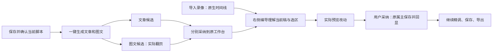

# T-1070：Codex执行、编导精调与文章图文联合创作

## 当前用户决定

2026-10-07用户报告Codex不能执行、右侧编导不能自然语言剪辑，要求参考ChatCut；明确清理快剪集成、快速转换等偏离正常创作的入口。随后用户实际答复：**“视频初稿这个初不了 这个不做 也不能自动生成 做个按钮吧 除视频外的一键生成 这个是没问题的 然后再去微调”**。

最终范围：脚本旁一个“一键生成文章和图文”主按钮；当前选择的引擎联合生成两份可编辑候选，实际预览后分别采纳，继续手动或右侧编导精调。视频只导入真实录像，通过手动精剪和编导自然语言编辑真实原生v3工程。不做自动视频、TTS、配音或视频根任务；不删除原作品/素材/历史，不push、发布或重置激活，不强关未保存客户端。已记DEC-T1070-EXCLUDE-AUTO-VIDEO。

## 阶段与服务边界

外部引擎基础修复已在5c444034提交，真实Codex隔离任务完成MCP工具读取与回复；它不代签本次新工具/UI/原生编辑。剩余实现先按本SPEC与[完整选定合同](t1070-director-script-workflow/CONTRACT.json)独立评审，之后进入BUILD。该JSON是本SPEC的严格详细附属合同，纳入同一次评审，不是另一个计划或候选方向。

维持contract→backend service ports→worker原任务的物理结构；frontend只消费真实操作与展示。execution_tasks/execution_calls/ai_messages是唯一任务/回执；原article、graphic和production owner保持唯一写端，无新表、迁移、task lane或全局registry。语义由当前配置Skill/模型判断；代码仅核ID、归属、类型、版本、时间、digest、幂等与用户明确采纳。

## 大白话流程与设计

沿用已确认丰富紫色工作台与现tokens/Button/Dialog/NoteRelay/OpenCut；使用oil-ui-pro 0.10.0和账号组UI_RULES。脚本、文章、图文、视频共享project:<id>编导会话；右栏展示真实作品与选区，不另挂第二聊天。候选卡显示对象、差异、预览和采纳状态；正常、等待保存、排版/渲染、可预览、冲突、失败、未知、已保存但未同步分别表达。窄窗可打开同一个编导，键盘/200%可读；长内容按需展开。

文章/图文转换入口从主操作区移除；独立“AI辅助粗剪”等收敛到右侧编导，原原片/时间线精调/历史/许可/合法导出保留。纯文字图文由真实NoteRelay排成页图；没有生成插画时不得声称AI图片已生成。候选独立只读实例允许翻页、PNG/ZIP，禁布局回写；不能disabled/inert掉预览。

## 共同读取、候选、采纳合同

1. 扩现DraftChatRequestProvider局部端口，注册token guarded unregister，稳定方法读refs。发送前捕获registration，等待原保存/原UNKNOWN恢复，owner读回，最终核本地draft/generation/native contextEpoch未变化。新严格路径单次预算至少120秒，等待结束保留原请求，不套旧4秒尽力flush或10秒strict路径。脚本端口取得该编辑器保存的真实artifactId/versionId/内容深等，首次ensure后的ID也保留；不能调用自动read()猜主稿。当前按钮点击就是用户对该保存版本的实际确认，reconstructed来源也可明确当场确认，但不伪称先前确认。
2. 默认用稳定clientRequestId经原workCompositions.create与members.create(article/image)明确新建两成员，读回原预约及完整revision；中途未知恢复同一组合/成员请求，不能再建一套。只支持明确选中的既有组合复用，不强归并旧作品。creationTarget冻结composition/revision、显式scriptSourceRef与两owner实际baseVersion。
3. 四个短host工具：work.creation.read=none、work.creation.propose=proposal、work.editor.read=none、work.editor.propose=proposal。只在验证对应target后提供，原冻结definitions/version/effect/lease/fence继续核；Codex safeNames仅加入这四个精确ID。无owner写入/模型子调用/任务提交。正式源、当前版本和exact媒体均执行时经backend原ports重读，篡改或漂移返回明确冲突。
4. 联合创作是同一个原copilot.assist聊天任务，所选Pi/Codex调用Skill联合产articleDocument和graphicPostDocument。原executionCalls与aiMessage.parts保存完整typed候选，无新候选表；已settled结果刷新可读，UNKNOWN/断流读原任务，不自动重发付费生成。
5. 编辑默认typed_patch，宿主机械合成完整owned候选，保护未改正文、图、layout、sourceRefs、其它页/scene/settings/sources。精确UTF16 range不能拆surrogate或重叠；native用固定原生120000 ticks与真实媒体时长，不让代码做创作删留。可选小稿typed_snapshot仍受相同真实base/ID/来源保护。原read支持selection/index/document/field_window，有明确scope/hasMore；不把机械索引当内容总结。
6. 仅四个新工具lossless结果跳过旧60k字符串裁剪，原有限owner/context预算继续；原ledger完整回执与模型展示窗口分开。现tool.result.read补兼容external identity/providerResult+outcome/resultText，严格同lease/execution/parent回合，按原toolCallId/offset回读，不另存文件/registry。原其它工具仍守裁剪预算。
7. 文章/图文采纳调用原createArticleVersion/createGraphicPostVersion，明确expectedCurrentVersionId与稳定原toolCall/member/contentDigest请求，源引用保真。各owner独立CAS，一成功一失败不回滚成功；丢响应以同一body/key恢复。exact/current读回后，仍匹配registration/generation且手工稿未变才同步当前编辑器；否则标“已保存，当前稿有新修改”保留手工稿。不得伪造旧articleCandidate lineage。
8. 原production.applyEditor新增replaceNativeSceneTracks v3 edit分支，机械核expectedBeforeDigest、唯一元素/轨ID、真实media exact目录；经原commit事务/CAS/checkReferenceMedia/原request回执写入，保持其它scene/metadata/nativeSources/transcripts。旧v1/v2路径及旧丰富v3手工save/export不因新候选validator失败。AI候选的新改字段对照固定v31 schema；未改扩展原样保留。
9. 原生新增preview-scene只渲frozen候选tracks/project/mediaAssets/duration为真实MP4 Blob，核targetscene/epoch/digest，沿原export lock；不load/setScenes/command/save，不取消合法import。忙时先完成或恢复原操作。owner CAS成功后原acceptVersion/apply-tracks→实际context readback，才显示已采用到时间轴；保原undo/manual继续编辑。保存成功但native响应未知分态，原回执恢复不二次apply。
10. 指定图卡文字/visualBrief编辑不改真实cardId或混用NoteRelay pageIndex。换页图先采用文字到新base，再走原image_card真实生成/预览/adoptResult，失败保文案与旧图；当前一次文章图文联合生成本身不额外启动AI配图。

原生合同固定documentVersion31/sourceRevision cf5e79e919144200294fb9fed22a222592a0aeea；实际轨/元素/动画/effect/mask schema和详细DTO见附属JSON。新纯contract文件按真实消费者实现并字节复制到native source，新validator只作用编导变动，不全局收紧原save/export。归档重建用固定base+完整累计patch零差异复原、frozen install、真实类型/测试与两次构建hash核一致。生成bundle/manifest据真实文件核；新增chunk须先明列精确路径，不能目录通配或手改minified bundle。

## 实际故障与执行归属合同

安装日志2026-10-06T16:19:43.465Z、16:19:51.173Z记录两个外部聊天任务在`reserveExternalChatTurn`被HOST_PORT_REJECTED拒绝。公开execution.tasks.list核对原任务78db601b与eb44dcc7的accountId均为null、groupId均为grp_legacy_acct-ae1a8346-9；它们尚未进入Codex启动。外部服务仍使用`account_id = NULL`读取AI任务/会话。另一个独立缺陷是工具白名单写`video.edit`，实际装配ID为`video.edit.render`。

T1070-EXTERNAL-GROUP-OWNER：沿用execution lease的真实冻结用户、组与可空账号，不改变身份来源或数据库。两个外部服务所有AI任务/会话查询改用现有workspaceFilter；冻结modelInput的user/account/group须与lease三项严格相等（可空值只归一为null）。外部图片授权也核同一三项；回复提交时createAiRepository传原组与可空账号。不得新增初始组别名、自动转归或跨组兼容兜底。保留历史摘要、消息绑定、fence、外部原生回执、幂等调用、未知结果不重发与图片候选态。

T1070-EXTERNAL-TOOL-ID：白名单只把错误字面ID更正为`video.edit.render`。仍仅允许已冻结的短读取/提案host工具；版本、效果、真实执行器、批准与租约校验不降低。此修复只恢复已存在的旧方案剪辑工具，不表示原生v3编辑或三种作品生成已实现。

## 本任务必要验收与证据诚实性

当场TDD RED→GREEN覆盖：两target严格DTO；真实脚本保存读回/在途变稿；composition原请求恢复；四工具效应/版本/lease/owner；typed range/真实native时间和媒体；>60k原ledger+续读深等；文章/图文原CAS冲突/同参响应丢失；native只读预览/一次采用/undo/原UNKNOWN。测试实际源与夹具边界清楚，不伪造前置RED或实机PASS。

公共组合链用隔离PGlite+中性人工素材，env显式移除DATABASE_URL/PGLITE_DATA_DIR。实际submit→claim→host read/propose→settled ledger→完成消息parts刷新一致，Pi与真实Codex新工具各验收；modelConcurrency=1无子任务自等。原非空account与纯group、cross-group/假effect/version/取消/未知保回归。

真实页面：脚本按钮→共同来源两候选；文章实际预览/采用/精调/保存/刷新/HTML；图文空imageUses多页纯文字真实翻页、PNG解码尺寸、ZIP全页，与正式layout保存；视频当前v3自然语言字幕/trim/move/replace/speed，实际预览音视频→CAS采用→readback→undo/manual保存/切Tab刷新/MP4一致。换页图与旧v1/v2合法保存导出回归单列。不能以规划、正文、模拟供应商或单独helper代签完整新链。

UI留同视口基线和新图并实际查看，1366/1024/200%、键盘和焦点；依oil-ui-pro做独立现有界面评审和任务走查。执行相关contract/backend/frontend/e2e/type/boundary/orphan/semantic/LED-047/timeout-policy检查；全局旧失败如实保留，不把已知红删除成全绿。具体命令放modules.config和Task Packet，验收记录存docs/verification/t1070，日志与中性媒体可留本地验收根。

结束全部必要链后才taskctl complete并真实提交；pmem sync/reconcile保全局债事实。固定本地入口CREATOROS_LOCAL_SKIP_INSTALL=1 pnpm -C frontend desktop:package-local以冻结提交构建，核镜像/签名/资源；当前App未保存状态问题未回复，不替换运行客户端。新安装版逐项实测与用户最终签收不能代签。

## 精确写集（完整任务范围，独评后准入）

基础四路径已于5c444034实现，执行归属规则保持。以下新增准入无通配：

- `contract/src/resources/work-editor.ts`：统一目标DTO、精确read窗口、typed_patch/typed_snapshot输入与完整候选/应用描述；仅合同与机械类型
- `contract/src/resources/production-native-document.ts`：v31原生scene/track/element/params/animation/effect/mask机械schema；纯Zod可字节复制到原生source
- `contract/src/resources/production-editor.ts`：原productionEditorEdit新增replaceNativeSceneTracks；不增加保存或采用endpoint
- `contract/src/index.ts`：导出新增纯合同，现operations经原索引自动复用；导出新增 work-creation 资源；无新公共 operation
- `contract/src/chat-tool-labels.ts`：登记两个真实工具中文用途；不新增能力占位
- `backend/src/modules/production/production-native-editor.ts`：验证patch前值并重建单scene完整tracks；派生duration；保护其它scene/settings/sources并核真实媒体
- `backend/src/modules/production/production.service.ts`：原applyEditor补v3分支，经原editorFor.commit事务/CAS/checkReferenceMedia/原request回执保存
- `backend/src/modules/ai-runtime/work-editor-candidate.ts`：经既有三owner/assets读端口重读；精确read/前值校验/机械应用typed patch；输出完整候选与原owner调用描述
- `backend/src/modules/ai-runtime/chat-work-editor-tool-host.ts`：恢复原execution冻结hostContext与三维owner；两短none/proposal工具真实装配，定义版本与原lease一致
- `backend/src/modules/ai-runtime/chat-tools.ts`：read/propose完整schema和真实native executor；ALL_CHAT_TOOL_NAMES及project允许列表；绑定同target而非模型自报output；两个工具定义/native executor 与必要精确 allowlist；无任意写/任务
- `backend/src/modules/ai-runtime/chat-tool-definitions.ts`：精准登记work.editor.read=none、work.editor.propose=proposal及实际实现版本；none/proposal effects、稳定工具实现 revision，保持 host
- `backend/src/modules/ai-runtime/chat-tool-gate.ts`：四个精确工具的真实kind错误占位与lossless:true；仅四工具跳过60k字符串裁剪，保原其它工具预算
- `backend/src/modules/ai-runtime/chat-task-tool-host.ts`：原resolveTools组合新增同一editor host组；不增加任务/runtime
- `backend/src/modules/ai-runtime/chat-production-composition.ts`：同组合根注入原三owner/assets ports到editor host
- `backend/src/modules/ai-runtime/chat-assembly-types.ts`：准备期readEditorTarget服务端端口类型；准备仅读，不取得写/模型权限；新增 named creation read ports 类型；无模型/提交 port
- `backend/src/modules/ai-runtime/chat-assembly-tool-deps.ts`：把已核真实editorTarget带入工具定义，不由普通project selection猜目标；冻结 creation context 传到定义装配；只读准备
- `backend/src/modules/ai-runtime/chat-assembly.ts`：仅合法当前editorTarget暴露两工具；附精确范围/能力说明，旧无编辑器聊天不被阻断；只在 verified creationTarget 允许 read/propose，联合语义方法与宿主快照
- `backend/src/modules/ai-runtime/chat-turn-preparation.ts`：两个公开入口共用冻结前owner重读；旧DTOadditive；保存base漂移明确拒绝，不静默改基点
- `backend/src/modules/ai-runtime/chat-context.ts`：ChatContext additive editorTarget；用户意图/选区作不可信数据，基点由owner核验；ChatContext creationTarget 类型及明确用户入口
- `backend/src/modules/ai/chat-host-context.ts`：strict schema添加共享typed editorTarget，沿现digest/三维owner冻存；严格 creationTarget 宿主快照/digest
- `backend/src/modules/ai/external-task-tool.service.ts`：原safeNames精确加两真实工具；保原冻结版本/effect/native executor/lease/UNKNOWN；仅 safeNames 增加 work.creation.read/propose，其他 ACP 效果边界原样
- `backend/src/modules/ai-runtime/index.ts`：仅导出新组合根所需preparer/ports，不导出新写运行时；导出新增 host/port 类型
- `frontend/src/server/persistence-client.ts`：现ChatRuntime与composition root注入原Articles/GraphicPosts/Production/Assets服务；业务实现在backend；只组合 backend work-creation root + resolveTools；不把跨 owner 业务移到 frontend
- `frontend/src/server/prepare-chat-reply.ts`：两个公开聊天入口同准备端口；保原8k可用于小patch，禁止用截尾完整稿冒充候选；原Skill/模型配置不新增runtime
- `frontend/src/app/api/chat/route.ts`：parse additive editorTarget并携带同次send的冻结body；不接受客户端owner权限证明；传递/校验严格 creationTarget 与 stable message；不直接模型
- `frontend/src/features/draft-workbench/draft-chat-request.tsx`：现Provider新增token守护的当前编辑器窄端口与严格prepareEditorTurn；不用4s/10s放行；无全局registry；creationTarget 在当前稿面 request 中保真；原 strict flush
- `frontend/src/app/(creator)/projects/[projectId]/stage-chat-wrapper.tsx`：现右栏覆盖真实article与outputs/:id/image路由，并维持production/review；同Provider当前目标；窄屏有实际本地打开路径，单聊天实例
- `frontend/src/features/draft-workbench/draft-chat-rail.tsx`：project同会话persistKey，当前作品/选区chip与prepare/preview/adopt端口接AICopilotContent
- `frontend/src/features/copilot/ai-copilot-content.tsx`：Enter/按钮/autoSend/retry/卡内续改共用prepare；DTO直接冻结同次body；恢复原parts并渲新候选卡；creationTarget 发给原 chat；原工具结果渲卡，刷新恢复与 selected engine 保真
- `frontend/src/features/copilot/chat-work-editor-card.tsx`：实际字段差异/只读候选预览/原owner采纳与saved-not-synced/UNKNOWN恢复；仅展开时渲重资源
- `frontend/src/features/article/article-workbench.tsx`：section/field精确选区与当前owner端口；发送前原save；候选preview不setDraft，采纳createVersion/readback/state同步保手工稿
- `frontend/src/features/projects/graphic-post-workbench.tsx`：activeCardId/selectedCardIds与字段精确选区；完整doc保图/design；原createVersion稳定body/UNKNOWN与state同步
- `frontend/src/features/projects/graphic-post-results.tsx`：编导已采用新文字后按该base复用现image_card页任务及原list/get/adopt恢复；移除新创作旁路，保旧结果
- `frontend/src/features/reference-editors/noterelay/noterelay-editor.tsx`：新增只读候选模式复用现projection与隔离实例load；不改当前draft/owner，不用分页pageIndex猜cardId；无NoteRelay归档改动；readOnlyCandidate 允许 page/export，布局不回写
- `frontend/src/features/reference-editors/project-video-session-host.tsx`：将原VideoSessionIdentity显式传现入口；保挂载寿命/dirty guard/hidden session与原Provider
- `frontend/src/features/production/production-editor-entry.tsx`：原session identity透传VideoReferenceWorkbench；收敛新粗剪旁路入口但旧工程/来源/历史/导出可达
- `frontend/src/features/reference-editors/video-reference-workbench.tsx`：真实context/epoch/tick/selection端口；preview-scene；原applyProductionEditor→acceptVersion→apply-tracks；保pending/undo/UNKNOWN及手工精调
- `frontend/src/features/reference-editors/native-editor-contract.ts`：typed native context、preview-scene入参/Blob结果、owner/generation/epoch；沿现request方法不新消息总线
- `ai-worker/src/prompt/templates/chatbox-turn.ts`：现已注册chatbox.topic v2模板更新版本/工具方法：先read真实局部，模型产typed patch；明确候选与实际采纳；不写死语义
- `frontend/scripts/verify-native-editors.mjs`：核新纯native contract复制件与source/archive/manifest字节一致，沿现交付文件集/生产宏校验
- `contract/tests/work-editor.test.ts`：read窗口/selection DTO/typed patch/完整candidate与错误态；无假ID、局部字段范围和Unicode边界
- `contract/tests/production-native-document.test.ts`：真实v31类型、tick/rate/source/keyframe/媒体，旧丰富未改扩展保真
- `contract/tests/modules/production.test.ts`：原apply operation接v3 edit，旧v1/v2 schema合法族保留
- `backend/src/modules/ai-runtime/work-editor-candidate.test.ts`：局部patch机械重建完整candidate；多output/准确section/card/scene；前值与base漂移、完整图/design/settings/source保真
- `backend/src/modules/ai-runtime/chat-work-editor-tool-host.test.ts`：原execution/三维owner/真实name/effect/version；篡改/跨组/未装配拒绝
- `backend/src/modules/production/production-native-editor.integration.test.ts`：隔离PGlite公共applyEditor v3、CAS/receipt/history/read、字幕/trim/move/replace/speed与同request回放
- `backend/src/integration/chat-work-editor-worker.test.ts`：同chat submission→claim→host list/call→原ledger/parts→完整候选；Codex/Pi协议路径；>60k回读不丢正文/params
- `backend/src/modules/ai-runtime/chat-tool-gate.test.ts`：>60k有长正文/params/effects的候选lossless、digest同字节；其它工具预算不变
- `backend/src/modules/ai-runtime/chat-tool-definitions.test.ts`：两实际工具名/effect/version/参数完整登记
- `backend/src/modules/ai-runtime/chat-tools.test.ts`：同target局部读/patch工具真实装配和错误kind
- `backend/src/modules/ai-runtime/chat-assembly.test.ts`：有无editorTarget工具scope、原Skill装配与真实端口一致
- `backend/src/modules/ai/chat-turn-submission.service.test.ts`：editorTarget冻结/digest/账号组及旧context兼容
- `frontend/src/server/prepare-chat-reply.test.ts`：两个公开入口准备端口、局部patch不需全文输出、正确已注册Skill版本
- `frontend/src/features/draft-workbench/draft-chat-request.test.tsx`：token注销、generation/换output防旧回写、真实save超过10s仍不旧版发送、UNKNOWN原body保留
- `frontend/src/app/(creator)/projects/[projectId]/stage-chat-wrapper.test.tsx`：文章/图文/视频实际右栏、同项目会话、窄屏可打开且单实例
- `frontend/src/features/copilot/chat-work-editor-card.test.tsx`：preview无owner写、原adopt/readback、known冲突/UNKNOWN/saved-not-synced、折叠资源
- `frontend/src/features/copilot/ai-copilot-content.test.tsx`：所有send/retry/续改同冻结editorTarget，原parts恢复真实候选；原消息/tool parts 结果恢复与 creationTarget 请求保持
- `frontend/src/features/article/article-workbench-save-race.test.tsx`：采用完整doc保图/layout；保存期间手动新编辑不覆盖；稳定原request读回
- `frontend/src/features/projects/graphic-post-workbench.test.tsx`：指定card文字/visualBrief前值、完整图页/design保真及UNKNOWN恢复
- `frontend/src/features/projects/graphic-post-results.test.tsx`：新文字base→现页图generation→真实预览→原adopt，仅改目标图；失败保旧图/成功稿
- `frontend/src/features/reference-editors/noterelay/noterelay-editor.test.tsx`：候选隔离load/current draft不变、图片保真/分页与cardId不混用；只读候选真实翻页/导出调用，禁 layout 写回
- `frontend/src/features/reference-editors/video-reference-workbench.test.tsx`：preview不改稿、原apply-tracks/undo、保存成功尚未应用/UNKNOWN/旧手工新改动
- `frontend/src/features/reference-editors/project-video-session-host.test.tsx`：generation透传，切Tab不卸载旧工程或丢dirty/pending/原receipt
- `frontend/src/features/production/production-editor-entry.test.tsx`：session透传与删除旁路后旧工程/手工精调合法可达
- `frontend/tests/e2e/t1070-director-editor.spec.ts`：真实右栏当前target→模型候选→预览→用户采用→原编辑器→保存刷新导出；模拟协议不能代签真模型
- `frontend/public/reference-editors/sources/opencut-classic/native-source.tar.gz`：新对应源码完整归档，native源member写集固定
- `frontend/public/reference-editors/sources/opencut-classic/native-patches.diff`：现适配patch更新，manifest patch摘要同步
- `frontend/public/reference-editors/sources/opencut-classic/native-from-t1046.patch`：从固定base归档复原新source零差异的完整累计patch
- `frontend/public/reference-editors/opencut-classic/native/native.js`：真实源码经固定锁依赖构建的生产ESM，禁止手改minified JS
- `frontend/public/reference-editors/opencut-classic/native/native.css`：完整构建闭包CSS；hash未变不写diff
- `frontend/public/reference-editors/opencut-classic/native/NATIVE_BUILD_GRAPH.json`：新preview/schema实际保留模块图，排除旧bridge/全页入口
- `frontend/public/reference-editors/opencut-classic/native/THIRD_PARTY_LICENSES.json`：真实保留依赖逐项许可，hash未变不写diff
- `frontend/public/reference-editors/opencut-classic/native/THIRD_PARTY_LICENSES.txt`：真实保留依赖许可原文，hash未变不写diff
- `frontend/public/reference-editors/opencut-classic/native/LICENSE.opencut`：原OpenCut许可保留
- `frontend/public/reference-editors/opencut-classic/native/effects/preview.jpg`：现效果预览依赖保留，不另下载媒体
- `reference-editors/manifest.json`：精确source/patch/bundle文件集与摘要；新增chunk/asset先补精确写集，不目录通配符
- `backend/src/modules/ai/chat-host-context.service.ts`：原readToolResult兼容当前execution的external settled outcome+providerResult identity；同租约/冻结user-account-group与parent绑定，原Pi包装仍支持；不另建长结果存储
- `backend/src/modules/ai/chat-host-context.service.test.ts`：隔离PGlite原lease结果目录/翻窗：Pi包装与Codex external原identity/outcome >60k无损重拼、未知未结算不读、parent mismatch/跨任务/跨组拒绝
- `contract/src/resources/work-creation.ts`：严格 creationTarget + 联合 candidate typed schema；使用现 articleDocument/graphicPostDocument/projectScriptSourceRef
- `backend/src/application/generation/work-creation-root.ts`：同 backend/application 装配真实 composition/article/graphic/script 只读 ports 与冻结校验；不写正式稿、不建任务
- `backend/src/modules/ai-runtime/chat-tool-parameters.ts`：两个精确工具 schema 登记
- `backend/src/modules/ai-runtime/chat-work-creation-tool-host.ts`：经真实 lease/reader 重建 frozen context，复用 createChatHostToolAdapter，仅 read/propose
- `frontend/src/features/draft-workbench/creation-flow-ctas.tsx`：一个明确按钮，默认新建两成员或恢复既有原请求；保存确认后自动发原 chat
- `frontend/src/features/draft-workbench/work-creation-request.ts`：客户端稳定请求冻结/恢复 composition create 与两 member 原预约，真实脚本版本读回；无业务写
- `frontend/src/features/copilot/chat-work-creation-card.tsx`：联合候选卡、独立 NoteRelay 预览、两 owner 现 createVersion/同参恢复/冲突；导航实际 output
- `backend/src/application/generation/work-creation-root.test.ts`：隔离真实 service：共同 ref/member/owner、group/account、篡改与版本冲突
- `backend/src/modules/ai-runtime/chat-work-creation-tool-host.test.ts`：冻结 defs、host effect、真实 lease、结构与权限；无模型子任务
- `backend/src/modules/ai/work-creation-chat.integration.test.ts`：原 submit→claim→read/propose ledger→completion/message replay + 普通/外部工具 + unknown
- `frontend/src/features/draft-workbench/work-creation-request.test.ts`：stable default composition/member 原请求恢复、strict flush/version、点击重入
- `frontend/src/features/copilot/chat-work-creation-card.test.tsx`：两 owner 采用/响应丢失/一项冲突/来源保真/不写预览
- `frontend/src/features/script/script-rich-editor.tsx`：注册当前脚本精确 artifact/version 读回端口，保存完成后核当前HTML；不依自动脚本读取猜首项
- `frontend/src/features/script/script-rich-editor.test.tsx`：真实保存版本回执、在途改稿/卸载防回写
- `frontend/src/features/draft-workbench/creation-flow-ctas.test.tsx`：联合按钮真实save确认/原请求/错误保输入；保原素材入口

原生source内部精确8成员见附属JSONnative.native_source_member_write_set；其它source成员不改。正式控制面限本SPEC/附属合同、BACKLOG、DEC/Task Packet/modules/progress/events、实际review记录与docs/verification/t1070证据，不扩大产品写集。
