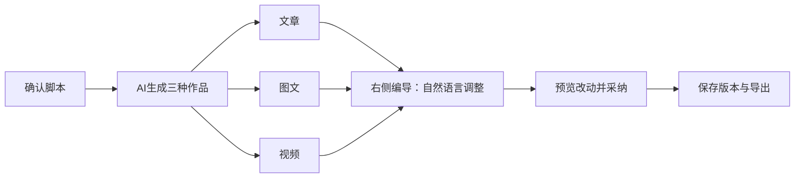

# T-1070：脚本驱动三种作品与可执行编导

## 用户已确认的方向

2026-10-07用户报告选择Codex执行引擎后不能执行，右侧AI编导不能通过自然语言剪辑。用户要求对照ChatCut，以同一确认脚本生成文章、图文和视频，再在各Tab精调或通过编导持续调整；删除偏离正常流程的快剪集成、快速转换等入口。

本次请求直接授权上述产品方向与可逆改动。它不授权删除原作品、原素材或历史版本，不授权发布、push、重置激活或强制关闭未保存工程。上轮本地包与手工导入/保存/导出证据不等于本次创作链路验收。

## 当前阶段与范围

PLAN：先读取现有研究、实际运行日志和前后端调用链，核对Codex运行、编导工具装配、脚本版本以及三种产物的保存/编辑/导出能力。只读盘点后补充准确服务契约、接口、精确文件范围、状态与独立评审；通过后才修改产品代码。

产品以既有账号组归属和现有execution_tasks执行权为真相，不引入第二数据库、第二任务系统或前端AI SDK。创作语义由可配置Skill/模型判断；代码只检查真实ID、归属、类型、版本、时间范围和落实用户采纳。AI只产生可查看候选，backend service负责正式保存。

## 用户可感知的流程

保持用户已认可的原版丰富紫色布局，按oil-ui-pro和账号组UI_RULES设计。右侧编导消费当前脚本、当前Tab、当前作品及选区真实上下文，操作效果必须在对应编辑器中可见；不可用能力提供真实原因和恢复操作，禁止假按钮或仅文字声称修改成功。

## 验收原则

- 从设置选择Codex到右侧编导真实提交、执行、工具调用、终态与结果回显形成可核验公共链路，记录实际失败点；模拟测试不得代签真实Codex执行。
- 一个确认脚本生成文章、图文和视频，三类作品保存、刷新、切Tab后可继续编辑；局部失败保留已成功结果并明确恢复，不整单吞掉。
- 自然语言能调整当前文章、指定图文页、视频时间线；展示实际候选与预览，用户采纳后保存/刷新/导出一致，保留原稿与原片。
- 覆盖Codex不可用/未登录、取消、冲突、账号组隔离、旧工程兼容与切Tab会话保留。删除快捷入口不破坏旧作品查看和导出。
- UI用真实截图与操作证据，安装包按固定本地入口构建并核验资源；未保存工程确认未解决前不关闭当前客户端。

## 实际故障与执行归属合同

安装日志2026-10-06T16:19:43.465Z、16:19:51.173Z记录两个外部聊天任务在`reserveExternalChatTurn`被HOST_PORT_REJECTED拒绝。公开execution.tasks.list核对原任务78db601b与eb44dcc7的accountId均为null、groupId均为grp_legacy_acct-ae1a8346-9；它们尚未进入Codex启动。外部服务仍使用`account_id = NULL`读取AI任务/会话。另一个独立缺陷是工具白名单写`video.edit`，实际装配ID为`video.edit.render`。

T1070-EXTERNAL-GROUP-OWNER：沿用execution lease的真实冻结用户、组与可空账号，不改变身份来源或数据库。两个外部服务所有AI任务/会话查询改用现有workspaceFilter；冻结modelInput的user/account/group须与lease三项严格相等（可空值只归一为null）。外部图片授权也核同一三项；回复提交时createAiRepository传原组与可空账号。不得新增初始组别名、自动转归或跨组兼容兜底。保留历史摘要、消息绑定、fence、外部原生回执、幂等调用、未知结果不重发与图片候选态。

T1070-EXTERNAL-TOOL-ID：白名单只把错误字面ID更正为`video.edit.render`。仍仅允许已冻结的短读取/提案host工具；版本、效果、真实执行器、批准与租约校验不降低。此修复只恢复已存在的旧方案剪辑工具，不表示原生v3编辑或三种作品生成已实现。

## 编导与三种作品的实现约束

下列为同一完整任务的后续必要工作，当前不以文字设计声称已经交付；其精确接口/写集仍须读现服务补全并独评，不能借本次执行归属修复的准入自由修改。

- 共同起点复用project_script不可变版本。发送前等待脚本编辑器flush并读回真实versionId；用户明确确认后才能绑定。派生output脚本不得被悄悄选为项目主稿，reconstructed来源不得冒充用户已确认。
- 复用work-compositions明确的文章/图文/视频成员和shared basis.sourceRefs；不按名称或列表首个把旧作品强行归并，不新增第二观点/事实表单或任务系统。
- 三项生成任务须冻结同一scriptSourceRef，并在候选及采纳后的来源中保真；独立成功/失败/取消/未知状态与稳定requestId可读回。单output creative bundle不能冒充跨三种作品批次。
- 图文要有实际页图，视频要有实际可预览/播放的工程与媒体。规划、正文和视频脚本不代签完整图文/视频；对已有页图准备、配音、媒体与渲染消费者补齐后再验收。
- 右侧编导在脚本、文章、图文、视频共享同一项目会话，冻结实际output/owner版本/选区，执行时经owner端口重读并校验。自然语言语义由模型/Skill判断；只准备可预览候选，用户采纳后由原属主CAS保存并读回，在原编辑器呈现实际变化。
- 原生v3不能再被当成旧renderProps损坏。扩当前真实工程读/候选/采用接口，保留native媒体exact引用、contextEpoch、未保存工程、未知应用回执及恢复/备份；不能通过卸载旧宿主实现UI清理。
- 删除三个工作台的“转成其他作品”主入口及新创作旁路。保留时间线手动精调与旧工程查看/历史/导出，不能仅因OpenCut技术名称就删除用户正常剪辑能力。将独立粗剪快捷面收敛到编导，仍保留对应真实原片能力。

## 当前精确准入与验收

本次独立评审只准入已确证的执行归属修复，四条产品/测试路径：

1. `backend/src/modules/ai/external-chat-turn.service.ts`
2. `backend/src/modules/ai/external-task-tool.service.ts`
3. `backend/src/modules/ai/external-group-chat.integration.test.ts`
4. `backend/src/modules/assets/generated-asset-candidate.service.ts`

T1070-GENERATED-RECEIPT-GROUP：当场新增测试的首次修复回归为18通过/1失败：组图片save/recover已经生成真实pending素材与文件，但settle经readCommittedGeneratedAssetFile进入旧readGeneratedAssetReceipt，仍强制accountId并使用旧账号键。只复用素材写端现有workspaceObjectIdentity的同源身份摘要（旧account值不变、group为既有group对象身份），pending commit/素材读与activate/discard均使用workspaceFilter；保留原调用键、原committed receipt深等、exact历史file/checksum/size/storageKey与pending状态检查。不能借空账号跳过组、改对象或激活图片。该同源helper还被现生成候选采用/拒绝消费，须一并覆盖纯组正确读取、跨组拒绝、已采纳素材禁止二次采纳/删除、已删除素材不能选、current变化不影响只读历史文件但阻止candidate采用；旧非空account回归继续保留。

无公开operation/DTO、表、迁移、引擎协议、超时或权限扩大。主会话为唯一产品writer；辅助只读，不能推进状态。该准入不覆盖尚未设计完成的编导和三产物写集，T-1070必须保持未完成直到全部用户范围实际验收。

先新增真实隔离PGlite公共service组合链测试并取得当场RED，再修复、取得GREEN：纯组提交→claim→外部预留/启动→工具list/call→供应商回执结算→回复commit。核对当前消息/候选卡、真实组、不重复提交；覆盖图像候选保存/恢复/结算、错误会话组、篡改冻结组、旧fence、未知工具结果、精确工具ID与原非空account回归。夹具为中性人工数据，绝不连接用户库或媒体根。

命令：`env -u DATABASE_URL -u PGLITE_DATA_DIR NODE_ENV=test pnpm -C backend exec vitest run src/modules/ai/external-group-chat.integration.test.ts src/modules/ai/external-chat-turn.service.test.ts src/modules/ai/external-task-tool.service.test.ts --testTimeout=120000 --hookTimeout=120000`。另跑相关chat submission/completion/lease回归、backend类型检查、boundary/orphan与最终diff独评；全局既有失败单列，不签全绿。

真实Codex验收仍需从右侧用户入口走到真实供应商回合、工具、终态与结果。原失败任务保持；不自动重发真实用户请求。当前App未保存状态尚未确认，先构建不安装候选，不能强行关闭；新包安装和用户最终验收单独记录。只读报告保存在本地验收根`t1070-diagnosis`，不含token、私钥或未脱敏输入。
