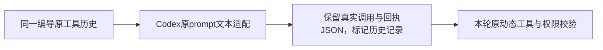

# T-1070：Codex连续精调保留原工具历史

原SPEC要求同一项目编导连续生成和精调。真实默认分镜已保存并送出请求ai-msg-143a8c85-166，但原任务execution-task-31c081af-3c18-4271-a27d-cafc81476b5c进入waiting_user/CODEX_INPUT_MODALITY_UNSUPPORTED；未发生模型生成。前一回合为成功的真实视频候选。原SDK convertToModelMessages会把持久工具部分转成assistant/tool的tool-call/tool-result数组；现externalChatPrompt只接受text数组，故把原工具历史误当多媒体，第二次正常操作被阻断。

这是原连续工作流的必要适配闭包，不新增多媒体支持、工具协议、授权、任务、账本、runtime或执行机制。待独立范围复核才准入两路径：

- `ai-worker/src/execution/external-chat-worker-run.ts`：只在原externalChatPrompt消费者把已有SDK assistant/tool的tool-call/tool-result机械序列化为明确标注的历史文本，保原type/真实toolCallId/name/input/output。当前新工具仍经原动态网关与lease/effect验证；历史不能冒充本轮工具执行或授权。普通text/string保持原样；image/file/audio/未知part或错角色仍保原明确unsupported，不丢附件、不删历史、不改route or frozen input。仅机械协议翻译，写SEMANTIC_BOUNDARY_ALLOW说明不做创作/选择。
- `ai-worker/src/execution/external-chat-worker-run.test.ts`：当场RED→GREEN真实调用原prompt适配器，覆盖SDK实际转换后两回合文本+tool-call+tool-result与完整字段、混合文字、普通文本不变、直接附件/未知/错角色仍拒绝。相关原Codex native/ACP/binding回归保留。

既有97实现路径增加这两个原消费者及其测试为99；原93合同和三轮PASS不修改，不开新formal周期。实际默认分镜连续创作须补真实链；本单测不代签模型、包或安装。原等待任务与失败证据保留，绝不为洗绿清会话或默默创建付费新任务。
