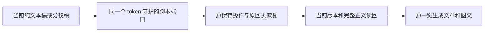

# T-1070：现有分镜稿接入同一个脚本确认端口

这是原 SPEC「当前脚本保存读回后，一键生成文章和图文」的必要实现闭包，不增加产品能力、服务契约或评审周期。原 SPEC、93 路径合同及三轮评审原样保留；本补充只申请以下两个实际消费者文件，待独立范围复核后才准入。

## 当场发现与影响

2026-10-07 实际私有页面已有保存脚本后，默认显示分镜稿。`ScriptStructureToggle` 根据 `sections.length > 0` 选择 `structure`，条件渲染卸载 `ScriptRichEditor`；目前只有后者注册严格脚本端口。`ScriptStructureEditor` 的当前 `local`、未保存修改、保存结果和 `editRevision` 保存在自己的闭包，只注册旧 `registerFlush`。因此原新按钮在正常默认视图不能确认当前稿。切换到纯文本稿可以继续验收模型，但不能据此签默认视图可用。

不通过隐藏旧富文本编辑器、从项目列表猜第一个脚本、把旧 flush 当确认，或丢掉未保存分镜稿来规避问题。

## 两个精确路径与实现限制

- `frontend/src/features/script/script-structure-view.tsx`：在真正持有当前分镜稿的现有组件复用 `registerScript`。冻结当前 section ID、类型、完整 visual 与原 contentData/contentText；沿原 `ensureScriptArtifact` 和 `createArtifactVersion` 保存。首次真实 ID 保留；等待原 pending 保存；保存结果未知时只读当前/原版本恢复同一次结果，禁止再追加一次。严格准备继承原至少 120000ms 预算，实际按 artifactId/versionId 深等读回当前内容，并核项目、工作区、token、编辑 generation 与卸载。编辑期间变化保留新稿且明确拒绝本次生成。默认视图、手工保存、分段 AI 改写和版本历史保留。
- `frontend/src/features/script/script-structure-view.test.tsx`：当场 RED→GREEN 验证默认分镜视图实际注册、未保存稿与完整字段保存、首次 ID 回执、在途修改/卸载/切换视图/token 保护、UNKNOWN 原结果恢复、并发当前版本变化拒绝。新测试走原 Provider 及原 save/read client，不伪造只成功的预确认端口。

以上复用现有 runtime、owner、端口、表和预算，无新 API/表/权限/模型调用/工具/任务/IPC/安装步骤，语义取舍仍由原 Skill/模型。原合同 93 路径加两项实现消费者后，当前实现写集为 95；旧四路径基础修复不变。与当前 frontend 候选隔离工作区合并，由主会话唯一整合。

## 必须补的实际证据

实际默认分镜视图输入新内容 → 原按钮保存确认 → 原 chat frozen source 与实际 current version 内容相同；模型和候选验收继续走原链。组件 RED/GREEN 不代签模型、包或安装验收。原所有验收要求与已有失败日志保留。
