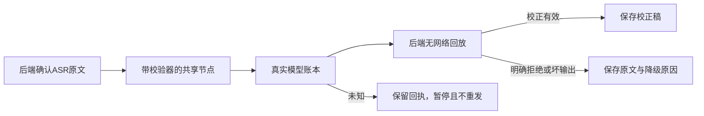

# T-1070 转录整理校验器与真实保存链回归

## 用户结果与授权

用户2026-10-07明确要求修复T-1068复现的问题，与T-1069同轮一次完成。整理后的逐字稿能够经真实后端回执回放保存；可选整理明确失败时保留已确认原文。授权与DEC沿用DEC-T1069-1070，不需要选择真实账号，不重发真实作品。

## FR与契约

FR-1070-01：buildTranscriptPostprocessNode共享节点在原生结构与text兼容模式均有真实validator，严格验证仅有correctedText:string的对象，拒绝缺字段/额外字段/错误类型。保留现有TRANSCRIPT_POSTPROCESS_SCHEMA、templateVersion/templateDigest及冻结输入摘要，不让旧完整回执因换schema摘要失效。校验器只做类型与形状校验，不承担创作语义。

FR-1070-02：Worker只产模型回执，不信任Worker自报最终正文；保留后端createExecutionTranscribePostprocessService的冻结ASR原文、归属、调用序列、请求摘要、预算与无网络回放作为最终结果真相。T-1068中忽略运行时返回值属于后端回放设计；先验证补齐validator即可闭合原save端口，不为该现象新增回退接口或绕过回执。模型未配置/预算拒绝/明确HTTP拒绝/已确认输出不合格式或保真规则时，沿现有后端降级结果保留原文。started/unknown、未结算usage、取消、deadline耗尽和归属冲突仍阻止新调用/伪造完成；未知调用不重发、不改成功。

## AC与验证

AC-1070-01：缺validator的真实RED转为GREEN，实际默认节点在自定义text端点能够请求一次并得到校正稿；原始JSON schema与冻结template digest保持不变，坏形状被真实validator拒绝。

AC-1070-02：内存PGlite中以真实ai_task/execution绑定与真实ASR reserve/start/settle产生原文，实际Worker后处理经prepare/reserve/start/settle/save全部真实业务service往返。正常SSE/完整JSON成功校正、已确认拒绝/格式失败/保真失败保留原文；read与prepare再次读取恢复同一结果，不重新HTTP。模型未配置及预算不足同样保留原文。非本任务作品、旧fence、伪造请求拒绝；断流及取消保留未知/控制状态，不能保存成已完成结果。

AC-1070-03：实际转录Worker与后端工件service完成至少一个逐字稿artifact写后读回，不以T-1068受控save端口冒充业务闭环；ASR媒体输入为合成回执、模型故障服务为localhost，证据明确与真实外部供应商/安装版边界。运行节点/后处理/转录/账本相关回归、类型/contract、boundary/orphan与timeout门；全局既有失败如实保留。

## 实现边界与图

写集：ai-worker/src/runtime/transcript-postprocess.ts及相关测试；backend/src/modules/execution/execution-transcribe-postprocess.service.test.ts与必要集成测试；T-1068复现用例更新；本SPEC/评审、docs/verification/t1070/**及本任务治理登记。若实际业务链发现需要更改公开schema/归属或新增端口，先记录具体证据与最小SPEC修订并独立复核，不能直接绕过保存守卫。

不修改真实数据库、安装版或已暂停用户任务；外部服务永不失败不属于可以承诺的验收目标。
