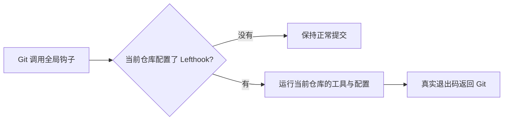

# T-1072 修复全局 Git 钩子误用失效 Lefthook 路径

用户2026-10-08明确要求修复提交日志里的 `Can't find lefthook in PATH`。本机全局 `core.hooksPath` 指向 `~/.config/git/hooks`，其中 `commit-msg` 是 Lefthook 生成包装脚本，写死 hyperframes 已不存在的依赖路径。CreatorOS 当前没有 Lefthook 配置或依赖；最近提交实际成功，钩子检查未执行。

本任务是当前电脑开发环境维修，不改变 CreatorOS 产品、服务契约、数据、安装包或发布行为。已核对另外两个全局包装脚本：`pre-push` 与 `post-checkout` 是 Git LFS 钩子，`post-commit` 是 ThirdSpace 原有 no-op，均保留原字节。仅备份并替换全局 `commit-msg` 的失效 Lefthook 包装器。无用户待决定的产品方向，不另加工具安装或跳过项目真实检查。

修复保留全局 `core.hooksPath`、ThirdSpace `post-commit` 原内容及两个 Git LFS 钩子。只改 `commit-msg`。移除跨项目硬编码路径，未配置该工具的仓库不调用它；按官方支持的主配置和 local-only 配置、显式配置文件判断适用范围。已配置仓库从当前仓库本地工具、显式 `LEFTHOOK_BIN` 或 PATH 解析，不从其它项目借用依赖。配置存在而工具不可用时明确报错并返回非零；配置要求的检查失败必须传回原退出码。保留用户原有 `LEFTHOOK=0` 显式行为，不自动设置它，不把不可用检查伪记为通过。

分发使用 `run --no-auto-install commit-msg -- <原参数>`，仅禁止工具运行时重装共享钩子；保留真实项目检查。官方依据：[配置文件](https://lefthook.dev/configuration/)、[显式配置](https://lefthook.dev/usage/envs/LEFTHOOK_CONFIG/)、[自动安装行为](https://lefthook.dev/configuration/no_auto_install/)。用官方发布的原包装器版本2.1.4临时二进制补一次真实检查成功/失败和参数回读，临时文件不装入PATH或项目依赖。

仓库写集仅本 SPEC、BACKLOG、任务状态审计/上下文和 `docs/verification/t1072/` 的实际证据与钩子修复副本；主会话负责写入全局钩子，独立评审只读。测试使用临时中性 Git 仓库及可观察的工具夹具，明确夹具边界：未配置项目不误触发、已配置工具实际收到 hook 与 argv、空格路径、linked worktree、工具缺失及检查失败返回非零。真实 CreatorOS 提交验证钩子消除提示且提交成功；不执行真实 push、不修改其它项目、不重启客户端。

收尾按真实结果记录，运行 pmem sync 与 reconcile；若全局既有债务仍红，登记原范围并说明本任务窄验证与保留失败，不伪称全仓通过。任务状态仅经 taskctl 修改，完成后真实提交，不 push/tag/发布。
