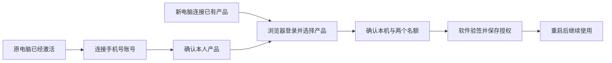

# T-1072 手机号连接已有产品与双设备

日期：2026-10-07。本地范围已获用户授权，规范待独立评审。关联 Growth T-188-owned-devices 与 Activity T-188-AM；两跨仓最终 closed contract 是网络字段权威，不修改旧 annual 领取协议。

## 用户任务与实际结果

首台维持输入激活码启用，不强制注册。已激活电脑在设置的产品授权卡选择“账号与设备”，从本机取得新短票据并打开官方完整客户登录页；手机号验证完成后确认准确产品归属。第二电脑在激活页选择“用手机号连接已有产品”，打开浏览器完成验证、选择本人产品、确认正在使用的电脑；回到软件后执行权威激活、验签与原子保存，显示“已启用，开始使用”。已满两台时网页明确选择移除哪台，再启用本机。网页登记成功与软件启用成功分别反馈。

| 操作者与已有对象 | 带走结果与下一步 | 失败与恢复 |
| --- | --- | --- |
| 已激活客户、原授权电脑 | 产品连接本人手机号，随后可管理两台设备 | 浏览器关闭/超时不损害现有激活；重开连接；其他账号不能偷接产品 |
| 第二电脑、本人手机号 | 同一授权有效期与同一AI额度，在本机启用 | 等待不重复创建；已批准但网络未知先续查同意向；本机未验证不报启用成功 |
| 换机客户、本人两台设备 | 明确选移除旧设备、登记新电脑，回到软件继续 | 回读实际设备，刷新/返回保留结果；不得要求清全部模型密钥或重建用户项目 |

## 实际协议与安全边界

- 新建独立 owned-device 能力，不打开 CREATOROS_ENTITLEMENT_CLAIM_ENABLED，不改变 API-210/211/212 与 annual consume 的用途。现有PKCE构件可复用，但旧create未冻结机器证据，不能原样作为第二设备授权。
- native 从 LicenseState 读取硬件稳定 machineId、烘焙 projectKey；JS不能输入或覆盖设备身份。machineId只作为TLS请求中的受控证据，禁止在日志、普通JS状态、URL、剪贴板、截图、持久普通文件中扩散。PKCE与桌面秘密证明同一客户端会话持有，不声称远程硬件证明。
- 第二台创建意向冻结 projectKey/machineId、PKCE S256 challenge、设备名称。浏览器只使用短期 userCode，不能改machineId；完整普通客户会话与CSRF执行批准。deviceSecret/codeVerifier原生内存保管，不跨IPC；退出/替换会话清理，卸载组件停止轮询，同一时刻仅一个在途请求，迟到结果不能覆盖新会话。
- 2026-10-09真实HTTP核对：Growth连接registrationRef是opaque locator，当前canonical形状为 `LDR_` 加32位小写UUIDhex（`^LDR_[0-9a-f]{32}$`）。native创建、journal完整性/电脑/PKCE绑定、恢复及ACK必须保持同一精确引用，只接受该形状，不把它当URL或错误要求Activity ULID。Activity权威registeredDeviceRef与v3票据jti仍严格26位Crockford ULID；两种引用不混淆。本轮之前未交付真实旧journal，不增加没有产品事实的ULID连接引用兼容。
- 成功轮询得到确切本人授权的原激活码只在原生保管并通过既有Activity公开activate/status取得可信签名；在写盘前由新原生薄consumer用内存candidate code+本机请求fresh config-ticket-v3，验证Activity外层原始响应Ed25519签名、date、nonce，按冻结v3票据声明核对批准的准确hash/project/channel/TIME及原期限。现有sidecarhelper依赖已落盘快照且不回hash，不能直接使用；license_activate也会先写盘，不能先调用再补核对。拒绝错误origin、path、外来code、错误签名、nonce不匹配、版本/期限不合约及超大响应。
- TIME永久 expiresAt 为 null，是正常情况；禁止复用旧annual consumer的“必须非空到期时间”校验挡永久。Monthly保持原usedAt/expiresAt；第二台不重新计时，不另建额度。
- 复用 .license 的原生加密写入和读回验证、sidecar镜像与配置刷新；成功后提供重启入口。替换前失败保留原授权文件；替换后fsync或读回未知时保留安全journal并回读收敛，或用已校验的原加密文件恢复。write_snapshot_file_checked的Err不能单独证明旧文件未改变，必须分别注错验证替换前/后恢复，不清空授权，也不能假报完成。
- 结果未知的登记/交付不自动新建第二意向；安全journal保管同一秘密与PKCE用于resume。Growth在连接有效期内允许原生重复读取同一ready结果，逐次核验当前owner与已登记设备仍active；原生完成验签、核对与原子保存后才ack并清理secret，ack丢失不阻断已启用软件。需要持久化时使用OS凭据库，不写普通文件里的deviceSecret、codeVerifier或明码。journal必须与既有annual分离，冲突可恢复且不互相清空。
- 明确网络预算：遵循项目LED-053两分钟单次请求下限和外层覆盖内层；短期意向TTL是资格有效期，不拿它覆盖正在执行的完整登记/保存动作。遇到超时保留真实请求状态，不伪造后台成功，不自动重发。
- 原电脑账号连接复用native/server-only fresh config ticket，浏览器走full手机号验证；短信过程可能超过60秒，原生保持该会话、单在途刷新准确票据证明，浏览器提示保持原电脑连接。JS不得拿deviceSecret，轮询结束/退出时停止刷新；AI额度restricted portal不承担设备写权限。已有额度owner转移以Growth当前事实为准，客户端不创造第二owner。

## 移除与兼容

Activity服务器移除后立即拒绝该设备验码和新票据。旧客户端在可信在线校验收到valid=false后停用；网络不可达及永久离线旧快照无法即时追回。原有永久心跳可到30天，本任务不扩为永久强制联网。页面明确剩余离线影响；尚未取得Mac/Windows实际安装包双机回执时不得称跨客户端完成。

不调整核心license heartbeat导航规则，不强制重启正在运行的编辑任务，不清本机项目、素材、模型Key、平台账号或数据库。旧首台输入码、COUNT/TRIAL/DEVICE_TRIAL与annual路径回归。设备移除不能只发valid=true/revoked=true（该旧信号只停更新）；公开服务按已移除机器返回旧兼容无效结果，幸存设备继续取票。

## 工程范围与验收

新增 frontend/src-tauri/src/owned_devices.rs、frontend/src/lib/owned-devices.ts、frontend/src/app/activate/owned-device-panel.tsx、frontend/src/features/settings/owned-device-connection.tsx；修改激活页、设置授权卡、原生命令注册/build flag/最小ACL capability与permission；原电脑连接新增native/server-only adapter与必要薄local route。若复用 frontend/src-tauri/src/license.rs 内部验签/快照/票据函数，仅做必要pub(crate)可见性或helper抽取，不变更旧验证语义。客户端身份继续使用既有烘焙client/projectKey/productRef及原appIdentifier；register_device由Growth先按准确注册事实定位唯一商品并冻结产品/project scope，官网由本人明确选择准确合法授权后固定其原profile；link_owner仍由准确ticket/grant/batch及既有source解析唯一profile，不猜first/latest/default，不让用户输入内部profileRef，也不在客户端写死猜ID。ready仅native响应分别携带连接有效期与原授权expiresAt（永久null），不能混用重置期限。新API消费只允许规范冻结的官方HTTPS origin；本地测试环境仅隔离开发构建，release不得允许绕过验签。

新增界面按oil-ui-pro及账号组UI_RULES，保留原方向；所有功能文字>=16px，触控>=44px，桌面/390px兼容。不要单独改变T1022其他页样式；不引入第二登录库、OAuth供应商或同步产品。

验证原生协议、秘密隔离、签名拒绝、永久/月卡、错误产品、不重复占槽、保存失败原文件保留、resume与过期、前端单在途/卸载/失败恢复，完整配套required checks；本地真实HTTP跨仓链路与UI操作证据分开记录。正式Mac与Windows安装包各一台、已验证owner、首台/第二台/第三台替换/重启/返回刷新/离线限制是最终用户验收，fixture不能代替；未完成保留待验，不补写PASS。

本任务不含push、发布、安装版替换、生产数据库或真实码/设备操作，候选与恢复方案完成后再按准确对象处理发布。

## 2026-10-09 完整回归中既有实现遗漏修复

用户授权完整功能测试工程，主控独立核对后确认：手工登记 `outputs.publications.register` 是已批准发布交接路径，成功的 publication 必须沿既有 SearchIndexPublication seam 立即在当前 workspace 视频搜索可见。当前代码只驱动项目已发布和 imported 收口，遗漏搜索投影。修复只在权威事务提交后以原 result.id/platform/accountReference 与现有 `entityType=publication` 形状 upsert；组/账号定位取正常 targetCtx，现有组合根继续映射 video。索引失败不回滚已成功发布事实，按同 external key 重复登记补偿原 ID，不新建发布、不改外部发布能力或 body/tags/URL 业务形状。

真实 RED 为 integration/frontend-account-scope-green.log（正常身份及既有手工登记后，原搜索断言失败，13/14），需验证登记后立即搜索、索引失败后原发布仍 published、同锚重复登记恢复、跨 owner/workspace 不可见及原换锚防护。此项属于 required 全回归维修，不意味着真实双机/原生HTTP已验收。

### 本轮全量工程验收发现的已批准组契约遗漏（待独立边界复核）

正常组真实 Worker 的 material.generate 保存键与候选读键不一致、空稿面 script.draft 未注入既有项目归属端口，分别保留真实 RED。准确 old→new、旧账号兼容、原调用恢复与守卫边界见 `docs/verification/t1072/integration/GROUP_GENERATION_REPAIR_PROPOSAL.md`。这两项只恢复 T-1022 第 60/63/70 行与现行 T-915 提交要求，不新增生成意图协议；在独立边界复核前保持生产代码未实现。

本轮上述组实现遗漏已完成独立只读边界复核，并按最小 3 文件修复：素材候选同源 workspaceObjectIdentity/workspaceFilter、空稿面同事务 Projects 锁端口、两条采纳 MaterialLinks callback 返回同事务真实 Projects row。真实 Worker 原14场景从4失败→2失败→14通过；研究用料组合根直接真实事务1通过（跨owner/组/缺项目拒绝、写后失败回滚），后端组候选与既有恢复4文件82通过，正常平台legacy别名补测15通过。组身份与成员冻结沿既有规则，未增加groupVersion逐值拒绝、未改schema/endpoint/业务shape；失败日志完整保留。正式安装版与双电脑仍待验，母聊天规范提案未批准未实现。

### 全量工程验收中完整JSONB回执等价比较遗漏

真实转写Worker/宿主全回归发现：JSONB规范对象键顺序，而strict schema按声明顺序构造完整后处理结果；原JSON.stringify比较把完整字段深相等的回执拒为未知，正常已确认稿无法保存。此为原母R03“完整回执/已确认事实”守卫实现遗漏，不涉及待审R05a、状态聚合或新协议。主控核唯一patch及独立只读proposal后授权：仅execution-transcribe-workflow.service.ts新增Node内建isDeepStrictEqual并替完整比较，现transcribe-postprocess.integration.test.ts追加真实键重排/全文与标记原因/字段缺失或extra/实际冻结identity/有序awemeIds反例；不改变strict schema、owner/workspace、fence、lease、事务、原operation及收费调用门。保原30业务库存和未裁决expected，新增守卫测试单独计数，完整产品与双机仍待验。

### 全量控制门中既有口播时长边界遗漏

原T794固定15秒真实横竖预览，候选与6b1322af均保portrait15.34≠15的RED。T902批准同一人物在辅助结束后原几何回位、代码落实时间边界，不授权口播结束后新增帧。主控已读本轮独立时长proposal复核并精确授权：仅backend/src/modules/execution/video-render/template.ts的schedulePortraitSpeakerDirection局部change及现template.test.ts，终点不新增tween、短剩余窗口限制原.34 transition，起点/持续/layer共同按原f2/fmt精度受口播终点约束；连续辅助单缩放、尾talking-head回位、真人常驻/字幕、横屏/visualOnly原规则保。严格15expected与原LED024命令不改。提案与原RED见MOTION_TIMELINE_DURATION_PROPOSAL.md及lesson024两份预览日志；本段登记不称已实施或验收通过。

相关自主研究3FAIL明确是T923已批模型传输首尾片段与旧JSON-only测试驱动冲突，主控仅授权existing agentic-research-worker.integration.test.ts内typed严格observer：完整content继续JSON/schema、明确16000/8000片段只读真正完整可见字段，不从DB补给模拟模型，保原3输入、12k正文、来源快照、6/5/4请求/预算、settle/采纳/隐私反例。该test-only不改Worker网页fixture、生产窗口/协议；准确算法及待验事实见RESEARCH_CONTEXT_DRIVER_PROPOSAL.md。
