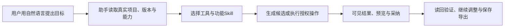

# T-1073 全系统 AI 助手操作、工具开放性与提示词

用户2026-10-08要求全面测试并优化 AI 助手对系统各功能的操作，发现缺口及时补齐。工具开放性、工具描述与系统/功能提示词须调研优秀开源实践，明确核实 Coze X、Coze Code 的实际项目和公开证据。典型验收必须包括让助手创建画布、生图和自然语言剪辑视频。

这项需求按完整范围执行；当前先做只读调研和真实链路盘点，研究结束后把精确改动、工具合同、提示词引导和验收补入本 SPEC 并独立评审，再写产品代码。T-1072 已在修复并先闭合，不撤销 T-1071/T-1070 的当前成果及待验边界。

验收覆盖功能与助手的真实结合：项目/脚本、文章、图文、素材、画布、生图、剪辑、账号组和绑定、发布准备、数据分析及现有其它功能。区分工具未开放、描述/提示词未引导、真实执行失败、UI未接结果等具体原因；助手应读能力与错误并给出可执行下一步，不能用笼统“不支持”掩盖缺口，也不能宣称尚未实现或无权限的操作已经完成。

保留原唯一 backend owner、contract、execution task/lease、真实组与可空账号、父项目/版本、幂等/未知恢复与安全边界。语义由配置的 Skill/模型判断；不写死内容词表/业务分支代替智能决策。AI正式写稿和剪辑继续先产候选、用户采纳后由原服务落实；本次中性验收不修改真实作品或自动发布。不新增第二套数据库、任务系统或任意命令权限。

研究证据优先官方仓库、实际开源代码和官方文档，标记不确定的项目对应关系与推断。盘点使用当前源和已安装公共能力分别记录，不用源码或模拟供应商代签安装版。新UI/工具结果交互使用项目 oil-ui-pro 和现有丰富紫色布局；具体路径及必要测试在研究后准入，当前产品写集为空。

只读阶段可更新本 SPEC、BACKLOG、任务控制与 `docs/verification/t1073/` 的真实研究/盘点证据；不push/tag/发布，不重启或强关当前客户端。完整公共模型工具链、保存读回、冲突/归属/未知/取消和原合法保存导出均需实际验证，最终用户验收不得代签。
