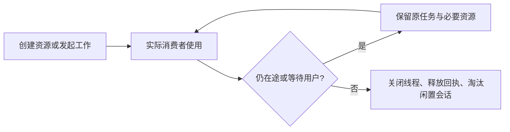

# T-1073 修复已复现的资源浪费与内存泄漏

用户2026-10-07在 T-1071 全面排查结论后明确要求“修复”。同一次交付修复报告 F-01 至 F-08，六个 T-1071-* 根因任务归入本规格，不构成分期。原始诊断保留，不能把旧的缺陷复现 PASS 改写成修复证据。

## 用户结果与范围

大白话：转录做完就关掉本次线程；回执被用完后不再攒着音频副本；聊天按页面取走数据的速度传；已完成的会话安全回收；页面与后台同一项读取只跑一份，完成后停止反复查。

不改变数据归属、模型选择、创作语义、服务端历史或公共 operation。仅修复源码和隔离验证，不安装、打包、推送或发布，不访问真实账号/数据库/媒体，不重发用户任务。报告列出的导出峰值、大库总览、渲染后代及共享浏览器其它静态风险不冒充已修复；本轮附带验证与同根因直接相关的调度停止、心跳在途和预览小缓存清理。

## 已确认要求与验收

| 要求 | 结果约束 | 验收与真实消费者 |
| --- | --- | --- |
| FR-001 Whisper 正常成功、失败、取消均有释放归属 | 每任务新建 registry 的资源须在任务 finally 等待退出，或经证明由父 Worker 唯一有界复用；不依赖外层迟到 abort。关闭与取消保留推理停止屏障，不与替代线程重叠 | AC-001 实际转录执行入口连续成功 3 次及失败/取消后，自己的线程均退出；真实 worker_threads 配合轻量模型回执可验证生命周期，不能声称实测模型容量 |
| FR-002 宿主不长期保留已消费的大回执 | 完成回执经 Worker 确认消费后释放字节；在途重复请求仍共享一次 invoke；相同 execution/request 身份不重复写入或收费。若采用私有确认协议，用单调调用序列与已确认水位/紧凑区间拒绝陈旧重放，避免将大缓存换成无界历史 ID 集合。旧协议兼容须明确，不能直接删掉写回执重做副作用 | AC-002 实际 supervisor + 实际 Worker 收到 100 份合成音频后，任务仍在运行但已消费字节不随总历史积累；并发/丢失确认/重复请求/陈旧 fence/断连/取消均验证，无重复副作用；单个大合法音频不因新上限失败 |
| FR-003 响应流按消费需求传输 | 生产数据受 pull/背压控制，缓冲最多当前有限页及当前事件；不按整个历史体积驻留。取消/请求 abort 释放订阅，绝不提交持久任务取消；最终错误、审批与 DONE 协议兼容 | AC-003 走实际 chatExecutionResponse 与持久事件订阅，真实本地 HTTP 慢消费者/不消费验证读取停止、恢复后事件不丢不重、取消释放；waiting_user/unknown_result/failed/cancelled 与已有聊天客户端协议回归 |
| FR-004 聊天与预览缓存有安全淘汰 | 当前挂载、有在途任务、等待审批/用户处理的会话受保护；已完成且无观察者的会话按数量/消息容量有界淘汰并解除其 transport/回调引用，回访从服务端历史恢复。账号与 scope 隔离、跨页回复持续。预览仅元数据字符串，过期及数量有界 | AC-004 100 个闲置完成 scope 的保存量有界；在途跨页/审批保护、恢复历史和切账号不串内容；实际 Copilot 消费点和预览消费者验证，不只测 Map helper |
| FR-005 同项目稿面审核共享一个在途读取 | 同页两个 hook、定时器、focus/visibility 共用一次读取；失败后可恢复；切项目/卸载不回写旧结果，隐藏暂停，完成请求后再安排下一次。若公共 transport 可取消则传递实际取消，不能谎称停止已发送请求 | AC-005 实际稿面消费者两处在 32 秒慢请求窗口最多一个公共读取；卸载/切项目无过期回写，失败/恢复/更新报告可见，保留 null 正常空态与 newerReport 真值 |
| FR-006 雷达升级队列保留完整历史但减少空闲工作 | 首次与明确恢复时读完整历史；在途任务按既有读取能力观察，全部完成/空闲停止高频全历史扫描；focus/重新可见、手动入队立即触发或合并一次恢复读取；可见且无在途读取时，跨窗口新增任务落库后 60 秒内发起发现读取，成功响应后立即合并本 scope。已有读取时只记一次待刷新，当前读取结束后补一次；隐藏时不定时扫描，网络响应耗时不冒充调度间隔。最多一个在途，保持真实总量和原任务 ID | AC-006 250 条完成历史首次均可见，30 秒内不再 11 次空扫描或 33 次全历史分页；新增/恢复即时触发或合并一次；真实 Radar API 与虚拟时钟验证可见空闲窗口在外部落库后 60 秒内开始发现、即时响应时任务可见，读取中唤醒只补一次 |
| FR-007 任务卡完整恢复成功终态 | succeeded 立即恢复为已完成并停止观察；其它合法终态、等待确认、失败、取消及暂停保持已有恢复行为，不能自动新建任务 | AC-007 重挂真实整稿卡、API 返回 succeeded，最多一次恢复读取且不显示运行中或观察超时；同类 thesis/发布物料卡若有同根因一并校正并覆盖原可完成场景 |
| FR-008 后台调度有在途限制和真实停止 | 慢 tick 期间不再并行发起同一调度，合并唤醒或等待下一轮，不丢到期持久任务；保存 cron handle，停止清理 cron 与 sweep，停止后不再查库；心跳最多一个在途且不追加无界 Promise 链，取消/结算保留原归属 | AC-008 实际 start/tick 十次唤醒最大在途为 1；失败后可再调度；实际持久层停止装配释放定时器；挂起心跳、取消及失败不会制造队列；真实端口/持久任务恢复回归 |

AC-009 兼容总约束：所有修复保留 execution/attempt/fence 归属、相同请求的幂等与收费结算、未知回执不得伪造成功；SDK 和浏览器预算守两分钟下限及原持久 deadline，取消及时，合法成功输出不被新资源预算反杀。没有新增顶层运行时、数据库、后台守护进程、公共 API 或语义词表。

## 实现归属与验证

- Worker 分区：Whisper/转录执行/私有 Worker 回执及协议，覆盖 T-1071-whisper / worker-memory。backend 仍是唯一业务写入者。
- 前端分区：已有 Copilot 会话、审核 hook、Radar 升级与任务卡、预览元数据，覆盖 T-1071-cache / polling；只修复既有交互状态，不改页面布局。
- 后台分区：自动化 driver、应用 scheduling、持久层停止装配与采集心跳，覆盖 T-1071-scheduler。
- 主会话：响应流与实际订阅链，覆盖 T-1071-stream；整合各独立 worktree，核对公共路径、边界、门和对账。

每个分区在改生产代码前留下针对正确行为的实际 RED，再运行同一用例 GREEN。各分区使用隔离工作树与互斥写集，不直接改主会话控制工件或其它分区源码；编译 Task Packet 并登记租约后执行。共享契约仅由 Worker 分区修改私有 execution-worker 协议，公共 operation 签名和 schema 不变。

必须完成聚焦单测/集成测试、真实公共消费者 witness、受影响类型检查、LED-047、LED-049、`node tools/timeout-policy/verify.mjs`、boundary、orphan 与完整 reconcile。UI 状态按项目 oil-ui-pro 核对已有页面与真实操作证据；不新增视觉方向，不把 jsdom 说成安装版验收。

全局已知 34 错误/1 告警保留 T-916 / T-1015 / T-1018 归属；尤其已有 live-chat-session SDK 边界与历史类型债不得伪造全绿，本轮不得新增结构违规。收尾运行 pmem sync、reconcile、taskctl complete 并提交源码、测试和实际证据。

## 用户确认与决定

2026-10-07 用户“修复”授权覆盖本页 8 个已复现根因。内部确认回执、水位、缓存与调度政策只落实该目标，不改变公共服务契约或数据归属。实现上采用可逆的私有有界策略；单个合法大输入不被截断、不丢事件、不删历史。若实测要求扩大公共契约、改变任务语义、迁移真实数据或发布安装版，回到原决定路径处理，不从本授权推导。
