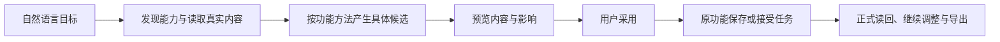

# T-1074 全系统 AI 助手操作、工具开放性与提示词

用户2026-10-08要求全面测试和优化AI助手对系统各功能的操作，及时补齐缺口，调研优秀开源Agent工具及系统/功能提示词设计，典型流程必须能创建画布、生图和自然语言剪辑。2026-10-08继续指令确认沿此目标推进；沿用用户既有实现、隔离测试、当前安装版中性验收及本地打包授权，不push、tag或公开发布。

本SPEC与BACKLOG是完整计划，不另建分阶段任务。研究已完成，精确实现补充需独立评审后准入；评审不替代功能验收。T-1072钩子修复已完成，T-1070/1071及原安装验收的未验证项继续保留，不以本任务覆盖历史缺口。

## 1. 大白话目标与证据

用户在任何页面都可以先问助手系统能力和真实状态；助手能按需要找到正确工具，准备具体可检查的改动，用户采用后在原功能看到结果并继续微调。失败时保留真实原因和原任务，给出能执行的下一步，不能把失败显示为空库或把候选显示成正式保存。

实际只读证据见[研究](../verification/t1074/research.md)、[覆盖盘点](../verification/t1074/tool-inventory.md)、[机器记录](../verification/t1074/research-result.json)。公共安装版405项目录实际exit0，9,549,765 UTF-8字节；不证明405项操作已验收。应用内Codex用独立任务级目录，当前host none/proposal过滤排除了画布；系统说明仍介绍被过滤的工具。原生视频已有read/typed candidate/preview/apply/undo/save/export；旧video.edit.render不是原生时间轴。画布节点生图已有冻结预约与精确结果证明，generic material.generate没有绑定当前画布。普通工具失败的外层outcome在聊天投影丢失，空数据卡和绿色“已调用”可误导用户。

公开依据是固定commit的Codex、Coze Studio与Claude官方资料；“Coze X/Coze Code”的具体对应仍未确认，不声称获得商业隐藏提示词。采用按需发现、目录与权限分开、功能方法与工具合同分层、结果与恢复可执行等原理，按本系统现有owner和账本落实。

## 2. 不变的产品和执行边界

- 创作语义、取舍、内容分类及工具选择由配置Skill/模型判断；代码只验证真实ID、归属、类型、版本、范围、时间、幂等和用户明确选择。目录按feature/ID精确筛选是协议查找，不用关键词评分代替内容判断。
- 单一contract、backend owner、execution_tasks/lease、ai_tasks/results保持。Worker不直连数据库，AI不直接写正式领域对象。新增纯候选保存在原executionCall结果；用户采纳回执复用aiTaskResults.executionCallId唯一键，不增加候选表或调度系统。
- 当前user/group/account-null、项目、版本和引用文件由服务重读。模型不填写userId/groupVersion/租约、source call ID、正式ID、请求key或预算；客户端采纳只传真实来源引用和candidateDigest，不重传可篡改业务body。
- 每个有限action调用只返回一个具体候选。无权限、跨组、来源伪造、输入损坏继续拒绝；合法任务优先确定性安全路径，不能新增审美门反杀保存/生成/导出。
- 正式发布、删除、归档、转组迁移、密钥及连接配置修改仍经原功能的具体影响/授权流程；本次不提供任意operationId/body、shell、文件或凭据通道。发现目录显示其真实原入口，不假装助手已执行。
- 用户此前明确取消自动视频初稿：脚本联合生成仍仅文章和图文。视频用真实导入录像，通过现有右栏编导精调；不恢复快剪/快速转换入口，不建立第二剪辑引擎。
- 原版丰富紫色布局，项目oil-ui-pro0.10.0及T1022 UI_RULES继续适用；不再询问已经确定的整体风格。

## 3. 工具发现与功能提示词

新增短宿主工具`system.features`、`system.read`、`system.action.propose`，均在普通各surface可见（明确专用脚本快捷回合保留原单工具语义）。推荐工具可以随页面改变，但发现入口不因默认topics surface丢失。

`system.features({feature?,offset?,limit?})`返回固定功能域、用途、可用read/action、前置条件、当前实际引擎工具、原页面入口；每页最多20项，不返回完整schema、真实密钥或整个业务对象。`system.read`是固定判别联合，分支只映射第4节已审原service读取；入参来自原contract，页长最多50，长正文沿原window/result reader，不把长对象返回后只靠前端折叠。目录/describe只是信息，不赋执行许可。当前未装配端口明确给出原因和入口，不能回落[]/0。

公共CLI `operations list`兼容增加`--compact`、`--domain`、`--effect`、`--offset`、`--limit`；未指定时保留原完整输出。`operations describe`保留原schema。公共MCP增加独立`creatoros_operations_list/describe`发现工具，保留全部现有endpoint工具，不删消费者能力；摘要仅包含操作ID/方法/路径/效果/输入段有无/确认与异步语义。元数据由contract/cli-policy派生，不重复登记405项。

新冻结任务在prepare时即按实际引擎的已审工具集合装配目录和说明，外部service执行时继续按同一政策及真实host版本复核。Codex/CodeBuddy只新增已审短读取/纯候选，不直接开放committed或worker-only工具。旧冻结任务不改写或自动重发。

两条公共入口在装配前传已解析引擎：submit的assemble callback共用第三参数{executionEngine}，沿route/prepareChatReply/durable/runtime传递。公开消息operation当前没有显式引擎字段，保留默认Pi并传同一Pi选项，不偷加未声明body；其预装配结果和提交必须一致。重放已有任务先返回原冻结任务，不重新装配或回填新默认值。新能力说明补充真实目录与边界，保留用户effective Skill和overlay；只比较实际目录块与冻结tools，不因用户文本提及其它方法就删除Skill。

系统指令围绕推进可检查结果、真实回执、候选采纳、冲突先读、未知查原ID。功能方法分开：项目/选题、脚本、文章图文、素材知识、雷达定位、账号绑定、发布准备、分析复盘、日历自动化、设置、画布生图、原生剪辑。方法引用只来自当轮真实工具；方法库可按需skill.read，但不能以Skill描述冒充已经开放的工具。

保留原生编辑器的严格ID/UTF16范围/120000 ticks/前值digest/目标epoch引导。明确native production editorTarget时移除旧`video.edit.render`和对应forced/functionKey，保留合法旧分镜入口。账号说明使用真实平台字段，不再写死抖音号。工具brief不以固定40行截断后宣称是完整能力目录。

## 4. 全功能读取与有限操作合同

`system.read`仅下列固定域分支，按原endpoint params/query形成严格联合，固定映射原owner端口；不接受自由operationId/path/method/headers。既有context/read/window继续使用，不重复大正文工具。

| 域 | 固定新增/可发现读取 | 操作承接 |
| --- | --- | --- |
| 项目/选题 | projects.list/get/outputs.list；candidates.list/get；topics.workspace.get | project.create、topic.create/promote；原brief候选 |
| 脚本 | artifacts.list/get/versions.list、原当前脚本reader | 原draft/hooks/patch；有限script.patch |
| 文章/图文 | articles.get/versions.get；graphicPosts.get/versions.get | 原work.creation联合候选、work.editor精调；article.save/graphic.save |
| 朋友圈/作品组合 | moments.get/versions.get；workCompositions.get/materials.list/dependencies.get | 原moments与composition严格保存/任务入口，不伪称跨载体原子写 |
| 素材/知识 | assets.list/search/files.list/usage.list；knowledge.list/get/revisions.list/folders.list | asset.tag、knowledge.create/folder.create；原获取/生成/确认 |
| 雷达 | intelligence.workspace.get、sources/items列表及详情 | radar.collection.create；原持久采集与来源界面 |
| 定位 | positioning.profile.get、pages.positioning.get、statement读取 | positioning.save及原定位候选/访谈 |
| 账号组/绑定 | accountGroups.list/get；accounts.list/get/bindingCapabilities/bind.status | group.create/rename、account.bind.start；显示真实扫码/登录状态 |
| 发布准备 | outputs.publications.list、publications.get/revisions.list | publication.prepare与原package候选；不自动外部发布 |
| 首页/概览/分析/复盘 | analytics项目/作品/traffic、dashboard/projectOverview/groupOverview/dailyReport | 原review候选，缺数据如实null/空；不把模型推演当统计 |
| 日历/自动化 | group.calendar.list/cadence.get、scheduledJobs.list/get、jobRuns.listByJob/get | calendar.plan、automation.createDraft/enable；原execution调度 |
| 设置 | preferences、安全模型能力及Skill版本摘要 | preferences.update；不读解密secret/secretReference/连接配置 |
| 画布 | canvas.list/get、当前画布全部document、tasks/capabilities/精确结果 | 第5节create/propose/generate/结果采用 |
| 视频 | 原work.editor.read含media/sourceTranscripts | 第6节精调；缺转写先完成真实转写，不凭文件名猜内容 |

有限`system.action.propose`严格`kind`联合，允许以下19项，参数直接复用原合同的必要字段（unknown字段拒绝）。模型所填目标ID须从当前组真实read取得；有当前冻结editorTarget时保存分支必须与它一致并服从本地epoch，避免绕开未保存内容。

| kind | 输入与原owner |
| --- | --- |
| project.create | title/brief/briefDetail/contentType/creationMode/targetPlatforms，Projects；不开放imported source/platformRef |
| topic.create | title/angle/source/contentRole/productAnchorId，Candidate；不造出处 |
| topic.promote | candidateId，Candidate与同行Projects；先读真实候选 |
| script.patch | artifactId/expectedVersionId/sectionId/expectedOriginalText/replacementText/changeSummary，Artifacts原applyScriptPatch；不绕开原锚点 |
| article.save | outputId/expectedCurrentVersionId/document，Articles原createVersion；宿主补稳定clientRequestId |
| graphic.save | outputId/expectedCurrentVersionId/document，GraphicPosts原createVersion；同上 |
| asset.tag | 真实assetId/expectedVersion数组和tag，原Taxonomy AssetTag服务；新增短chat来源适配，不伪造agentic.run证明 |
| knowledge.create | title/note/sourceNote及可选真实folderId，Knowledge原create；host来源sourceType=ai，禁止模型传任意sourceMetadata |
| knowledge.folder.create | name/parentId，Knowledge原createFolder |
| radar.collection.create | name/parentId，Intelligence原createCollection，ctx账号与稳定key由宿主提供 |
| positioning.save | persona/field/audience/differentiation/capabilities/facets/downstreamRules，Positioning；host捕获原profile摘要，采纳经原owner新增compareAndUpsertProfile，在既有liveRuleRoot锁中重读比较 |
| group.create | name，AccountGroup，host稳定key；不隐式切组 |
| group.rename | 当前group名称及expectedVersion，AccountGroup原update；不操作其它组 |
| account.bind.start | 当前group/platform/expectedGroupVersion，AccountBinding原持久reserve；稳定key来自source；只表示待扫码 |
| publication.prepare | outputId/platform/accountId/accountReference/expectedMembershipVersion，Publishing原createPublication；只建准备记录 |
| calendar.plan | 当前group/projectId/plannedDate/targetAccountId/note，ContentCalendar原createGroupEntry；用户看清日期与发布目标，不能绕过当前项目排期限制 |
| automation.createDraft | name/prompt/schedule/sourceKind与targetAccountId，sourceKind限topic.daily/self.metrics/comments；topic.daily的targetAccountId可null，self.metrics/comments必须是当前组真实目标账号。Scheduling新增createDraftIfAbsent，沿原createJob创建enabled=false；无任意toolGrants/target/systemManaged；不复用既有任务冒称新草稿 |
| automation.enable | jobId/enabled，Scheduling原setEnabled；host冻结原任务摘要/状态，新增setEnabledIfUnchanged复用原workspace/job锁重读比较；启用影响在候选卡显示 |
| preferences.update | 原六偏好字段，Settings原patchPreferences；host捕获受改字段前值，新增patchPreferencesIfUnchanged在原偏好写锁中比较；普通手工patch同锁，避免仅AI串行造成竞态；不改密钥或用户身份 |

新增正式用户API `ai.assistantActions.adopt`与只读`ai.assistantActions.receipt`，入参只收`{taskId,callId,toolCallId,candidateDigest}`。create/propose工具结果由宿主从scope装入来源，模型不传这些字段。来源服务位于AI模块；读取本任务真实settled call，不使用历史消息文字或readToolResult历史回退。

来源核验原copilot.assist↔executionTask/modelInputDigest、会话/源消息/historyDigest、原user/group/account-null和冻结hostContext。Pi使用原AgenticToolBinding核model/toolCall/version/schema/operationKey/inputDigest；ACP核external_tool identity、真实root external_agent start/receipt、engine/turn/version/原tool参数inputDigest，并分别解析原结果格式。仅成功proposal、无error/unknown可采纳；reusedCallId沿最初同参来源归一，不让同结果重复创建。旧合法候选不会仅因后来发一句话被作废，实际target/CAS冲突仍拒绝。

采纳按现有membership锁顺序，锁真实source call，重读当前owner/目标；同行store factory执行原业务服务与aiTaskResults唯一回执，同事务commit。稳定id为source call派生，同行重复返回原正式响应，不覆盖后来编辑；异参拒绝；事务失败不留下半成品。既有已结算executionCall.resultText/resultRef与聊天终态不改写。receipt GET只读取真实已采用结果，响应丢失可查询原call，不能默认重提交。

自动化候选保存真实targetAccountId及成员版本；宿主核验后派生原Scheduling目标ctx，不隐式任取账号。采纳在加锁前确定已核真实目标，按account→member→group原顺序锁，不在持group锁后再加account锁。原owner的createDraftIfAbsent在同事务、与普通createJob共用的membership锁中，先按原去重身份查已有任务：topic.daily查当前workspace+sourceKind且不叠account=null过滤；self.metrics/comments按目标account+sourceKind。已有enabled=true或false均返回明确冲突、真实job ID和read/enable原入口，不改name/prompt/schedule/启用状态；没有已有行才调用tx-bound原createJob并实际返回关闭草稿。公共owner验收包括account-null、多账号、topic.daily非null账号旧job、已有任务内容/状态不变、普通createJob与AI采纳并发、跨组/转组、回滚和同source采用幂等。

外部动作只在事务内预约原owner持久task，commit后wake；AccountBinding保留唯一active controller/drain/stopping实例，抽`reserveInTransaction`和`wakeReserved`端口，不new整个binding service。数据库写失败不叫unknown，响应未知先receipt/get同ID；外部execute结果未知交原任务恢复。

跨模块仅service port；现成workProjectsFor/workArtifactsFor/workArticlesFor/workGraphicFor/workMomentsFor/settingsServiceFor复用。Candidate/Calendar/Positioning/Intelligence/Publishing的peers需绑定同tx；不能把固定db singleton塞入事务port。派生searchUpsert/editDelta在commit后，不能在tx内等待全局数据库回写。AssetTag保留版本与已有taxonomy owner，不扩大agentic.run来源验签。

## 5. 画布创建与节点生图

新增`canvas.create.propose({title,projectId?,document})`，document复用严格canvasDocumentSchema；任意普通surface可用。宿主重验当前项目与素材引用，仅返完整可预览候选，不创建空画布。正式`canvas.create.adopt`收来源，经AI来源port与Canvas原owner，在同事务验证初文档/精确asset file/checksum、创建完整画布和记录采用回执。不前端串create→save；原手工create接口保持兼容。

保留当前已有画布read/propose，公开严格canvasProposalOperationSchema，不再宽泛object。canvas.read补全visualGroups、capabilities及分页任务身份；精确文件结果通过原getGenerationMaterial端口读取，不能由名字推断。create工具不需要旧canvasId，修改/生成仍强绑定当前受信canvas；从其它页可新建并打开后继续，不偷偷改其它画布。

新增`canvas.generate.propose({baseRevision,nodeId})`，宿主重读当前保存generation node，固定完整节点inputDigest、真实reference file/checksum、asset有限policy及source parent deadline。用户卡显示prompt/比例/参考图/真实模式和“确认生成”，不得说已生成。

正式`canvas.generation.confirm`收当前canvas/node URL+source；后端核原候选及当前节点输入，只在第一次确认固定admission与稳定attempt=`canvas-proposal:<callId>`，沿原canvas.node.generate核心冻结canvasGenerationLinks、原asset.generate task。同行首次receipt先固定confirmedAt与绝对deadline，重复确认或未知恢复不得重新计时或改用当前revision解释原候选。

连续copilot budget不能把null继承为无限生图。冻结既有asset policy（当前6calls/1Mtokens/30min），firstConfirmedAt+原policy期限与显式parent deadline取较早；耗尽停止，有限parent剩余不足两分钟不能续期到两分钟。新增可选host `canvasOwner.proposalAdmission`包含source/sourceExecutionTaskId/confirmedAt/deadlineAt/assetLimit，纳入严格frozenInput与有序digest，历史缺省不变。Canvas原assert返回已验证admission给assetBusiness.prepare；budget.deadlineMs=deadlineAt−原AI task.requestedAt，authority仍计算同绝对deadline。准备、排队、等待锁与重启不加时；已有mapping核原budget仅恢复同ID。不得伪装成hostTaskSubmission或新runtime。

原generate当前是links预约事务→submitTask/wake→link回写，不能把整段调用后再补采用回执。原Canvas service抽reserveGenerationInTransaction及attachReservedTaskInTransaction核心；确认用tx-bound原AI.createTask（它只写原任务，不dispatch）让source receipt/admission/links/task同行提交，commit后由原实例wake。手工generate保持原两阶段恢复语义并复用必要核心，历史已付费任务不重发。assertFrozenGenerationInput对新候选返回已验证admission；注入端口必须返回它，不能仅await后丢返回值。有admission时缺证明即拒绝，不回落默认预算；外部inheritedBudget与已冻值不相等则拒绝，已有mapping同时核原executionBudget/deadlineAt。

生成进度/取消/结果精确读取沿原Canvas node任务和AI owner。确认素材后用户使用原“保留/放到画布”，必须精确assetFile/checksum和原node来源；UI提供真实预览与操作，不把generic素材库保存称画布已插入。Codex只新增上述pure工具及读取，不直接开放committed material.generate。

## 6. 原生视频与跨载体创作验收

原work.editor/read/propose、work.creation/read/propose保留。视频自然语言验收至少覆盖剪掉指定范围、两次试讲/口误（有真实transcript）、重排、变速、音量、字幕/文字、真实素材替换；模型提出typed edits，宿主守原tick/媒体catalogue/版本，不写词表来选择删留。未有transcript先走原transcribe并按原ID观察；不能凭空声称删口误。

候选预览不写正式稿；用户采用经原production owner CAS→精确读回→apply-tracks，保留本地新改/epoch冲突、Undo/Redo与保存。替换素材先当前库真实文件，不能造mediaId；轨道split可明确结构化元素拆分，但不能把结构支持称语义粗剪已实测。原5秒/8.16秒已成功样例纳入保存和MP4解码回归，新操作需新证据，不借旧render任务代签。

文章和图文联合生成仅从用户确认脚本，分别候选预览/采用/读回，再编导微调和HTML/PNG/ZIP导出；不假称两个owner原子创建。现有发布物料、知识、定位、选题、复盘按实际引擎目录测试，缺adapter由本SPEC有限操作补齐；既有worker能力不能只因外部目录缺失就静默无动作。用户目标若需要旧worker专用任务，发现返回真实原功能发起入口并明确尚待用户确认，不能编造Codex已调用。

## 7. 结果、恢复及界面规范

新任务在原严格chatWorkerInput冻结toolOutcomeProjectionVersion=1，旧任务缺省保持原投影字节，不改写已存消息或流事件、不放宽原deepEqual。Pi的流/终态与ACP终态共用原applyChatToolOutcome规则，分别读取同一冻结版本；新metadata只作展示，前端统一剥离后再传旧strict作品schema。保留外层status/summary/error/recovery/sideEffect/continuation与callId，将只用于UI的元信息附入兼容data投影；不让业务data覆盖宿主metadata。保留旧成功卡字段、拒绝approval与坏参数rawInput。普通error/blocked/partial清晰显示，错误时不渲染context空列表/0；真实成功空结果仍显示空态。unknown结果不结束聊天或自动重发，继续原任务对账。

ChatToolTrace使用明确状态及Lucide图标，读取完成/候选待采用/排队/执行中/失败/拒绝分开；展开前不序列化大对象（LED-047）。统一错误卡显示安全原因、具体recovery和原任务/结果入口；不输出堆栈、路径或密钥。ACP MCP settled error/blocked同步isError=true，ok/partial正确保留原结构，不截成假事实。

system action卡展示动作中文名、具体内容、目标/影响、可检查预览、采用按钮、原回执和查看结果。采用在途单飞；失败保持候选，响应未知提供“核对原操作”，已采用按钮不可再发起，刷新从receipt恢复。article/graphic/native已有editor目标时调用原编辑器candidate桥接，不能直接后台覆盖本地未保存稿。

画布创建卡提供真实缩略布局/节点内容、采纳并打开；生成卡显示prompt、参考图、比例、候选状态与确认按钮，原task observer限制在途/过期回写。宽度1366/1024和200%放大、键盘焦点/回车/取消、长中文、loading/error/empty/conflict/unknown/adopted均实际检查，遵守现有tokens/Button/Dialog/Lucide。视觉基线先保留，证据区分隔离页面与当前安装版原生。

## 8. 准入写集与验证

改动仅以下具体路径及其列明测试；如发现实际新消费者需改，先补本SPEC和module packet、复核，不能自由扩目录。根会话独占persistence装配、contract公共导出/labels、工具注册/definitions/gate、模块绑定/控制文档；独立writer必须隔离worktree且写集不相交，最终由根合并。

- contract：`src/resources/assistant-system.ts`（新）、`src/operations/assistant-system.ts`（新）、`src/assistant-operation-catalog.ts`（新）、`src/resources/creative-canvas.ts`、`src/operations/creative-canvas.ts`、`src/endpoints.ts`、`src/index.ts`、`src/chat-tool-labels.ts`、`src/cli-policy.ts`、`src/internal/chat-worker.ts`（可选冻结展示版本，旧输入缺省兼容）；测试`src/assistant-system.test.ts`（新）、`src/operations/creative-canvas-assistant.test.ts`（新）。
- backend AI：`src/modules/ai/chat-proposal-source.service.ts`（新）、`assistant-action-adoption.service.ts`（新）、`assistant-action-transport.ts`（新）、`ai.service.ts`、`index.ts`、`external-task-tool.service.ts`、`chat-turn-submission.service.ts`、`chat-receipt-projection.ts`、`external-chat-turn.service.ts`（ACP同源投影）；新`chat-proposal-source.service.test.ts`、`assistant-action-adoption.integration.test.ts`、`external-task-tool.service.test.ts`、`chat-turn-submission.service.test.ts`、`chat-receipt-projection.test.ts`、`copilot-message-task.service.test.ts`、`external-chat-turn.service.test.ts`、`chat-turn-completion.service.test.ts`（旧完成/流回放与新版本一致性）。
- backend ai-runtime：`chat-system-tool-host.ts`（新）、`assistant-operation-policy.ts`（新）、`assistant-functional-prompt.ts`（新）、`chat-canvas-tool-host.ts`、`chat-tools.ts`、`chat-tool-definitions.ts`、`chat-tool-gate.ts`、`chat-assembly.ts`、`chat-assembly-types.ts`、`chat-turn-preparation.ts`、`chat-production-composition.ts`、`chat-production-runtime.ts`、`asset-business-execution.service.ts`；`chat-system-tool-host.test.ts`（新）、`assistant-operation-policy.test.ts`（新）、`assistant-functional-prompt.test.ts`（新）、`chat-canvas-tool-host.test.ts`、`chat-assembly.test.ts`、`chat-tools.test.ts`、`chat-tool-definitions.test.ts`、`chat-tool-gate.test.ts`、`asset-business-execution.service.test.ts`。
- backend execution：`src/modules/execution/chat-tool-stream-projection.service.ts`，读取冻结展示版本，保留原来源/卡片/租约严格比较；公共测试由上述chat-turn-completion.service.test.ts覆盖原流与完成链。
- backend Canvas：`src/modules/creative-canvas/creative-canvas.service.ts`、`creative-canvas.transport.ts`、`index.ts`、`creative-canvas.service.test.ts`、`creative-canvas-ai-owner.test.ts`（真Canvas→原AI task→asset.prepare/authority预算链，不只mock submit）；`src/application/generation/creative-canvas-root.ts`及`src/application/chat/assistant-system-root.ts`（新，固定原owner组合）。
- backend必要owner：`src/modules/platform-account/account-binding.service.ts`、`account-binding.integration.test.ts`、`account-binding-commit.integration.test.ts`；`src/modules/taxonomy/asset-tag-proposal.service.test.ts`（原prepare/adopt已接tx，无需扩大owner）；`src/modules/scheduling/scheduling.service.ts`、`scheduling.service.test.ts`；`src/modules/positioning/positioning.service.ts`、`positioning.service.test.ts`、`src/modules/settings/settings.service.ts`、`settings.service.test.ts`；不跨模块repository导入。
- backend route组合：`src/application/transport.ts`及新`src/application/assistant-transport.test.ts`，只登记新正式owner transport；新`src/application/chat/assistant-system-root.integration.test.ts`。
- frontend根装配：`src/server/persistence-client.ts`、`src/server/prepare-chat-reply.ts`及`src/server/prepare-chat-reply.test.ts`（必要时新）；`src/app/api/chat/route.ts`及`src/app/api/chat/route.test.ts`（旧夹具仍mock runChatStream，先对齐实际durable路径，其旧夹具失败不记成本次RED）；根只服务组合，无业务逻辑搬入frontend。
- frontend结果：`src/features/copilot/ai-copilot-content.tsx`、`chat-tool-trace.tsx`、`chat-tool-outcome.tsx`（新）、`chat-system-action-card.tsx`（新）、`context-card-registry.tsx`、`src/features/creative-canvas/canvas-chat-result.tsx`；`src/features/copilot/chat-tool-outcome.test.tsx`（新）、`chat-system-action-card.test.tsx`（新）、`chat-tool-trace.test.tsx`、`ai-copilot-content.test.tsx`、`src/features/creative-canvas/canvas-chat-result.test.tsx`。
- ai-worker：`src/execution/external-chat-worker-run.ts`、`external-task-mcp-bridge.ts`、`external-chat-worker-run.test.ts`、`external-task-mcp-bridge.test.ts`（新）；必要`src/prompts/chatbox-canvas.ts`、`chatbox-topic.ts`仅工具指导，不改用户配置中的有效Skill内容。
- mcp-server：`src/cli.ts`、`src/tools.ts`、`src/server.ts`、`tests/cli.test.ts`、`tests/tools.test.ts`、新`tests/server-discovery.test.ts`；新增`src/operation-catalog.ts`及新`tests/operation-catalog.test.ts`。保留原operation工具及CLI输出兼容，不引入新凭据路径。
- 验证工件仅`docs/verification/t1074/`精确新增结果、矩阵、公共探针和页面证据；由module配置逐文件绑定；SPEC/review/DEC/BACKLOG/module/context/PROJECT由主控制面维护。

验证必须当场发生：先新增能够暴露已确认缺口的RED测试（原目录/提示词漂移、画布未开放、失败空值/绿色、source伪造/unknown拒绝、create原子/幂等、预算不续期），再实现GREEN。测试不镜像实现，不删除旧约束。

Gate：相关contract/backend/frontend/worker/mcp测试与类型；真实公共owner集成（隔离PGlite，事务回滚/CAS/并发/组隔离/null账号/撤权/unknown/replay/cancel）；LED-047、boundary/orphan/semantic、timeout-policy规定命令。当前MAIN缺timeout-policy verify文件为已登记全局欠债，必须如实执行并保留错误，不借其它checkout通过。新增预算公共asset.prepare/Canvas确认/重启链必须实际回归，不能仅helper。

真实模型矩阵：两引擎按实际目录分别完成第4节各功能主旅程、画布创建/采用/刷新再改、生图确认/进度/精确产物/放画布、视频上述七类调整、文章/图文联合及微调、至少一次缺输入/过期版本/拒绝/取消/未知恢复。确定性协议fixture、真实模型、真实UI、安装版分别记录。任务等待保原ID，不为获取PASS重发付费生成。

最终源码提交后按既有本地packaging skill出新包，先新鲜备份再安装当前App（用户已授权），核启动和逐功能。当前原生自动化受403来源保护及OS权限缺失时不绕过；公共CLI与隔离UI仍可继续，原生可见体验保留实际用户反馈，不伪造PASS。最终用户功能验收不能代签。

收尾实际pmem sync、reconcile、任务Gate与独立实现/UI评审。全局旧37错误/1告警沿T1018/T1015保留；若新增范围内失败先修复，不写全绿。只有完整本任务目标已完成才taskctl complete并提交；不能以研究完成、预算将尽或单个典型案例成功结案。

本任务开工前由T1073更正T1074，以避另工作区资源修复任务同号；原登记4eedd433保留。主实现树为codex/t1062-integrated-client，禁止写默认Windows/资源工作树。

## 8.1 用户授权的9文件补充复核（一次）

用户已明确“同意这9个文件补一次独立复核”。只补以下4项既有目标的必要接入与保护，不扩大AI权限、业务范围或发布授权；通过本次独立复核后并入原写集，由主会话串行实现。

| 变更ID | 精确补充路径 | 设计与验收边界 |
| --- | --- | --- |
| T1074-CONSUMER-SCOPE | `contract/src/workspace-operation-scope.ts` | 将已审`ai.assistantActions.adopt`、`ai.assistantActions.receipt`、`canvas.create.adopt`、`canvas.generation.confirm`登记为原group作用域；保持其它操作穷举和原账号/组隔离，不引入新API。 |
| T1074-EDITOR-ADOPTION | `frontend/src/features/draft-workbench/draft-chat-request.tsx`、`frontend/src/features/draft-workbench/draft-chat-request.test.tsx`、`frontend/src/features/copilot/chat-work-editor-card.tsx`、`frontend/src/features/copilot/chat-work-editor-card.test.tsx` | 正式article/graphic采用使用当前编辑器同一候选机制及原两参数`adoptCandidate(candidate,requestId)`，允许请求ID承载正式来源采用的绑定执行器，不另加第三参数。原编辑器负责未保存稿件、target/epoch、刷新与结果核对；当前匹配编辑器dirty、身份/epoch变化、拒绝或未知响应不得绕过到直接保存。无匹配编辑器仍可按正式来源API采用；先读取回执恢复同source，保留旧手工/联合生成/视频候选机制。只改原协调器/卡消费者，不新增编辑器业务owner。 |
| T1074-CANDIDATE-LOCK | `backend/src/modules/candidate/candidate.service.ts`、`backend/src/modules/candidate/candidate.service.test.ts` | Candidate原owner增加仅在tx绑定service可调用的锁读端口，SELECT FOR UPDATE保留当前user、workspace及真实id筛选并返回原DTO；原应用root锁读、与候选观察比较后调用原promote，保持原项目创建及资料归属。验证已经改变的候选拒绝、receipt同行回滚，并在隔离真实PG以两连接验证候选编辑与采用串行，不把PGlite单连接顺序当并发证据。 |
| T1074-RADAR-PURE-READ | `backend/src/modules/intelligence/intelligence.service.ts`、`backend/src/modules/intelligence/intelligence.service.test.ts` | Intelligence原owner增加窄分类纯读端口，过滤当前user/workspace/id且排除已归档，不能调用会初始化分类、迁移或恢复任务的getWorkspace。无parent不查询分类并返回null；有parent在prepare纯读归属，采用事务先锁父分类、复核后仍走原createCollection。验证prepare前后业务记录不变、非法/归档/跨组parent拒绝，采用时父分类变化拒绝且无孤儿/回执。 |

新增上述9条精确路径；原第8节路径和Gate完整保留。正式来源、receipt原子性、用户确认、有效期限和旧输入兼容不变。独立复核只核本节及受影响的原端口/消费者；不将方案PASS冒充真实模型、UI或安装版验收。
