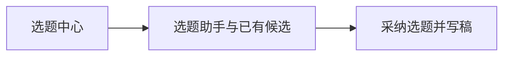

# T-1074 移除九宫格选题

用户2026-10-09明确要求“选题里的九宫格选题还是去掉吧”。优先于T-1019原有双九宫格方向。

## 范围

移除选题中心的观众任务/双九宫格配置入口及独立专用界面；取消新普通聊天、手动与每日选题任务的默认网格读取及注入：公共准备路径不调用getTopicRecommendationContext，不携带audienceTaskContext；生成提示仅对已冻结旧任务存在该上下文时保留原语义，缺该上下文不得要求gridVersion/cellIds或配对。新的普通候选不走九宫格审读门槛。已冻结旧任务、旧候选的上下文、归属、版本和采纳防伪校验保持兼容。普通选题聊天、候选筛选、雷达来源与创建项目保持可用。保留原历史配置、候选、后端兼容接口与归属校验，不执行数据删除或重发任务。

## 验收

真实页面不出现九宫格入口；非空已配置账号的新普通聊天/手动四依据/每日任务不读取网格、不注入或以配对阻断；旧冻结路径仍通过兼容回归；普通候选与助手入口保留；聚焦选题页面与交互回归、frontend检查、boundary、orphan与reconcile。独立评审通过后实施。安装版和真实供应商未测不能标PASS。仅本地提交，不push/发布。

