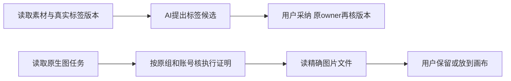

# T-1075 修复安装验收发现的素材标签观察与纯组生图证明

用户2026-10-08要求“全功能可用性稳定性验证”，沿T1074全系统操作与原中性验收授权，实际安装版暴露两个阻断。作为该验证发现的独立缺陷任务处理，不扩大模型写权限、不重发付费任务、不push/tag/公开发布，也不修改真实创作内容。

## 目标与实际失败

- 真实Pi `ai-task-b64dd921-391` 正确读到了素材，但 `assets.get` 没有标签owner的 `expectedVersion`，模型拿文件ID/updatedAt猜版本两次都被拒。不能要求用户复制内部版本号。固定 `system.read` 的 `assets.get` 结果需要提供原标签owner的真实观察目标；模型选择标签，代码不推断标签语义。
- 真实画布任务 `ai-task-b64dd921-401` 已生成1024×1024、1824488字节的pending图片；`canvas.generations.material.get` 返回unverifiable。原 `getCommittedAssetResult` 查询executionTasks用了 `eq(accountId, context.accountId ?? "")`，将纯组NULL误作空串。应沿原workspaceFilter+user，并额外保留原account-null精确身份；不能删证明检查或猜素材。

## 精确实现与边界

1. `AssistantSystemRootPorts` 增加仅原标签owner `prepare` 的只读端口，生产组合注入既有 `assetTagProposalAdoption`。只有固定assets.get且素材active、asset.tag owner装配时才补 `tagTarget:{assetId,expectedVersion}`。原public assets.get DTO/API不改；system.read仍原generic text/window响应。不增加新read kind、动作、MCP、数据表或凭据。
2. 从真实assets.get得到素材，原owner prepare读取观察，再沿原assets.get重读并与第一次完整DTO比较；素材字段变化则明确冲突，零候选/业务写，不把新版本配给旧素材说明。pending素材读取仍正常、不调用active标签观察；没有标签端口的配置不虚构版本。标签owner既有归属、active、锁读和digest算法不改。
3. `getCommittedAssetResult` 的executionTasks查询使用 `workspaceFilter(executionTasks,context)`、userId和原account身份（NULL用isNull，实际account用eq），随后继续原ownerId/kind/status、bindAssetExecution、call/receipt/file/checksum全部检查。account入口、纯组入口和组内带账号各保持原精确身份；跨组、跨用户、跨账号、空串混用、错误task/result仍拒绝。
4. 方法提示只在实际装配system.read/system.action.propose时指导复制assets.get的tagTarget；不让模型生成digest或让用户粘贴内部版本。T1074本轮功能目录精确匹配与request/action示例修复继续在原任务，旧冻结schema/tool版本不修改。
5. 使用已安装原401任务及原attempt/link恢复，确认前先核精确文件；响应未知查原ID，不另建付费任务。源修复与安装版验证分开记录；新包仍走原新鲜备份/签名/镜像守卫，不抹除当前安装失败。

## 精确写集

产品及有意义测试仅：

- `backend/src/application/chat/assistant-system-root.ts`
- `backend/src/application/chat/assistant-system-root.integration.test.ts`
- `backend/src/modules/ai-runtime/assistant-functional-prompt.ts`
- `backend/src/modules/ai-runtime/assistant-functional-prompt.test.ts`
- `frontend/src/server/persistence-client.ts`
- `backend/src/modules/ai/execution-candidate.service.ts`
- `backend/src/modules/creative-canvas/creative-canvas-result-proof.test.ts`
- `backend/src/modules/creative-canvas/creative-canvas-material-selector.test.ts`

控制面只本SPEC/相邻REVIEW/DEC/BACKLOG/模块与上下文，以及 `docs/verification/t1075/CURRENT_VALIDATION.md`、`docs/verification/t1075/result.json` 两个精确验证文件。原T1074源改动必须分别绑定，不借本缺陷扩目录。

## 验收

先实际RED：模型可用的assets.get→原target→正式候选/采纳/读回，纯组NULL真实执行→文件提交→候选→canvas selector。修复GREEN后保留原account旅程和全部证明拒绝；标签观察零业务写、元数据并发变化拒绝、pending不新增拒绝、同source幂等及改标签拒绝旧版本。两类至少各一个完整原公共owner/transport链，不用stub proof代签。

聚焦上述root/来源/画布证明与selector/原execution-candidate测试，contract/后端/前端类型、boundary/semantic/timeout原规定门及diff检查；全局旧37错误/1告警、原2后端测试类型错误、7边界与缺timeout入口继续诚实保留。独立实施复核后提交，并沿当前本地打包授权纳入下一包；安装版原401任务精确读回/文件验证/保留/放画布，标签真实Pi再验，方可完成本缺陷任务。不代签T1074全功能或用户原生验收。
