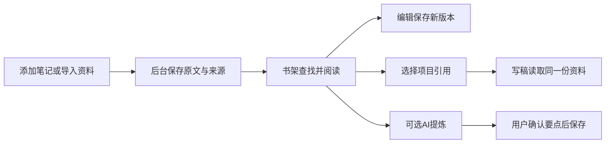

# T-1075 资料书架知识库：真实读写与创作引用

用户2026-10-09先要求调研重新设计，已明确选01「资料书架（推荐）」，追加“核心要和数据读取写入衔接起来，否则是空壳”。方向探索证据保留在 `t1075-knowledge-redesign/RESEARCH.md` 和 `style-explorer.html`；以本SPEC的正式实现范围为准。

## 用户结果与确认范围

默认 `/knowledge` 是分类/文件夹、资料列表、完整原文的三栏书架。一个主要动作「添加资料」，能直接保存整段笔记或导入既有支持文件；打开真实正文、编辑为新版本、放进文件夹、明确归档、选择现有项目引用后能进入写稿查看该引用。AI提炼复用原对话候选采纳，不作为手动保存前提。所有可见控制必须真实有效。

保留已有资料类型、文件夹、来源、原文件、版本历史、关系及项目引用。IP课、已验证经验、关系图、观点地图、标签管理和评论回流继续可由次级「更多知识视图」访问，不删除能力或数据。课程路径仍为 `?view=course`；旧 `?tag=` 深链继续走高级视图。新主视图不默认装配全图/逐条关系，不以AI或图谱失败阻断手动读写。

不新增表、索引、模型、服务、AI问答或新数据所有者；不迁移真实库，不运行外部仓库，不更新安装版，不推送或发布。操作范围是当前用户/当前账号组；旧单账号兼容沿既有归属守卫。用户明确选择并要求数据接通，授权此范围内契约复用与页面实现，不重复请求确认。

## 数据链与操作绑定

| 用户动作 | 既有契约与最终结果 |
|---|---|
| 找资料/选择类别或文件夹 | `knowledge.list`沿当前实际全量回包契约一次完整读取当前scope元数据（请求使用合法pageSize=100，不截断返回集合、不循环请求假分页）、`knowledge.folders.list`；本地显式标题/类型/文件夹筛选不做创作语义判断，列表每页有界渲染，原文按选择读取。主读取失败显示错误，禁止当空或悄悄截断200条。文件夹读失败显示局部恢复，不伪称没有文件夹。 |
| 添加整段资料 | `knowledge.create`：标题、用户选的既有类型、完整正文、可选出处、当前文件夹；后台在创建事务内校验非空folderId属于当前用户/工作区且active；非空assetId经既有asset服务端口校验可读且active，沿已有显式grant、不扩大原资源写权限；悬空或越界目标拒绝且不落库。保存成功刷新读回同一真实ID，失败保留输入；不要求AI先拆解。 |
| 文件导入 | 复用 `assets.uploads.create/complete`与既有上传URL、`material.extract`持久任务及`knowledge.create`链。原文件和来源assetId保留；PDF/DOCX/MD/TXT入口保持，部分失败保留成功项、报告失败，不自动重发原任务。 |
| 阅读/编辑 | `knowledge.get`和`knowledge.revisions.list`取得当前正文；`knowledge.revisions.create`保存完整编辑为新版本，回读当前正文，失败保留草稿，旧版本不删除。未读成功不允许拿空内容编辑。 |
| 建文件夹/移动 | `knowledge.folders.create` / `knowledge.move`。真实保存后刷新回读；新文件夹可选择；移出当前筛选清空选择/详情。 |
| 归档 | `knowledge.archive`显式二次确认；隐藏归档条目、保留历史及引用，不伪装永久删除。 |
| 用到写稿 | `projects.list`选择当前scope真实项目，`materialLinks.create`绑定knowledge真实ID；后台既有ownership与同项目同实体幂等保持。写后`materialLinks.list`确认有该引用，再显示进入项目写稿链接；刷新或重复操作不造第二条引用，项目稿面继续消费既有用料链，修正只读30条/仅投影12条使旧引用消失的截断：按合法分页完整读取metadata，实体分批限并发，卡片有界分页展示；知识预览按需读取当前正文而非空预览。 |
| AI提炼/经验/关系视图 | 复用本地打开Copilot的原scope和确认门、既有高级视图；无新SDK、语义分类算法或直接AI写库。 |

## 状态与物理边界

主页面loading/empty/error均有明确下一步；资料为空仍能添加。详细读取错误能重试，不显示旧条正文。筛选、选择、编辑草稿与引用目标分别属于明确ID；`selectedId == null || visibleIds.includes(selectedId)`、`detail == null || detail.id == selectedId`。筛选使已选项不可见时采用clear策略。返回/刷新由URL恢复类别、文件夹、标题查询和可见选择；切scope立即卸载旧选择/正文/输入，旧异步返回不覆盖新scope，提交开始后禁止双发或误切目标。

前端只组合契约客户端、组件与页面查询适配；所有领域写入经backend service。资料书架轻读投影不含业务归属判定；后台原ownership/资源授权/版本/幂等保持。错误说清读取/保存失败、原资料未丢和重试入口，不显示控制面ID或内部实现错误。默认失败不回落fixture，不把缺数据编成条目或统计。

正常1366×900、最小1024×768，390作为附加极限检查；小窗压缩目录、保留可读正文与操作，不靠小字塞满。列表/正文独立局部滚动，长标题换行，弹窗有焦点返回、Esc和键盘操作。沿用CreatorOS tokens/Button/Input/Dialog/图标，不另造品牌。缩放200%复查。正式稿按oil-ui-pro独立视觉评审及任务走查，独立上下文，不用分数代替业务验收。

## 验收与Gate

正式页面合同见 [PAGE_SPEC](t1075-knowledge-redesign/PAGE_SPEC.md)，其操作/转换/机器合同是本任务组成部分。先经独立SPEC审查，再当场TDD RED→GREEN：全量资料与分页引用读、主从一致、失败保留/重试、正文版本和引用真实ID。frontend类型/lint与相关知识录入/详情/高级兼容回归；backend知识/引用归属及持久集成；实际浏览器两视口跑保存→重载→正文编辑→文件夹移动→项目引用→项目读回，包含第二实体、空/错/慢/返回/重复与跨scope拒绝。收集当场RED、可见文案、截图和正式frontend-validation收据，commit/watched_paths绑定真实实现后才完成任务。

运行LED-047与超时公共门（复用导入/同页弹层时不降低既有预算）、boundary、orphan、pmem sync与完整reconcile。全局既有34错误归T916/T1015/T1018，逐项对比，不写全绿；新增本任务缺陷必须修复。真实供应商语义/安装版/生产数据未验单独报告，不从隔离数据库旅程推定。
