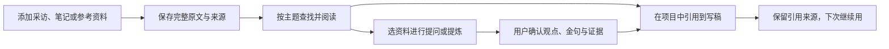

# 知识库重新设计：先能存、能找、能用

调研日期：2026-10-09。来源为产品官方文档、官方仓库；未安装或运行外部仓库。本报告是设计建议，不是已确认的产品方向。

用户要的是：把采访、读书笔记、自己的经验和参考资料存下来，下次写稿能找出来，AI使用时知道依据来自哪。

## 现状为什么不好理解

实际代码入口：`frontend/src/features/knowledge/knowledge-page.tsx`、`knowledge-interactive-region.tsx`、`knowledge-dump-zone.tsx`。当前页面同时承载我的知识、IP课、知识倾倒场、观点/证据/金句/观众问题等分类、关系图、观点地图、统计、标签、经验和洞察；文件工作区已有组件与接口，但入口开关为false。具备图谱VM时初始视图优先关系图。术语和视图数量抢占主要任务，资料列表与完整阅读反而不够突出。

这说明不是缺功能，而是主入口和顺序不清楚。上述为代码及隔离页面观察，尚未做真实用户可用性访谈。

## 同类产品与开源项目

| 参考 | 它怎样让用户理解知识库 | 我们可以学什么 | 不照搬什么 |
|---|---|---|---|
| [Docmost 官方仓库](https://github.com/docmost/docmost) / [产品界面](https://docmost.com/) | 空间、页面树、编辑阅读、搜索和历史 | 目录稳定、原文成为主体、先读后加工 | 企业协作/管理员权限配置；官网AI能力不能当作开源版均提供 |
| [Outline 导航](https://docs.getoutline.com/s/guide/doc/navigation-Nxnr2lWbck) / [文档集合](https://docs.getoutline.com/s/guide/doc/collections-l9o3LD22sV) | 左侧首页、搜索、集合与嵌套文档 | 明确位置，读文档时不离开资料目录 | 团队权限和公开分享；当前仓库许可证为BSL 1.1，不能把代码公开等同自由开源 |
| [NotebookLM 官方聊天说明（当前重定向至Gemini Notebook）](https://support.google.com/notebooklm/answer/16179559?hl=en) | 用户选择资料范围、提问、从引用回看原文 | 先看清这次AI用了哪些资料，每个事实能回溯 | 不默认复制音频播客、测验等额外生成场景 |
| [AnythingLLM](https://github.com/Mintplex-Labs/anything-llm) / [资料使用说明](https://docs.anythingllm.com/chatting-with-documents/introduction) / [聊天模式](https://docs.anythingllm.com/features/chat-modes) | 区分本次附件、工作区长期资料；资料问答和自由聊天不同 | 清楚区分保存与本次引用范围，问答无资料命中如实说没有 | 把向量数据库、相似度和模型参数放在普通用户主页面 |

许可证核查仅用于辨别候选代码复用边界，不构成法律结论。Docmost README声明core AGPL-3.0，企业目录另有许可；AnythingLLM仓库声明MIT；[Outline LICENSE](https://github.com/outline/outline/blob/main/LICENSE)明确BSL 1.1且非OSI开源许可证。本轮建议借鉴交互，未复制实现代码，未决定接入任何运行时。

## 两个可比较方向

A：资料书架（推荐）。页面主角是原文。左侧分类/主题，中间资料列表，右侧完整阅读。录入先保存整篇原文；想加工再选“提炼要点”，AI只产候选，确认后保存。适合日常积累和写稿找素材。

B：研究桌。页面主角是本次研究问题。先选资料范围，再问问题，回答旁可以打开证据原文并保存引用。适合围绕一个主题研究、对比多份长资料。需要补齐有来源的问答契约与完整回归后才可正式实施。

两者保持现有紫色品牌、字体、圆角、全局导航。小样A使用目录/列表/阅读三栏；B使用搜索区与资料/阅读两栏，先验证资料发现和阅读的骨架；**B本轮没有实现AI回答、引用定位或问题理解**，输入只按资料标题筛选，不应当作语义问答验收。未来B的AI提问不能用关键词算法替代模型。

## 建议的使用顺序

建议默认显示资料列表；关系图/观点地图进入次级视图；“知识倾倒/知识原子/蒸馏”分别用“添加资料/要点/提炼”表达。IP课保留可访问入口但不混入私人资料；是否换到学习页需用户选择，不自行改全局IA。经验保持来源和验证状态，不把AI建议冒充实测经验。

## 现有能力与建议能力

| 能力 | 当前事实 | 正式改版需做 |
|---|---|---|
| 文本、PDF/DOCX/MD/TXT导入 | 既有上传/提取/录入链；本轮只核查隔离文本录入 | 保留确认、进度、部分失败与原文件，重排入口 |
| 目录与正文 | 文件工作区已存在但暂停入口；正文预览可复用 | 明确主题/目录与类型的关系，不迁移或删除历史数据 |
| 搜索 | 标题过滤及既有语义搜索入口 | 区分找资料与问资料；模型不可用保留标题搜索 |
| AI提炼 | 既有对话候选及确认门 | 提炼不替代原文；完善原文与要点关联呈现 |
| 写稿引用 | 项目已有material-links/参考资料能力 | 明确选项目、引用范围、写后回读，不复制后端模块 |
| 资料问答和段落引用 | 本轮未实证为完整能力 | 新SPEC明确资料范围、版本、出处与无答案状态后实现 |

关键状态：空库先添加资料；无搜索命中不编造；解析失败保留原文件和已完成项；AI失败可继续手动保存与阅读；跨账号组/切换资料不回写旧结果；长文分区与图谱按需加载。正式实现仍遵循后台单写者、候选采纳和既有账号组归属。

## 本轮证据与下一步

`docs/verification/t1075/`保存隔离页面截图和操作证据；候选使用项目React组件与真实后端读取，合成文本只存入独立临时数据库。未复制真实用户资料。对比页保存截图，离线可打开；候选截图是静态样本，不能操作业务。临时开发预览路由取证后移除，源代码留在本目录供选定后实现。

未选定候选，未做候选独立视觉评分，未声称任何AI问答/生产迁移/安装版验收PASS。按oil-ui-pro，对比方向先交用户；选定后再深化并独立评审。独立评审可以检查可读性、导航与主操作，预计一轮约5–10分钟，1次视觉评审调用；本轮未默认派发该工作。
