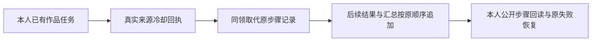

# T-1075 来源冷却说明与后续结果步骤维护

Growth T-213 / DEC202 已明确准入的现有 T230/T243/T1066/T1070 与当前正式 Mother R01/R05 实现维护；不新增协议或审核周期。

操作者在本人项目已有作品上执行原转录任务，需要在原任务的公开步骤看到当时来源限流冷却事实，并继续拿到图集或转录结果和最终汇总。恢复沿原失败任务 retry→claim 和原已确认结果，不替换付费键或取消/未知语义。入口及安装版 UAT 仍待验。

## 准确实施边界

仅 SourceHost、原 WorkflowHost 和一个新增集成测试；Root 已审组合差异 5eae8508 与测试 v2 3445c1a7。Source 保原 typed 回执、原 payload、严格 owner/channel/lease/deadline/取消、已确认结果晚响应抑制、事务失败回滚；仅写历史当时抖音来源限流冷却事实，不承诺等待或取消，不将 clamp 当 raw 时间。Workflow 原文件内锁内 max+1 追加，稳定 ID 与归属保留，store/summary 同用 helper；保 T208 per-attempt summary、五类计数、终态同事务与 paid keys；历史日志不重排。

## 验收

真实 memory PGlite、原 Gateway、公开 AiService.listSteps/requireTask，原 Node25.9/pnpm10.32.1、20s、maxWorkers1/retry0。先 typed cooldown 返回且公开步骤缺说明 RED，再两 Host GREEN；核已确认结果晚响应、截止与取消插入回滚、未知 SQL 拒绝和原 retry/summary/付费账本。保相关132、runner36、原170库存与四原FAIL，必要 typechecks。零真实供应商、用户目录、环境秘密、浏览器或生产。所有测试结果仅本地工程证据，不代入口 UAT。

T915 当前母规范已正式 PASS；partial 用户循环候选未批，本任务不实施 partial/新恢复命令/新 DTO。
