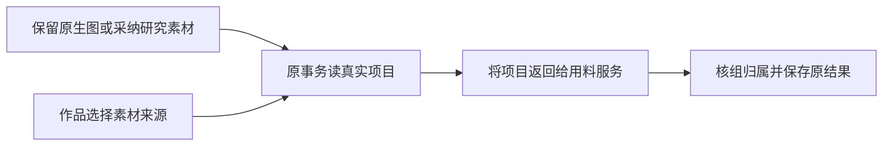

# T-1077 修复采纳与作品素材读取的项目返回值

用户2026-10-08要求继续全功能验收。安装版b640原生图401的证明和文件已恢复，但`ai.tasks.confirm`返回404“项目不存在”；公开`projects.get`实际可读原项目104。代码核对发现组合根的`linkAdoptedMaterial`与`researchMaterialAdoption.linkKnowledge`只await项目校验并返回void，而原MaterialLinks service在组入口需要校验返回的项目groupId。同类`workSourceService`素材读取适配也丢弃返回值。此缺陷独立登记，不扩大T1075固定8路径。

## 精确行为与边界

仅将上述三个MaterialLinks适配中的`assertProjectOwned`接到同一事务/数据库的原Projects public service `getProject`并返回其真实项目行。保留组、用户、账号、父根、活跃状态、冻结版本和事务锁校验；不删MaterialLinks检查、不伪造项目对象、不添加权限绕过。其他只要求void的端口保持原样。公共API/schema、数据归属、UI及生成服务均不改变。

产品与有意义测试写集只有：

- `frontend/src/server/persistence-client.ts`：三个私有适配返回值。
- `frontend/src/server/__module_integration__/canvas-original-worker.persistence-client.test.ts`：沿原Settings→Canvas→实际本机HTTP worker→精确文件→confirm→原材料来源链增加纯组/组内账号，保留旧账号旅程，核同任务回放不重复生成/链接及越权拒绝。
- `frontend/src/server/__module_integration__/material-parent-port.persistence-client.test.ts`：隔离临时库的真实组合根研究候选采纳→知识/项目链接/读回，以及作品素材来源选择；构造候选只用原AI service，候选夹具不能声称真实模型。核纯组/组内账号/旧账号和跨组拒绝，无真实内容操作。

控制面仅本SPEC及相邻review、BACKLOG、DECISION_LOG、模块注册/上下文/事件和`docs/verification/t1077/CURRENT_VALIDATION.md`、`result.json`。根单写者，独评只写审核文件，不并行写产品。

## 验收

先独立审核精确范围，再实际RED→三个适配最小GREEN。公开组合根测试使用独立PGLite目录和独立媒体目录；单次执行/观察至少两分钟，外层覆盖串行余量，不以重复重试洗红。前端/contract类型、MaterialLinks原backend回归、boundary/semantic/timeout规定检查与diff检查。全局既有红项保留，不修改断言或基线以洗绿。

独立实施复核后提交并纳入新本地包；新鲜备份沿原完整范围和原占用守卫，不释放备份、不动激活。安装版恢复原401及原link，先读回再沿原保留幂等键确认/精确读回和放画布，绝不重发生图或调用新生成确认代替保留。必要的旧失败幂等回执按真实CLI恢复策略处理，不能换键冒充未知成功。完整AI助手矩阵继续T1074/T1062，不代签原生或用户验收，不push/tag/发布。
