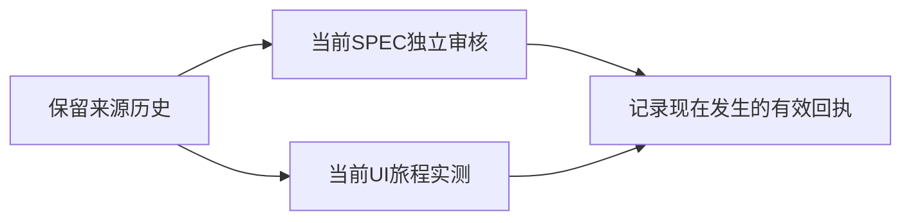

# T-1082 合并来源任务的当前评审与验收记录复核

T1080 真实本地main出包后完整reconcile为44错误/1告警；其中7条是合并后当前任务归属缺口，不能全部写成旧债。源码与来源历史已保留，原链单独字节归档，但不等于当前任务已拥有可校验评审或安装版验收。

5个当前任务需要实际独立完整SPEC评审：`T-1073`、`T-1072-owned-devices`、`T-1069-completion-json`、`T-1070-transcript-reliability`、`T-1063-release-pipeline`。按reviewctl支持的initial流程建立现在发生的新评审事件和独立快照，保留原来源review文件/链，不重哈希、不复制旧PASS签当前任务，不仅核对来源就空finding洗绿。

另2个任务`T-1023-agent-recovery`、`T-1022-agent-recovery`保留了原main的真实UI历史，但当前alias缺taskctl completion，旧报告的任务绑定和watched paths也需核对。必须先恢复当前任务可执行的真实旅程契约，再实际执行并由taskctl记录，不能手改历史完成状态、复制旧completion或把来源核对当真机验收。既有功能仍由原服务和真实数据归属守边界，本任务不新增产品行为，不修改检查器绕过记录。

逐项失败和支持接口限制详见[独立归因](../verification/t1080/post-package-control-receipt-independent-review.json)和[接口核对](../verification/t1080/post-package-receipt-interface-independent-review.json)。18条更早review旧债仍属原T1025等任务，19条教训失败不因本任务自动清除；T1081只覆盖原短预算及静态扫描误报。原完整对账失败保留，先独立复核必要范围再实施；该登记不构成PASS，也不代签安装或用户验收。
