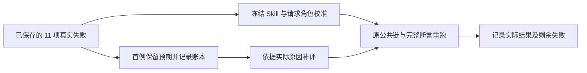

# T1085 聊天集成测试协议校准与计划失败诊断

本文件承接本轮实际出包、安装后的测试校准，须由独立审核回执准入后才修改测试。T1085 仍完整解决本轮 11 项真实失败，不另拆任务、不将未知首例预先算作 fixture 漂移。初版产品修改数为 0；本轮实际诊断已证明参数签名缺陷，现补入下方两处生产写集及回归矩阵，待独立复评准入后实施。其余产品写集不变，不改断言洗绿。

基点：`3a60fafc4fd299d2a0d2efc403ee6a24691075de`；记录时间：`2026-10-08T15:59:47.360218+00:00`。本草稿仅通过只读源码及既有日志形成，未执行测试、模型、业务 API、数据库或 App 操作。

## 问题和目标

前端原三文件串行实测 23 例中 **14 PASS / 9 FAIL，exit 1**；后端原计划集成 **2 PASS / 2 FAIL，exit 1**。使测试正确承接当前冻结 Skill、流式子模型和安全原任务续跑合同，并修复 Pi 占位参数误触发终态失败门，保留归属、候选、幂等、CAS、账本、不重发与真实输出断言，再以相同公共 service/Worker 链实证全部 11 项。确定性 HTTP/PGLite 夹具不代签安装版、真实模型或全功能矩阵。

## 已证实事实与本轮诊断更新

| 失败族 | 已有事实 | 本轮允许动作 |
| --- | --- | --- |
| read-host 1 例 | `structuredGeneration` 开启，却只冻结四项 Skill；最终严格门报“原任务缺少生成节点 Skill” | 补齐同场景真实 Skill 快照；校准后段流式子请求 fixture |
| submission 8 例 | planning/review/publish 各两例为 `STRUCTURED_OUTPUT_INVALID`；script 两例 `no_evidence`。子模型实际 `stream:true`，旧 fixture 把它们派到根聊天文本响应 | 按真实工具声明/请求角色分流，按请求编码合法 JSON/SSE，保留业务断言 |
| plan 暂停恢复 1 例 | 无供应商结果、无子调用/外部副作用的根模型符合原安全续跑选择；实际 `succeeded`，旧断言要求 `unknown_result` | 对照原恢复合同校准为同任务继续，增强原计划/回执/CAS/不重放证明 |
| plan 非法回执纠错首例 | 实际诊断已取得：参数不同，第三轮却无工具收口；Pi placeholder:{} 被误当真实参数签名 | 保留原成功、五轮/四工具、零副作用和 CAS；沿后端 reservation.input 修正内部签名，见补充 |

既有相邻诊断前文曾将首例直接归为“重复相同签名终态收口”，该定因在本草稿中不采用。`chat-pi-loop` 的签名包含规范化 args；现有两组 args 不同，初版最终日志没有该例完整 lastError/调用账本，未预先定因；现已通过本轮增强诊断补齐，并在下方记录真实产品缺陷，仍不能减少五轮或改为失败预期。相邻诊断末尾还已纠正此前“chat-context 日志表示全部准备完成”的说法；以最终缺 Skill 栈为准。

## 精确测试写集

原测试校准只准以下三个已有测试文件；可在文件内沿原测试风格使用有类型的局部分类/响应 helper，不新增生产 helper 或共享运行时，不修改原产品 import/装配逻辑。

1. `frontend/src/server/chat-read-host.integration.test.ts`：完整装配例沿 `prepare-chat-reply.ts` 的真实清单解析快照，即 `requiredSkillIdsForTask("chat.sync",{surface:"topics"})` 加 `topic.enrich / positioning.generate / calibration.diagnose / topic.generate / review.insights / knowledge.distill`，使用原 `runtime.resolveEffectiveSkillSnapshot` 与 `workerSkillSnapshotSchema`。不手造空 Skill、不修改 Skill 正文/结构 schema，保留账号 overlayRevision 与 `context.projects / script.hooks / topic.generate / brief.fill` 完整工具目录断言。

   该例另有 `!stream` 识别 script.hooks 子模型和 stream 请求计数的同族隐患。必须按完整请求实际工具声明/消息角色识别根模型与子模型；`stream` 只决定响应格式。子模型返回原合法 hooks JSON，流式请求按原 SSE chunk / finish / usage / `[DONE]` 协议响应。根请求仍分三轮读取、hooks、最终答复，子请求单列；保留原总请求 4、账本 6、全部 settled、账号隔离、候选内容及消息实体断言。

2. `frontend/src/server/chat-task-submission.integration.test.ts`：参数化工厂例按本例冻结工具的真实 provider 名称/消息角色区分根聊天与子节点。结构化 planning/review/publish 和 script 授权子节点返回原 schema 所需结果；图片请求按实际媒体协议/请求路径识别，保持原图片分支，不因缺 `stream` 推定图片调用。根模型最终回合也要按角色识别，不能把工具表为空时一律猜成子节点。未知或含糊请求记录诊断并按 fixture 错误显式失败，不靠文本关键词猜业务意图。

   同一个分类结果用于响应与观察断言：原 `requests.filter(stream)` 的根请求集合、`requests.filter(!stream)` 的子请求集合改为按角色取集合，保持原“非空 1 子请求、空稿 0 子请求、根第二轮含 childId”业务意义。不得删除首次准备失败 0/1 两族、原候选/整稿/归属、同 attempt 复用、子任务唯一、原 prepare 次数、确认回放不重复发布/素材、empty 零派发等断言。

3. `backend/src/integration/chat-workbench-plan.integration.test.ts`：暂停例沿原 public command 与 Worker 继续原 executionTask/aiTask，验证冻结 payload/Skill 与原截止期未换，旧无结果根调用按当前合同废弃并以同逻辑请求恢复，原已结算 plan.update callId/result/计划 revision 1 在恢复前保留。恢复后只新增真实 revision 1→2 的完成计划调用，使用原 operationRef；初始建立计划不重放，tool 数和请求数严格覆盖当前实际合同（原 fixture 预设第三轮完成计划、第四轮终结，预期四次请求及两个计划工具调用，须以真实账本核对）。保留原关闭在途连接、pause 真状态、CAS、任务 ID、回执归属及无新任务证明；不能将外部结果未知或有子调用的情况也放行，生产恢复门不变。

   首例保留原 `succeeded / requests=5 / tools=4 / plansBeforeRepair=[null,null] / planRevision=2`、两次 invalid_input 无副作用及 operationRefs 原断言。只补失败路径诊断：同一任务/原调用 ID、lastErrorCode/lastErrorMessage、请求 ordinal/声明工具/tool_choice、两次 args、调用 sequence/kind/status/parent/retryOf/inputDigest、完整隔离 fixture resultText/providerResult、当时计划/CAS。诊断应在原 assertion 异常或 finally 清理前输出，异常继续抛出，不能 catch 后成功返回。禁止采集请求头、token、连接文件、用户 DB 或安装版私有配置。

## 验收与执行约束

- 三个写集正式准入后才改测试；现出包阶段仓库完全冻结，本草稿没有授权任何当前仓库改动。
- 保留已发生 RED 及旧诊断全文，补测/校准记录真实 argv、退出码、日志 SHA、retry 0 和完整终态。不得补拍不存在的早期 RED，不跳过或删除任何原用例。
- 实跑原前端三文件串行 suite 和后端计划四例，保留完整工具目录与全部原业务断言；前端 23 例与后端 4 例全部逐项记账。针对首例先按增强诊断取得实际原因，随后补 SPEC 独评再定校准；本轮诊断已产生下方补充并等待独立复评。这是同一个完整 T1085 的证据依赖，不是缩减范围或先签部分完成。
- 不修改任何现有 timeout 断言或生产预算/重试/未知结果边界；执行外层覆盖原 suite 的完整串行及清理。原短 budget 静态债和全局失败按真实结果保留，不借本任务全面整改。
- 跑测试所需的 Worker 构建、隔离 DB/fixture HTTP 生命周期需按原测试入口执行并完整 finally 回收；不使用用户数据库、付费模型、当前 App 或新业务数据代替夹具。**本草稿阶段没有执行这些操作。**
- 完成校准后核源码 diff 只含下方两处准入产品文件，实际 frontend/backend 类型和 boundary/semantic/timeout 结果逐项记录。失败原因若是产品 gap，必须重新明确必要产品写集并补评，不可把测试改成弱预期。
- T1085 不能在 11 个真实失败未闭合时标全绿；T1084 安装复验、原会话消息与任务读回、原生 UI、Codex 实际执行和 T1062 全矩阵由原任务继续，不由此测试草稿代签。

## 只读来源绑定

| 路径 | SHA256 |
| --- | --- |
| `frontend/src/server/chat-read-host.integration.test.ts` | `3005663879d77e8a980b3b667baad327738048edc2c0ea67d179797bf3ac91c3` |
| `frontend/src/server/chat-task-submission.integration.test.ts` | `10527f3afdf337c731e25ad8c5f8129ec03de57a49668fce184483b9fa48abd5` |
| `backend/src/integration/chat-workbench-plan.integration.test.ts` | `e166b824e3c301dfaccbaea5836bafa98b6ee0b6611c9290284e43666eba1585` |
| `frontend/src/server/prepare-chat-reply.ts` | `9cf8800c09c2f5b428a566f7de3cf1b9e0e894e2ecbddc0a3a70c52127e2fbc5` |
| `backend/src/modules/ai-runtime/chat-turn-preparation.ts` | `4bcd064091f18250f1aaf97f6efdcdc06d4b426158dbdc0604cc67e404977ef5` |
| `backend/src/modules/execution/model-call-recovery.ts` | `7acf67fa290f352b778a9236cd5a992b4590730fc5890469d34d83724ef75b40` |
| `ai-worker/src/runtime/chat/chat-pi-loop.ts` | `1bbde6d6fe9f126e4f10e518bf5dbb7d25a34f08b67c4bbebfd82e31d8f7da9c` |

以下证据在本草稿同目录；日志中的 exit 由主会话真实进程观察，统计及失败栈已只读核对。

| 文件 | SHA256 |
| --- | --- |
| `adjacent-integration-diagnosis.md` | `5ae688b1aaadeb873dff38d93e12810a402d01c5e165720c6ff688d11dac4abe` |
| `public-chat-regression-serial.log` | `9c2efb7143bf250c192539b5051d460779bd56ccccd59db48b04aa6da20ced91` |
| `public-plan-integration.log` | `b127d2e0fec582a84f404e44511731d988c00b01c9866c52fe40151a25257c11` |

控制写集：本 SPEC、同名独立评审及输入、`docs/verification/t1085/`、T1084/T1062 本轮事实报告、BACKLOG/BACKLOG-details/PROJECT 和流程命令实际生成的事件/回执。打包脚本不变；本次生产修复后的 main 须重新出包并验证安装，不能拿已安装3a60的运行时代替新源码。用户明确构建不备份，真实稿件、激活和用户数据保留。

# T1085 实际诊断补充：终态工具失败须按后端权威调用参数签名

- 状态：已合入本 SPEC，须独立复评后准入实现。
- 基点：`3a60fafc4fd299d2a0d2efc403ee6a24691075de`
- 本轮未修改生产、测试、任务状态或事件，未运行模型、数据库或共享构建。

## 新证据与根因

后端四例增强诊断实际为 3 PASS / 1 FAIL。非法回执纠错例保留原成功断言后，实际第三次模型请求已变成 `tools=[] / tool_choice=none`，模型 fixture 仍按原旅程发出第三个 `plan_update`，宿主最终以 `CHAT_FINAL_RECOVERY_TOOL_CALL` 失败。

两次失败调用的真实参数不同：

1. `artifactRefs:[null]`，在 schema 校验阶段返回 `invalid_input`；
2. `operationRefs:["invented"]`，在计划引用校验阶段返回 `invalid_input`。

`plan-repair-diagnostic.json` 同时证明两个模型回执的 `tool-call.input` 保留了上述不同 JSON，后端 `reserveAgenticTool` 回执也已有 `input` 字段。问题发生在 `chat-pi-loop.ts` 的适配层：收到 `tool-call` 事件时，为避免 SDK 在账本外再次校验，Pi message 只写入 `arguments:{}`；Pi 随后调用 `execute(def,args)` 时传回这个占位 `{}`。终态失败门当前直接对该 `args` 做 canonical 签名，于是两个真实不同调用都被误签成 `[plan.update,invalid_input,{}]`，错误触发“两次相同不可重试失败”的有限收口。

证据绑定：

- `plan-repair-diagnostic.json` SHA256 `a1af5d05a026af9b20979724b78057a8dcf4c33749df2ebdf0c18c5529ba369b`
- `plan-calibration-first.log` SHA256 `6af6acad82fcfde03b3333f01966876ece0ea475faaac78ac7831e26ce163196`
- `ai-worker/src/runtime/chat/chat-pi-loop.ts` SHA256 `1bbde6d6fe9f126e4f10e518bf5dbb7d25a34f08b67c4bbebfd82e31d8f7da9c`
- `ai-worker/src/execution/chat-worker-run.ts` SHA256 `440956e341527dbf83effcc5eccbefcfedd1151a695fd4480c3af230c9fde6a9`

这是真实产品运行时的错误收口缺陷，不是把 fixture 改成终态失败即可接受的协议漂移。原用例的五轮纠错、最终成功、计划 CAS 与真实回执引用预期应保留。

## 最小结果约束

终态失败去重的参数部分必须来自**后端已绑定并返回的原工具调用输入**，不能来自 Pi 的占位参数，也不能只信任未绑定的模型原始字符串。

建议在现有两个内部运行文件内闭合：

1. `chat-worker-run.ts` 在 `reserveAgenticTool` 返回后，以 provider `toolCallId` 记录 `agenticToolReservationSchema` 已校验的 `reservation.input`。该输入来自后端根据已结算模型回执完成的真实绑定，和执行/授权使用同一事实源；无须新数据库列、协议版本或外部 API。
2. `ChatPiLoopOptions` 增加内部只读回调，例如 `terminalToolFailureInput(toolCallId)`。仅在工具已经执行并返回 `status=error / sideEffect=none / retryable=false` 时读取；`chat-worker-run` 从上述 map 返回权威输入。
3. `chat-pi-loop.ts` 的签名改为 `[原 definition 名,error.code,canonical(authoritativeInput)]`。Pi `arguments:{}` 继续只承担“禁止 SDK 二次参数校验”的既有职责，不再被当成业务输入。
4. 回调缺失或 provider toolCallId 没有对应的后端 reservation 时，生产 Worker 必须 fail closed 为既有未知回执错误，不能退回 `{}` 后继续累计终态失败。纯 loop 单测可显式提供签名输入；不能让缺事实的调用静默共用空签名。
5. 签名输入只用于判断“是否重复同一个不可重试调用”，不重新执行、不改工具结果、不改计划、不改变已结算回执、费用、授权、任务归属或 CAS。

不建议直接以 `event.input` 字符串签名。它虽能证明本次 fixture 两组 JSON 不同，但后端才是参数解析、默认值、schema 及调用绑定的权威；以原始字符串签名还会把键序或等价编码误判成不同调用。

## 精确实现范围候选

生产候选仅两处：

- `ai-worker/src/runtime/chat/chat-pi-loop.ts`
- `ai-worker/src/execution/chat-worker-run.ts`

测试候选：

- `ai-worker/src/runtime/chat/chat-pi-loop.protocol.test.ts`：证明 Pi 执行占位参数均为 `{}` 时，终态门仍使用显式权威输入；不同输入不收口，相同输入第二次后才进入无工具有限收口。
- `backend/src/integration/chat-workbench-plan.integration.test.ts`：保留原非法回执纠错完整五轮及全部原断言，增强验证第三次请求仍有 `plan_update`；另增加或参数化真实 Worker 同参数重复族，证明请求三为 `tools=[] / tool_choice=none`，只在真实相同参数时有限收口。

若实现需要修改 contract、后端端口 schema、数据库、产品 API、权限、费用或 UI，则超出本最小草稿，必须重新列写集并独立评审；当前源码显示 reservation 已携带 `input`，没有这种必要性。

## 必验矩阵

1. **不同参数、同错误码**：本次 `artifactRefs:[null]` → `operationRefs:["invented"]` 不得触发重复签名；第三轮工具目录仍存在，后续按原真实回执修正并最终成功。请求 5、工具 4、前两次均为无副作用 `invalid_input`、计划 revision 2、成功步骤引用第三个真实工具 callId。
2. **相同参数、同错误码**：两个真实调用的后端 reservation.input 深度等价；第二次后才进入无工具收口，第三次请求明确 `tools=[] / tool_choice=none`，不第三次执行工具，终态失败引用两条真实 callId。
3. **等价 JSON 编码**：键序不同但后端解析后输入相同，应视为相同；数组顺序和数组值不同必须视为不同。不得用原始 JSON 字符串比较。
4. **不同工具或不同错误码**：不得合并签名。
5. **回放/已结算 reservation**：仍读取原后端绑定 input；不得因重启、checkpoint 或历史回放退回 Pi `{}`。
6. **缺权威输入**：fail closed，不能生成“相同空参数”的终态判断，也不能重放副作用。
7. 原 `chat-pi-loop.protocol`、原后端计划四例、Worker/type/boundary 回归全部实际运行；旧 RED 与本次诊断保留，不补拍历史 PASS。

## 非目标与边界

- 不把非法回执首例改成部分失败、终态成功或减少请求。
- 不放宽两次真正相同不可重试调用后的有限收口。
- 不让 Pi/SDK 接管后端参数校验，不改变 `arguments:{}` 的隔离目的。
- 不新增外部 API、数据归属、安全角色、数据库字段、模型调用、凭据或用户数据读取。
- 测试不代签 T1084 安装复验或完整聊天可用。

本根因、两处生产写集和上述矩阵现已补入本 SPEC；新的产品修复须通过独立复评后实施，原已准入的测试校准继续。

本补充的控制写集额外允许同名 `.review-recheck-input.json`、`.review-amendment-input.json` 及独立复查输入/报告。缺权威输入仅说明原调用证明损坏，沿现有工具未知回执错误处理；不新增针对合法已结算调用的质量门。新单测与公共链观察使用不少于120秒预算，既有测试短预算保留在T1081而不为本轮洗绿改动。

## 本轮前端重跑后的后段 fixture 补充

实际原三文件串行 `--retry=0 --no-file-parallelism` 在最初校准后为20PASS/3FAIL（原23例），日志 `frontend-calibration-first.log` SHA f0fc7e98359cbb17de0534f3fa5f55abdca57da02ea3ce676b0c098899a2bb1d。原9FAIL中六项已通过；后段新增可见失败不隐去。

- 完整装配例冻结完整清单，却只给task host部分ports，实际缺 `script.draft / publish.package / cover.generate / research.autonomous / material.screenshot / web.read / material.generate`，在零模型请求时拒为 CHAT_WORKER_INPUT_UNAVAILABLE。此例校准为使用原 `prepare-chat-reply.ts` 对应 worker/atomic 选项（不裁剪完整目录），原runtime现成prepare/wake端口注入createChatTaskToolHost，并组合原createChatIngestionTaskToolHost；不能造任意pass-through工具或空executor。保留完整工具目录、实际4请求6ledger/隔离和候选断言。
- 两个publish非空例已取得真实候选，但采纳时原publishing owner正确拒绝未登记的假accountId:a。fixture通过原accounts.create创建中性抖音平台账号，用返回真实accountId作为后续项目、稿件、父/子任务与采纳上下文；不改生产归属门。空稿原零派发、其它tool的a账号夹具及同attempt/确认幂等断言保持。

以上仍仅在原两前端测试写集内，服务/Worker产品写集不扩大，正式复评准入后修改。原假账号的后端拒绝是正确行为，不能将平台账号登记称作真实扫码/login。
