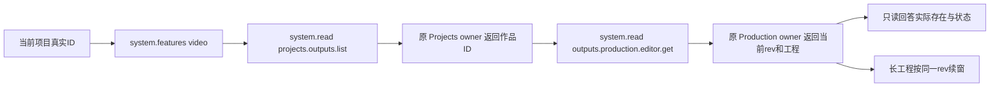

# T1086 补齐 AI 助手发现与读取原生剪辑工程

**正式 SPEC，待独立评审准入。** 已由root登记到看板，尚未修改产品或测试；未运行付费模型、业务 API、数据库、App 或新增运行时。T1086 目标是让助手在既有授权范围内发现真实作品并读取原工程，正确回答用户的只读问题，沿原 owner 保存候选与用户采纳边界，不增加第二执行器。

基点：`3a60fafc4fd299d2a0d2efc403ee6a24691075de`；观察时间：`2026-10-08T16:21:08.072154+00:00`。T1085 正在串行处理自己的三个测试，本草稿不修改它们；原 plan 首例已在T1085通过实际账本独立诊断，不混入本任务产品范围。

## 已发生的问题

安装版中性只读请求明确要求核对当前项目的主脚本、文章、图文和视频，禁止写入、候选、生成、渲染和操作其它项目。真实 Pi 任务 `ai-task-efc7b28d-117` 最终 `succeeded`，但回答 `project-58776bff-104` 没有可编辑视频工程。消息 parts 中实际只见 `artifacts.list / context.project.lifecycle / artifacts.versions.list`；`new-installed-read-steps.json` 是 total 0，不能把它冒称完整工具账本。

原公开 `installed-editor-reopen.json` 对同项目 `output-58776bff-119` 明确返回 `revision:7 / state:editable / productionId:production-58776bff-169`。主会话已有原导出 8.16 秒成功验收；本次只读另核到公开下载摘要 HTTP200、199098 字节，不重新下载或代签媒体解码。任务执行成功不代表回答事实正确，原错误回答和请求键保留。

三个确定性缺口：

- `projects.outputs.list` 已在助手只读目录；`assistant-system.ts` 没有装入 `productionOperations`，没有 `outputs.production.editor.get` 分支，因此模型无法通过现有 `system.read` 读取工程。
- `video` feature 的 reads/actions 均为空；当前任务没有冻结 editorTarget，`work.editor.read/propose` 不存在。不能用“没有当前编辑选区工具”推断项目没有工程。
- `context.project.lifecycle` 只投影 artifacts/materials/publications 等，没有 outputs/原生工程；当前项目指引优先生命周期，缺少再读作品与工程的路径。空 artifacts 或无 workCompositions 不能证明无视频工程。

## 用户授权与拟 DEC

用户持续授权 T1062 全功能可用性验证及既有 gap 修复；本次原请求明确为当前项目只读。root 正式准入时记录 DEC 与实际授权来源：将既有 GET 纳入助手固定只读协议，并增加原生工程续窗的机械 revision 条件；同时为旧冻结任务保留精确旧读取权限和目录。此为服务契约及执行指引变更，不新增创作语义策略、Skill 正文、公共生产 GET 或写权限。未发生正式 DEC/评审时不把本草稿记作 PASS。

## 结果与调用链

不扩展 lifecycle DTO 或另造工程索引；明确它的观察边界，复用现成作品列表和原 Production GET。既有链为 `assistantSystemRoot.read → compositeTransport → production.transport → productionService.getEditor → productionEditorRepository.read`，它从 output→project 校验 user/workspace、作品与项目归组、production 与原父归组及 video 类型；读取不插入 production、版本、渲染或候选记录。保留纯组、组内共享账号与 legacy account 的原 scope 语义，不能新增“同组不同账号拒绝”假边界。

`video` 目录对新任务列出 `projects.outputs.list` 和 `outputs.production.editor.get`，actions 仍空。目录如实区分“可只读发现工程”和“精调需要打开真实已保存编辑目标”。GET 不解锁 work.editor.propose、不手造 editorTarget/base/digest；只有原当前编辑器链提供真实冻结 target 时才使用原 read/propose，仍由用户预览采用后原 owner 落库。

## 固定旧新协议与严格冻结兼容

1. 在 contract 内固定两种构造：V1 保留基点的全部原 readIds、操作顺序、严格 params/query、分页/正文窗口及默认值；V2 只新增原 `outputs.production.editor.get` GET，复用 `productionOperations.getProductionEditor` 的原 params/response。共享构造函数只接这两个代码内固定集合，不接受任务/模型提供端点或 schema。V1 生成的 JSON schema 必须与变更前捕获的已冻结 system.read parameters 完全相同。
2. V2 的 `window.expectedRevision` 仅在该 editor GET 的非零 `offsetUtf16` 续窗合法；续窗必填非负整数，不能用于其它读取分支或首读。首读返回 `observedRevision`，续窗仍沿原 GET 重读并比较真实 DTO.revision；变化时确定性冲突，提示从 offset 0 重读，不拼接混合版本，不更新截止期。不新增 private read、事务锁持有或第二份快照执行器。
3. `buildChatTools` 默认新任务使用 V2；仅执行端按代码内固定 catalog 变体重建旧工具。内部选择参数为固定枚举，不接受任意 Zod/schema 或持久任务自报权限。名称、description、effect、implementation revision、其它工具及 schema 均不借本次修改。
4. `createChatSystemToolHost` 使用固定 V1/V2 原型分别重建并和冻结 definitions **完整 canonicalJson 相等**后才选择变体；其它系统工具定义也必须相等。未知/篡改版本、schema、描述、副作用或目录仍拒绝。不删全量匹配，不只比较名称，不按旧任务的任意 parameters 动态造工具。
5. `system.features` 用该冻结定义精确匹配出的 catalog 返回 reads：旧 V1 不能广告新增 editor GET；旧 task 的 system.read 不能执行它。features/read 使用同一已知变体身份，不允许一边旧 schema、一边动态新全目录。无冻结 system.read 工具时目录要如实表示不可经本轮工具读取，不推定新授权。
6. 仅新 editor GET 增加机械响应校验：原 DTO.outputId 必须等于请求；有冻结 `chatContext.projectId` 时，原 DTO.projectId 必须等于当前项目。项目归属来自原 owner DTO，不能用模型或公开项目 DTO 手造。跨组/user、legacy 外账号、同组其它项目、非 video、损坏父归组保持原拒绝；其它既有读取不增加新的质量门。
7. 所有实际调用仍经原租约、冻结工具、账本和 public transport；旧候选/已付费任务不重发，不修改任务快照、来源、attempt、receipt 或截止期。

## 正确能力指引

只改新任务 functional system 方法，不更改已有工具 description/schema 的无关部分或 Skill 正文。拥有 system.read 时明确：先 `system.features` 精确查 `video`，当前项目调用 `{"request":{"kind":"projects.outputs.list","params":{"projectId":"真实当前ID"}}}`，按原分页读全当前项目作品；从返回的真实 video outputId 调用 `{"request":{"kind":"outputs.production.editor.get","params":{"outputId":"真实作品ID"}}}`。state/revision/plan 决定如何表述，不根据 title、文件名、stage、primaryAssetId、artifacts 或空目录语义猜测。

首读完整时直接回答；不完整时复制 observedRevision 与 nextWindowOffset 续读同一个 GET，保留当前 outputId/projectId。empty 只表示该真实作品无保存工程，legacy 按原状态与 unsupportedFields 说明，不代作可编辑或删除；多视频作品逐个读真实状态，不把一个 empty 推成全项目没有。GET/权限/缺端口失败如实说明未读到，不写成“用户未创建”。只读请求不得创建候选或生成/渲染。若工作目标需要精调，只有当轮真实 work.editor.read/propose 存在时才沿原选区/base/digest 规则；否则给出打开该真实视频作品编辑器的下一步。

## 精确写集

产品仅五条：

- `contract/src/resources/assistant-system.ts`：固定 V1/V2 GET catalog 与严格续窗条件。
- `backend/src/modules/ai-runtime/chat-tools.ts`：代码内固定 schema 变体选择，原描述/执行闭包不变。
- `backend/src/modules/ai-runtime/chat-system-tool-host.ts`：精确旧新冻结匹配及对应 catalog 身份传递/复用。
- `backend/src/application/chat/assistant-system-root.ts`：video reads/前置说明、冻结版本目录、原 DTO 的 output/project/revision 校验与 observedRevision。
- `backend/src/modules/ai-runtime/assistant-functional-prompt.ts`：上述只读发现/读取/候选边界指引。

测试仅五条：

- `contract/src/assistant-system.test.ts`。
- `backend/src/modules/ai-runtime/chat-system-tool-host.test.ts`。
- `backend/src/application/chat/assistant-system-root.integration.test.ts`。
- `backend/src/modules/ai-runtime/assistant-functional-prompt.test.ts`。
- 新增 `frontend/src/server/assistant-native-editor-read.integration.test.ts`，避免占用 T1085 已准入三个测试写集。

控制/证据由 root 正式登记：SPEC、独立评审、DEC、BACKLOG、T1062 当前验证、`docs/verification/t1086/` 及流程命令实际事件/回执。不改 owner/repository、persistence 生产装配、native/worker 引擎、GUI、Skill 正文、lifecycle DTO 或额外 GET/写端点。

## RED 与验收

先准入、独评与真实 context-compile，再在产品改动前捕获旧 V1 system.read 完整定义，增加有意义用例并运行实际 RED；现有安装错误是外部真实证据，不能替代尚未执行的新测试 RED。每次留 argv/exit/log SHA，保留原失败，retry 0，不删除原断言。

1. 合同：新分支严格接受原 outputId，拒绝自由 ID字段、owner 字段、额外 params、写操作、未知 GET；V1 不含新增端点，原 schema/golden 完全相同；expectedRevision 的 kind/offset 限制及续窗缺 revision 拒绝。
2. 冻结 host：变更前真实 V1 定义仍恢复原读取；旧 features 不返回新 GET、旧工具 schema 拒绝新 GET 且 owner 调用为 0；新 V2 接受。V1/V2 任意单字段 schema/description/version/effect 或目录篡改仍拒绝，不从伪造任务造执行器。
3. 原 owner 公共链：隔离库建立真实项目/作品/原生 editorVersion 3 工程，走正式 Projects/Production transport 保存；正式模型协议 fixture 调 system.features → system.read outputs.list → 原 editor GET，并经原 chat submission/Worker/lease/账本回执读取。不能用直接返回 editor DTO 的 read mock 冒充公共链。
4. 归属及诚实状态：pure group account null、同组带真实账号、legacy account 三族成功；跨组/user、legacy 外账号与冻结项目下的别项目 output 拒绝，不放松原父一致性。video empty/legacy/editable 与非 video 分支都有实际 owner 结果；无 outputs 真实 0，错误不能当空。包含超过一页作品，原 nextInput 读到目标；不能只验证目录常量。
5. 长工程：原 owner 工程超出默认窗口，通过 observedRevision 固定续窗读回完整 JSON，与直接正式 GET 深等；两窗间原 owner 合法保存产生新 rev 后续窗确定性冲突。读前后 production/version/history/render/task/result/candidate 等表快照不因本次读取改变（原只读模型任务及账本记录除外）；零业务保存、候选、生成、渲染。
6. 提示词与公开装配：新 GET 被新 `prepareChatReply` 的实际冻结 schema 带入；没有 editorTarget 时仍没有 work.editor.read/propose；有真实 target 时原候选边界不变。fixture 真实读取当前 project/output/rev 并正确回答“工程存在”，原主脚本、文章、图文读取断言保留。提示词单测不能替代公共服务/Worker integration。
7. 运行五个写集测试与相关旧 contract/chat-system/assistant-root/chat-assembly/production-editor 回归，实际 frontend/backend/contract 类型与 boundary/semantic/timeout Gate 逐项记录；已有静态 debt 或相邻失败保持真实，不写整体全绿。单次执行/有限观察至少两分钟，外层覆盖完整串行及清理，继承原任务剩余期限不续期。
8. 独立实施复核后由 root 提交 main 冻结出包，按既有授权安装。真实模型用原中性当前项目发**新的只读验收意图与独立键**，保留原错误回答，不重发未知/已完成任务。读回消息/原任务/实际工具回执，必须真实调用作品发现与 editor GET 并与正式当前 rev/plan 交叉，确认模型正确说存在工程及当前版本；工程/history/render/旧稿/文章图文前后保持。只读工具失败或模型未调用时如实待验，不拿 scripted fixture 代签。

T1086 只关闭发现/读取及正确引导 gap，不代签 T1062 全矩阵、原生操作、自然语言剪辑效果或未执行的引擎实测。

## 只读源码绑定

| 路径 | SHA256 |
| --- | --- |
| `contract/src/resources/assistant-system.ts` | `330215019d5584dd806ce112ac958cb062ae497d1eeab67c69514524bbc5ee4c` |
| `contract/src/operations/production.ts` | `db61251a44b0f800d8fd2e41667a98ba1dfb80f7d9a07a634efece1f1f34b4e2` |
| `backend/src/application/chat/assistant-system-root.ts` | `18277ec922b395397022d01d6a35545cfcddee87abc5e8ab49890a4bba0b2386` |
| `backend/src/application/chat/lifecycle-readers.ts` | `55c436283be49710a06f16465ba495e920388ea750a3b2dd178e6268448acfe4` |
| `backend/src/modules/ai-runtime/chat-tools.ts` | `adcecd4843ed0a7ebb3367e109ca0aff5644b85f35f8a7fa85f9594dbb9b8784` |
| `backend/src/modules/ai-runtime/chat-system-tool-host.ts` | `e85eaa6e78e6838d225ae96f02f4138dc8c0fb960202f86d41c5f92279d64148` |
| `backend/src/modules/ai-runtime/assistant-functional-prompt.ts` | `eb976cf90c7d93c25ef8506113114c89b4fa867839292436df9e82fe65e708bf` |
| `backend/src/modules/ai-runtime/chat-assembly.ts` | `dc35a2c20d031e79e1c2e09dec8a8f9156cac42003a6c41b534981490f693985` |
| `backend/src/modules/production/production.transport.ts` | `076f07b1bd349fddec4ff3b4657f3fc08cdcbc6ad8e08c4fd9ba591ee88471d2` |
| `backend/src/modules/production/production.service.ts` | `8d4606840c0640a340663cc81f41cdf8274652abdebbadecfc96657580589b26` |
| `backend/src/modules/production/production-editor.repository.ts` | `9c095f46c414e4908462f99a4135f5c6cbdbc7303f8f6d10f5cbbb8e1fb17ee8` |
| `backend/src/modules/projects/projects.repository.ts` | `e133d1e127831f503393dfb52e3d0ee1a4dd3e71d58e4016bec6378304541f0c` |
| `frontend/src/server/persistence-client.ts` | `6f31afb254a97756fa54402e248a6036ca5c7995ce0f50d90b276ad2db928384` |
| `frontend/src/server/prepare-chat-reply.ts` | `9cf8800c09c2f5b428a566f7de3cf1b9e0e894e2ecbddc0a3a70c52127e2fbc5` |

## 实际证据绑定

| 文件 | SHA256 |
| --- | --- |
| `/Users/zyongzhu/CreatorOS-local-acceptance/main-installed-20261008/t1084/installed-chat-read-request.json` | `94d36067bbb87605b49d927baf2e7b29f519df0a8eab0bbd65ca2e4f7dab5235` |
| `/Users/zyongzhu/CreatorOS-local-acceptance/main-installed-20261008/t1084/new-installed-read-task.json` | `9cd3847592f395a9c635fc36b47ff74d04e65b456b8f4fd46f25ae945fa78cbb` |
| `/Users/zyongzhu/CreatorOS-local-acceptance/main-installed-20261008/t1084/new-installed-read-messages.json` | `6fa975e7a4f37ccff5ce1fa01884f50479342eb60adae756e71768851f1911cc` |
| `/Users/zyongzhu/CreatorOS-local-acceptance/main-installed-20261008/t1084/new-installed-read-steps.json` | `17f7c57103340df00911482b47874c948ed2ca06a8310cb1e87dc22dd67e1ea4` |
| `/Users/zyongzhu/CreatorOS-local-acceptance/main-installed-20261008/installed-editor-reopen.json` | `77fb0f6f6b0f27f34c248941d02b809fb096ad4f25696ee3cd8c4d1703392381` |
| `/Users/zyongzhu/CreatorOS-local-acceptance/main-installed-20261008/installed-export-download-proof.json` | `adbc0441ae2a53c29e58294d57df97d60ad0b7318ec76537af414a61887ec2f5` |

## 任务包绑定补充（2026-10-09）

原 context-compile 实际 exit2：T1086 尚无模块绑定。允许仅在 `orchestrator/process/modules.config.json` 新增 T1086 的精确读写集和本步骤验证命令，在 `orchestrator/progress.json` 初始化一个 pending implementation 队列项及重算汇总；不修改任何已有任务状态、commit、归属、blocked_reason 或历史证据。完整 progress generate 仍受 T1083 旧 glob 阻断，该失败保留、不迁移旧 glob、不放宽 guard。新项是队列初始化，BACKLOG 状态仍由原 taskctl 管理。绑定后实际编译并检查 packet，补充属于控制配置，不扩大上文产品/测试写集。
