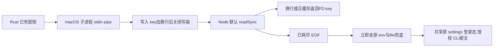

# T1087 修复密钥 FD 真 EOF 被错误等待

**待正式独评准入。** 用户持续授权慢启动修复与全功能验证，构建不备份；本方案只读源代码及已有安装证据，未读取用户密钥/连接文件、token、数据库或环境秘密，未运行当前 App、业务或隔离测试，未停止进程，未编辑仓库产品/测试/事件。基点 `3a60fafc4fd299d2a0d2efc403ee6a24691075de`，时间 `2026-10-08T16:27:20.526608+00:00`。

## 实际问题与因果边界

`installed-chat-observations.json` 记录新安装版首次 `ai.conversations.messages.list` 实际 231782ms、exit 0，随后同类消息读为 1013ms。采样的真正 sidecar PID 67212、Native 父 PID 66971；主线程 2369 样本中 2355 在 `v8::internal::Builtin_AtomicsWait`（约 99.4%）。不能把“2355 个样本”写成 PID，也不能把 Atomics 等待写成 99% CPU 忙算。

项目生产源码中的 `Atomics.wait` 位于 `secret-crypto.ts.sleepSyncMs`。其真实 `readMasterKeyFromFd` 在 `readSync` 返回 0、尚无数据时执行 sleep 10ms 并重试，直到 `executionTimeoutMs()`；当前合同最低为 120000ms。真 EOF 是通道已结束，重复等待不能产生后续字节，属于确定性错误分类。源码注释声称“换行或 EOF 即停”，与该分支矛盾。

**尚未证明：** sample 没有 JavaScript 函数名或 FD 返回码，不能区分这次是在 EOF 还是 EAGAIN 等待；它不证明独立模块实例数，也不证明全部 231.782 秒由该分支造成。模块初始化、数据库、其它资源竞争或真正迟到写入不在本次定因结论内。先用原默认 reader 的隔离真实 EOF 子进程复现，再做修复后安装前后对照，不补拍历史 PASS。

## 已核真实注入与消费链

- macOS Rust 使用 std `Stdio::piped`，spawn 后 `write_all(key+换行)`，临时 payload zeroize，再 drop 写端形成 EOF。源码没有依据可将 `readSync` 的 0 解释成“Rust 写端暂未就绪”。真正非阻塞未就绪由 EAGAIN 分支承担；阻塞管道写端仍开而没有数据时一次 readSync 自身可能等待，EOF 修复不声称解决这种等待。
- 非 macOS 原 plugin-shell 写入换行、保持写端打开；Windows reader 明确短路 FD并转原文件兜底。跨平台路径不在本次产品改动范围。
- `resolveMasterKey` 原优先级为 fd → web 显式 env → 原 machine-seed 同源文件 → 随机 dev fallback；AES-256-GCM、enc:v1、文件算法、随机 fallback 都不改。
- `persistence-client.buildPersistence` 在组装时同步 resolveMasterKey，再把同一 masterKey 交 CLI 回执加解密、browser sessions、settings、activation 等服务；公开 getter 共用 getBundle 初始化 Promise。授权 license reader、client-config reader 也各有 resolveMasterKey 调用。因此 EOF 等待可阻塞请求入口和同 event loop 其它请求，不应仅猜 CLI 审计 DELETE 锁。
- `fdKeyCache` 是模块实例内 Map，只缓存非空原读值；同实例二次 resolve 依赖正缓存，不再消费已结束 FD。若构建/加载产生独立模块实例，其缓存不共享，后读者可碰到 EOF 并应立即走既有同源文件。源码不证明安装版真的有重复实例，不能将两分钟倍数当证据。

## 最小修复与不变边界

产品只改 `backend/src/secret-crypto.ts`：将 `n === 0` 分支改为无条件结束该次 FD 读取，不论 sawData；同步校正邻近“EOF/未就绪 0/旧 3 秒窗口”注释，写明 EAGAIN 才按原有限 deadline 等待。**不缩短 executionTimeoutMs，不绕过 EOF 前成功读取，不新增异步密钥 API 或执行器。**

保留：EAGAIN 在尚无数据时的原有限 sleep 重试；已有 sawData 后 EAGAIN 的原收尾规则；其它错误原降级；换行终止、4096 字节上限、trim、合法 32B 校验及非空缓存；Windows 空缓存短路；全部 fallback 顺序与密钥格式。EAGAIN 后分片短读的更广泛重设计不在本次修复内，不能声称已改成完整异步无阻塞协议。

不缓存真 EOF 空串，不建立 process-global 密钥 cache，不关闭借入 FD，不修改 shell、密钥文件或 keychain，不轮换、清除、迁移或重加密任何用户数据。EOF 后没有有效原兜底时仍沿原 degraded 路径如实说明，不能用一把新生成密钥冒充原密钥。

## 精确写集

- 产品：`backend/src/secret-crypto.ts`。
- 测试：`backend/src/secret-crypto.test.ts`；新增 `backend/src/secret-crypto.fd.integration.test.ts`。
- root 控制/证据：正式 SPEC、独立评审、必要 DEC、BACKLOG、T1062 当前验证、`docs/verification/t1087/` 及流程命令真实事件/回执。

其余 consumer、Rust、contract timeout、加密 owner、数据库、CLI协议、App生命周期和 T1085/T1086 写集不改。若实测需要扩大修复，先补 SPEC/独评，不能顺手缩短其它预算或迁移业务。

## 隔离 reproducer、RED 与测试

正式准入后先捕获实际 RED。所有 key/seed/明文都是测试自建中性值，保存在临时目录，子进程 env 明确白名单，不继承用户 CREATOROS 密钥变量或 NODE_OPTIONS；不打印 key、密文内容、请求头或连接串。使用既有 Node/tsx 跑**当前真实源文件**，不能用 `opts.readFd:()=>""` 替代 default reader 后声称复现了 EOF。原 mock fallback 测试只能作单测补充。

1. **真实 closed pipe EOF 必验：** 父进程 spawn 独立 Node/tsx 子进程、stdin=pipe；子进程导入真实模块并发 ready 后，父关闭输入写端且不送数据。子进程对自己 fd 0 调用原 resolveMasterKey，env/file 分别给不同固定假钥匙以证明原优先级。只记录 source/degraded、是否等于预期假钥匙、elapsed、默认 read 次数/等待次数和事件循环观察。观察包装如使用 readSync/Atomics.wait 必须调用真实原函数、不伪造返回值或跳过 sleep。旧版本应真实显示重复 EOF 等待或约原 120 秒迟延；修复后应单次 EOF即退出、EOF路径 sleep 0、原兜底正确且不泄漏密钥。不要用 1 秒子进程强停伪造 RED。
2. **Rust 正常注入：** 父写有效假 key+换行再关闭；默认 reader source fd/degraded false，同模块重复 resolve 的正缓存有效，原 env/file 不能抢优先级。另覆盖 key 后 EOF（无换行）、空 EOF、仅换行/空白、非法/过长值和 EBADF 原 fallback。真实文件 EOF 可补充，但不能替代 pipe 场景。
3. **非阻塞 EAGAIN 与 EOF 区分：** macOS/Linux 隔离临时 FIFO 用真实 `O_NONBLOCK` read FD、父先保持写 FD 打开，子 ready 后由父延迟写完整 key+换行；这样“写端开着且没有字节”真实产生 EAGAIN，后来仍取得原 fd key，不提前转 fallback。只用标准系统 FIFO/Node fs，不新增 native addon/toolchain或产品依赖；全部 FD/FIFO/子进程 finally 清理。Windows 维持原短路合同，不将未运行的 Unix 场景写成 Windows PASS。
4. **多实例/已消费 FD：** 在同一隔离子进程用可证明独立的真实模块实例（例如 ESM 不同实例 URL，并核实例独立）共享一条已经消费且关闭的假钥匙 pipe；第一实例 fd source，第二实例立即 file source，二者假钥匙相同、AES roundtrip 相通、degraded false。不能用共享 global cache 帮 fixture 过关；若 loader 不能确保实例独立，真实记录未验证并使用独立构建实例，不冒签。
5. **无改变保密/可用性：** 原 env/file/dev fallback、坏密钥 GCM 失败、旧明文透传、null、合法 key 加解密及日志不包含假 key/明文全部原断言保留。回归现有 settings.repository.crypto、identity.crypto；无真实用户 DB/文件。
6. **预算与证据：** 单次子进程/有限观察至少 120000ms，原 RED 外层覆盖等待、tsx导入、数据发送、退出与清理；多个慢用例串行时外层覆盖总量（建议至少 1200000ms，按真实 argv 计算），retry 0。快速 EOF 判定用 read/sleep 次数和实际耗时对照，不把更短执行 timeout 当修复。父定时写入在独立进程进行，不能让待测主线程自己的 timer 给自己解围。

## 收尾和安装前后验证

- 只读独立实施复核绑定一产品/两测试 SHA；真实 backend/frontend/contract 类型及 boundary/semantic/timeout Gate 逐项记录，不吞旧全局债或相邻失败。没有发生的新 RED、真实安装或采样不能提前签署。
- 沿原 main 固定打包/签名/镜像/安装路径，构建不备份；不借慢启动排查清用户缓存、历史、密钥、数据库或重置激活。安装生命周期由 root 既有授权流程负责，本方案阶段无权限操作当前进程。
- 原安装的 231782ms 与 sample 原样保存。修复后记录 App/sidecar启动 markers、同一中性会话首次只读 messages.list 的真实 argv/开始结束/exit/elapsed、随后同一读取与其它公开读。请求只读，不创建付费模型或重复任务。若再长等待，对属于当前安装的 sidecar 取有限 sample 并保存身份；不停止别会话 devserver。
- 同时验证现有授权/账号/模型配置可读及原密文可继续使用，凭据只由原 service 消费，不输出或抄入报告。比较前后结果，不能只靠首次读变快宣称全部冷启动根因关闭，也不能把活跃环境差异误作唯一因果。

T1087 完成标准是确定性 EOF 错误分类的真实 RED/GREEN、既有 fallback/加密不回退及安装首读对照证据闭合；全部慢启动原因和 T1062 全功能矩阵仍按实际证据分别记录。

## 只读来源绑定

| 路径 | SHA256 |
| --- | --- |
| `backend/src/secret-crypto.ts` | `83de7fb12e2e99ee8b3c55ab7094ce4f518ee86d80d42feae16b054173162240` |
| `backend/src/secret-crypto.test.ts` | `baa23b109eb173323ff00695ba1a56f11a1640719627f37c84ad15137c5aa1e8` |
| `contract/src/timeout-policy.ts` | `0ab2c32fe7f282bb1e7d9e3fc29d252bc3aef8d48a2385d46a13e089f6fbbb71` |
| `frontend/src-tauri/src/lib.rs` | `b85d52ffce43dd10f3e6e82c242b9987ee0820ee5100abdc17f02e0d81f335eb` |
| `frontend/src/server/persistence-client.ts` | `6f31afb254a97756fa54402e248a6036ca5c7995ce0f50d90b276ad2db928384` |
| `frontend/src/server/activation/license-file.server.ts` | `a437fbe1aa64330db0c313a3006e2dace4319865e9ecc69e7ea73f3b58e126ba` |
| `frontend/src/server/activation/client-config.server.ts` | `d7236b0c4424af6f1205707b0ee75b7b59414c09b0a879369374541eded50dbd` |
| `backend/src/modules/cli-invocations/cli-invocations.service.ts` | `27fc2a8a0ba105ae05717eb29f82e34bdfcb63f234b03ca4651104efbbae5927` |

| 同目录原证据 | SHA256 |
| --- | --- |
| `installed-chat-observations.json` | `b5e117a94c28171ea220178f8298fef51c2e310171afbb5851ee059015e3f8e2` |
| `new-installed-sidecar-pending-read-sample.txt` | `a4aece615c352454fb5d00029a43e3ceef81e1b8cc9d6c063e30311fcbfdedef` |
