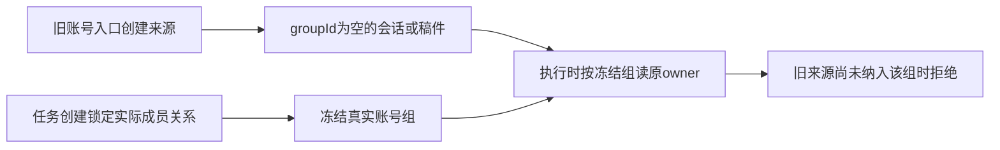

# T1089 旧账号来源与任务冻结组的读取兼容诊断

用户持续授权全功能可用性验证和缺口修复。本文件只登记实际失败与待核范围，不授权未评审的产品、数据归属或迁移改动。

在 T1086 的隔离库中，原公开 accounts.create 登记账号后原服务建立真实 grp_legacy 及成员关系。显式 legacy 账号入口建立的会话或文章/图文 artifact 仍可能 groupId=null；任务创建经原 membership lock 冻结真实 grp_legacy。执行时以该组调用原精确 owner，先发生“会话不存在或不可访问”；会话来源校准为实际组后，文章/图文仍实际返回“不存在”。没有修改 owner、任务冻结或真实用户数据。

实际证据保留在 `/Users/zyongzhu/CreatorOS-local-acceptance/main-installed-20261008/t1084/`：`t1086-frontend-web-complete` 3 FAIL（两项展示解析问题，另1项会话来源不一致）；`t1086-frontend-final-owned-content` 2 PASS / 1 FAIL，旧文章/图文 owner 拒绝，日志 SHA256 `3ae813ec145fb30b96b97e9a19ba4b8ce1233dc1ab0f158cbf28041540e8baef`。不能把三项全部称作生产故障，也不能把新组数据成功代签旧 group=null 数据。

下一步先核对现有 migration、legacy 范围、写入服务与冻结任务合同，区分迁移前无成员的老账号与已登记到真实组的账号。形成必要的精确产品/测试写集并通过独立评审，再沿原服务和来源链修复；不得把 workspaceFilter 改为跨组或用户全量、动态改冻结任务组、删除旧来源、复制稿件或直接迁移真实用户库。

T1086 的前端最终例另明确标作 legacy-registered：数据按公开读回的真实组建立，仍经显式账号入口提交，验证当前登记后合法来源。它不覆盖本任务的旧 group=null 来源缺口。旧失败及原任务保持，不重发真实未知任务。
