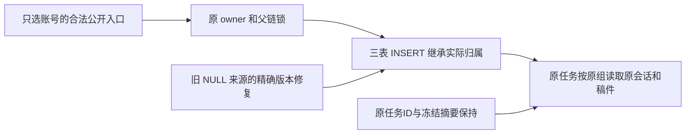

# T1089 修复旧账号来源没有继承实际初始组

正式候选 SPEC，待独立评审准入；当前完成源码诊断与外部隔离诊断 RED，未修改产品或仓库测试。产品基点为 `b75eb8dad4aa4953f15ead5ff259bbec3af05071`，其产品源码与已安装 `ecb1de60` 相同。用户持续授权全功能可用性验证、及时修复缺口、本地 main 提交和无备份构建；本方案不授权发布或图401采纳。

## 问题与结果

公开入口只给真实 account、不给 group 是原合法合同。accounts.create 已建立实际 initial group/member，但随后 conversation 与两类文章/图文 anchor 仍可能写 NULL group；task 经原 membership lock 冻结真实组，之后按原严格 owner 读不到原来源。原 owner、Worker 和冻结并没有错误地要求权限；缺的是三处来源写入盖章。

大白话：同一个账号创建的会话和稿件应该进入它实际所属的初始账号组，助手才能继续读取和处理。对能证明来源的旧记录，补齐同一归属；不动正文、版本、消息或原任务。

诊断与方案来源：`docs/features/t1089-legacy-frozen-source-read.md`；外部 `/Users/zyongzhu/CreatorOS-local-acceptance/main-installed-20261008/t1089/legacy-source-diagnosis.md` SHA `1acc44637092184a1daea96cdac090306ad6ffda37a56fe32c5b2a6454ceb9a9`、`legacy-repair-options.md` SHA `993463d421c0ca34a0fbfae4144b2ce90486b83f5269eedbf24d9e1318075c1e`。这些为源码诊断，不能代签尚未执行的公开 RED、迁移或 PG 行锁测试。

随后实际外部诊断：同目录 `legacy-entry-public-red-run.json` 实际 exit1，日志 SHA `f0560101e6bc2e1322ee241772a7e349ea1d0772b51f05f08fb4665fc1bf1c48`；实际 resolver→正式 compositeTransport 创建账号、项目、会话、文章/图文，三来源都为 NULL，而真实组为 `grp_legacy_acct-p-4`。这是合成 PGlite 的公开合同/owner 诊断，不是 HTTP、Worker、模型或旧任务恢复 Gate。`pg-lock-probe-run.json` 实际 exit0，日志 SHA `b326384c3df80641bcc30346486677835712ae52fd458da5e391f1fac013c24c`；独立真实 PG 两连接证明错误 DDL-first 原语形成40P01、NOWAIT失败后 savepoint 回滚释放前面的组行锁。它是锁模型诊断，不能代签完整原业务或0130无死锁。独立源码锁审 `legacy-lock-review.md` SHA `3816588e904bbb7f6cfe8e40e355ed42f6db1bf73c223b6585db69708ee84492`；其必要约束落实如下。

## 方案与归属边界

复用现有 INSERT 归属 trigger 机制，新版本 `0130_legacy_source_ownership.sql` 精确覆盖 `ai_conversations / article_anchors / graphic_post_anchors`；同一真实版本修复可证明的旧 NULL。仅写三表的 group_id，不新增账号、组、成员、别名或 read grant。三 owner 文件、workspaceFilter、RequestContext、Worker、任务冻结、工具/Skill/模型目录都保持。

共同行为：非 NULL 来源不覆盖；account/user/ID、parent、标题、正文、时间、版本、请求摘要、幂等回执保持。字符串 `grp_legacy_A` 只核实实际初始组身份，必须有同 user 的真实 account/group/member 证明，不能凭前缀造 authority。

1. 项目会话：真实 project 同 user、原 legacy account 相同，实际 project.groupId 对应这个真实初始组；继承实际 parent。project 为 NULL 归属时不单独把子会话升组。原显式 group 会话非 NULL 不变。
2. 无项目会话：原 account 同 user、active，唯一当前 initial member version1、无其它转组历史，同 user 的实际 active initial group；才盖章。无成员、已转到其它组、返回 initial 但有历史、多义或冲突保持 NULL。原公开写入本来会拒绝转组/归档，不新增豁免。
3. 两 anchor：output.id、output.projectId 与 anchor 一致，article/image 类型正确；实际 project 同 user/原账号/初始组；artifact 同 user、project/output 及 wechat_article/graphic_post 类型正确。project/output/artifact 的非 NULL 归属必须一致且为实际初始组；不只凭 project_id 给误绑 artifact 升组。完整父根没有可证明归属时不更新。
4. 旧 NULL 回填执行相同证明，只有实际可证明族改变。未知/断链/转组/非 NULL 冲突不更新、不删、不复制；不把这些可选行变成 App 整体启动 hard-fail。结构、SQL身份或账本未知仍走原 strict guard。

该修复覆盖已登记初始账号的真实三处遗漏及对应旧来源。未来才登记的孤立无成员旧行、父根自己未归组、原缺 host 协议或 stale epoch 不取得新权限；本任务不能声称这些状态已可恢复。实际 RED 如暴露当前合法链另有必须修复的父源，登记必要原路径并独评，不用已校准新组数据代签。

## 冻结任务与恢复

旧 task 冻结 NULL+account A 时，原 legacy filter 已允许同账号 NULL 或真实 canonical；冻结 canonical A 的旧 task 在来源补齐后经原精确 group filter 读取。chatHistoryDigest 不含会话 group/account，内容与全部原 source ID/parts 不变；modelInput/host payload 也不改。

必须分别实测三族，不能给原本未准入的任务伪造已结算回执：①冻结 canonical 但 conversation 为 NULL 的真实旧任务，原 host admission 已拒绝、尚无 Worker/工具请求；正常升级后用原 ID 完成首次准入和执行，允许必要首次模型/工具请求，不重新创建消息或任务。②冻结 NULL+account、原 host 可读 NULL/canonical 来源的真实旧任务，先实际结算再升级，原回执回放/completion/同key replay无新模型或工具请求。③conversation 已合法 canonical、稿件 anchors 为 NULL 的真实旧任务，原合法工具结算后升级，读取稿件修复结果与回放/completion保持原回执零新增。不得修改 ai/execution task 的 group/version/epoch、payload、digest、task ID、source message metadata、已结算账本、收费、租约/期限或既有状态；首次执行/原completion的状态变化只由原服务落实。原 cancelled/unknown/awaiting 或成员版本失效不能借回填解封。与来源不符的冻结 scope 保留原拒绝。

## 事务与锁

INSERT trigger 只做机械 SELECT/盖章，复用原 withWorkspaceWrite 的 group SHARE、二次原成员核验及真实父锁；不得在已持 SHARE/parent lock 后追加 account/member/group UPDATE。这样 RETURNING 直接见到真实 stamp，原 owner DTO 继续有效。

回填采用如下具体协议：0130 的函数/trigger DDL、全部锁与三表回填放进同一 PL/pgSQL DO 循环的 EXCEPTION 子事务；成功一轮才退出，之后由原 migrator 写真实 receipt。不得把 startup advisory lock 当业务互斥。

1. 每轮重置所有候选数组/计数/证明变量；更优先直接使用实际表重采，不保留跨轮快照。按固定表序 `platform_accounts / account_group_memberships / account_groups` 取 `TABLE SHARE NOWAIT` 稳定 authority DML；按 `projects / content_outputs / artifacts` 同样取 `TABLE SHARE NOWAIT`，既防父行锁的隐式表锁等待，也稳定父表 INSERT/UPDATE/DELETE。此前 ROW SHARE 候选允许第二扫后插入缺失父行，不能作为完整父锁闭包；实施独审发现该phantom边界后修正，不沿用旧SQL/hash或旧GREEN代签。
2. 全部实际 group 按 ID 排序 `FOR SHARE OF g NOWAIT`。实际 parent 行按 project→output→artifact 及每表 ID 排序 `FOR SHARE OF p/o/a NOWAIT`；可锁全表实际行作为短暂迁移屏障，不能因 JOIN 意外锁 account/member，也不能持 SHARE 后新增 UPDATE 升级。
3. 三来源表固定序取 `SHARE ROW EXCLUSIVE NOWAIT`，这是 CREATE TRIGGER 所需实际表模式。全部取得后重新扫描全部实际 NULL 来源；补齐这期间新候选所需父锁，仍按同一父序 NOWAIT。不能只用取得来源表锁之前保存的候选。所有父行锁完成后，来源待更新行按稳定主键 `FOR UPDATE OF source NOWAIT`，最终重新验证完整 authority/父链，再仅写 group_id；同一成功块创建全部 INSERT trigger。
4. 仅 SQLSTATE55P03 走整轮异常回滚。全部该轮新表/行锁和 DDL/DML 释放后，在块外 `pg_sleep(.05)` 再重采；不持半套 DDL 锁等待，不用 SKIP LOCKED，不新增次数/执行上限或业务任务重发。其它结构/SQL/取消/40P01 仍由原错误处理拒绝，不宽泛吞错。持续负载可能等待，不能静态承诺无饥饿。
5. 查实际 canonical PG catalog 与已知入站 FK：只改 group_id、不改引用 id，新 INSERT-only trigger 不触发回填 UPDATE；所有函数读表必须属于已预锁 authority/parent 表，不新增隐式写锁。未知额外 trigger/结构保持原 strict guard。原 Drizzle 全部 pending migration 在一个外层事务，不能假称异常回滚能释放0128/0129以前已持锁；必须实测104→105及fresh/旧lineage normal migrator。

必要 PG RED/GREEN 包括原显式归组真实 UPDATE 与新 DDL 竞争、原 Article/Graphic createOutput 项目 UPDATE→INSERT 与 DDL 竞争、source 行/表分别冲突后释放、authority FOR UPDATE 后的原 freeze/transfer、多组反向参数、来源表锁前新行提交、成员变化重采及取消回滚。不能以 PGlite 串行回归代签无死锁，不得新增生产执行/锁等待上限。

## 版本装配

- 正常 journal 旧104项不变，只追加 idx104、tag0130、when1791043200003；实际SQL SHA生成后固定进代码，不预填假hash。
- migration-convergence 精确认识唯一0130身份、校验SQL/hash、固定105尾及原104前缀。未知未来/hash/顺序缺前置/旧SQL漂移仍拒绝；0130 receipt 要有原0128与0129真实前置，不伪造历史。
- 原104库的预迁移检查仍匹配旧catalog。reference catalog 必须将这个已知 post-convergence SQL 放在0128之后执行，仅在历史确有0130真实回执时增加新trigger/函数；cache绑定该身份/hash。fresh/升级正常 migrator执行一次，二次启动不重放，不改0128/0129或历史lineages字节。
- 不为此修改原 needsUpgrade 的结构收敛/repair定义、备份策略或 db启动入口；沿原createDb/createRuntimeDb执行新版本并写真实receipt，不直接对用户库做诊断手改。

## 精确写集与不触碰范围

产品仅3路径：新增 `backend/drizzle/0130_legacy_source_ownership.sql`；修改 `backend/drizzle/meta/_journal.json`、`backend/src/migration-convergence.ts`。

测试新增 `backend/src/legacy-source-migration.test.ts`（版本/父链/身份与PG竞争）、`frontend/src/server/legacy-frozen-source-read.integration.test.ts`（resolver/dispatch、原owner和完整Worker、两种原任务恢复）。实际旧migration测试若因明确104→105尾预期需要变更，先追加精确测试路径与独评，不删未知身份/保真/拒绝断言。原T1086四族测试不改。

控制与证据：本SPEC与相邻review/input、原诊断引用、BACKLOG/DEC、`docs/verification/t1089/`、T1062实际验证索引，以及流程命令实际审计。若context-compile要求绑定，只向modules.config/progress追加本任务精确pending项，旧对象/状态/历史不变；不迁移T1083旧glob。

不改 contract/API/页面、owner三个业务文件、workspace权限、worker/native、模型/Skill、credentials、历史迁移、用户库或媒体。所有试验使用独立临时库与自己的合成媒体/账号；不清理真实业务行。

## RED/GREEN 与适用验收

1. 独评通过后，先捕获原104 journal/三owner/0128/0129摘要，跑真实公开resolver/dispatch只传account不给group的新来源RED，核三表实际NULL与原冻结组不一致；本地模型协议fixture只证明完整服务/Worker路径，不是实际模型。
2. 新project与global会话、文章/图文真实版本，原公开创建/消息任务→prepare→lease/host→Worker→ledger→completion。原RETURNING、parent stamp一致，原key replay零重复；pure group、group-account、registered合法组来源及无member premigration四族保留。
3. 原104已收敛隔离库准备真实旧NULL来源与上述三族既有任务，经正常migrator升级；迁移本身原payload/host/消息/ID/正文/版本/账本前后深等，只增加一个0130receipt。①保留原admission拒绝证据并升级后原ID首次执行；②③原已结算回执回放/completion/同key replay零新增。分别记录真实模型/工具计数，不声称①有旧回执或首次执行零请求，不手改任务冻结字段来制造族。
4. foreign user/account、missing/错project/output/artifact/type、跨组、转组/回归、多义历史、非NULL冲突、stale epoch、未知状态；只合法三来源group变化，其它对象与计数不变。不自动解封任务。
5. fresh、104现行和原已知root/diagnostic/canvas/installed lineage完整保真；二次启动无重复/无回填重放。0130前置缺失、未知hash/future、旧前缀/SQL漂移拒绝。旧门失败保留实际来源，不能用新SQL吞旧失败。
6. 明确配置的隔离PG服务器55422、独立测试数据库、两个真实连接：新source写与transfer两个顺序；回填与原explicit group migration/owner write、CREATE TRIGGER表锁及多group反向顺序。观察真实锁等待/提交/拒绝，零deadlock/错归组/重复/丢失；无PG配置不得skip冒称PASS。单次预算至少120秒，外层覆盖迁移/观察/清理，不改生产期限。
7. 必跑两个新文件、原migration-convergence/workbench-main-migration/db.creative-canvas-lineage回归、原T1086四族及归属/恢复相关回归、frontend/backend类型、boundary/semantic、orphan及完整reconcile。实际全局已知42错误、合同/timeout欠债不洗绿。独立实施复核后提交main，再沿既有授权无备份出包安装；旧来源安装验收只在新建中性账号来源中测试，不手改用户历史行。

本任务没有页面设计/主要UI旅程改动，适用非UI验收；不能代签T1062原生点击、Codex或全功能。验收列分类由独立评审核实后更正为—，状态只由taskctl转换。
