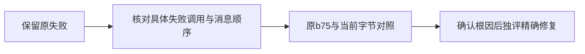

# T1090 核对完成回执回放的会话来源变化

用户持续授权全功能可用性/稳定性验证、发现缺口及时修复。T1089扩大回归发现一项真实失败；当前只做只读诊断，不扩大T1089产品写集。

原始事实：`/Users/zyongzhu/CreatorOS-local-acceptance/main-installed-20261008/t1089/ownership-recovery-regression.json` 实际 exit1，189.978512秒，8文件131 PASS / 1 FAIL；日志 SHA256 `0bc45a96ae5d99520dbb3aa2f6f3a1272ea6ee25c1b8b9877ea7a74c11d1a570`。失败为原 `chat-turn-completion.service.test.ts` 中 `T1088 commitResult严格拒绝worker额外 'tools' 且零完成写`，错误 `ConflictError: 会话来源已变化`。此文件与生产完成/提交/会话owner均未被T1089改动。

待核实：失败发生在合法首次commit还是原回放；同createdAt消息的实际读取顺序是否改变；原b75产品是否同样失败；0130未盖章的孤立账号fixture是否有其它影响。单次重跑通过不能证明根因或消除原失败。

诊断只用全新合成数据库或外部b75 backend归档；依赖复用时确认实际自引用解析位置与字节。保留全部真实结果和准确对照范围，不新增worktree，不修改测试断言、生产排序、冻结摘要或历史任务。需要改产品时先写正式SPEC并独立复核。

这是诊断任务，没有页面改动；未发生独评、RED修复、安装验收或完成证据。

2026-10-09实际对照：当前原60例再跑59PASS/1FAIL（日志SHA `59e8f5391da430b3860d8d85e1422007b4130476c56a5709e30fb224090b2f9e`）；b75全backend归档的原60例也59PASS/同tools1FAIL，日志SHA `abd7b17d4b77cac748b19a0e82803e5465120b1fd0f97d85e19f5c4b46b98e9a`。Node自引用到归档source，Vite加载trace拒当前backend（traceSHA `bb2cdc89b5981cf467e6c7ed7ff2269b89a7c0fc6ec0ab1a3716e685e0f20efa`）；合同233/worker520追踪文件与b75逐字相同。证明T1089差异不是该失败的必要条件；尚不证明同时间排序的精确根因或全仓基线通过。
