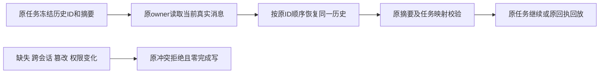

# T1090 修复冻结聊天历史被同时间消息排序扰动

正式修复候选，待独立评审准入。基点 `9828f8c9`，产品与已安装 `6e4689b3` 同字节。用户持续授权全面验证、及时补齐缺口、main提交和无备份本地构建。本任务沿原T1090诊断继续，不把原FAIL记成PASS。

## 问题与结果

原60例与真实b75全backend归档均59PASS/1FAIL；额外tools严格拒绝和首次合法commit成功，第二次同参replay因同createdAt的assistant排到source user前面而冲突。证据见 [原诊断](t1090-chat-completion-replay-diagnosis.md) 与 [机制和字节绑定](../verification/t1089/ADJACENT_REPLAY_DIAGNOSIS.md)，后者SHA `94d6c41670e6e45f6f95c9c81b9b50f5bb94f80b4ddf387b9f1647d4547b8aaa`。这是PGlite实测，不冒称真实PG/App已出现同顺序。

大白话：任务已经记住本轮用了哪些消息及顺序。恢复时应按这份原记录读取同一批真实消息；不能因为后来新增回复或数据库重新排序，就误报用户改了指令。原消息内容确实变化、丢失、跨会话或权限改变时仍拒绝。

## 实现和边界

复用已持久化的 `ai_tasks.inputData.historyMessageIds/historyDigest`，不加schema、迁移或模型判断，不改变消息时间、全会话UI排序或原冻结输入。依据来自后端已核owner的真实业务task；模型/Worker/请求不能提交替代ID或digest。

新增模块内纯函数 `selectFrozenChatHistory`：入参为原conversation、其真实消息行、source ID及可信任务的原historyMessageIds；列表必须非空、全部非空字符串、唯一，最后一个是source；每个ID必须存在于当前同conversation，source必须user。返回按原ID顺序排列的实际行。调用方保留原 `chatHistoryDigest`、source绑定、project/owner、modelInput/host digest、lease/fence、回执与终态校验，不缩减摘要字段。既有冻结数组可以是与当前时间排序不同的合法顺序；不擅自重新排序/重哈希旧历史。新增完成回复或后续消息不在原数组内，不进入原历史；这与冻结输入本身一致。

`readChatTurnSnapshot` 仍先核会话user/workspace并读取实际source。未绑定的新source沿原截取/装配路径，不在本任务重排整个历史。已绑定source只从后端表查实际chatTaskId，按原owner核user/workspace、copilot.assist、项目、chat.run、conversation/source一致后使用原数组；未知或坏绑定拒绝，不能退回时间排序。原existing、宿主读取和候选采纳继续各自核完整execution/payload/摘要映射。source的旧replyTaskId规则不变。

Pi completion与external completion继续保留原conversation锁及全部当前消息（供已保存assistant回执核对），用相同函数恢复原历史，原source绑定和摘要校验不变。外部owner其它租约、预算、Codex/CodeBuddy/ACP协议、图片归属和回执均不变。host/proposal通过原readChatTurnSnapshot受益，不新增可写工具或采纳权限。

初次未绑定历史的全会话时间排序、原生UI顺序、历史旧reply任务及全功能验收不是本次新增实现；不能声称任意同毫秒新多轮显示顺序已修复。必要场景若暴露另外的首轮冻结问题，保留事实并独立核精确范围，不用任意ID二级排序扩张本方案。

## 精确写集

产品4路径：新增 `backend/src/modules/ai/chat-turn-history.ts`；修改同目录 `chat-turn-submission.service.ts`、`chat-turn-completion.service.ts`、`external-chat-turn.service.ts`。host/proposal、repository、AI service、Worker、contract、DB、页面、凭据和所有原任务数据不改。

测试只新增 `backend/src/modules/ai/frozen-chat-history.service.test.ts`，真实PGlite/原service组合；原completion60例、submission、external、proposal、host与前端完整Worker用例不改。可在同一新文件配置合成独立PG测试族（明确环境时不能skip冒称PASS），不改原已有预算或fixture时钟。控制仅本SPEC/独评input和review、原诊断追加引用、BACKLOG描述、DEC、本任务精确pending绑定与流程真实审计、`docs/verification/t1090/` 和父T1062验证索引；不迁移旧glob或伪标旧模块完成。

## 验证和完成条件

1. 独评后先捕获原completion60例已发生RED并新增有区分性的真实service RED：先正常冻结/完成，再把合成后续回复的createdAt变成早于source，以确定性重现原timestamp前缀算法误读；不改冻结/正文/ID/回执。保留这只是后续时间排序扰动，不冒称历史任务恢复。
2. 同时间或排序扰动后的提交replay、host读取、proposal来源读取、Pi completion和external completion走真实服务，原ID/payload/输入/digest及回执deep-equal，零新增assembly/模型/tool/消息/result/finish。首次合法完成仍通过；完整Worker沿原task恢复公开service端口，不能只测helper。
3. 严格拒绝原history IDs空/重复/坏型/缺失/跨会话/最后不是source、真实content/parts/attachments变化、source绑定变化、project/user/account/group/fence或冻结输入变化，零完成/回执写；无需信任Worker自报。旧合法冻结顺序不同于当前createdAt仍按原数组校验，不能替换旧摘要。仅合成坏fixture测试数据，不手改用户库。
4. 原completion60例、submission/external/proposal/candidate相关测试、前端原T1089恢复及T1086四scope、backend/frontend类型、boundary/semantic/orphan、完整reconcile；相关原失败保留准确对照。单次测试/hook至少180秒；不修改生产执行期限或重发未知任务。
5. 独立实施复核后提交main，沿原打包入口无备份出包并核source/DMG/实际安装字节、真实首页启动及公开AI只读任务。不自动采纳图401、生成视频或改用户稿件，不发布。安装公开入口不能直接发送Worker completion：其幂等回放由真实服务集成证明，安装实测只覆盖真实公开操作，不冒称live Codex或全功能UI。

没有页面设计/交互变化，适用非UI验收分类—，需独评核实。全局reconcile既有42错误仍保留，不能以专项PASS冒称全绿；本任务新失败须修复才收尾。
