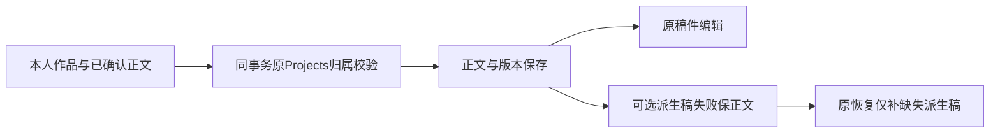

# T-1092 原转写工件项目归属装配维修

Root/Growth T216、DEC203准入的既有T1070与Projects/Artifacts公开guard维护，不改方向、架构、数据归属、合同或收费。

本人创作者已有导入作品和已确认正文，需保存本人项目并交原稿件编辑；失败保正文/版本/来源锚和付费账本，沿原任务恢复，不重复识别。派生口播初始化失败不能丢正文，解除故障仅补一次派生稿。

准确两路径：backend/src/modules/projects/transcript-artifact.service.ts与新增transcript-artifact-ownership.integration.test.ts。候选3494ee800226；生产原b4a5d4de5863到056a0bd223f7。五factory同db/tx装配原ProjectsService.getProject，保全部原guard、来源双读/项目锁、事实与可选master交易、索引、版本及已保存结果。禁止删group、mock权限或改通用Artifacts/Projects、配置、公共DTO、旧规范及partial。

7例真实createDb内存PGlite：legacy与显式组保存/公开回读、重复不覆盖；跨owner/组零变化；无必需guard仍拒绝；真实master-only CHECK失败保正文并恢复一次；图集锚不制造master。先test-only真实RED，后生产GREEN；新test错误保首FAIL且只修新test。原每例180000ms，Node25.9/pnpm10.32.1，maxWorkers1/retry0；原相关工件测试与backend typecheck。无实际PG并发或本人UAT证明。

Root串行任务治理；未核独立报告前不apply生产。零供应商、用户目录、browser、安装/部署/生产写；T213原8及相关132/原170仍由其准确任务重验，全局欠债不伪PASS。
