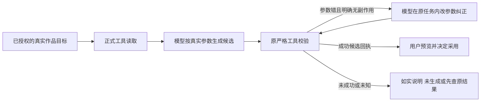

# T1093 校准编导首次读取、数字参数与真实候选状态

用户持续要求全面可用性、稳定性验证，发现缺口及时修复，并已授权本地main无备份出包。本任务承接T1091真实安装结果，不改变创作方向、公开服务契约、归属、工具副作用、保存权限、超时或页面。

## 问题与期望

main 58bc6246 已真实安装，Codex只读及四种候选全部通过；Pi文章、图文候选经原任务工具safeName归一复核通过，不重新提交模型。Pi原生任务 ai-task-b8c8d3c3-306 读取成功后，把整数ticks发成字符串，正式propose返回invalid_input、sideEffect:none，随后正文仍称候选就绪。Pi联合任务 ai-task-b8c8d3c3-320 误猜第一次read可省略的targetDigest，被严格门拒绝后误以为缺输入并停止；没有两稿候选。原失败和探针误报均保留。

大白话：工具参数写错时，助手应看错误、在原任务中修正参数再调用；不能把没有生成的候选说成成功。联合生成应先直接读已选脚本，再复制读取结果中的标识。

## 实施范围和冻结边界

产品仅改 backend/src/modules/ai-runtime/assistant-functional-prompt.ts 的执行方法文本。实际工具选择后注入system，再由原prepare/submission冻结modelInput和digest。只影响未来新任务，旧task、system、definition/version/hash、消息、账本、checkpoint与同键回放保持原字节。

- 原生时间必须是JSON number/整数；给出数字格式示例，明确示例不是当前工程值。实际ticks、trim/rate/duration只从真实read计算和复制，不猜媒体或摘要。
- 联合创作第一次work.creation.read使用{}，不传、不猜targetDigest；成功后复制其裸64hex和完整两稿文档、共同scriptSourceRef到propose。
- status:error、error.code:invalid_input、sideEffect:none时，引导模型在同一原任务根据schema/recovery纠正，仅可用实际改变参数的新调用；不同参数才能纠正，重复原参、权限旁路、unknown当none、超预算续期均禁止。
- 只有正式propose成功回执才说明候选就绪；失败未纠正成功就说明没有候选。task结束、排队、文字计划、模型自述不代正式工具回执。
- 方法仅引用当前实际装配的工具；原目录/描述/schema/Worker循环和采纳owner不改。已有严格门正确拒绝坏参数，不能为通过验收放宽数字或摘要校验。

不改工具描述：描述属于冻结definition/version/hash；现有描述已说明ticks/digest和成功回执，缺口在跨工具方法、首调用法、纠错与状态表述。提示改善不保证模型永远遵守，必须真实安装复验。

## 精确写集

产品1路径：backend/src/modules/ai-runtime/assistant-functional-prompt.ts。
只新增测试 backend/src/modules/ai-runtime/assistant-director-methods.test.ts，原测试/断言/时钟不改。复用实际contract验证给模型的示例类型与首次read合法性、已绑定/未绑定方法注入；回归原functional prompt/assembly、AI task冻结/提交/回执/Worker/public消息及双端类型、boundary/semantic/orphan。

控制限本SPEC及三个review文件、T1093精确pending绑定、BACKLOG/DEC/PROJECT/events、docs/verification/t1093/**、T1091当前验证记录及父T1062实际索引、reconcile实际生成的orchestrator/.lessons-stats.json（仅自动观测时间，不手改性能或PASS），不修旧glob、旧测试2FAIL或改旧任务状态。

## 验收和结束条件

1. 正式SPEC独评、taskctl start和显式implementation的context-plan后，先捕获新测试真实RED；保留此前实际Pi两个失败的ID、参数与正式回执，不补历史PASS。
2. 新方法经原assembly/submission实际冻结；产品外所有旧definition/schema/revision与T1091六路径保持字节不变；原9测试与原完整Worker两文件、相关类型/扫描通过。提示单测和协议模型夹具不代真实Pi。
3. 独立实施复核后main提交并固定入口无备份出包；DMG/签名/包来源/安装字节/真实HTTP首页及CLI连通实证。
4. 原任务均有终态并已回读后，只能新增明确标识的本次修复验收意图，不能替换或抹掉旧失败，也不重新提交unknown/running原任务。Pi原生与联合各新中性验收一次，首调正确或在同一新task内从坏参数改为合法参数都可；必须真实propose host receipt ok、精确base/script refs、业务DTO不变、没有采用，原key同消息回放及客户端重启恢复。若仍失败不得不停换键重发或继续堆提示签完成，应保留实际失败并独评其它最小落点。
5. Codex四类、Pi文章/图文保持当前实际候选；未改产品下原已结算证据和重启恢复可沿原ID核查，不冒称新包上重新生成。原生v3公开HTML预览409如实保留，必须回剪辑工作台，原生UI自动化缺证据不能代签。
6. 完整reconcile当场重跑并对比旧42欠债；新增范围内失败先修。pmem/reconcile/taskctl及实际审计提交。旧两测试失败/T1092、Code Mode外部警告、原生UI/平台登录采集发布/图401保持范围外，不签全仓/全功能/用户验收。

## 当场流程适用性校准（2026-10-09）

实际context-compile exit2：progress.json缺T1093绑定；官方progress generate exit2由既有T1026非规范glob引起（T1083已登记），两份原日志保留，不能声称Task Packet成功，也不手改progress或旧绑定。3.29的v3-4-build明确“交互式单人任务不生成包”，故本任务产品/测试由root串行实施，正式独评仅辅助只读、不派发产品写入。以当前精确modules绑定、显式step的context-plan、已加载说明与正式SPEC评审守边界；包编译缺失保留为既有流程欠债。产品与真实验收要求完全不减少，T1083和原全局42FAIL不在此任务洗绿。
