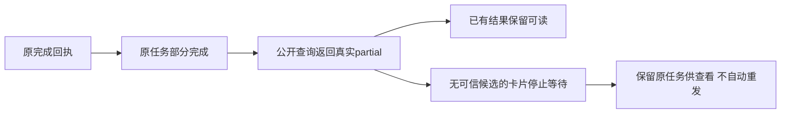

# T1094 保留真实部分完成并停止旧卡片无限等待

用户持续要求全面可用性、稳定性验证，发现缺口及时修复；本地main提交、无备份构建与当前安装版验证已授权。本任务是T1093实际验收确认的独立状态合同缺陷，不修模型参数遵循、不重发任何旧任务。

## 实际问题与结果

main770037安装版Pi联合任务 ai-task-434be109-200 原completion已把业务和执行均保存为partial，消息与结果可读取；ai.tasks.get却持续HTTP400，因公共aiTaskStatus只接受六态。独立消费者盘点还确认多处卡片不识别partial，会持续等待。原失败证据见T1093 FOLLOWUP_DIAGNOSIS，不改成PASS。

大白话：已经做完一部分，就如实显示“部分完成”，保留做出的内容，停止转圈。不能说全部成功，也不能自动再跑一遍。

## 契约与消费者方案

1. contract/src/primitives.ts 的aiTaskStatus末尾追加partial，原六项值与顺序保持。共享AI/execution/article响应沿原严格schema；不加raw旁路，不把partial映射failed/succeeded/running/awaiting_confirmation。toTaskDto与execution projection保持当前真实值，不修改它们或completion、账本、owner、lease和任务输入。
2. 现有Copilot黄卡、taskRuntimeStatus、TaskRuntimeActions和chat-system-action-card已认识partial，保留其仅刷新、无retry/cancel的终态行为。WireTask及文章手写状态类型使用真实公共类型；articles.service生成回放返回partial，去掉隐藏新增状态的旧六态类型断言，仅校准类型，不放宽其采纳门。
3. 缺少可信候选的通用采纳卡、论点、整稿、发布物料、生图、审核及盲预测卡：partial时停止观察，新增内部partial显示态，复用原状态样式显示“任务部分完成，已保存实际结果；当前卡片暂无可采纳候选，请查看原对话或任务”。不读取候选、不确认、不锁定、不自动重发。完整候选仍仅沿原awaiting_confirmation；已有消息/结果不删除。共享小型状态文案组件不另造主题、按钮或流程。
4. ArticleWorkbench的partial停止轮询，说明当前候选尚未就绪，保留原session任务键供刷新回读，未改正文和采纳权限。KnowledgeDumpZone优先使用实际done且有正文；无正文且原任务partial时停止并说明原文件仍在素材库，不能把不完整正文写知识库。
5. 日报分析partial显示未完整完成并保留原assistant正文；既有分析会话在partial后点击分析只回读原任务，不send/createMessage/retry。不把真实部分正文丢弃，也不冒称完整报告。
6. 画布按原generation material资格读已保存结果，原生粗剪/use-video-decision已partial终态，保持原行为；执行成果卡按原manifest展示实际部分摘要，补partial类型与终态反馈，但不显示采纳/重试/取消；其它不同领域creativeResultStatus/jobStatus等不因同名状态扩展。

## 精确写集和流程

root串行写产品/测试。独立评审只读辅助，按3.29交互式BUILD显式context-plan，不派发产品写入或生成Task Packet；既有T1083旧glob/progress阻断不迁移。正式SPEC独评通过后taskctl start。

产品仅：

- contract/src/primitives.ts
- backend/src/modules/articles/articles.service.ts（返回状态类型校准）
- backend/src/modules/production/production-sources.ts（仅原task读取的本地类型闭包；原严格productionSourceRequest探针状态与准备/采用行为不扩展）
- frontend/src/components/ai/task-partial-notice.tsx（新增）
- frontend/src/components/ai/adopt-candidate-card.tsx
- frontend/src/features/copilot/ai-copilot-content.tsx（WireTask类型）
- frontend/src/features/copilot/execution-task-card.tsx（真实部分摘要及终态反馈）
- frontend/src/features/copilot/chat-thesis-card.tsx
- frontend/src/features/copilot/chat-script-draft-card.tsx
- frontend/src/features/copilot/chat-publish-package-card.tsx
- frontend/src/features/copilot/chat-generate-card.tsx
- frontend/src/features/copilot/chat-review-report-card.tsx
- frontend/src/features/copilot/chat-result-cards.tsx
- frontend/src/features/article/article-workbench.tsx
- frontend/src/features/knowledge/knowledge-dump-zone.tsx
- frontend/src/features/daily-report/analysis-session.ts

测试新增backend/src/modules/ai/public-partial-task.integration.test.ts及frontend/src/components/ai/partial-task-consumers.test.tsx。原contract/tests/primitives.test.ts只校准精确枚举断言（尾部partial）；可在原文章、知识库、日报测试追加partial回归，不改既有断言、时钟预算、模型回执或fixtures。原Worker/public消息/完成/归属和通知回归保持。

实际类型检查与实施独评确认公共ExecutionTaskResource同样派生aiTaskStatus，production-sources的本地六态变量因此不能接收原task类型；追加此一处注解闭包，使用真实公共类型及reserved，不改任何运行时分支。media.probe仍只接受原完整严格探针回执；不把partial映射成功、失败或候选，不扩展productionSourceRequest与其它领域job状态。独立复核这项精确补充后才实施，新增运行原production-asset-asr.integration.test.ts回归；无原生媒体采纳或真实供应商调用。

控制限本SPEC及相邻review三文件、docs/verification/t1094/**、T1093/T1091当前证据与父T1062索引、BACKLOG/PROJECT/DEC/events/review-events、modules.config新增精确pending项、自动reconcile stats；不改旧模块状态、progress/glob、Gate标准或父任务状态。

## 验收

- 新测试实际RED后最小实现：通过原submit→claim→generation ledger→checkpoint→completion有限partial（隔离账本回执，不称真实模型），再从正式AiService/ai transport严格schema get/list/find同一任务；保原消息、result、payload/digest、账本、lease终态，同键回放不增task/execution/model/result，跨owner拒绝。旧六态及未知/在途不被误收口；新增enum仍严格拒绝任意状态。
- 真实组件使用合同client替身只观察状态：所有新增partial分支停止在一次读取、不进review/confirm/lock、不自动create/send；文章刷新沿原键只读，知识库只在实际正文可用时写，日报保原部分正文。不以合成组件证明真实安装GUI。原相关卡片、文章/知识库/日报/通知/运行时门回归及三端类型通过；触及轮询运行LED-047回归。
- 页面沿项目oil-ui-pro与原tokens，仅局部终态文案；不重新设计。实际局部渲染/操作与可用截图证据据实记录，未有真机画面不代签父全功能GUI验收。该合同与消费者修复不新增页面或主要流程，验收列—不豁免这些组件操作证明。
- 独立实施复核后提交main，固定入口无备份出包，DMG/包来源/安装字节/HTTP首页/CLI证明。只读取原 ai-task-434be109-200：get/list从400恢复，status/runtimeStatus均partial，原消息/结果和ID一致、无新模型；原key回读与重启恢复。不得为了通过联合候选重新发送或伪造null调用。
- 完整reconcile记录当场结果并对比已有42项，不洗绿。pmem同步、taskctl按真实范围证据收尾。T1093联合候选失败/T1095、旧测试T1092、原生GUI/平台登录采集发布/图401继续保留；本任务通过不代表全功能通过。

## 授权记录

用户“全面测试和优化…有gap及时支持”“全功能可用性稳定性验证”“代码都合并到主分支…构建不需要备份”和当前“继续验证”覆盖该必要修复。只诚实扩展已有partial读状态，保留原写权限、严格归属与采纳；不授权发布、重发未知或采用候选。正式DEC同步此确认，独评之后才动产品。

### 正式验证命令绑定

T1094 modules.config 已精确加入新增public-partial和consumer、原primitives/任务提交完成归属、全部受影响卡片/文章/知识库/日报/通知，以及LED-047八文件回归。实际RED/GREEN与退出码原样留存，不靠只跑类型或reconcile代替行为测试。
