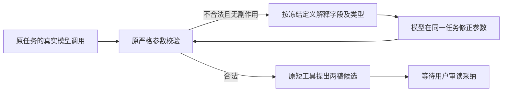

# T1095 让 AI 得到可落实的参数纠错回执

用户2026-10-09要求“有问题的创建 task 及时修复”。本任务承接真实安装验收中 Pi 联合创作失败，继续原已确认的文章与图文联合候选流程，不自动生成视频或采用稿件。

## 问题与事实

原任务 ai-task-434be109-200 已终态 partial。首读成功，实际已结算模型回执的三次提案为 ruleSnapshotRef:{}、缺字段、缺字段；没有合法 null 调用。原完成消息直接解析已结算 providerResult 的 input，未发现宿主删 null。未保存原供应商 HTTP 字节，不能把这次核查说成逐字验证供应商原线。原证据和失败状态保留。

当前错误回执只有 `graphic.ruleSnapshotRef.versionId (invalid_type)`，随后只有 `graphic.ruleSnapshotRef (invalid_type)`。没有告诉模型字段必填但允许 null，以及收到的值类型。大白话：告诉 AI “哪里错了、这里允许什么、你刚才给了什么”，它才能在原任务里改对；程序不替 AI 编内容或造真实版本 ID。

## 最小实现与兼容

1. 仅新 chat-turn-submission 创建的后端 execution payload 保存 `toolValidationRecoveryVersion:1`。它是内部冻结纠错格式标记，不进入公共请求、不改变 modelInput/tools/Skill/权限/引擎选择。已有绑定回放直接返回原任务，不补标记、不迁移旧 payload。原任务200与其它旧调用的 inputDigest、错误回执和已结算结果保持字节一致。
2. agentic-tool-binding 仍先验证原模型账本、冻结白名单、版本、execution、JSON 和原 Zod 参数。仅在上述内部标记精确为1且是原合法 chat 输入时，替换无副作用 invalid_input 的 recovery 文案；原 JSON 损坏、Pi length 截断、unknown 与其它错误路径保持。
3. 新 helper 从当前任务冻结的 JSON Schema 及已结算实际 input、原 Zod issue.path 派生有限机械说明：字段路径、必填/可省略、声明类型、是否允许 null、对象必填子字段、收到的 JSON 类型或缺失。路径下若存在允许 null 的父字段，也说明该父字段及必填事实，覆盖收到空对象却报 versionId 缺失的实际族。不根据工具/业务名字分支，不把 {} 或缺字段转成 null，不猜 versionId，不展示实际正文、ID、描述、完整 schema 或完整参数。
4. 只沿 properties/items/anyOf/oneOf 的明确路径解释有限深度、分支、条数和文本长度。复杂/含糊/不支持的 schema 仅回退原字段+错误码说明，不新增 hard-fail，不放宽校验。类型说明不能将声明当成当前合法值或声称某一个分支已通过完整校验。
5. 新任务的完整确定性回执按原 inputDigest 公式绑定；reserve/start/execute/settle/forCall 都重复派生同一文案。旧标记缺失的任务执行原公式和文案，未改变任何旧签名。无新重试策略或次数、期限、收口策略；模型必须实际改参，重复同参仍沿原有限收口。

## 写集与流程

root串行写入，独立诊断/评审仅只读，不派发产品实现；按3.29交互式 BUILD 运行显式 context-plan，不手改旧 progress/glob 或 Gate 标准。正式 SPEC 独评通过后 taskctl start。

产品仅：

- backend/src/modules/ai/chat-turn-submission.service.ts
- backend/src/modules/execution/agentic-tool-binding.ts
- backend/src/modules/execution/tool-parameter-recovery.ts（新增，协议说明 helper）

测试仅：

- backend/src/modules/ai/chat-turn-submission.service.test.ts（追加新标记与旧绑定回放不改字节）
- backend/src/modules/execution/tool-parameter-recovery.test.ts（新增）
- backend/src/integration/tool-parameter-recovery.integration.test.ts（新增，通过原 submit/真实 Worker/隔离 HTTP/工具账本及完成链；不能由 helper 单测代签公共链）

控制：本SPEC及相邻 review/independent-review/review-input、docs/verification/t1095/**、T1093/T1094和父T1062当前证据、BACKLOG/PROJECT/DEC/events/review-events、modules.config新增精确绑定、实际生成的 lessons stats。不改其它产品、旧测试、契约和数据库。

## 验收

- 新测试当场 RED，再最小实现。机械矩阵含必填 nullable 的 {}、缺失、null、真实合法对象，非 nullable 仍拒 null、数字字符串不转换、嵌套数组/联合分支、未知路径/复杂定义降级、有限说明且不泄露值。两种错误指出允许 null 的父字段；合法 null 无 validationOutcome，合法值仍走原工具。
- 原提交保存新标记及唯一任务；旧绑定在当前提交代码下回放不重新装配、不增加任务、不补标记/改变 payload、历史、Skill、原输入摘要或 deadline。
- 隔离真实 Pi Worker 经原公开提交 service、真实模型与工具调用 ledger、宿主严格工具及完成链：先发生上述两类非法参数，错误进入下一次模型请求，模型 fixture 据回执改为合法 null，在同一 aiTask/execution 下实际得到候选；非法调用无副作用，候选未采纳。保留当前模型/工具预算、同参有限收口及取消/未知边界。此 HTTP fixture 不称真实供应商模型遵循，不代签安装版业务候选。
- 原 execution-agentic-tool-ports/host、原 chat-turn-submission/completion/终态参数签名与 plan Worker 回归；backend/worker 类型、boundary/semantic/orphan、timeout-policy。相关失败逐项登记，保留既有失败，不删断言或改旧预算。运行完整 reconcile，和原42项逐项比较，不冒称全绿。
- 独立实施复核后提交 main，再无备份构建/安装。真实 Pi 在已选择的中性组/项目里使用一个明确独立的终态缺陷修复验收意图生成两稿候选，不重发原 partial/unknown，不自动采纳。记录实际公开操作、任务、调用参数、候选与原稿一致性；供应商仍失败就记录实际失败，不冒称闭合或改用 Codex 代签 Pi。原任务200保持原状态/ID/回执。
- pmem sync、reconcile、taskctl 按真实完整结果收尾。相关旧回归 T1096、T1092及父全功能验收不由本任务代签。

## 授权与判断

DEC-T1095-A 保存本轮用户授权；这是既有工具的机械纠错可用性修复，不改变产品方向、服务请求、数据归属、写权限或采纳规则。内部标记只冻结新错误解释以保护旧回执。未授权 push、发布、凭据操作或采用候选。界面没有变化，页面设计规范不受影响。
