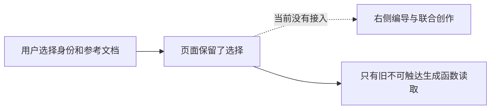
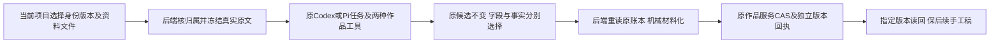

# T1097 文章编导参考资料与候选审读保护缺口

用户2026-10-09要求验收发现问题及时建任务修复。T1096只读核查确认：文章页“AI 辅助生成与内容扩展”仍展示写作身份与参考文档选择，但相应状态只被已经没有UI调用入口的旧 generate()读取；当前注册的编导 editor target 与联合 creation target 未使用这两项选择。旧按钮已按用户确认的“除视频外联合生成、右侧编导微调”方向移除，不能为旧测试恢复按钮。

大白话：页面让用户选了身份和资料，当前 AI 却没有收到，选择看起来有效但实际没生效。



以下开头保留初始缺陷登记；本文件后续正式合同是本次待评SPEC，尚未取得实施准入。保留产品选择的事实与真实来源归属；核对是否应将这些真实版本资料送入当前编导上下文，以及当前已有方式如何向用户表达。若决定删除失效选项，须核已确认范围而不能擅自删除用户仍需要的资料选择能力。正式方案须按oil-ui-pro、当前UI规则、前后端服务契约和独立评审，取得真实选择→模型冻结上下文→候选→审读微调证据。

完整只读核查同时发现两项需要实际验收的审读保护：当前联合候选按整个成员文档采纳，缺少旧稿与新候选事实清单的对照；当前微调 typed_snapshot 可改标题/摘要，没有原字段默认勾选保护的等价证据。它们不预判模型一定改坏稿件，但不能把旧恢复用例PASS当作新链已保护。修复范围需核对用户实际选择、真实冻结base、预览与采用边界，保留未请求修改的元数据并让事实替换可审读。与身份/文档接线一起在当前正式编导路径闭合，不恢复旧按钮或另造平行生成流程。

它与T1096测试校准分开：测试补项目父资料和旧任务候选恢复，并不能证明这两项选项在当前联合流程里有效。未修改产品、未通过验收，不标完成。完整只读诊断摘要由T1096补齐。

## 正式修复合同（2026-10-12，待独立评审）

用户2026-10-11通过T1246授权完整首轮后集中修复确认缺陷、重新打包与逐项复验。本次落实已有身份/资料选择及候选审读责任，保留已确认的“文章与图文联合创作、右侧编导微调”方向。它不是恢复旧生成按钮的许可，也不新建生成器、候选表、数据库迁移或模型供应商。服务合同增补为修复这些已登记缺口所必需；用户确认及取舍在DEC-T1246-WORK-CANDIDATE-001登记。此节尚未取得新独评，不据此提前改冻结产品或原断言。

当前首次证据是533224f候选：原文章9个单元失败及公众号E2E均在退役按钮处停止，未验证下游；身份/资料控件可达而未接线、当前联合采用缺少事实对照/字段选择，来自精确源核查。微调typed_snapshot已保护factItems/图片/布局/来源，不能误称它们未受保护或为修复解除保护。采用窄合同来源为[T1097来源核查](../verification/t1246/first-diagnosis/t1097-formal-writing-contract-review-notes.md)和[后台采用提案](../verification/t1246/first-diagnosis/t1097-narrow-candidate-adoption-contract.md)。提案原文封存、不代签历史或本次实现PASS；以下冻结选择消除提案里的可选方向。

大白话：这次勾选的身份版本与文档文件交给这次编导，旧任务恢复仍读它当时的版本。候选先供审阅；已有标题、摘要、标签默认保留，事实变动单独对照确认。后台从原任务账本取候选、按人的明确选择形成文档，再用原作品服务保存。采纳重试只找原回执，不重发模型。



### 1. 身份与资料进入原公共执行链

新选择结构名称固定为`writingContext`，严格形状为`{schemaVersion:1,brandProfileVersionId:string|null,sourceAssets:Array<{assetId:string,assetFileId:string}>}`。最多20份，重复asset/file pair拒绝；不得接受guidance、提取文本、账号或组等“已验证”前端字段。`brandProfileVersionId`是真实定位statement版本，不是profile当前指针。null明确代表本次中性写作身份，空sourceAssets明确无额外资料；不阻断合法创作。文件原文沿既有60000 UTF-16字符有界规则，真实截断须在read结果中说明，不猜填未提取内容。

只给`owner=wechat_article`的WorkEditorTarget及WorkCreationTarget增加这个可选字段；独立图文精调、production/native视频目标不接该字段。历史目标缺字段保持其历史合同，不现场注入neutral或新策略以重算旧摘要。新文章准备始终明确给出选择；联合创作以本项目文章成员的选择作为两成员共同写作方法，不随图文平台号/当前账号变化换身份。

页面沿现DraftChatRequest的scope/project通道保留未提交选择，文章切Tab可读取同项目选择；切组/项目不带过去。现联合按钮确认时冻结完整选择、脚本ref、composition及两个member原base。提交结果不明恢复原snapshot，不读取现在的checkbox，不产生新任务/新期限。页面原控件继续真实有效，不以删控件代替接线。

后台窄只读`work-writing-context`装配端口复用material-link、assets.readDocumentFileSource、positioning.getStatement：核当前user/group/project链接、真实asset同file、已提取文本、真实品牌版本snapshot。首次品牌选择核当前可选版本，冻结后以其精确历史snapshot恢复，不能换最新版本。依赖读取不存在/无权/未提取时准确报原错误，保持原输入与任务ID；中性/无资料不需要定位或资料配置。

真实prepareDurableChatTurn→prepareChatAssembly→hostContext保存经后台解析的选择、真实refs、原文/guidance、截断事实和摘要；resolved内容只在后台组合，不从公开输入采信。hostContext strict schema及其digest必须覆盖该内容。work.editor.read/work.creation.read返回对应已核上下文，模型输入使用本次明确选择及原必需脚本/稿件/Brief，不额外全量添未选文档。中性身份不得被全局品牌写作模板替换；仍保原业务必需的项目/脚本事实。后续真实tool执行重核原目标权限和基点，恢复使用原冻结内容/来源，禁止重新dispatch主模型补证明。Codex与Pi共用原公共路径，Codex不要求独立文本/生图API。

解析后唯一strict结构名`resolvedWritingContext`固定如下，公开target只含选择IDs，不能接受该结构：

```ts
{
 schemaVersion:1, projectId:string, selection:WritingContext,
 brand:null|{versionId:string,profileId:string,oneLiner:string,
   masterSnapshot:PositioningMasterSnapshot,guidance:string},
 sourceMaterials:Array<{assetId:string,assetFileId:string,
   ref:{kind:'asset',id:string,versionId:string},label:string,text:string,
   originalLength:number,providedLength:number,truncated:boolean}>,
 digest:string
}
```

`PositioningMasterSnapshot`严格复用现定位snapshot的业务字段并拒绝额外key，不接受当前live profile代填。brand仅在selection.brandProfileVersionId非null时存在，versionId一致；首次从readPositioningCenter取得当前profile/currentStatement，要求id/profileId及masterSnapshot一致，再读该历史statement冻结。guidance精确为`canonicalJson({oneLiner,persona,field,audience,differentiation,capabilities,facets,downstreamRules})`，业务字段来自该statement/masterSnapshot；不按关键词做取舍。sourceMaterials按selection源顺序一一对应，assetId/fileId与ref.id/versionId相等，label由真实source port提供。text仅为真实原文前60000 UTF-16代码单元，originalLength为原文length，providedLength为text.length，truncated等于originalLength>providedLength；不得把未提取资料当空选择。模型read结果在text之后单独附真实截断通知，通知不进入text长度。每文件独立上限，不把20份合计改为60000。

摘要固定为`sha256:SHA256(canonicalJson(结构去除digest自身))`；hostContext保存`resolvedWritingContext`可选字段，并在完整strict validate检查projectId/selection与该target一致。新选择必须有同选择快照；旧target与旧hostContext缺字段保持缺字段、原摘要。work.editor.read/work.creation.read在其strict response中增加同名可选字段，返回原冻结结构；模型消息使用其guidance及真实sourceMaterials。恢复只读原冻结snapshot，不从当前文件/当前品牌补内容。

### 2. 原候选来源的唯一只读解析

新增唯一公开只读操作`ai.workCandidates.source`，GET `/ai/conversations/:conversationId/work-candidates/source`，group scope，严格query `{sourceMessageId,toolCallId}`，无body。response严格为`{assistantSource,toolName,candidate}`，toolName仅`work.editor.propose|work.creation.propose`，candidate为对应原完整成功work结果，不能伪造旧articleCandidate行。只读原账本，不创建任务、版本或候选，不reserve/dispatch模型。CLI READ及真实workspace scope精确登记该操作。

`assistantSource`严格复用`{taskId,callId,toolCallId,candidateDigest}`；taskId为原业务aiTask，callId为经合法reusedCallId链归到的原executionCall。来源摘要是`sha256:SHA256(canonicalJson({source:{taskId,callId,toolCallId},candidate:原完整成功work结果}))`；不能冒用内层文档摘要或改变候选现有摘要。

sourceMessageId从真实owned会话消息的chatTaskId映射该轮，不扫最近同名工具。活跃UI按本轮x-source-message-id保存来源；历史UI保留assistant.modelMetadata.sourceMessageId，并逐卡绑定真实toolCallId。不得用全局最新preparedReceipt或最近一条用户消息给旧卡补来源。read回的完整candidate须与当前卡规范字节一致，否则保卡并报冲突，不静默替换。

后台同事务核user/workspace/business↔execution映射、原history/hostContext摘要、原项目、settled成功proposal、冻结工具version/effect/execution/parameters及原input/target/base。Pi需真实宿主claim/model-tool binding/receipt；Codex/ACP需真实external_tool、parent external_agent、providerTurn/protocol/binding/inputDigest。unknown/started不可采纳。work为单独严格类型分支，不放宽system/canvas白名单、不要求work具备它没有的request/source字段。reusedCallId只向同任务更早成功调用追溯，参数/outcome/原字节一致，循环和错输入拒绝。明确支持原`chat-tools-work-director-v1`冻结版本及其真实schema；新target含writingContext时四个work工具采用`chat-tools-work-director-v2:<原生成法的definition hash>`发行版本，仅替换revision prefix并沿原versionInput摘要算法，新增只读资料快照属于执行语义增补。缺writingContext的原target仍发行/读取v1，保原工具定义、描述、参数、执行结果与digest；不得将旧任务按v2重算。source reader按原hostContext/tool version分别核v1/v2，当前system/canvas原验真维持。

外部原参数证明采用既有`executionTasks.payload.externalToolInputs[真实call.id]`的独立命名空间，不改变原providerResult六项identity、既有execute请求/回执及Worker端口，不新增表/迁移。单条严格形状为`{schemaVersion:1,callId,turnCallId,toolCallId,toolName,toolVersion,inputDigest,input:JSONValue}`，input保现JSON.stringify(input).length<=1_000_000字符串长度门（UTF-16代码单元，不改为UTF-8字节门收紧中文输入）。input由原reserve的冻结tool.parameters解析、z.json解析，并在同admission租约事务插入该新call后随task.payload保存；只更新该受控namespace，保payload其他字段。inputDigest逐字沿现`sha256:${chatInputDigest({turnCallId,toolCallId,toolName,version:toolVersion,input})}`公式，key=真实call.id。

source必须核该记录与当前task/call/parent/原核心identity/原冻结工具parameters及摘要一致，原provider/thread/turn/lease/settled outcome门另行保持；改变typed_patch/snapshot kind/edits但终文相同仍拒绝。重放只读原record，禁止从request.input补写既有call，无record保持原unknown/settled回执、不再次execute。external-chat-turn仅对真实既有record投影经校验原input；历史无record卡保原{}，不補伪参数。历史联合提案可以从原完整提案重建且核原digest；历史editor缺真实原参数证明准确冲突，不逆推候选为snapshot、不重发模型、不猜claim。此协议适用于真实Codex及ACP外部宿主调用，Pi仍读原真实model tool参数；不塞入codexCalls[root].tools冒充ordinary tool，不改变已在途task/turn/call/task剩余期限。

### 3. 原versions.create的严格人采纳分支

保原手工body与operation ID/路径/response不变。文章和图文增加互斥严格assisted分支。文章仅允许work.editor.propose的wechat_article或work.creation.propose的articleMember；图文仅允许work.creation.propose的graphicMember。source read同样只支持这三个采用族，独立graphic_post editor与production/native source明确拒绝本操作且继续原manual路径，后端不能靠UI隐藏准入：

```ts
{
 adoptionMode:'assistant', expectedCurrentVersionId:string,
 assistantSource:{taskId:string,callId:string,toolCallId:string,candidateDigest:string},
 fieldSelection:Array<'title'|'summary'|'tags'>,
 policyVersion:1, clientRequestId:string,
 // 仅文章有：
 factSelection:{mode:'keep'}|{mode:'replace',expectedBeforeDigest:string,proposedFactsDigest:string}
}
```

此分支没有document/edits/target/候选正文，未知字段与两分支混入拒绝；outputId来自原params，成员由真实原target确定。ctx.source必须user。导出原manual body schema，assistant-system的article.save/graphic.save仍仅由manual schema派生，不让模型得到assisted采用能力。不是把已有手工保存改成必须有AI来源。

fieldSelection无重复、按title/summary/tags固定顺序规范集合；已有非空字段默认不勾选，空字段可明确默认勾选并在UI显示真实最终选择。候选缺字段不显示/不允许选择；真实空tags数组可由人明确清空。元信息未选时恢复base原字段，并按下述owner投影表保持真实refs；不以关键词猜用户想改标题。模型带未选元信息不整单hard-fail，合法正文仍可安全采用。

微调文章只允许factSelection.keep，保持现typed_patch/snapshot事实/来源/图片/布局/身份保护；不能用此修复放开微调事实。联合文章keep保base.factItems规范字节及原用户状态，replace要求旧base与原候选事实两份摘要匹配（两者均为`sha256:SHA256(canonicalJson(各自完整factItems数组))`，包含原reviewState及数组顺序），后台只取原候选事实，不接前端新事实正文。UI逐项显示旧新facts、sourceRefs/reviewState；显式替换不把模型新事实自动标为confirmed：仅当候选fact与base存在同真实id，且text与sourceRefs规范字节精确一致（refs顺序保留），才继承base.reviewState；其余新/改项一律needs_confirmation，不靠文本相似度。状态确认走原用户操作。未选facts仍可采用合法正文；空列表显示真实无。

metadataSource为整组来源：全部元信息沿base保base标识；全部沿同一已核候选可保候选标识；混合来源不声明一个整组metadataSource，后台删除可选metadataSource键（不写非法null），按下述owner表保真实refs和原来源回执，预览须显示此变化。不猜填缺refs，不给tags造不存在的refs类型，不放松typed_snapshot保护。旧值仍在原base版本；采用摘要保原候选来源，不能伪称整个base元信息由本次模型生成。

按owner固定投影，不新增图文字段：

| owner | 已选择元信息 | 未选择元信息 | 正文及引用 |
|---|---|---|---|
| article | title与candidate.titleSourceRefs一起复制，summary与candidate.summarySourceRefs一起复制；tags仅复制其真实数组/可选存在性 | 从base复制该字段及其对应refs，保optional缺键与原字节 | 原成功candidate.sections及该sections.refs；facts按明确选择；微调其他受保护字段按原typed校验不放松 |
| graphic joint | 仅title/summary/tags真实字段，没有titleSourceRefs/summarySourceRefs | base真实字段 | candidate.body、cardBriefs及card refs；全局sourceRefs为candidate.sourceRefs后接base.sourceRefs，按规范ref字节稳定去重，保双方真实证据；不冒称这些引用对应某一个元信息字段 |

图文全局refs合并只保护保留字段来源，属于确定性同ref去重、不得语义匹配/跨owner转引用；新增ref照原owner授权门校验。metadataSource上述整组策略按三项实际来源计算，缺候选tags不默认candidate来源；全部选择但候选未带合法metadataSource就缺键，不猜脚本版本。article字段refs缺键保对应原实际缺键，不从别处填。keep事实按base原字节；replace采用前UI预览必须与后台投影后的reviewState一致，不能勾替换就展示confirmed。

### 4. 机械投影、事务及原请求恢复

新application adapter组合窄source reader→纯机械projector→原文章/图文owner service port；只落实人的字段/事实选择，标注SEMANTIC_BOUNDARY_ALLOW，不做创作语义判断。读取和原owner保存均使用同一tx store，保原membership/组→父项目→artifact锁序及归属，不跨模块repository直调。

来源及owned artifact身份核实后先查该artifact精确采用receipt，再查当前CAS/动态资料；已有精确receipt返回原version/document，不覆盖后续稿、不重读最新身份/资料、不发模型。无receipt才读原base精确版本、重算候选/选择、沿原owner原位置/同ref历史保护验证refs/真实file、父项目新写入门与expectedCurrentVersionId CAS。保留base同location相同ref、原已选图片/file不可用时，沿原owner现有历史相同引用规则仍可安全保存正文；不得在新adapter先强查全部base引用当前active、删除旧图/facts或替换latest来过门。只有新增/改变引用适用原当前授权/文件门，真实归属或授权撤销仍拒绝。目标迁移/权限撤销/并发当前版本变更准确冲突，保原候选，不自动换base。

原owner增加内部createPreparedCandidateVersion，复用原保存核心；transport不接受override。既有artifactVersions.adoptionKey用`article-assisted:<clientRequestId>`或`graphic-assisted:<clientRequestId>`，adoptionSourceDigest为完整intentDigest，aiTaskId为原业务task、createdByType仍是人的采纳。查receipt显式expectedAiTaskId，不沿默认null。两个不同artifact各自保存/回执，一份冲突不抹掉另一份。不得复用execution_call_id唯一的ai_task_results去挤两成员、不得新增候选表或迁移。

intentDigest固定为`sha256:SHA256(canonicalJson({operationId,outputId,adoptionMode,assistantSource,expectedCurrentVersionId,fieldSelection:规范集合,factSelection:文章选择,policyVersion}))`。同key任一意图字段变更冲突，包含不同选择碰巧得到相同文档的情况，不能仅hash finalDocument。

候选卡沿现scope/project隔离待确认记录冻结原workspace/operation/params/body；unknown/ACK不明只重放原body/key，不重算checkbox/latest source/base。用户编辑新选择先保原pending状态，不自动给新key。保持withEditorCandidateSave本地防重/race，绑定原候选+source+独立选择，不改原candidate/digest。成功读指定receipt.versionId，核投影后的exact document；current不同或有后续dirty输入显示已保存但未同步，不能覆盖手工稿。模型调用增量必须0。

### 5. 精确实现及验收写集

此处为T1097完整修复范围，原T1246冻结首轮完成、此SPEC独评与控制面写集/context更新后才集中实施。源文件存在性/原SHA见两份只读来源binding；新增文件明确标记。没有实际缺口不得扩大到素材/定位repository、DB迁移、视频或新SDK。

- contract_product：`contract/src/resources/work-writing-context.ts`、`contract/src/resources/work-candidate-adoption.ts`、`contract/src/resources/work-editor.ts`、`contract/src/resources/work-creation.ts`、`contract/src/resources/ai-public-message.ts`、`contract/src/resources/assistant-system.ts`、`contract/src/operations/ai.ts`、`contract/src/operations/articles.ts`、`contract/src/operations/graphic-posts.ts`、`contract/src/index.ts`、`contract/src/workspace-operation-scope.ts`、`contract/src/cli-policy.ts`。
- backend_product：`backend/src/application/generation/work-writing-context.ts`、`backend/src/application/generation/work-creation-root.ts`、`backend/src/application/generation/work-candidate-adoption.ts`、`backend/src/application/generation/work-candidate-projection.ts`、`backend/src/modules/ai/work-candidate-source.service.ts`、`backend/src/modules/ai/chat-proposal-source.service.ts`、`backend/src/modules/ai/chat-host-context.ts`、`backend/src/modules/ai/ai.service.ts`、`backend/src/modules/ai/ai.transport.ts`、`backend/src/modules/ai-runtime/work-editor-candidate.ts`、`backend/src/modules/ai-runtime/chat-work-editor-tool-host.ts`、`backend/src/modules/ai-runtime/chat-work-creation-tool-host.ts`、`backend/src/modules/ai-runtime/chat-assembly.ts`、`backend/src/modules/ai-runtime/chat-assembly-types.ts`、`backend/src/modules/ai-runtime/chat-turn-preparation.ts`、`backend/src/modules/articles/articles.service.ts`、`backend/src/modules/articles/articles.transport.ts`、`backend/src/modules/graphic-posts/graphic-posts.service.ts`、`backend/src/modules/graphic-posts/graphic-posts.transport.ts`。
- frontend_product：`frontend/src/server/persistence-client.ts`、`frontend/src/server/prepare-chat-reply.ts`、`frontend/src/features/article/article-workbench.tsx`、`frontend/src/features/draft-workbench/draft-chat-request.tsx`、`frontend/src/features/draft-workbench/work-creation-request.ts`、`frontend/src/features/draft-workbench/creation-flow-ctas.tsx`、`frontend/src/features/copilot/conversation-persistence.ts`、`frontend/src/features/copilot/ai-copilot-content.tsx`、`frontend/src/features/copilot/chat-work-editor-card.tsx`、`frontend/src/features/copilot/chat-work-creation-card.tsx`。
- new_tests：`contract/src/work-candidate-adoption.test.ts`、`backend/src/modules/ai/work-candidate-source.service.test.ts`、`backend/src/application/generation/work-writing-context.test.ts`、`backend/src/application/generation/work-candidate-adoption.integration.test.ts`、`backend/src/application/generation/work-candidate-projection.test.ts`、`frontend/tests/e2e/t1097-assisted-work-candidate-adoption.spec.ts`。
- exact_existing_tests：`contract/src/assistant-system.test.ts`、`contract/tests/endpoint-bootstrap.test.mjs`、`contract/tests/registry.test.ts`、`contract/tests/work-editor.test.ts`、`contract/tests/ai-public-message.test.ts`、`frontend/src/features/article/article-workbench.test.tsx`、`frontend/src/features/article/article-workbench-save-race.test.tsx`、`frontend/src/features/copilot/chat-work-editor-card.test.tsx`、`frontend/src/features/copilot/chat-work-creation-card.test.tsx`、`frontend/src/features/draft-workbench/work-creation-request.test.ts`、`frontend/src/features/draft-workbench/creation-flow-ctas.test.tsx`、`frontend/src/features/copilot/conversation-persistence.test.ts`、`frontend/src/features/draft-workbench/draft-chat-request.test.tsx`、`backend/src/application/generation/work-creation-root.test.ts`、`backend/src/modules/ai-runtime/work-editor-candidate.test.ts`、`backend/src/modules/ai-runtime/chat-work-editor-tool-host.test.ts`、`backend/src/modules/ai-runtime/chat-work-creation-tool-host.test.ts`、`backend/src/modules/ai-runtime/chat-assembly.test.ts`、`backend/src/modules/ai/work-creation-chat.integration.test.ts`、`backend/src/integration/chat-work-editor-worker.test.ts`。
- suggested_exact_test_write_additions：`backend/src/modules/ai/chat-host-context.service.test.ts`、`frontend/src/server/prepare-chat-reply.test.ts`、`frontend/src/features/copilot/ai-copilot-content.test.tsx`。
- 原参数协议/新旧冻结版本补充产品：`contract/src/internal/execution-worker.ts`、`backend/src/modules/ai/external-task-tool.service.ts`、`backend/src/modules/ai/external-chat-turn.service.ts`、`backend/src/modules/ai-runtime/chat-tool-definitions.ts`。
- 同协议原测试：`contract/src/internal/execution-worker.test.ts`、`backend/src/modules/ai/external-task-tool.service.test.ts`、`backend/src/modules/ai/external-chat-turn.service.test.ts`、`backend/src/modules/ai-runtime/chat-tool-definitions.test.ts`。
- 只读/运行且不授权改动：`backend/src/modules/ai/external-chat-call-tree.ts`及既有支持叶子；原identity/execute端口与call-tree保持不变，不因读源码授权批量改叶子。若实际Gate发现缺真实消费者再写精确证据并复评。
- 工件：本SPEC、T1246 SPEC与既有BACKLOG任务说明、DEC、模块/进度写集/context及本轮docs/verification/t1246证据。task状态仍只由taskctl控制，不手改完成。

### 6. 必须实际发生的验收

AC-1097-1：真实身份/文档radio/checkbox→公共提交同sourceMessage/task→hostContext原选择/版本/text→真实work.read及完整模型输入。neutral/品牌/一份文档/不选、不同文件版本/未选sentinel分别核；错组/项目/file/假brand/未提取拒绝且模型0。无资料合法创作及手写保存仍可用。

AC-1097-2：切Tab/组/项目/ABA、更新当前品牌/file、submitted-unknown恢复，保原选择/task/source/thread/turn/call/预算，原任务不读新选择、不重发。历史无writingContext目标仍按真实旧定义恢复/采纳或准确现状冲突，不补造source/claim/turn。

AC-1097-3：联合原call产生两真实成员候选、预览前正式稿0变化。已有title/summary/tags/facts默认保持，空项脚本真实refs可用；改一个元信息其余原字节/refs不变。事实keep/replace/空/增删改/confirmed→新对照真实可见，微调replace仍拒绝。混合metadataSource变化可审阅、source不假归属。

AC-1097-4：真实Codex/ACP typed_patch及typed_snapshot分别经受控原参数持久→source read，改变kind/edits但同文档拒绝；历史editor无proof准确冲突且不回填，不重发。原旧图片/文档不可用、未选元信息/事实仍保相同引用的合法正文可安全采纳，新增越权ref仍拒绝。真实source read→assisted versions.create请求没有document；后台同原task/call/tool/binding/digest，两artifact各自CAS/原版本receipt。跨组、变更base、篡改来源/未知字段/混入manual拒绝；普通manual和system.action原保存及图文独立精调/视频不变。采纳本身模型调用增量0。

AC-1097-5：ACK不明→刷新→原body/key重放只一版本；同key换选择即使doc相同也冲突，后续手工编辑不覆盖；指定receipt版本exact document及current/dirty回读闭合。两个成员分别保存，一份冲突不丢已保存另一份。

AC-1097-6：复用原品牌tokens/组件，按oil-ui-pro及账号组UI_RULES保当前选择区/候选卡基线，在1366×900和390×900独立真实UI操作/截图/trace、原ID读回与目视审查。正文安全采用路径不能因未选元信息或审美门整单反杀。Codex/Pi真实公共执行分别核，受控Pi fixture与官方Codex证据分开，不拿helper或模型探针代签。

原相关TDD/合同/前端/后端-worker公共链、四包types、boundary/orphan、LED047和`node tools/timeout-policy/verify.mjs`必须实际运行，有限正动作/request/expect>=120秒、test/hook>=180秒，保更长原预算、外层覆盖完整串行和清理、retry0；原task剩余期限不续。保首轮所有FAIL/未达后置，不补拍历史红测或前置审查PASS。App仍遵用户决定保未验，本SPEC不解除macOS授权边界。
