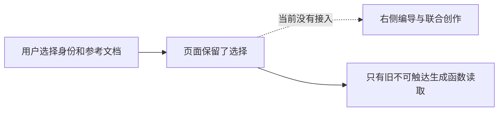

# T1097 文章编导参考资料与候选审读保护缺口

用户2026-10-09要求验收发现问题及时建任务修复。T1096只读核查确认：文章页“AI 辅助生成与内容扩展”仍展示写作身份与参考文档选择，但相应状态只被已经没有UI调用入口的旧 generate()读取；当前注册的编导 editor target 与联合 creation target 未使用这两项选择。旧按钮已按用户确认的“除视频外联合生成、右侧编导微调”方向移除，不能为旧测试恢复按钮。

大白话：页面让用户选了身份和资料，当前 AI 却没有收到，选择看起来有效但实际没生效。

当前是有证据的缺陷登记，尚未形成准入实现SPEC。保留产品选择的事实与真实来源归属；核对是否应将这些真实版本资料送入当前编导上下文，以及当前已有方式如何向用户表达。若决定删除失效选项，须核已确认范围而不能擅自删除用户仍需要的资料选择能力。正式方案须按oil-ui-pro、当前UI规则、前后端服务契约和独立评审，取得真实选择→模型冻结上下文→候选→审读微调证据。

完整只读核查同时发现两项需要实际验收的审读保护：当前联合候选按整个成员文档采纳，缺少旧稿与新候选事实清单的对照；当前微调 typed_snapshot 可改标题/摘要，没有原字段默认勾选保护的等价证据。它们不预判模型一定改坏稿件，但不能把旧恢复用例PASS当作新链已保护。修复范围需核对用户实际选择、真实冻结base、预览与采用边界，保留未请求修改的元数据并让事实替换可审读。与身份/文档接线一起在当前正式编导路径闭合，不恢复旧按钮或另造平行生成流程。

它与T1096测试校准分开：测试补项目父资料和旧任务候选恢复，并不能证明这两项选项在当前联合流程里有效。未修改产品、未通过验收，不标完成。完整只读诊断摘要由T1096补齐。
