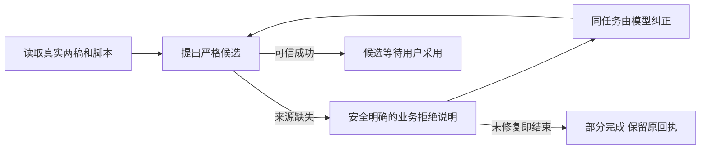

# T1099 修复明确业务拒绝被吞没及末次失败被算成功

用户要求有问题及时建task修复。T1095真实安装Pi任务 ai-task-7548f31b-222 已结算，前三次work.creation.propose均未得到成功候选。两次静态参数校验已回传具体字段/类型/缺失，模型实际修正成仅targetDigest/article/graphic三根字段；最终输入通过原静态schema，但原领域来源守卫拒绝。原任务/消息/回执保留，稿件未采用。

实际文章缺titleSourceRefs、summarySourceRefs，4段sourceRefs均为空；图文引用了真实共同脚本。用当次公开读取回执/保存DTO与末次实际输入在隔离端口重放原未改owner root，得到“两份稿件必须保留同一确认脚本的来源。”；这是隔离重放证据，不冒称拿到真实宿主原异常字节。原propose每次都会重新read，源码没有“读取后必须立即提出候选”的TTL。

宿主的实际错误却是no_evidence / “读取未完成，可检查权限与目标状态后继续”，模型据此编出了“读回执过期、无再调用授权”的解释并停下；三个proposal的可信状态均error/none。最终aiTask.status=succeeded，消息completeness=completed，仍没有可采用的联合候选。

大白话：系统应告诉AI“文章哪里缺来源、该从哪份真实读取复制”，让它在原任务改参数。若最后一步仍失败，结束状态应如实保留失败，不能凭模型说完话算候选完成。

待准入方案必须保留来源/owner/版本/未知/副作用校验，不能为过门补来源、造版本、把unknown当none或重发旧任务。新纠错/结束格式须由新提交冻结版本启用；旧task200/222、payload/digest/错误文字/完成回放不变。精确正式SPEC及独立评审尚未完成；本登记不授权自由编码或声称修复已通过。
