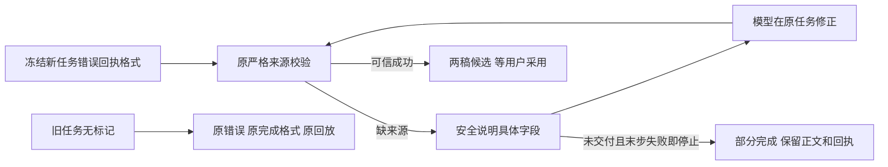

# T1099 让联合创作业务拒绝可纠正，保真实末次失败

用户2026-10-09要求“有问题的创建 task 及时修复”，本任务承接T1095新包装入后的实际Pi失败。原task200/222不迁移、不重发、不改终态或回执；文章/图文仍是候选，用户采用前不落正式稿，不生成视频。

## 真实问题

安装源68dff、HTTP首页与原10任务/4对象对照通过。新Pi task222两次收到T1095具体参数错误，第三次修正为合法三根字段，但文章titleSourceRefs、summarySourceRefs缺失，4段sourceRefs空。实际宿主仅给no_evidence/读取未完成；模型据此误称读取过期。原owner root实际上每次propose重新read，没有该TTL。用实际公开DTO/read回执/input隔离重放原root，得到“两份稿件必须保留同一确认脚本的来源”；不冒称保存了真实宿主原异常字节。任务succeeded、completeness=completed，三个proposal均为error/none，零成功候选。原失败及哈希见相邻缺陷登记和本机t1095证据，前置设计核查t1099/PRE_SPEC_DIAGNOSIS.md SHA256=a96ff954e1dd413b5ba4ef9b7010746954d563f3bc0b55c6287964344b948925。

大白话：告诉AI文章哪几处缺来源，让它从同一次真实读取复制；没有交付候选且最后一步仍失败时，应显示部分完成，保留已完成的读取和完整回执。

## 最小实现与冻结

1. 新chat submission仅外层execution payload增加toolFailureReceiptVersion:1；原existing绑定先返回，不补旧字段，不重装配/改modelInput/tools/Skill/hostContext/digest/deadline。原toolValidationRecoveryVersion:1不变。版本只能由后端提交冻结，不能从公共请求、模型参数或工具结果读取。
2. 原chat-host-context reader在所有原source/owner/执行权/输入与host digest校验之后，向宿主返回该可信内部版本；旧缺失保持旧返回形状。creation host从此真实任务结果把版本给原host adapter，current resolve仍每次重新核原冻结上下文/定义。不得依当前部署默认开启旧任务，或跨execution缓存/共享版本。
3. 只把work-creation-root明确“共同脚本来源缺失/不符”守卫改为既有纯ChatToolUserError，消息只列字段及复制方法，不拼正文、真实ID、凭据或堆栈；其它冲突/权限/版本/未知异常保持原处理。原sameSource/版本/图片/目标摘要/权限校验不放宽，不由代码补引用。root导入纯错误类须实际通过boundary；若边界拒绝，应回SPEC重评允许的唯一共享类型，不复制类或按字符串识别。
4. adapter仅新内部版本且真实instanceof ChatToolUserError，返回error/invalid_input、retryable:false、sideEffect:none，以其已审核安全消息为summary/recovery和原data.error。原无标记任务继续原分类/通用文本/形状；普通Error和含敏感信息未知错误不透出。原工具definitions/version/schema/effect/inputDigest/预算/次数/审批/同参有限收口均不改。
5. 新系统方法逐项说明：article.titleSourceRefs、summarySourceRefs、每个sections[*].sourceRefs、存在的factItems[*].sourceRefs、graphic.sourceRefs及每个cardBriefs[*].sourceRefs均必须包含本次read的同一个scriptSourceRef，逐字复制kind/id/versionId；旧文章来源空不能照抄成新候选空。graphic.ruleSnapshotRef则保留read的真实对象或字面null，不用default、{}或省略。当前引擎决定内容，代码只校验来源/格式；提示由原assembly冻进新modelInput.system，旧payload不重装配。不改工具description/schema/hash。

## 新格式结束状态

只在toolFailureReceiptVersion:1、原所有完成条件成立、最后根模型为已settled stop时，读取原可信已settled根工具AgenticToolOutcome。若本任务没有任何status:ok且sideEffect:proposal或committed的已交付结果，最后根工具为error或blocked且sideEffect:none，添加有限后端partial说明并返回partial。普通成功read不是候选。这个规则不判断用户文字意图，不声称所有请求已完成，也不把已有交付因后续辅助失败降为未交付。

固定优先级：原unknown/unknown_commit、unsettled、非stop、scope/lease/digest/账本/checkpoint/卡片不一致继续原拒绝；原plan failure与重复同参不可重试failure说明优先，只有一份notice；已有可信proposal/committed交付保原投影；其余满足上述末次失败条件记录partial。保全部正文/失败卡/成功读取，permission拒绝事实不变，不自动重试/审批或续期。只用真实receipt的status/sideEffect/error，不信model文案、业务data同名字段或Worker自报新引用。

沿原completion事务、实际stream finish/partial事件、AiTask/结果保存与同键replay；无标记task222原succeeded/completed和所有原字节保持，不能通过get/list读取时改写历史。新notice要准确表示末次未成功，不能称单次错误为“相同参数连续失败”。

## 精确写集与流程

root交互式BUILD串行写产品/测试，独立代理仅只读评审。正式SPEC独评与taskctl start后运行显式context-plan；不改旧progress/glob、Gate或测试预算，不派发无法编译TaskPacket的产品实现。

产品8路径：

- backend/src/application/generation/work-creation-root.ts
- backend/src/modules/ai/chat-turn-submission.service.ts
- backend/src/modules/ai/chat-host-context.service.ts
- backend/src/modules/ai-runtime/chat-work-creation-tool-host.ts
- backend/src/modules/ai-runtime/chat-host-tool-adapter.ts
- backend/src/modules/ai/chat-turn-completion.service.ts
- backend/src/modules/ai/chat-receipt-projection.ts
- backend/src/modules/ai-runtime/assistant-functional-prompt.ts

测试7路径（原断言/预算不改，只追加或新建）：

- backend/src/application/generation/work-creation-root.test.ts
- backend/src/modules/ai/chat-turn-submission.service.test.ts
- backend/src/modules/ai/chat-host-context.service.test.ts
- backend/src/modules/ai-runtime/assistant-director-methods.test.ts
- backend/src/modules/ai-runtime/chat-host-input-error-recovery.test.ts（新）
- backend/src/modules/ai/chat-tool-tail-failure-projection.test.ts（新）
- backend/src/integration/chat-creation-source-recovery.integration.test.ts（新）

控制仅本SPEC及review/independent-review/review-input、docs/verification/t1099/**、T1095/T1093/T1094/父T1062当前证据、T1098缺陷登记核查更新、BACKLOG/PROJECT/DEC/events/review-events、modules.config精确新增绑定、真实生成的lessons stats。不改公共合同、数据库、Worker实现、SDK、其它产品或历史review/Gate。

## 验收

- 先当场RED：领域安全类型/具体来源消息、可信版本/旧格式、末次失败partial。原缺来源仍拒；六类来源逐项缺失/错误均零proposal；真实共同ref齐全仍成功。原nullable静态/schema边界、数字类型、原素材与版本防线不改。
- 适配安全矩阵：新格式明确安全输入错误；旧缺标记保持原完整outcome；普通Error/敏感未知/权限/transient不泄露。定义/hash/effect/inputDigest不变；对已settled调用即使隔离库模拟标记变化，仍沿原回放不能改写历史。
- 真实公共Worker隔离HTTP模型夹具，经原submit→真实Worker→model/tool ledger→原creation host/adapter→owner root→completion：先typed合法但缺来源→下一模型请求实际收到安全字段回执→夹具复制同一read真实ref→同task/execution未采用proposal。另一例单次业务失败后stop，实际公开task为partial、完整卡片/finish/同键回放一致。夹具是协议验证，不代供应商AI；helper/root直调不代签该链。
- completion可信矩阵：新末步error/blocked+none且未交付为partial，旧格式同账本保持原succeeded；成功proposal/committed后辅助失败不降为未交付；原plan/repeated优先单notice；data伪造成功不生效；unknown/unsettled/非stop仍拒；原结果/stream卡/历史/owner/签名守卫保留。
- 原root、host、submission/context、completion/projection、T1095完整121及plan Worker、提示/assembly、公开partial服务/消费者相关回归；backend/worker类型与Worker构建、boundary/semantic/orphan/timeout-policy，完整reconcile与原42逐项比较。旧27timeout/15相关/T1092等欠债保留，新增范围内失败先修，不删断言洗绿。
- 实施独评后提交main，无备份固定入口新包；45基本预检、包内修复来源、DMG/签名/安装字节/HTTP首页/CLI连通当场核验。原task200/222和原稿/工程对照；一个新的、明确终态缺陷修复验收意图在既定中性组/project真实Pi产文章和图文候选，严格可信host ok/proposal、实际来源/base、DTO不变，不采用；原键只恢复同一绑定，不重发旧任务或unknown。供应商仍失败就登记实际问题，不改用Codex代签Pi或不停换键。
- pmem sync/reconcile/taskctl只按实际范围验收与完整原失败保留收尾。T1095的真实Pi未通过在依赖闭合前不能complete，T1097资料/审读及T1098后台问题不由本任务代签。

## 已有授权与边界

DEC-T1099-A记录用户要求发现并及时修复、已授权main无备份本地打包及当前App验收。这里只修原合法联合流程的安全可落实错误和如实结束，未改创作方向、公开服务契约、归属、候选采纳权限、发布标准或视频自动生成范围。没有页面变化；当前客户端可用于用户测试，不声明全功能通过。无push/tag/发布、凭据操作或原媒体删除。
