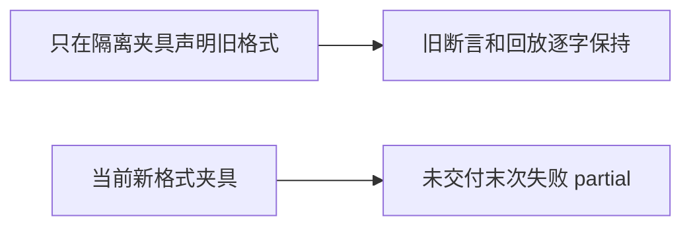

# T1100 明确原completion兼容夹具的冻结版本

用户2026-10-09要求发现问题建task及时修复。T1099正式扩展回归core-regression实际284例中282PASS、2FAIL，原 different-tool/different-code 场景最后工具error/none、未交付而模型stop，新提交已冻结toolFailureReceiptVersion:1，实际partial符合T1099已独评规格；旧测试标题和断言要求“原completion”succeeded，却没有标明旧格式。不是权限/回执门故障，不能将产品改回假成功。日志本机t1099/core-regression.log SHA256稍后按实际回读登记，初始失败保留。

大白话：旧规则的测试明确使用旧任务格式，新任务继续检查真实失败；不删旧断言来凑通过。

仅修改backend/src/modules/ai/chat-turn-completion.service.test.ts：fixture新增可选布尔legacyToolFailureReceipt，仅指定时在隔离库删除新外层toolFailureReceiptVersion，保其它payload/modelInput/digest/预算/历史；只给原“无重复粗组”三场景显式启用它。原expect、错误码、调用数量、stream/parts/账本/权限/回放和预算全部保留；不改产品源码或用户DB。追加新格式直接completion测试，真实合法工具失败、无proposal/committed、settled stop时partial，保全部卡片、正文、一次notice、同请求完成回放一致，不把单次错误称重复同参。T1099公共Worker3例仍需运行（已实测通过，不由此SPEC代签）。

root串行测试实现，独立只读SPEC与实施复核；reviewctl真实初审通过和taskctl start后执行context-plan。读集本SPEC/T1099规格与实际失败、原completion/projection/submission、execution绑定/账本/lease/stream、当前测试。产品方向、公共契约、owner/来源/归属、工具定义、超时规则和T1099 8产品+7测试写集均不变。控制写集仅本SPEC及review/review-input/independent-review、docs/verification/t1100/**、T1099当前证据、BACKLOG/PROJECT/DEC/events/review-events/modules/真实lessons-stats。

验收：实际core-regression已有2FAIL是当场RED，不伪称历史；实现后完整completion文件（原60+新增）retry0/no-file-parallel且原长预算不缩短；T1099完整backend/Worker/frontend、类型/架构门/timeout/全局对账仍按父规格实际验证。检查diff保原断言且legacy布尔默认false、只三旧场景选择，实际生成证据并独评后本地提交main，不签全功能、真实Pi或安装验收。pmem sync/reconcile按实际失败保留与taskctl状态收尾。
