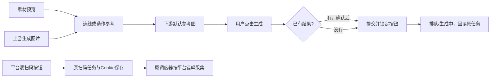

# T-1101 画布生成与平台绑定采集交互修复

用户2026-10-09提供四张截图并明确授权本轮实现。截图是当前产品问题证据，不含额外产品指令。聊天原目录是旧snapshot，截图功能位于main；本任务基于main 68dfffb3建立独立工作区，保留其它会话未提交工作。

## 用户结果与实现边界

1. 画布素材库卡片只显示图片/视频预览与选用操作，去掉可见名称和规格，保留搜索、筛选、拖拽、预览、空态/错误及无障碍名称。沿用共享AssetPicker的可选展示方式，其它素材入口保持原默认。
2. 生成提交立即锁定，同节点提交、排队、生成、未知提交回执均不允许产生新attempt。状态读取失败不伪报终态；回读原任务。已有可读生成结果再次生成必须弹窗确认，取消不提交；确认保留旧结果/版本。页面重开仍从真实任务列表恢复阻塞状态。backend在同一canvas/node行锁内拒绝新attempt；以原任务runtimeStatus（含retry_wait/unknown_result/paused/waiting_user与控制中）判定，未确定终态只回读原任务，同attempt恢复不受新门阻断，单节点读取失败不锁死无关节点。预约已存但task未创建时，用户通过“继续提交原任务（按原输入）”沿原冻结输入恢复，后来编辑仍保留且不变成新attempt；较早历史结果保留按需读取入口和已读取的精确文件。覆盖图/视频普通节点及图文页生成入口。
3. 图片素材→图片生成/视频生成、图片生成结果→图片生成/视频生成连线，自动填入默认参考图片和真实file版本；已有手选参考不擅自覆盖。支持先连接后结果完成的回读。只沿用户明确连线传递类型与真实ID，不作创作语义猜测，不自动运行下游。现有readImageReference允许pending/active；连线仅引用候选精确file，不调用confirmTask，不自动保留或采纳上游候选，不把pending伪造ready或绕过owner。
4. 删除常驻“重新读取平台能力”按钮与下方重复扫码绑定区，在各支持qr的平台行提供扫码按钮，局部弹窗复用AccountBindingPanel。支持抖音/快手/小红书。每次进入页面自动读取安装包实际能力；错误保留恢复反馈，未支持平台不呈现假按钮。保留手动登记入口。扫码仍用原持久绑定任务、平台身份验证和加密profile/Cookie存储，不在前端存Cookie，不跨账号串用。
5. 各平台账号以真实平台能力配置自己的采集任务。复用现有scheduled_job和统一调度/资源队列，不新增任务系统。按北京时间错开平台的定时窗口，启动与绑定只补缺；既有系统默认计划可按明确旧默认匹配更新，保留用户自定义、关闭状态、历史任务、水位和归属。首次绑定以原初始化流程执行，失败不能反杀绑定成功。快手/小红书只映射实际支持的workCatalog/workMetrics（快手另支持accountOverview），不复制抖音traffic/comments/detail；停止旧periodic新建任务，保留queued/running/partial原run恢复与手动采集。平台admission必须核真实job/sourceKind/member/platform及能力，不无条件放宽归属。

## 界面方向

保留现有品牌紫、Noto Sans SC、tokens、画布和账号组布局；这是用户已指定方向的局部改造，无需另选视觉风格。使用现有Dialog/Button/AssetPicker。素材以预览为主，生成按钮直接显示真实当前状态；重生成对话框说明将创建新结果且旧结果保留；扫码弹窗标题与目标组、平台清楚。窄窗、长名称、键盘焦点和失败恢复必须可用。

## 验证与交付

- 行为变更先记录真实RED，再实现GREEN；前端AssetPicker/画布节点/CanvasEditor/AccountGroupManager、backend画布生成/绑定/collection bootstrap与实际启动装配聚焦回归。
- 取得隔离运行的页面与操作截图，明确模拟服务范围，不冒充真实模型或本人扫码。独立评审SPEC与最终UI/任务旅程；类型检查、contract、boundary、orphan、LED-047、timeout policy（如涉及）及reconcile保留原失败。
- 运行pmem sync、reconcile后按taskctl记录真实状态；提交本地可审查改动，不push、打包、安装或发布，不修改真实账号/profile/Cookie或重发用户任务。
