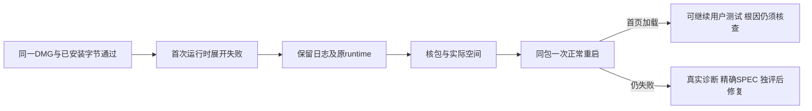

# T1102 安装后首次运行时展开失败

用户2026-10-09要求“有问题的创建 task 及时修复”；承接T1099本地安装验收的当场失败。当前先做诊断和已授权的当前App正常重启，不预先批准产品修改。

大白话：安装包已经生成，但应用展开自己的运行文件时失败。先保留这次失败，查真实原因，恢复可测试的首页。

## 当场事实

- 冻结main为`070287024a99fdf810a03d0ff39a9c944a9775e7`，36文件匹配、工作树clean，版本1.2.0。
- 固定入口构建exit0，584.145秒。DMG `/Users/zyongzhu/Downloads/CreatorOS-1.2.0.dmg`，840412331字节，SHA256 `36669fdff1539c57b545c3bb4ff7b598f98a3863873ed877ed3b32b7f2a641f8`；hdiutil、源App/挂载App deep strict签名、4成员、9运行时修复成员及原0130迁移均实际通过。本地ad-hoc，未公证。
- 当前App温和退出后替换，无备份、无强杀、无数据清理。新PID63623首次展开至37000项/约1709MiB后失败，位置为包内Chrome for Testing Framework；原输出只包含外层`failed to unpack`，未记录I/O内层原因，不能声称已证明磁盘不足、权限或包损坏。
- 实际原生加载为`tauri://localhost`，未记录真实HTTP首页；公开CLI status exit3/CONNECTION_NOT_FOUND。没有提交本轮新AI验收任务。
- 构建后实际df可用2.3Gi，首次失败清理临时目录后12Gi；空间变化相关但不证明唯一根因。原runtime/1.2.0约2.1Gi仍在。不得删旧runtime或用户资料来洗掉失败。
- 原stdout失败前缀SHA256 `4d2ebf99df760018ebc305ea00387cac8cf73488607e29ae65cb72f5b04efd64`；stderr前缀SHA256 `bfdb22f57ae45b5e89b11d8811b3e8d7ce1cf93a5486629d88efcf2539d36d07`。私有完整命令和日志位于本机验收根`t1099`。

## 当前允许范围

保留实际失败和包；只读核对当前包、安装字节、日志、实际空间及原runtime目录元信息。正常温和退出并重开**同一已安装App最多一次**，不重装、不改源代码，不增加模型任务；保留第一轮日志前缀和实际第二轮进程/HTTP加载/CLI结果。启动恢复不冒称根因或防复发已完成。

若必须改产品、打包脚本、测试或配置，先记录可复现根因，补精确写集和独立审核，再按taskctl及正式Gate修复；不能在打包冻结中修改来消除失败。本轮已退出打包Skill进入此独立缺陷诊断，已有用户修复授权，不追加重复权限请求。

## 验证和状态

真实HTTP首页、CLI连接和当前包4安装成员匹配才算启动恢复。之后T1099原11任务/4DTO/两旧会话须照常核验，再按既有授权提交唯一新Pi联合候选验收意图。原任务200/222和新unknown不重发，原失败记录不改。根因未确认或防复发未实施时本任务不complete；可用首页也不代签全部功能。后续代码验收按正式补充SPEC，不补拍历史PASS。

## 已发生的一次同包恢复

第二轮PID65609展开37646项/约2051MiB，真实HTTP61596首页加载、SIDECAR_STARTUP_VERIFIED、公开CLI连接及4安装成员匹配。只正常quit/open一次，没有换包、强杀、备份、reset或模型重发。原观察开始至完成53.821秒，不冒签准确冷启动耗时。11原任务/4DTO/两旧会话及22公开读取随后对照通过；新Pi候选失败属于T1103。首次底层原因仍UNKNOWN；独立确认的错误链和清理结果失真另立T1104精确修复，未装入新包前不能声称已生效。
