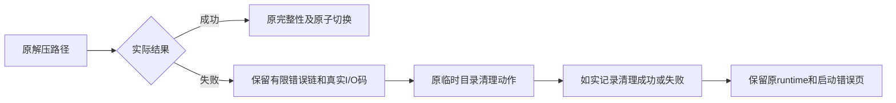

# T1104 保留运行时展开的真实错误链与清理结果

用户2026-10-09要求“有问题的创建 task 及时修复”。T1102已恢复同包首页，但首次具体I/O原因未保存。本任务修复独立、已确认的诊断缺口；首次启动原因仍由T1102核查，不把日志修复写成原故障根治。

大白话：解压失败时应留下真正的系统错误，例如权限或磁盘写入错误；清理没成功，就不能显示“已清理”。现有解压、完整性校验和安全切换照常执行。

## 实际依据

源码main `070287024a99fdf810a03d0ff39a9c944a9775e7` 的 `frontend/src-tauri/src/lib.rs` SHA256为 `b85d52ffce43dd10f3e6e82c242b9987ee0820ee5100abdc17f02e0d81f335eb`。固定tar 0.4.46把底层I/O异常放在source链中，Display只给外层`failed to unpack`。原extract_sidecar_tarball立刻转String，丢失内层kind/OS码；失败分支忽略remove_dir_all的Result后固定说已清理。T1102真实失败只留下外层文字，不能据此归因为ENOSPC。

私有只读报告 `t1102/READONLY_DIAGNOSIS.md` SHA256 `6f2644cd2fb14cb49a445c7aa3402a95aa9b5d1f664d2c881ca2e49fc1c870e4`，机械建议 `t1102/MECHANICAL_WRITE_SET.json` SHA256 `b5cfc8c35ebb8ad0c1941c0c9453a08ec808a130a10f74377161d20e095397a4`。目录为本机 `CreatorOS-local-acceptance/main-installed-20261008`；不将报告建议冒充实施或正式评审。

## 机械实现

唯一产品/测试路径：`frontend/src-tauri/src/lib.rs`。

1. 增加私有I/O错误格式化函数：在转String前，保留外层、真实source/get_ref链中I/O kind及可取得的raw_os_error。最大8层、每层1024个Unicode字符，超出明确标记截断；无递归、无文件内容/env/凭据读取，不按异常文字猜根因。
2. 原extract路径的打开归档、读取条目和unpack_in错误转换使用上述诊断；只改错误String，不增加尝试、不改变成功结果、路径安全或业务决策。
3. 原unpack失败、缺入口、写完成标记失败三处，各自仍只执行原一次remove_dir_all(temp)，由私有清理函数返回真实成功/失败说明。失败保留实际清理错误链；不新增删除对象、不掩盖原主错误、不把失败转成功。
4. 原stamp、old dest、same-volume temp、原子promote/rollback、Windows完整隔离目录fallback、signature/hash/完整性抽样和启动验证不改。不得改变启动预算、用户数据、模型任务、打包门或SDK。

这是诊断兼容修复，不新增公开operation/schema/授权或质量门；不改变原任务和费用，不从数据文本判断语义。

## 精确控制写集

本SPEC及 `.review-input.json`、`.review.md`、`.independent-review.md`；`docs/verification/t1104/CURRENT_VALIDATION.md`、`docs/verification/t1104/evidence.json`；看板、DECISION_LOG、review-events、taskctl事件、modules.config的新增T1104绑定及pmem生成记忆。root串行改产品/测试，独立代理只读复核；不派发产品实现，不迁移旧glob或更改Gate。无页面设计或交互调整，oil-ui-pro页面重构门不适用。

## RED与完整回归

- 先仅追加真实tar::Builder+gzip夹具：server.js之后同名目录和普通文件碰撞，走原extract函数而不是模拟日志。预置旧dest/server.js及旧stamp，失败后两者逐字不变、无新stamp、只有本例temp被清理；断言底层实际I/O码被保留，在旧实现必须真实失败。原失败日志留存，不填满用户磁盘、不改用户runtime。
- 再做最小修复；追加有限嵌套I/O格式化、真实清理成功/真实file-as-directory清理拒绝、错误链长度上界、坏gzip读取与旧目录保护测试。合成errno只验证诊断，不冒称首次错误码。
- 保留全部原runtime_cleanup_tests断言和预算；正常展开/二次复用、损坏重建、路径拒绝、Windows安全切换与回滚继续验证。
- 执行 `cargo test --manifest-path frontend/src-tauri/Cargo.toml --lib runtime_cleanup_tests -- --test-threads=1`，随后同一Cargo入口全lib回归；独立外层无新增人为超时，测试不运行用户App、不读用户库、激活或凭据。
- 执行boundary、semantic、orphan、`git diff --check`及完整reconcile。全局历史42/超时27有原证据；不得据此将本轮或全仓写成全绿。实际新失败登记任务，本任务Gate范围内失败未闭合不得complete。

## 交付与完成边界

精确源码实现、真实RED/GREEN、旧路径回归与独立实施复核后本地main提交才算本诊断修复完成；本任务不替代T1102首次根因或T1103真实Pi联合候选验收。新的安装包与安装生效由父T1062合并验证，未装入当前App前明确为源码已修/安装待验，当前可用App不为本测试退出。已有无备份构建和安装授权持续有效，不push/tag/Release/公证/公开部署。
