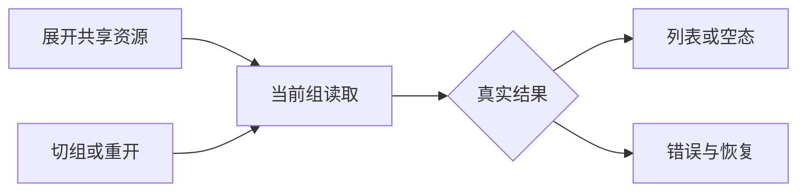

# T-1105 共享资源面板持续加载缺陷

用户明确要求全功能可用性验证、发现问题及时建task并修复。T1101来源隔离Chrome旅程展开共享资源时真实未见列表或空态，页面留在加载状态，console记录组上下文拒绝；保留原失败日志，不把范围缩窄后的扫码PASS当该面板通过。

来源：f97a80da002db91dcdeac464203828dd9268cbd3 的 docs/verification/t1101/journey-shared-state-failure.log。当前main合并后是否复现尚待实际验证，根因暂不签确定。候选关注 ResourceGrantsPanel 的 epoch、reading.current 与挂载/卸载：过期读取不能丢失当前加载终态，也不能阻挡当前合法重读。

修复需正式SPEC/独评和真实RED。保留组权限检查、单在途请求、过期/卸载不回写、实际空列表和错误恢复；不跨组读、删除历史或取消后台任务提速，不改共享/撤销/素材删除的服务契约。页面沿用 oil-ui-pro 和账号组规范，在真实页面展开/重开/切组/失败重试验证。未实施、未PASS，不代签原日志中的 aborted 因果。

